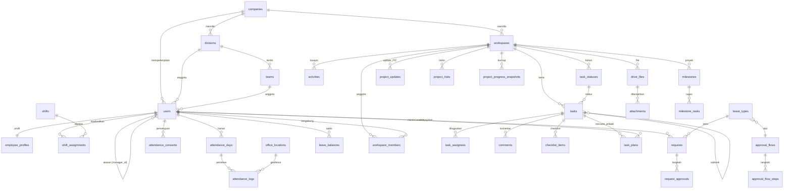

# Desain Database — RuangKerja

> PostgreSQL 17 · Laravel 13 migrations · Draf v1.0

## Konvensi

- Nama tabel & kolom: `snake_case` bahasa Inggris (kode tetap Inggris, UI berbahasa Indonesia).
- Primary key: `id` **ULID** (`char(26)`, `HasUlids`). Aman diekspos di URL, urut waktu.
- Semua tabel punya `created_at`, `updated_at`. Tabel master & konten memakai `deleted_at` (soft delete).
- Waktu disimpan **UTC** (`timestamptz`). Tanggal kerja (`work_date`) disimpan sebagai `date` menurut zona waktu kantor.
- Enum disimpan sebagai `varchar` + PHP backed enum (bukan enum Postgres) agar mudah diubah.
- Kolom JSON memakai `jsonb`.
- Kolom sensitif (token Google, NIK) dienkripsi lewat cast `encrypted`.
- Foreign key eksplisit dengan `cascadeOnDelete` hanya untuk data anak murni (mis. `task_assignees`). Data historis memakai `restrictOnDelete` / `nullOnDelete`.
- `company_id` ada di tabel utama untuk kesiapan multi-perusahaan di masa depan. Fase 1 hanya punya satu baris `companies`.

## Ringkasan per domain

| Domain | Tabel |
|---|---|
| Organisasi & akses | `companies`, `divisions`, `teams`, `positions`, `users`, `employee_profiles`, `roles`*, `permissions`*, `model_has_roles`*, `audit_logs` |
| Absensi | `office_locations`, `shifts`, `shift_assignments`, `holidays`, `attendance_days`, `attendance_logs`, `qr_tokens`, `kiosks`, `attendance_consents` |
| Pengajuan | `leave_types`, `leave_balances`, `leave_balance_adjustments`, `requests`, `request_sequences`, `request_approvals`, `approval_flows`, `approval_flow_steps`, `approval_delegations` |
| Workspace & task | `workspaces`, `workspace_members`, `milestones`, `milestone_tasks`, `project_updates`, `project_risks`, `project_directions`, `project_progress_snapshots`, `task_statuses`, `labels`, `tasks`, `task_assignees`, `task_labels`, `task_watchers`, `checklist_items`, `task_plans`, `comments`, `mentions`, `reactions`, `activities`, `saved_views` |
| Otomasi (F2-4) | `automation_rules`, `automation_runs`, `recurring_tasks`, `recurring_task_occurrences`, `task_templates`, `workspace_templates` |
| Google & file | `google_accounts`, `drive_files`, `attachments` |
| Notifikasi | `notifications`*, `notification_preferences`, `notification_settings`, `notification_dispatch_logs` |
| Fase 2 | `channels`, `channel_members`, `messages`, `notes`, `note_versions`, `note_shares`, `calendar_events` |
| Fase 3 | `devices`, `face_templates`, `objectives`, `key_results`, `key_result_checkins`, `key_result_tasks` (OKR sudah dimigrasi, F3-3) |

\* tabel bawaan paket (spatie/laravel-permission, Laravel notifications).

---

## 1. Organisasi & akses

### companies
| Kolom | Tipe | Keterangan |
|---|---|---|
| id | ulid PK | |
| name | varchar(150) | |
| google_domain | varchar(150) unique | domain Workspace yang diizinkan login, mis. `perusahaan.co.id` (disimpan huruf kecil) |
| timezone | varchar(50) | default `Asia/Jakarta` |
| settings | jsonb | jam ringkasan harian, retensi selfie (bulan), dll. Default `{}` |

`companies`, `divisions`, `teams`, `positions` memakai `deleted_at` (soft delete).

### divisions
| Kolom | Tipe | Keterangan |
|---|---|---|
| id | ulid PK | |
| company_id | FK companies | |
| parent_id | FK divisions null | untuk sub-divisi bila perlu |
| name | varchar(120) | |
| code | varchar(10) unique per company | dipakai prefix task, mis. `KEU`. Huruf besar (mutator + CHECK `code = upper(code)`); unik termasuk baris terhapus (kode tidak dipakai ulang) |
| head_user_id | FK users null | Kepala Divisi |
| is_board | bool | `true` untuk unit **Direksi** |

Indeks unik parsial `divisions_one_board_per_company_unique (company_id) WHERE is_board AND deleted_at IS NULL`: paling banyak satu unit Direksi aktif per perusahaan.

### teams
`id`, `division_id` FK, `name`, `code` varchar(10) null (label singkat di bagan, mis. `GDG`; huruf besar), `lead_user_id` FK users null (Ketua Tim).
Indeks unik parsial `teams_division_code_unique (division_id, code) WHERE code IS NOT NULL AND deleted_at IS NULL`: kode tim unik per divisi (kode tim terhapus boleh dipakai ulang). Tim yang masih punya anggota aktif tidak boleh pindah divisi (aturan aplikasi, `SaveTeam`).

### positions
`id`, `company_id`, `name` (mis. "Staf Keuangan"), `level` smallint (1 = Direksi … 5 = Staf).

Tambahan Dashboard per jabatan (F3, migrasi `2026_10_11_500000_add_dashboard_role_to_positions`, `docs/fitur/dashboard-peran.md`): `dashboard_role` varchar(20) null — dashboard jabatan SPKD pemegang jabatan ini (`dirut` · `direktur` · `hr` · `corsec` · `marketing` · `programming` · `implementer` · `analis`, CHECK `positions_dashboard_role_check`; enum `App\Domain\RoleDashboards\Enums\DashboardRole`). Diisi HR di Admin › Organisasi › Jabatan; tidak unik (Kepala Divisi dan staf boleh berbagi). Null = tanpa dashboard jabatan. Akses `/peran/{kunci}`: pemegang jabatan dengan kunci itu, plus Direksi & Super Admin untuk semua kunci (Gate `viewRoleDashboard`). Tanpa tabel baru: dashboard memakai data portofolio, persetujuan, tugas, dan absensi yang sudah ada.

### users
| Kolom | Tipe | Keterangan |
|---|---|---|
| id | ulid PK | |
| company_id | FK | |
| name | varchar(150) | |
| email | varchar(190) unique | email Google Workspace |
| password | varchar null | hanya Super Admin darurat |
| two_factor_secret | text null encrypted | |
| google_id | varchar null unique | `sub` dari Google |
| avatar_url | varchar null | |
| division_id | FK divisions null | |
| team_id | FK teams null | |
| position_id | FK positions null | |
| manager_id | FK users null | **atasan langsung** (penyetuju pertama) |
| work_mode | varchar | `office` · `hybrid` · `wfh` · `field` |
| status | varchar | `active` · `inactive` · `resigned` |
| joined_at | date | |
| deactivated_at | timestamptz null | saat status menjadi `inactive`/`resigned` (dikosongkan saat diaktifkan lagi); batas akhir rekap bulanan |
| theme | varchar | `system` · `light` · `dark` |
| last_login_at | timestamptz null | |

Indeks: `(company_id, status)`, `(division_id)`, `(manager_id)`, `(team_id)`, `(position_id)`.

Implementasi (Sprint 1): kolom organisasi ditambahkan lewat migrasi `2026_10_05_000500_add_organization_columns_to_users_table` (bukan menulis ulang migrasi Sprint 0). `password` nullable. `two_factor_recovery_codes` & `two_factor_confirmed_at` (Fortify) dan `email_verified_at`, `remember_token` tetap ada. `work_mode` default `office`, `status` default `active`, `joined_at` nullable. FK `division_id`/`team_id`/`position_id`/`manager_id` = `nullOnDelete`.

Tambahan perbaikan review Sprint 3–9 (#11): `deactivated_at` timestamptz null (migrasi `2026_10_07_300100_add_deactivated_at_to_users`), diisi `DeactivateEmployee` (nilai pertama dipertahankan saat berpindah inactive ↔ resigned), dikosongkan `ReactivateEmployee`; backfill dari audit `user.deactivated` terakhir, fallback `updated_at`. Rekap bulanan/ekspor payroll hanya menghitung tanggal `joined_at` … tanggal kantor `deactivated_at` (inklusif).

### employee_profiles
`user_id` PK/FK (cascade), `employee_number` varchar(30) unique null, `nik` text null (encrypted, disembunyikan dari serialisasi), `phone` (untuk WA), `birth_date`, `address`, `emergency_contact` jsonb (`{name, relation, phone}`). Dipisah agar data pribadi tidak ikut ter-load di setiap query `users`.

### Peran global (spatie/laravel-permission)
Peran awal: `super_admin`, `direksi`, `hr`, `kepala_divisi`, `anggota`. Satu user boleh punya beberapa peran.

Permission dasar (guard `web`; sumber kebenaran `App\Domain\Organization\Enums\Role::permissions()`, disinkronkan `RoleSeeder`). Cakupan data (diri sendiri / bawahan / divisi / semua) **bukan** permission, melainkan scope `visibleTo()` + Policy.

| Permission | super_admin | direksi | hr | kepala_divisi | anggota |
|---|:-:|:-:|:-:|:-:|:-:|
| `employees.view` — lihat semua karyawan | ✓ | ✓ | ✓ | | |
| `employees.manage` — tambah/ubah/nonaktifkan/impor karyawan, atur peran (kecuali Super Admin) | ✓ | | ✓ | | |
| `organization.manage` — CRUD divisi, tim, jabatan | ✓ | | ✓ | | |
| `settings.manage` — pengaturan sistem, perusahaan, integrasi Google | ✓ | | | | |
| `audit.view` — halaman audit log | ✓ | | | | |
| `attendance.view_all` — absensi semua karyawan | ✓ | ✓ | ✓ | | |
| `attendance.manage` — koreksi absensi, shift, lokasi, hari libur | ✓ | | ✓ | | |
| `attendance.view_selfie` — lihat selfie (atasan langsung diizinkan lewat Policy, bukan permission) | | | ✓ | | |
| `attendance.export` — ekspor rekap | ✓ | | ✓ | | |
| `requests.view_all` — semua pengajuan | ✓ | ✓ | ✓ | | |
| `requests.manage_flows` — alur approval & jenis cuti | ✓ | | ✓ | | |
| `workspaces.view_all` — lihat workspace non-pribadi | | ✓ | | | |
| `workspaces.manage` — kelola workspace non-pribadi | ✓ | | | | |
| `dashboard.view_company` — dashboard seluruh perusahaan | ✓ | ✓ | ✓ | | |
| `portfolio.view` — portofolio proyek (M10) | ✓ | ✓ | | | |

Tidak ada `Gate::before` untuk Super Admin: workspace pribadi & selfie tetap tertutup baginya.

### audit_logs
| Kolom | Tipe | Keterangan |
|---|---|---|
| id | ulid PK | |
| user_id | FK users null | pelaku |
| action | varchar(80) | mis. `attendance.corrected`, `request.approved`, `selfie.viewed` |
| auditable_type / auditable_id | morph | objek |
| old_values / new_values | jsonb null | |
| ip_address | inet null | null untuk perubahan dari console/queue |
| user_agent | varchar(512) null | |
| created_at | timestamptz | append-only, tanpa update (model menolak update) |

Indeks: `(auditable_type, auditable_id)`, `(action)`, `(created_at)`, `(user_id, created_at)`. `auditable_type` berisi nama kelas model (tanpa morph map).

---

## 2. Absensi

### office_locations
`id`, `company_id`, `name` varchar(120), `address` varchar(255) null, `latitude` numeric(10,7), `longitude` numeric(10,7), `radius_m` int (default 100), `is_active`, `deleted_at`. CHECK koordinat valid & `radius_m > 0`. Indeks `(company_id, is_active)`.

### shifts
| Kolom | Tipe | Keterangan |
|---|---|---|
| id | ulid PK | |
| company_id | FK | |
| name | varchar | "Reguler 08–17", "Shift Malam" |
| start_time / end_time | time | |
| break_minutes | smallint | |
| crosses_midnight | bool | |
| late_tolerance_min | smallint | default 10 |
| early_leave_tolerance_min | smallint | |
| check_in_window_before_min | smallint | boleh check-in mulai X menit sebelum jam masuk (default 120) |
| office_location_id | FK office_locations null | **tambahan Sprint 2**: lokasi check-in shift ini (mis. shift gudang). Null = semua lokasi aktif perusahaan |

`crosses_midnight` diturunkan otomatis dari jam (pulang ≤ masuk). Soft delete; shift yang masih dipakai penugasan aktif tidak bisa dihapus.

### shift_assignments
`id`, `user_id`, `shift_id`, `weekdays` smallint[] (1=Senin…7=Minggu), `valid_from` date, `valid_until` date null, `override_date` date null (penugasan khusus satu tanggal, mengalahkan pola), `work_mode_override` varchar null.

Resolusi jadwal (Sprint 2): `override_date` → hari libur perusahaan → pola aktif pada tanggal tersebut (bila beberapa, `valid_from` terbaru) → tidak terjadwal. Override mengalahkan hari libur.

Implementasi: `weekdays` = `smallint[]` NOT NULL default `{}` (CHECK nilai 1–7), `shift_id` **nullable** hanya untuk override = libur khusus, CHECK `override_date IS NOT NULL OR (shift_id IS NOT NULL AND cardinality(weekdays) > 0)`, unik parsial `(user_id, override_date)`. Override menyimpan `valid_from = valid_until = override_date`. `work_mode_override` (`office`/`hybrid`/`wfh`/`field`) dipakai untuk hari WFH karyawan hybrid. Pola baru tanpa tanggal akhir mengakhiri pola lama yang hari-harinya tercakup (`valid_until` = sehari sebelumnya).

### holidays
`id`, `company_id`, `date`, `name` varchar(150), `type` (`national` · `collective_leave` · `company`). Unik `(company_id, date)`. Tanpa soft delete (tidak dirujuk FK).

### attendance_days — satu baris per karyawan per tanggal kerja
| Kolom | Tipe | Keterangan |
|---|---|---|
| id | ulid PK | |
| user_id | FK | |
| work_date | date | **unik bersama user_id** |
| shift_id | FK null | snapshot jadwal hari itu |
| scheduled_start / scheduled_end | timestamptz null | |
| check_in_at / check_out_at | timestamptz null | |
| check_in_log_id / check_out_log_id | FK attendance_logs null | |
| status | varchar | `present` · `late` · `early_leave` · `absent` · `leave` · `permit` · `sick` · `business_trip` · `holiday` · `wfh` · `needs_correction` |
| late_minutes | smallint | |
| early_leave_minutes | smallint | |
| work_minutes | int | |
| overtime_minutes | int | dari pengajuan lembur yang disetujui |
| request_id | FK requests null | jika status berasal dari pengajuan |
| request_portion | varchar(10) null | `full` · `half_day` (CHECK) — porsi tanggal yang ditutup pengajuan yang disetujui. Setengah hari dan dinas luar (`business_trip`) tetap boleh check-in: status & `request_id` dipertahankan, dinas boleh check-in di luar geofence dengan catatan |
| is_suspicious | bool | ada log yang ditandai |
| note | text null | |

Indeks: `(work_date, status)`, `(user_id, work_date)` unique.

Implementasi (Sprint 2): FK `check_in_log_id`/`check_out_log_id` ditambahkan oleh migrasi `attendance_logs` (referensi melingkar); `request_id` belum ber-FK (tabel `requests` dibuat Sprint 4). `late_minutes` dihitung dari **batas toleransi** (mulai + toleransi), `early_leave_minutes` dari akhir − toleransi, keduanya menit utuh. `work_minutes` dikurangi istirahat bila rentang kerja > 4 jam. Status: `late` > `wfh`/`present`; `early_leave` hanya menggantikan `present`/`wfh`. `attendance:close-day` menulis `absent`, `holiday` (hari pola yang jatuh pada libur) dan `needs_correction`.

### attendance_logs — setiap peristiwa check-in/out (immutable)
| Kolom | Tipe | Keterangan |
|---|---|---|
| id | ulid PK | |
| user_id | FK | |
| attendance_day_id | FK | |
| type | varchar | `check_in` · `check_out` |
| method | varchar | `gps_selfie` · `qr` · `wfh` · `manual` · `face` (F3) · `fingerprint` (F3) |
| occurred_at | timestamptz | waktu server |
| client_time | timestamptz null | waktu perangkat (untuk deteksi selisih) |
| latitude / longitude | numeric null | |
| accuracy_m | numeric null | |
| office_location_id | FK null | lokasi geofence yang cocok |
| distance_m | numeric null | |
| selfie_path | varchar null | path di object storage privat |
| qr_token_id | FK null | |
| ip_address | inet | |
| user_agent | varchar | |
| device_fingerprint | varchar null | |
| flags | jsonb | mis. `["low_accuracy","new_device","impossible_travel"]` |
| is_suspicious | bool | |
| reviewed_by / reviewed_at | FK users / timestamptz null | tinjauan HR |
| corrected_by | FK users null | untuk `method = manual` |
| note | text null | |

Implementasi (Sprint 2): `accuracy_m` numeric(8,2), `distance_m` numeric(10,2) = jarak ke lokasi terdekat (juga untuk WFH), `office_location_id` hanya diisi bila di dalam radius. `qr_token_id` belum ber-FK (Sprint 3). `flags` jsonb default `[]`: `low_accuracy`, `clock_skew`, `new_device`, `new_ip`, `impossible_travel`, `dark_selfie`; `new_ip` saja tidak membuat `is_suspicious`. Baris immutable (model menolak update selain `reviewed_by/at` dan menolak delete). Indeks `(user_id, occurred_at)`, `attendance_day_id`, parsial `occurred_at WHERE is_suspicious AND reviewed_at IS NULL`.

Implementasi (Sprint 3): FK `qr_token_id` → `qr_tokens` (`restrictOnDelete`) + indeks. Method `qr`: tanpa selfie, `office_location_id` = lokasi kiosk, `latitude/longitude/accuracy_m/distance_m` hanya bila GPS dikirim; flag baru `qr_location_mismatch` (GPS lebih jauh dari radius + akurasi dari lokasi kiosk, menandai). Tambahan perbaikan review Sprint 3–9 (#15): flag `qr_no_location` ("QR tanpa lokasi GPS", menandai) bila scan QR tanpa GPS — kode QR yang diteruskan bisa dipindai dari mana saja; `config('attendance.qr.require_location')` (env `ATTENDANCE_QR_REQUIRE_LOCATION`, default false) menolak scan tanpa GPS (`qr_location_required`). Method `manual` (koreksi HR): `occurred_at` = jam hasil koreksi, `corrected_by` = HR, `note` = alasan wajib. Selain kolom tinjauan, `selfie_path` boleh diubah **hanya menjadi null** oleh job retensi selfie (`attendance:purge-selfies`).

### qr_tokens
`id`, `office_location_id`, `token_hash`, `valid_from`, `valid_until` (≈30–45 detik), `kiosk_id`. Token di QR = `HMAC(secret, location_id|window)`. Tabel ini opsional bila validasi murni HMAC. Disimpan untuk audit.

Implementasi (Sprint 3): `office_location_id` FK restrict, `kiosk_id` FK `kiosks` null (`nullOnDelete`), `token_hash` char(64) **unik** = SHA-256 dari tanda tangan di QR (kode asli tidak disimpan), tambahan `window` bigint (= floor(unix / 30)), `valid_from`/`valid_until` = awal/akhir jendela 30 detik. Satu baris dibuat saat kiosk menampilkan kode (upsert per jendela). Pindaian diterima bila HMAC cocok, jendela ±1 dari jendela server, **dan** barisnya ada dari kiosk aktif. Tanda tangan = 128 bit pertama HMAC-SHA256 (32 hex) agar QR tidak terlalu padat. Kode yang tidak pernah dipindai dihapus setelah 2 hari (`attendance:prune-qr-tokens`, harian). Indeks `(office_location_id, valid_from)`.

### kiosks (tambahan Sprint 3)
Akun perangkat kiosk lobi (guard sesi `kiosk`, bukan baris `users`).

| Kolom | Tipe | Keterangan |
|---|---|---|
| id | ulid PK | |
| company_id | FK companies | restrict |
| office_location_id | FK office_locations | lokasi QR, restrict |
| name | varchar(80) | mis. "Lobi" |
| code | varchar(20) | huruf besar, tampil di kartu QR (mis. `KP-LOBI`); unik `(company_id, code)` |
| is_active | bool | nonaktif = perangkat langsung keluar |
| activation_token_hash | char(64) null unik | SHA-256 tautan aktivasi sekali pakai |
| activation_code_hash | char(64) null unik | HMAC-SHA256 (kunci `APP_KEY`) kode aktivasi pendek 8 karakter yang diterbitkan bersama tautan; dikosongkan bersama `activation_token_hash` saat salah satunya dipakai atau kiosk dinonaktifkan (fitur dokumentasi, migrasi `2026_10_08_100000`) |
| activation_expires_at | timestamptz null | 24 jam (berlaku untuk tautan dan kode) |
| activated_at | timestamptz null | pemasangan terakhir; dibandingkan dengan penanda di sesi perangkat |
| last_seen_at | timestamptz null | diperbarui tiap kode diambil |
| remember_token | varchar(100) null | dirotasi tiap pemasangan/nonaktif |
| deleted_at | timestamptz null | soft delete |

Indeks `(office_location_id, is_active)`.

### attendance_consents
`id`, `user_id`, `type` (`location` · `selfie` · `face`), `version` (versi teks kebijakan), `granted_at`, `revoked_at` null. Check-in ditolak bila persetujuan versi terbaru belum diberikan.

Implementasi (Sprint 2): versi dari `config('attendance.consent.version')` (`ATTENDANCE_CONSENT_VERSION`, sejak Sprint 10 default = `PRIVACY_POLICY_VERSION` kebijakan privasi). Check-in GPS + selfie butuh `location` **dan** `selfie` versi terkini yang belum dicabut. Indeks `(user_id, type, version)`.

---

## 3. Pengajuan & approval

> Diimplementasikan Sprint 4 (`docs/sprints/sprint-4/SUMMARY.md`). Model: `LeaveType`, `LeaveBalance`, `EmployeeRequest` (tabel `requests`), `ApprovalFlow`, `ApprovalFlowStep`, `RequestApproval`, `ApprovalDelegation`.

### leave_types
`id`, `company_id`, `code`, `name`, `category` (`leave` · `permit` · `sick` · `overtime` · `correction` · `business_trip`), `annual_quota_days` numeric(5,1) null, `requires_attachment_after_days` smallint null (0 = selalu wajib), `is_paid`, `allow_half_day`, `carry_over_max_days` numeric(5,1) null, `approval_flow_id` FK null (null = alur "Default" perusahaan).
Tambahan Sprint 4: `description` null, `max_backdate_days` null (koreksi absensi "maks. 7 hari lalu"), `min_service_months` null (cuti besar "Belum berhak"), `is_active`, `sort_order`, `deleted_at`.
`code` = 2–10 huruf besar/angka (CHECK), **juga prefiks nomor** (`CUT`, `CBR`, `SKT`, `IZN`, `LBR`, `KOR`, `DNS`, `CML`, `CAP`, `CLT`). Unik `(company_id, code)` termasuk yang terhapus.
Tambahan Fitur pengajuan (`docs/sprints/FITUR-PENGAJUAN.md`): `counts_calendar_days` bool default false (durasi dihitung hari kalender, mis. Cuti melahirkan; hari kerja tetap dipakai untuk efek absensi), `max_days_per_request` numeric(5,1) null (CHECK > 0; maks. per pengajuan, mis. 90 hari kalender melahirkan, 3 hari alasan penting), `is_provisional_default` bool default false (**"Bawaan sementara"**: jenis bawaan seeder yang belum ditinjau HR; otomatis false saat HR menyimpan jenis atau menetapkan alurnya; seeder tidak pernah menimpa jenis yang sudah ada). Cuti di luar tanggungan = `is_paid` false tanpa `annual_quota_days` (tidak memotong saldo).

### leave_balances
`id`, `user_id`, `leave_type_id`, `year`, `entitled_days` numeric(5,1), `carried_over_days`, `used_days`, `pending_days`. Unik `(user_id, leave_type_id, year)`. `pending_days` dipakai agar saldo tidak terpakai dua kali saat pengajuan sedang diproses.
CHECK: semua kolom ≥ 0 dan `entitled + carried_over − used − pending ≥ 0` (saldo tidak pernah minus). Hanya jenis ber-`annual_quota_days`. Dibuat oleh `requests:generate-balances` (1 Januari) atau saat pertama dipakai. `generated_at` timestamptz null: kapan carry-over ditetapkan (oleh generator atau HR). Baris yang dibuat saat pertama dipakai (mis. cuti Januari diajukan Desember) tetap null sehingga generator mengisi carry-over-nya tepat sekali; ubahan HR menetapkan `generated_at` sehingga tidak ditimpa.
Tambahan Fitur pengajuan: `opening_days` numeric(5,1) default 0 (**saldo awal**, diisi HR/impor), `adjustment_days` numeric(5,1) default 0 (= Σ `leave_balance_adjustments.delta_days`, boleh minus; dijaga `AdjustLeaveBalance` dengan row lock). CHECK diperluas: `entitled, carried_over, opening, used, pending ≥ 0` dan **`entitled + carried_over + opening + adjustment − used − pending ≥ 0`**. `entitled_days` untuk karyawan yang bergabung di tahun berjalan = **prorata** (`LeaveEntitlement`: kuota × sisa bulan / 12, bulan masuk dihitung bila tanggal 1–15, dibulatkan ke bawah per 0,5 hari) — dipakai generator tahunan dan saat saldo dibuat pertama kali.

### leave_balance_adjustments (tambahan Fitur pengajuan)
`id` ulid, `balance_id` FK `leave_balances` (cascade), `delta_days` numeric(5,1) (CHECK ≠ 0; + menambah, − mengurangi), `reason` varchar(255) wajib, `actor_id` FK users null (nullOnDelete), `created_at` timestamptz. Hanya ditambah (tidak diubah/dihapus), setiap baris juga dicatat di `audit_logs` (`leave_balance.adjusted`). Impor CSV/XLSX Admin › Saldo cuti menulis lewat aksi yang sama.

### requests — semua jenis pengajuan dalam satu tabel
| Kolom | Tipe | Keterangan |
|---|---|---|
| id | ulid PK | |
| number | varchar null unique | mis. `CUT-2026-10-0012`; diisi saat pertama dikirim (draf belum bernomor) |
| user_id | FK | pemohon |
| leave_type_id | FK | jenis |
| start_at / end_at | timestamptz | lembur & izin memakai jam. Cuti memakai hari penuh (00.00–23.59.59 waktu kantor). CHECK `end_at >= start_at` |
| days | numeric(5,1) null | hari kerja terhitung (jadwal shift, tanpa libur); 0,5 = setengah hari |
| minutes | int null | lembur / izin per jam |
| reason | text | |
| payload | jsonb | per jenis: `half_day`, `mode` (izin `hours`/`days`), `date`/`start_time`/`end_time` (lembur, izin jam), `check_in`/`check_out` (koreksi), `destination` (dinas) |
| substitute_id | FK users null | **tambahan**: pengganti selama cuti |
| status | varchar | `draft` · `pending` · `approved` · `rejected` · `revision_requested` · `canceled` |
| round | smallint | **tambahan**: putaran; +1 setiap dikirim ulang setelah revisi |
| current_step | smallint null | langkah yang sedang menunggu |
| submitted_at | timestamptz null | **tambahan** |
| decided_at | timestamptz null | |

### request_sequences (tambahan Sprint 4)
`id`, `key` unik (mis. `CUT-2026-10`), `last_number`. Nomor diambil dengan satu `INSERT … ON CONFLICT (key) DO UPDATE SET last_number = last_number + 1 RETURNING` (atomik, aman dari race condition). Periode = bulan pengiriman (waktu kantor).

### approval_flows / approval_flow_steps
`approval_flows`: `id`, `company_id`, `name`, **`skip_self_approval`** bool (default true; mati = naik ke atasan pemohon), **`allow_delegation`** bool (default true), `deleted_at`. Alur bernama `Default` = cadangan perusahaan.
`approval_flow_steps`: `id`, `approval_flow_id`, `step_order` (unik per alur), `approver_type` (`direct_manager` · `division_head` · `role` · `user`), `approver_role` null, `approver_user_id` null, `condition` jsonb null (mis. `{"overtime_month_minutes_gt": 2400}` → langkah hanya aktif bila kondisi terpenuhi). Kunci `<metrik>_<op>`; metrik `overtime_month_minutes` · `days` · `minutes`; op `gt` · `gte` · `lt` · `lte`; semua kunci harus terpenuhi.

### request_approvals
`id`, `request_id`, **`round`**, `step_order` (unik per request+round), **`approver_type`**, **`approver_role`** null (salinan langkah alur saat dikirim), `approver_id` FK users null (diresolusi saat langkah aktif; null untuk langkah peran yang menunggu — siapa pun pemegang peran boleh memutus, lalu terisi), `delegated_from_id` null, `status` (**`queued`** · `waiting` · `approved` · `rejected` · `revision_requested` · `skipped`), `note`, **`activated_at`**, `decided_at`.
Indeks: `(request_id, round, step_order)` unique, `(approver_id, status)`, `(status, approver_role)`, parsial `(delegated_from_id) WHERE delegated_from_id IS NOT NULL` (Sprint 10: visibilitas pengajuan "penyetuju ATAU pemberi delegasi").

### approval_delegations
`id`, `delegator_id`, `delegate_id`, `starts_on`, `ends_on`, **`reason`** null. CHECK `ends_on >= starts_on` dan delegator ≠ delegate.

Lampiran pengajuan (surat dokter, dll.) memakai tabel `attachments` (morph ke `requests`, `source = storage`), disimpan di disk privat (`config/requests.php`), **bukan** Drive; diunduh lewat `/pengajuan/{id}/lampiran/{attachment}` (policy + audit `request.attachment_viewed`).

`attendance_days.request_id` mendapat FK ke `requests` (nullOnDelete) di migrasi Sprint 4.

---

## 4. Workspace & task

### workspaces
| Kolom | Tipe | Keterangan |
|---|---|---|
| id | ulid PK | |
| company_id | FK | |
| type | varchar | `personal` · `team` · `division` · `project` |
| name | varchar(120) | |
| key | varchar(10) | prefix task, unik per company (`KEU`, `PRJX`) |
| description | text null | |
| icon / color | varchar null | |
| visibility | varchar | `private` · `internal` |
| owner_id | FK users | |
| division_id / team_id | FK null | untuk tipe division/team (sinkron anggota). Tipe `project`: `division_id` = **divisi utama** (Sprint 9; sinkron divisi hanya membaca `type = division`) |
| drive_folder_id | varchar null | ID folder di Shared Drive |
| task_sequence | int | penghitung nomor task berikutnya (dikunci `SELECT … FOR UPDATE`) |
| archived_at | timestamptz null | |
| previous_keys | jsonb (default `[]`) | key lama setelah diganti; `/w/{key-lama}` dialihkan (301) ke key baru. Key harus `^[A-Z][A-Z0-9]{1,9}$` (CHECK) dan unik terhadap key aktif **dan** key lama di company |
| **Kolom proyek** (hanya `type = project`) | | |
| lead_user_id | FK users null | PIC proyek |
| sponsor_user_id | FK users null | anggota Direksi |
| start_date / target_date | date null | dasar progres rencana |
| project_status | varchar null | `planned` · `active` · `on_hold` · `completed` · `canceled` |
| health | varchar null | denormalisasi dari update terakhir: `on_track` · `at_risk` · `off_track` |
| last_update_at | timestamptz null | denormalisasi, untuk penanda "update kedaluwarsa" |
| completed_at | timestamptz null | diisi saat `project_status` menjadi `completed`, dikosongkan bila berubah lagi |

Sprint 9: CHECK `project_status IN (planned, active, on_hold, completed, canceled)` dan `health IN (on_track, at_risk, off_track)` (keduanya boleh null), indeks parsial `(company_id, project_status) WHERE type = 'project'`. `project_status` null diperlakukan sebagai `active`.

### milestones
`id`, `workspace_id` FK (cascade), `name` varchar(160), `description` null, `target_date` date, `completed_at` timestamptz null, `position` varchar(100) `COLLATE "C"` (lexorank), `created_by` FK null, timestamps (tanpa soft delete; penghapusan tercatat di `activities`). Indeks `(workspace_id, target_date)`. Status diturunkan (`MilestoneStatusResolver`; "berjalan" = ada tugas terkait di kategori in_progress/review/done): selesai / selesai terlambat (`completed_at::date > target_date`) / terlewat (target < hari ini dan belum selesai) / berjalan / belum mulai. Pivot `milestone_tasks` (`milestone_id`, `task_id`).

### project_updates
`id`, `workspace_id` FK (cascade), `author_id` FK users null (nullOnDelete), `health` (`on_track` · `at_risk` · `off_track`), `summary` text, `blockers` text null, `decision_needed` text null, `decision_resolved_at` timestamptz null, `decision_resolved_by` FK null, `progress_snapshot` numeric(5,2) (progres aktual saat update ditulis), `planned_snapshot` numeric(5,2), `created_at`, `updated_at`. CHECK health. Indeks `(workspace_id, created_at)` + parsial "keputusan terbuka" `(workspace_id) WHERE decision_needed IS NOT NULL AND decision_resolved_at IS NULL`. Update tidak pernah diedit (riwayat). Setelah insert: perbarui `workspaces.health` dan `last_update_at` (`PostProjectUpdate`). Arahan Direksi memakai tabel `project_directions` (bukan `comments`, lihat di bawah).

### project_directions (tambahan Sprint 9)
`id`, `workspace_id` FK (cascade), `project_update_id` FK null (nullOnDelete; arahan umum bila null), `author_id` FK users null, `body` text, timestamps. Indeks `(workspace_id, created_at)`. Alasan: tabel `comments` milik Sprint 6 belum ada; arahan cukup teks polos dan perlu notifikasi ke PIC. Bila nanti `comments` dipakai, data bisa dimigrasi ke morph `project_updates`.

### project_risks
`id`, `workspace_id` FK (cascade), `title` varchar(200), `level` (`high` · `medium` · `low`), `owner_id` FK users null, `status` (`open` · `resolved`, default `open`), `resolved_at` null, `task_id` FK null (nullOnDelete), timestamps. CHECK level & status, indeks `(workspace_id, status)`.

### project_progress_snapshots (untuk grafik burn-up)
`workspace_id`, `date` (PK gabungan), `scope_count` int (tugas non-batal), `done_count` int, `scope_hours` numeric(10,2) null, `done_hours` numeric(10,2) null (diisi bila ada estimasi), timestamps. CHECK `0 ≤ done_count ≤ scope_count`. Diisi job `TakeProjectProgressSnapshots` harian 23.55 WIB dengan upsert (idempoten) untuk proyek terbuka (planned/active/on_hold, tidak diarsipkan).

### workspace_members
`workspace_id`, `user_id` (PK gabungan), `role` (`owner` · `admin` · `member` · `viewer`), `joined_at`, `is_synced` (true bila berasal dari sinkron divisi/tim; baris pemilik yang dibuat otomatis untuk workspace divisi/tim juga `true`, sehingga mantan pemilik yang bukan lagi kepala/anggota dihapus saat sinkron, anggota manual tidak disentuh). Tambahan Sprint 5: `favorited_at` timestamptz null (favorit di sidebar, urut waktu dibintangi). Tambahan Sprint 7 bagian B ("Akses Drive" per anggota, ditulis listener `DrivePermissionsSynced` lewat query builder sehingga `updated_at` tidak berubah): `drive_access` varchar(10) null (peran Drive terakhir yang dikonfirmasi sinkron izin: `writer`/`reader`; status "Tersinkron" bila sama dengan peran saat ini — owner/admin/member → `writer`, viewer → `reader` — selain itu "Menunggu sinkron"), `drive_error` varchar(100) null (alasan Google menolak, mis. `invalidSharingRequest`; status "Gagal sinkron"), `drive_synced_at` timestamptz null. Pemilik workspace pribadi juga punya baris `owner` di sini (memudahkan daftar sidebar & validasi penanggung jawab); aturan "pribadi hanya pemilik" tetap ditegakkan Policy.

Indeks unik parsial: `workspaces (owner_id) WHERE type = 'personal'` (satu workspace pribadi per user) dan `workspaces (division_id) WHERE type = 'division'` (satu per divisi). Warna (`workspaces.color`, `task_statuses.color`, `labels.color`) disimpan sebagai **nama palet** (`gray`, `slate`, `teal`, `blue`, `green`, `amber`, `orange`, `red`, `violet`, `pink`; `resources/css/palette.css`), bukan hex.

### task_statuses
`id`, `workspace_id`, `name` ("Sedang dikerjakan"), `category` (`backlog` · `todo` · `in_progress` · `review` · `done` · `canceled`), `color`, `position` varchar (lexorank). Workspace baru mendapat 5 status default.

### labels
`id`, `workspace_id`, `name`, `color`.

### tasks
| Kolom | Tipe | Keterangan |
|---|---|---|
| id | ulid PK | |
| workspace_id | FK | |
| number | int | unik per workspace → ditampilkan `KEY-number` |
| parent_id | FK tasks null | sub-task |
| title | varchar(255) | |
| description | jsonb null | dokumen Tiptap/ProseMirror JSON |
| description_text | text null | versi teks polos untuk pencarian |
| status_id | FK task_statuses | |
| status_category | varchar | **denormalisasi** dari status untuk query metrik cepat |
| priority | smallint | 0 tanpa · 1 urgent · 2 tinggi · 3 sedang · 4 rendah |
| position | varchar | lexorank di dalam kolom |
| start_date | date null | |
| due_date | date null | |
| estimate_hours | numeric(6,2) null | |
| created_by | FK users | |
| started_at | timestamptz null | pertama kali masuk `in_progress` |
| completed_at | timestamptz null | masuk kategori `done` |
| canceled_at | timestamptz null | |
| search_vector | tsvector | kolom GENERATED STORED: `setweight(to_tsvector('simple', title),'A') || setweight(to_tsvector('simple', description_text),'B')`, indeks GIN. Konfigurasi `simple` karena PostgreSQL tidak punya stemmer Indonesia |

Indeks: `(workspace_id, number)` unique, `(workspace_id, status_id, position)`, `(status_id, position)` (Sprint 10: kartu satu kolom tanpa filter workspace — pindah kartu, ubah/hapus kolom), `(workspace_id, status_category)`, `(due_date) where status_category not in ('done','canceled')`, GIN `search_vector`. CHECK `priority BETWEEN 0 AND 4`, `number > 0`.

Kolom `position` (tasks, task_statuses, checklist_items) bertipe `varchar(100) COLLATE "C"` agar urutan lexorank = urutan byte (`App\Domain\Tasks\Services\Lexorank`, base-62, kolom diseimbangkan ulang bila kunci > 40 karakter). Lifecycle: `started_at` diisi saat pertama kali masuk kategori `in_progress` **atau `review`**; `completed_at` diisi saat masuk `done` dan dikosongkan saat keluar; `canceled_at` sama untuk `canceled`. Mengubah kategori sebuah kolom menyinkronkan semua tugas di kolom itu.

### Tabel pivot task
- `task_assignees` (`task_id`, `user_id`, `assigned_at`, `assigned_by`)
- `task_labels` (`task_id`, `label_id`)
- `task_watchers` (`task_id`, `user_id`)
- `checklist_items` (`id`, `task_id`, `title`, `is_done`, `position`, `done_by`, `done_at`)

### task_plans (tambahan "Ruang saya", Okt 2026)
Rencana **pribadi** seorang pengguna atas sebuah tugas di Beranda ("Ruang saya": Hari ini · Minggu ini · Nanti). Tidak mengubah tugas itu sendiri.

| Kolom | Tipe | Keterangan |
|---|---|---|
| id | ulid PK | |
| user_id | FK users (cascade) | pemilik rencana |
| task_id | FK tasks (cascade) | |
| bucket | varchar(10) null | `today` · `week` · `later` (CHECK). **null = kembali otomatis** (baris hanya mengingat `seen_at`, supaya tugas yang sudah diterima tidak muncul lagi sebagai "tugas baru") |
| planned_for | date null | tanggal kantor saat bucket ditetapkan; `today` dengan `planned_for` < hari ini = "terbawa dari kemarin". Mengurutkan ulang di bucket yang sama tidak mengubahnya |
| position | varchar(100) `COLLATE "C"` null | lexorank di dalam bucket (`Lexorank`, diseimbangkan ulang bila kunci > 40 karakter). CHECK: null tepat bila `bucket` null |
| seen_at | timestamptz null | kapan tugas yang ditugaskan orang lain diterima/direncanakan |
| created_at / updated_at | timestamptz | |

Unik `(user_id, task_id)`, indeks `(user_id, bucket, position)` dan `(task_id)`. **Privat**: hanya pemilik yang membaca/mengubah (`TaskPlanPolicy`, juga tidak untuk Direksi/HR/Super Admin); daftar selalu `TaskPlan::ownedBy($user)`. Merencanakan butuh `TaskPolicy::plan` (tugas terlihat, workspace tidak diarsipkan, dan ditugaskan kepada pengguna **atau** berada di workspace pribadinya). Tugas tanpa baris (atau `bucket` null) ditempatkan otomatis tanpa menulis baris: lewat tenggat/hari ini → Hari ini, sampai Minggu ISO berjalan → Minggu ini, selain itu/tanpa tenggat → Nanti. "Tugas baru" = tugas terbuka yang ditugaskan orang lain (`task_assignees.assigned_by` ≠ pengguna) dalam 14 hari terakhir dan belum punya `seen_at` (`App\Domain\Planner\Queries\PersonalPlanner`).

### daily_reports & daily_report_items (Laporan progres harian, Okt 2026)
Laporan progres kerja harian karyawan (Beranda staf) yang dibaca atasan langsung dan monitoring kerja Direksi.

`daily_reports`: `id` ulid, `company_id` FK restrict, `user_id` FK cascade, `report_date` date (tanggal kantor), `summary` text null, `blockers` text null (hambatan), `notes` text null (catatan/notulensi bebas), `submitted_at` timestamptz null (null = draf), timestamps. Unik `(user_id, report_date)`, indeks `(company_id, report_date)`.

`daily_report_items`: `id` ulid, `daily_report_id` FK cascade, `task_id` FK null (nullOnDelete; null = pekerjaan di luar tugas), `task_key` varchar(30) null + `task_title` varchar(255) null (salinan saat lapor agar riwayat tetap terbaca), `progress_note` text, `status_category_after` varchar(20) null (CHECK kategori status; kategori tugas setelah laporan bila dipindah), `percent` smallint null (CHECK 0–100), `hours` numeric(5,2) null (CHECK > 0 dan ≤ 24), `position` smallint, timestamps. Indeks `(daily_report_id, position)`, `(task_id)`.

Akses: pemilik (tulis selama hari itu), atasan langsung & Kepala Divisi divisinya (baca), Direksi/HR/Super Admin (baca, monitoring). Tidak pernah memakai `visibleTo` workspace untuk ringkasan, tetapi judul tugas hanya ditampilkan ke pembaca yang bisa melihat tugas itu; selain itu memakai salinan `task_key` saja.

### comments
`id`, `commentable_type`/`commentable_id` (morph: task, catatan F2), `user_id`, `body` jsonb, `body_text` text, `edited_at` null, soft delete.

Implementasi (Sprint 6): `timestampsTz` + `softDeletesTz`, indeks `(commentable_type, commentable_id, created_at)`. `body` selalu lolos `App\Domain\Tasks\Services\RichText::sanitize` (whitelist node/mark, tautan http/https/mailto, label mention = nama asli). Komentar terhapus tetap di timeline sebagai "Komentar dihapus" (isi tidak dikirim); mention & reaksinya dihapus.

### mentions
`id`, `mentionable_type`/`mentionable_id` (comment, task, message), `mentioned_user_id`, `created_by`. Diisi ulang setiap komentar disimpan (parse node mention dari JSON).

Implementasi (Sprint 6): tambah `created_at`; unik `(mentionable_type, mentionable_id, mentioned_user_id)`. **Hanya** user aktif yang bisa melihat workspace (`WorkspacePolicy::canView`) yang mendapat baris & notifikasi; mention orang tanpa akses menjadi teks biasa. `task` = mention di deskripsi.

### reactions
`id`, `reactable_type`/`reactable_id`, `user_id`, `emoji`. Unik `(reactable, user_id, emoji)`.

Implementasi (Sprint 6): `emoji` varchar(16) dari daftar tetap `Reaction::EMOJI` (👍 🎉 ❤️ 😄 👀 🙏 ✅ 🚀), tambah `created_at`.

### activities — feed & riwayat
`id`, `workspace_id`, `subject_type`/`subject_id`, `causer_id`, `event` (`task.created`, `task.status_changed`, `task.assigned`, …), `properties` jsonb (`{"from": …, "to": …}`), `created_at`. Append-only. `subject_type` = FQCN (`App\Models\Task`, `App\Models\Workspace`; tanpa morph map, sama dengan audit_logs). Event Sprint 5: `task.created`, `task.status_changed`, `task.assigned`, `task.unassigned`, `task.due_date_changed`, `task.priority_changed`, `task.renamed`, `task.deleted`, `workspace.created|updated|archived|restored`, `workspace.member_added|member_removed|member_role_changed`. Event Sprint 9: `project.attributes_changed`, `project.update_posted`, `project.update_requested`, `project.direction_given`, `project.decision_resolved`, `milestone.created|updated|completed|reopened|deleted`, `risk.created|updated|resolved|deleted`. Sprint 6: `task.start_date_changed`, `task.estimate_changed`, `task.description_changed`, `task.checklist_completed` (`item`), `task.subtask_added` (pada induk, `subtask{id,key,title}`). Sprint 7 (lampiran): `task.attachment_added` / `task.attachment_removed` (`attachment_id`, `filename`, `kind`; hanya lampiran tugas — lampiran komentar tampil di komentarnya). Properti tugas selalu memuat `key` & `title` agar feed tetap terbaca setelah tugas dihapus.

### saved_views
`id`, `user_id`, `workspace_id` null (null = lintas workspace, mis. "Tugas saya"), `name`, `layout` (`board` · `list` · `calendar`), `filters` jsonb, `sort` jsonb, `is_shared`.

Implementasi (Sprint 6): `name` varchar(60), CHECK `layout`, `filters` default `{}` dengan bentuk `{assignees[], priorities[], labels[], due, q}` (sama dengan filter query string; `assignees` boleh berisi `me` = penonton), `sort` null, timestamps, indeks `(workspace_id, is_shared)` & `(user_id, workspace_id)`. Pribadi hanya pemilik; dibagikan terlihat oleh semua yang bisa melihat workspace; membagikan butuh hak ubah tugas.

### Otomasi (F2-4, Fase 2)

Migrasi `2026_10_11_300100_create_automation_tables` (bisa di-rollback). Model `AutomationRule`, `AutomationRun`, `RecurringTask`, `TaskTemplate`, `WorkspaceTemplate`; logika di `app/Domain/Automation`. Di balik `FEATURE_AUTOMATION`.

#### automation_rules — aturan "jika … maka …" per workspace
| Kolom | Tipe | Keterangan |
|---|---|---|
| id | ulid PK | |
| company_id | FK companies | restrict |
| workspace_id | FK workspaces | cascade |
| name | varchar(80) | |
| trigger_type | varchar(30) | denormalisasi `trigger->type` (CHECK `task_moved` · `task_overdue` · `task_created_with_label`) untuk mencari aturan lewat indeks |
| trigger | jsonb | `{type: task_moved, category}` · `{type: task_overdue}` · `{type: task_created_with_label, label_id}` — **kategori** kolom, bukan nama |
| condition | jsonb null | `{type: priority, priority 1–4}` · `{type: assignee, user_id}` |
| actions | jsonb | 1–3 aksi (CHECK): `{type: notify, target: {kind: user, id} \| {kind: role, role: kepala_divisi\|hr\|direksi\|anggota} \| {kind: assignees} \| {kind: watchers}}` · `{type: assign, user_id}` · `{type: add_label, label_id}` · `{type: move_status, category}`. Tanpa aksi WhatsApp (ditahan) |
| is_active | bool | default true; dijeda = tidak berjalan |
| run_count / last_run_at | int / timestamptz null | dihitung dari setiap run yang dicatat |
| created_by | FK users null | nullOnDelete; aksi dijalankan sebagai pembuat (atau owner workspace bila pembuat kehilangan akses) |

Indeks `(workspace_id, trigger_type, is_active)`, `(trigger_type, is_active)`. Penjaga loop: validasi `move_status` ≠ kategori pemicu, satu aturan tidak berjalan dua kali dalam satu rantai, rantai berhenti setelah 3 aturan (`AutomationContext`).

#### automation_runs — log eksekusi (append-only)
`id` ulid, `rule_id` FK cascade, `task_id` FK tasks null (nullOnDelete), `task_key` varchar(20) + `task_title` varchar(255) (salinan agar log tetap terbaca), `result` (`success` · `failed` · `skipped`, CHECK), `detail` varchar(255), `depth` smallint (0 = dipicu orang/job), `cycle` varchar(40) null (kunci de-dup pemicu berulang: `overdue:<tenggat>`), `ran_at` timestamptz. Indeks `(rule_id, ran_at)`, `(ran_at)`, unik parsial `(rule_id, task_id, cycle) WHERE cycle IS NOT NULL` (aturan "lewat tenggat" sekali per tugas per tenggat). Kondisi "Dan" yang tidak terpenuhi tidak dicatat.

#### recurring_tasks — tugas berulang
`id`, `company_id`, `workspace_id` FK cascade, `title` varchar(255), `assignee_id` FK users null, `priority` smallint 0–4 (CHECK), `pattern` jsonb (`{kind: daily, weekdays_only}` · `{kind: weekly, weekdays[1–7]}` · `{kind: monthly, day_of_month 1–31}` (31 = akhir bulan) · `{kind: every_n_weeks, interval 1–12, weekdays}` dijangkar pada minggu `starts_on`), `starts_on` date, `ends_on` date null (CHECK ≥ starts_on), `is_active`, `created_count`, `last_created_on` date null, `created_by` FK users null, timestamps. Indeks `(is_active, starts_on)`, `(workspace_id)`. Jadwal dihitung `RecurrenceSchedule` (port `recurrence.ts`, diuji dengan fixture bersama `resources/js/features/automation/recurrence-cases.json`).

#### recurring_task_occurrences
`recurring_task_id` FK cascade + `occurs_on` date (PK gabungan), `task_id` FK tasks null, `created_at`. Diklaim lebih dulu oleh job 07.00 WIB (`CreateRecurringTasks`) sehingga satu tanggal hanya membuat satu tugas walau job berjalan dua kali. "Buat sekarang" tidak menulis baris di sini (tugas tambahan, di luar jadwal). Tugas terjadwal bertenggat pada tanggal jadwalnya.

#### task_templates
`id`, `company_id`, `workspace_id` FK null (cascade; **null = semua workspace** perusahaan), `name` varchar(80), `description` varchar(255) null, `title` varchar(255), `priority` smallint 0–4, `estimate_hours` numeric(6,2) null (CHECK 0,5–999), `checklist` jsonb (string), `labels` jsonb (`[{name, color}]`, dicocokkan dengan nama label di workspace tujuan; yang belum ada dibuat bila pemakai admin workspace, selain itu dilewati), `used_count`, `created_by`, timestamps. Indeks `(company_id, workspace_id)`.

#### workspace_templates
`id`, `company_id`, `name` varchar(80), `description` varchar(255) null, `type` (`team` · `project`, CHECK), `statuses` jsonb (`[{name, category, color}]` urut papan, minimal 1), `labels` jsonb (`[{name, color}]`), `used_count`, `source_workspace_id` FK workspaces null (nullOnDelete), `created_by`, timestamps. Dibuat dari Pengaturan workspace ("Simpan sebagai template"); "Pakai template" membuat workspace lewat `CreateWorkspace` lalu mengganti 5 kolom bawaan dengan kolom template. Key workspace divalidasi `^[A-Z][A-Z0-9]{1,9}$` dan unik termasuk `previous_keys`.

Notifikasi: tipe `automation.notify` (event preferensi `automation.notify`, default in-app saja). Kinerja saya (`/kinerja`) tidak menambah tabel: memakai `MetricDefinitions` Analytics.

---

## 5. Google & file

### google_accounts
`id`, `user_id` unique (FK users, cascade), `google_id` (indeks), `email`, `access_token` text (encrypted), `refresh_token` text null (encrypted; `null` = harus hubungkan ulang), `expires_at` timestamptz null, `scopes` text[] (default `{}`), timestamps. Token per pengguna dipakai untuk Google Picker & tindakan atas nama pengguna (scope `drive.file`). Satu-satunya migrasi pemilik tabel ini: `2026_10_05_230000_create_google_accounts_table` (Sprint 7); login Google (Sprint 1) hanya menyimpan `users.google_id/avatar_url/last_login_at` dan boleh memanggil Action `StoreGoogleAccount`. Operasi folder workspace memakai **service account dengan domain-wide delegation** (kredensial di secret file, bukan DB).

### drive_files — cache metadata file Drive
| Kolom | Tipe | Keterangan |
|---|---|---|
| id | ulid PK | |
| workspace_id | ulid null (indeks) | FK `workspaces` **nullable, `nullOnDelete`** (Sprint 7 bagian B, migrasi `2026_10_06_100000_link_drive_files_to_workspaces`). Workspace di-soft-delete, jadi null hanya bila baris workspace dihapus permanen (workspace pribadi karyawan yang dihapus); baris tanpa workspace tidak terlihat siapa pun |
| google_file_id | varchar unique | satu baris per file Drive di seluruh aplikasi; file mempertahankan workspace pertama yang mencatatnya |
| parent_google_id | varchar null | **tambahan**: folder induk di Drive (sinkron isi folder per tingkat; file hasil Picker tidak ikut terhapus) |
| name | varchar(500) | |
| mime_type | varchar | `application/vnd.google-apps.document`, dll. |
| kind | varchar | `doc` · `sheet` · `slide` · `pdf` · `image` · `folder` · `other` |
| web_view_link | varchar(1000) | |
| icon_link | varchar(1000) null | |
| thumbnail_link | text null | URL bertanda tangan Google bisa panjang |
| size_bytes | bigint null | null untuk file Google native & folder |
| owner_email | varchar null | **nullable**: file di Shared Drive tidak punya pemilik (diisi `lastModifyingUser` / penambah) |
| modified_at | timestamptz null | |
| added_by | FK users null | **nullable**, `nullOnDelete`: null = ditemukan lewat sinkron folder |
| last_synced_at | timestamptz | |
| created_at / updated_at / deleted_at | timestamptz | **soft delete**: file yang hilang dari Drive tetap tampil di lampiran |

Indeks: `(workspace_id, parent_google_id)`, `(workspace_id, kind)`.

### attachments — tautan polimorfik
`id`, `attachable_type`/`attachable_id` (morph ULID: task, comment, request, message; FQCN karena tanpa morph map), `source` (`drive` · `storage`), `drive_file_id` FK null (`nullOnDelete`), `storage_path` null, `filename`, `mime_type`, `size_bytes` null, `uploaded_by` FK users null (`nullOnDelete`), timestamps, `deleted_at` (soft delete = lepas lampiran; file Drive tidak dihapus). Selalu dimuat lewat induk yang sudah diotorisasi (`$task->attachments`, `$comment->attachments`). Hak: lihat = `view` induk, tambah/lepas = `update` induk (tugas: bisa mengedit tugas; komentar: penulisnya). Komentar terhapus (soft) menyembunyikan lampirannya (induk tidak ter-resolve → 404). Indeks `(attachable_type, attachable_id)` dan parsial `(drive_file_id) WHERE drive_file_id IS NOT NULL` (Sprint 10: "Dipakai di tugas" di tab File).

---

## 6. Notifikasi

- `notifications`: tabel bawaan Laravel (`id` uuid, `type`, `notifiable`, `data` jsonb, `read_at`) dengan perluasan Sprint 8:
  | Kolom | Tipe | Keterangan |
  |---|---|---|
  | id | uuid PK | dibuat Laravel (`Str::uuid`) |
  | type | varchar(80) | nilai `NotificationType`, mis. `task.assigned`, `request.submitted` (bukan nama kelas) |
  | notifiable_type / notifiable_id | morph ULID | penerima (`App\Models\User`) |
  | data | jsonb | payload seragam `{type, title, body, url, actor{id,name,avatar}, subject{type,id,code,title}, meta}` |
  | subject_type / subject_id | morph ULID null | objek notifikasi (task, pengajuan, …) untuk de-duplikasi & menyelesaikan "Perlu tindakan" |
  | action_required | bool | tampil di tab **Perlu tindakan** selama `resolved_at` kosong |
  | resolved_at | timestamptz null | diisi modul lewat `ResolveNotificationsForSubject` saat aksinya selesai |
  | read_at | timestamptz null | |
  | archived_at | timestamptz null | diarsipkan dari Inbox (sekaligus dibaca) |
  | created_at / updated_at | timestamptz | |

  Indeks: `(notifiable_type, notifiable_id)`, `(notifiable_id, created_at)`, `(subject_type, subject_id)`, indeks parsial `notifications_unread_index (notifiable_id) WHERE read_at IS NULL AND archived_at IS NULL` untuk hitungan lonceng. Retensi 30 hari (`notifications:prune`), kecuali yang masih perlu tindakan. Model baca: `App\Models\InboxNotification`.
- `notification_preferences`: `id` ulid, `user_id`, `event` (`task.assigned`, `mention`, `task.commented`, `task.due_soon`, `task.overdue`, `request.pending`, `request.decided`, `attendance.check_in_reminder`, `attendance.check_out_reminder`, `system`, `digest.daily`), `channel` (`in_app` · `email` · `whatsapp`), `enabled`, timestamps. Unik `(user_id, event, channel)`. Baris tidak ada = pakai default di `config/notifications.php`. Daftar kejadian = enum `NotificationEvent`.
- `notification_settings` (Sprint 8, 1:1 dengan `users`): `user_id` PK/FK, `digest_time` time (jam kirim ringkasan harian, zona kantor, default `07:30`), `quiet_hours` bool (default `true`: email di luar 07.00–17.30 & akhir pekan ditunda), `pause_while_on_leave` bool (tahan notifikasi saat cuti), `digest_last_run_on` date (idempotensi ringkasan harian), timestamps.
- `notification_dispatch_logs` (review fix 3-9 #8): `id` ulid, `type` varchar(80) (`NotificationType`), `subject_type`/`subject_id` (ulid morph), `user_id` FK cascade, `cycle` varchar(40) (mis. tanggal tenggat), `created_at`. Unik `(type, subject_type, subject_id, user_id, cycle)`. Klaim atomik (`INSERT … ON CONFLICT DO NOTHING`) sebelum pengingat terjadwal dikirim (H-1, lewat tenggat) agar de-dup tidak bergantung pada kanal (penerima email-saja tidak lagi dapat email harian). Baris dihapus saat pengingat diselesaikan (`ResolveNotificationsForSubject`, `ResolveOverdueNotices`) dan saat subjeknya hilang (`notifications:prune`). Diakses lewat `App\Domain\Notifications\Services\NotificationDispatchLog` (tanpa model Eloquent).

---

## 7. Fase 2 (sebagian sudah dimigrasi)

**Obrolan (F2-1) — diimplementasikan** (migrasi `2026_10_10_100100_create_chat_tables`, tugas #1 `docs/PEMBAGIAN-TUGAS.md`):

- `channels`: `id` ulid, **`company_id`** FK (restrict), `workspace_id` FK null (cascade), `type` (`workspace` · `public` · `private` · `dm` · `group`, CHECK), `name` varchar(80) (null **tepat** untuk dm/group, CHECK), `topic` varchar(250) null, **`direct_key`** char(64) null (SHA-256 id anggota terurut; terisi tepat untuk dm/group, CHECK; unik parsial `(company_id, direct_key)` → membuka orang yang sama memakai ulang percakapan), `created_by` FK users null (nullOnDelete), `archived_at`, timestamps. CHECK `(type = 'workspace') = (workspace_id IS NOT NULL)`; unik parsial `(workspace_id) WHERE type = 'workspace'` (satu channel otomatis per workspace non-pribadi, anggotanya disinkronkan dari `workspace_members`). Indeks `(company_id, type)`.
- `channel_members`: PK `(channel_id, user_id)` (cascade keduanya), `role` (`owner` · `admin` · `member`, CHECK, default `member`), `muted` bool, `last_read_message_id` ulid null (tanpa FK; ULID urut waktu → belum dibaca = pesan induk orang lain dengan id lebih besar), `joined_at`, timestamps. Indeks `(user_id)`.
- `messages`: `id` ulid (urutan timeline), `channel_id` FK cascade, `user_id` FK null (nullOnDelete), `parent_id` FK `messages` null (cascade; thread), `body` jsonb null (Tiptap tersanitasi, null setelah dihapus), `body_text` text default `''`, `edited_at`, timestamps, soft delete (pesan dihapus tetap di timeline "Pesan ini dihapus", balasan thread tetap), `search_vector` tsvector GENERATED STORED (`simple`, dari `body_text`) + GIN. Indeks `(channel_id, id)`, `(parent_id, id)`.
- Reaksi, mention, dan lampiran Drive memakai tabel morph yang sudah ada (`reactions`, `mentions`, `attachments`, `attachable_type` = `App\Models\Message`). Lampiran di DM/grup hanya file Drive yang workspace-nya terlihat oleh setiap anggota channel.
- Visibilitas (`Channel::visibleTo`, `ChannelPolicy`): workspace → mengikuti `Workspace::visibleTo`; publik → karyawan satu perusahaan; privat/dm/group → **hanya anggota** (Super Admin, HR, Direksi pun tidak).
**Catatan bersama (F2-2) — diimplementasikan** (migrasi `2026_10_11_200100_create_notes_tables`, `docs/fitur/catatan.md`):

- `notes`: `id` ulid, **`company_id`** FK (restrict), `workspace_id` FK (cascade), `parent_id` FK `notes` null (**nullOnDelete**; CHECK `parent_id <> id`), **`kind`** varchar(10) (`note` · `folder`, CHECK, default `note`; jenis lain seperti sematan gambar/berkas ditambah lewat CHECK ini di fase berikutnya), `title` varchar(200), **`access`** varchar(12) (`workspace` · `restricted`, CHECK, default `workspace`), `yjs_state` bytea null (state Yjs dari server kolaborasi, **tidak pernah** dikirim ke browser; null = dibangun ulang dari `content` saat dokumen dibuka), `content` jsonb null (snapshot ProseMirror tersanitasi `RichText::sanitize`), `content_text` text default `''`, `created_by`/`updated_by` FK users null (nullOnDelete), `position` varchar(100) `COLLATE "C"` (lexorank di antara saudara), timestamps, soft delete, `search_vector` tsvector GENERATED STORED (`simple`: `title` bobot A + `content_text` bobot B) + GIN. CHECK `kind = 'note' OR (yjs_state IS NULL AND content IS NULL)` (folder tanpa isi). Indeks `(workspace_id, parent_id, position)`, `(company_id, updated_at)`, `(created_by)`. Aturan pohon (`CreateNote`, `MoveNote`): folder hanya di akar atau di dalam folder; catatan di bawah folder atau catatan (sub-halaman); tidak boleh siklus (dicek di bawah kunci workspace). Menghapus memindah anak ke induk yang dihapus.
- `note_versions`: `id` ulid, `note_id` FK cascade, `yjs_state` bytea null, `content` jsonb null, `title` varchar(200), `label` varchar(120) null (mis. "Dipulihkan dari versi 5 Okt 2026 10.12"), `created_by` FK users null, `created_at` (waktu state itu tercapai). Hanya ditambah: `StoreNoteState` menyimpan state **sebelumnya** bila versi terakhir > 5 menit; `RestoreNoteVersion` menyimpan state sekarang lalu versi berlabel. Indeks `(note_id, created_at)`.
- `note_shares`: `id` ulid, `note_id` FK cascade, `user_id` FK cascade, `role` (`edit` · `view`, CHECK), timestamps. Unik `(note_id, user_id)`, indeks `(user_id)`. Peran undangan mengalahkan peran workspace untuk catatan itu; diubah lewat `UpdateNoteShare` (audit `note.share_updated`).
- Visibilitas (`Note::visibleTo`, `NotePolicy`): workspace pribadi → hanya pemilik (tanpa berbagi); diundang (`note_shares`) → sesuai peran; `access = workspace` → semua yang melihat workspace (`Workspace::visibleTo`; menyunting = peran workspace owner/admin/member); `access = restricted` → hanya penulis + undangan (Direksi/HR/Super Admin **tidak** otomatis). Workspace diarsipkan → baca saja. Mention (`mentions`, morph `App\Models\Note`) hanya untuk orang yang bisa membuka catatan.
- `calendar_events`: `id`, `google_event_id`, `calendar_id`, `source_type`/`source_id` (task, request), `user_id`, `meet_link` null, `synced_at`.

## 8. Fase 3

- `devices`: `id`, `user_id`, `platform`, `device_id_hash`, `push_token`, `integrity_verdict` jsonb, `last_seen_at`, `is_trusted`.
- `face_templates`: `id`, `user_id`, `template` bytea (dienkripsi), `model_version`, `consent_id` FK attendance_consents, `created_at`. Dihapus otomatis bila persetujuan dicabut.

### OKR divisi (F3-3, sudah dimigrasi)

Migrasi `2026_10_11_400100_create_okr_tables`, di balik flag `FEATURE_OKR` (`config/features.php` `okr`). Model `Objective`, `KeyResult`, `KeyResultCheckin`; rumus di `app/Domain/Analytics/Okr` (`docs/fitur/okr.md`).

#### objectives
| Kolom | Tipe | Keterangan |
|---|---|---|
| id | ulid PK | |
| company_id | FK companies | restrict |
| division_id | FK divisions | restrict; divisi pemilik objective |
| quarter | varchar(7) | `YYYY-Qn`, CHECK `quarter ~ '^[0-9]{4}-Q[1-4]$'`; kuartal kalender tanggal kantor |
| title | varchar(200) | |
| description | text null | |
| owner_id | FK users | restrict; pemilik/PIC objective (karyawan aktif atau kepala divisi itu) |
| status | varchar(10) | `draft` · `active` · `closed` (CHECK, default `active`); `closed` = hanya baca |
| closed_at | timestamptz null | CHECK `(status = 'closed') = (closed_at IS NOT NULL)` |
| created_at / updated_at / deleted_at | timestamptz | soft delete; `updated_at` disentuh setiap KR/check-in berubah |

Indeks `(company_id, quarter)`, `(division_id, quarter)`. Visibilitas (`Objective::visibleTo` = `ObjectivePolicy::view`): pemegang `dashboard.view_company` (Direksi, HR, Super Admin), karyawan divisi itu, Kepala Divisi (`ledDivisionIds`, termasuk sub-divisi), pemilik objective, dan pemilik salah satu KR-nya. Buat/ubah/tutup: Kepala Divisi divisi itu dan Direksi.

#### key_results
| Kolom | Tipe | Keterangan |
|---|---|---|
| id | ulid PK | |
| objective_id | FK objectives | cascade |
| title | varchar(160) | |
| unit | varchar(10) | `number` · `percent` · `currency` · `days` (CHECK) |
| unit_label | varchar(20) | default `''`; hanya untuk `number` ("skenario", "bug") |
| start_value / target_value / current_value | numeric(14,2) | CHECK `target_value <> start_value`; target boleh lebih kecil dari awal ("makin kecil makin baik") |
| weight | numeric(5,2) | default 1, CHECK `0 < weight <= 100` (form: bilangan bulat 1–100) |
| owner_id | FK users | restrict |
| position | smallint | urutan dalam objective (ditambah di akhir, row lock objective) |
| created_at / updated_at | timestamptz | |

Indeks `(objective_id, position)`, `(owner_id)`. Tambah/hapus KR: pemilik objective dan Kepala Divisi; ubah, check-in, tautkan tugas: pemilik KR, pemilik objective, Kepala Divisi. Objective `closed` menolak semuanya (403).

#### key_result_checkins (append-only)
`id` ulid, `key_result_id` FK cascade, `value` numeric(14,2), `confidence` smallint null (CHECK 1–10), `note` text null, `author_id` FK users null (nullOnDelete), `checked_on` date (tanggal kantor), `created_at`. Indeks `(key_result_id, checked_on)`. Model menolak update. `RecordKeyResultCheckin` menulis baris ini dan `key_results.current_value` dalam satu transaksi (row lock KR).

#### key_result_tasks
`key_result_id` FK cascade, `task_id` FK tasks cascade (PK gabungan = unik), `linked_by` FK users null, `created_at`. Indeks `(task_id)`. Hanya tugas yang terlihat oleh penaut **dan** berada di workspace divisi objective (workspace divisi, workspace tim divisi itu, atau proyek dengan `division_id` = divisi utama; bukan pribadi/diarsipkan) — `LinkableTasks`. Detail objective hanya menampilkan tugas tertaut yang terlihat oleh penonton.

Notifikasi: `okr.checkin_reminder` (Jumat 15.00 WIB, satu per pemilik KR per minggu bila belum ada check-in sejak Senin, de-dup `notification_dispatch_logs` dengan cycle = tanggal Senin) dan `okr.objective_at_risk` (status objective aktif memburuk; ke pemilik objective + Kepala Divisi, bukan pelaku; sekali per tingkat status per kuartal, dilepas saat kembali sesuai jalur/ditutup). Baris preferensi `okr.activity`.


---

## 9. ERD (Fase 1)



## 10. Query metrik dashboard (acuan)

```sql
-- Ketepatan waktu per divisi untuk periode [:from, :to)
SELECT u.division_id,
       COUNT(*) FILTER (WHERE t.completed_at::date <= t.due_date)::float
         / NULLIF(COUNT(*), 0) AS on_time_rate
FROM tasks t
JOIN task_assignees ta ON ta.task_id = t.id
JOIN users u ON u.id = ta.user_id
WHERE t.status_category = 'done'
  AND t.due_date IS NOT NULL
  AND t.completed_at >= :from AND t.completed_at < :to
GROUP BY u.division_id;

-- Kedisiplinan hadir per karyawan untuk satu bulan
SELECT user_id,
       COUNT(*) FILTER (WHERE status IN ('present','wfh'))::float
         / NULLIF(COUNT(*) FILTER (WHERE shift_id IS NOT NULL
                                    AND status NOT IN ('holiday','leave','sick','permit','business_trip')), 0)
         AS punctuality_rate
FROM attendance_days
WHERE work_date >= :month_start AND work_date < :next_month
GROUP BY user_id;

-- Portofolio proyek: progres aktual vs rencana
SELECT w.id, w.key, w.name, w.health, w.target_date,
       COUNT(t.*) FILTER (WHERE t.status_category = 'done')::float
         / NULLIF(COUNT(t.*) FILTER (WHERE t.status_category <> 'canceled'), 0) AS actual,
       LEAST(GREATEST((CURRENT_DATE - w.start_date)::float
         / NULLIF(w.target_date - w.start_date, 0), 0), 1) AS planned,
       COUNT(t.*) FILTER (WHERE t.due_date < CURRENT_DATE
                          AND t.status_category NOT IN ('done','canceled')) AS overdue
FROM workspaces w
LEFT JOIN tasks t ON t.workspace_id = w.id AND t.deleted_at IS NULL
WHERE w.type = 'project' AND w.project_status = 'active'
GROUP BY w.id;
```

Implementasi (Sprint 9, `app/Domain/Analytics/MetricDefinitions/*`, satu kelas per metrik): tanggal selesai dibandingkan dengan tenggat dalam **tanggal kantor** (`(completed_at AT TIME ZONE 'Asia/Jakarta')::date <= due_date`); pembilang kedisiplinan hadir juga dibatasi pada hari bershift (tidak pernah > 100%); tingkat penyelesaian tidak menghitung tugas `canceled`; tugas diatribusikan ke orang lewat `task_assignees` (satu tugas dihitung sekali per cakupan) dan hanya dari workspace yang terlihat oleh penonton (`Workspace::visibleTo`), workspace pribadi hanya di Dashboard Saya. Tidak ada tabel/kolom baru: dashboard memakai indeks yang ada (`tasks (workspace_id, status_category)`, `tasks (due_date) WHERE open`, `attendance_days (user_id, work_date)`). Dengan 50 karyawan × 6 bulan (±6.100 hari absensi, ±3.900 tugas) satu blok metrik dihitung < 100 ms dan di-cache 5 menit per penonton + filter.

Dashboard Manajemen (`/manajemen`, `Queries/ManagementDashboard`): **tingkat kehadiran** (`AttendanceRate`) = hari-orang hadir (`present`, `late`, `early_leave`, `wfh`, atau `needs_correction` dengan check-in — aturan "Hadir" rekap bulanan) ÷ hari-orang terjadwal (definisi hari terjadwal sama dengan kedisiplinan hadir). "Tugas selesai dari rencana" = pembilang/penyebut tingkat penyelesaian (tugas bertenggat dalam periode). Mingguan = Senin–Jumat minggu kerja terakhir yang sudah lewat; bulanan = 4 minggu kerja tersebut, dijumlah per minggu sehingga kolom grafik = angka KPI. Tanpa tabel baru.

Untuk puluhan pengguna, query langsung sudah cukup cepat. Bila data tumbuh, tambahkan tabel ringkasan harian `daily_metrics` yang diisi job malam.
