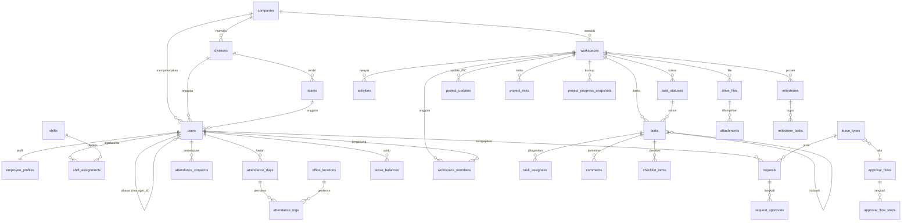

# Desain Database — RuangKerja

> PostgreSQL 17 · Laravel 13 migrations · Draf v1.0

## Konvensi

- Nama tabel & kolom: `snake_case` bahasa Inggris (kode tetap Inggris, UI berbahasa Indonesia).
- Primary key: `id` **ULID** (`char(26)`, `HasUlids`). Aman diekspos di URL, urut waktu.
- Semua tabel punya `created_at`, `updated_at`. Tabel master & konten memakai `deleted_at` (soft delete).
- Waktu disimpan **UTC** (`timestamptz`). Tanggal kerja (`work_date`) disimpan sebagai `date` menurut zona waktu kantor.
- Enum disimpan sebagai `varchar` + PHP backed enum (bukan enum Postgres) agar mudah diubah.
- Kolom JSON memakai `jsonb`.
- Kolom sensitif (token Google, NIK) dienkripsi lewat cast `encrypted`.
- Foreign key eksplisit dengan `cascadeOnDelete` hanya untuk data anak murni (mis. `task_assignees`). Data historis memakai `restrictOnDelete` / `nullOnDelete`.
- `company_id` ada di tabel utama untuk kesiapan multi-perusahaan di masa depan. Fase 1 hanya punya satu baris `companies`.

## Ringkasan per domain

| Domain | Tabel |
|---|---|
| Organisasi & akses | `companies`, `divisions`, `teams`, `positions`, `users`, `employee_profiles`, `roles`*, `permissions`*, `model_has_roles`*, `audit_logs` |
| Absensi | `office_locations`, `shifts`, `shift_assignments`, `holidays`, `attendance_days`, `attendance_logs`, `qr_tokens`, `attendance_consents` |
| Pengajuan | `leave_types`, `leave_balances`, `requests`, `request_approvals`, `approval_flows`, `approval_flow_steps`, `approval_delegations` |
| Workspace & task | `workspaces`, `workspace_members`, `milestones`, `milestone_tasks`, `project_updates`, `project_risks`, `project_progress_snapshots`, `task_statuses`, `labels`, `tasks`, `task_assignees`, `task_labels`, `task_watchers`, `checklist_items`, `comments`, `mentions`, `reactions`, `activities`, `saved_views` |
| Google & file | `google_accounts`, `drive_files`, `attachments` |
| Notifikasi | `notifications`*, `notification_preferences` |
| Fase 2 | `channels`, `channel_members`, `messages`, `notes`, `note_versions`, `calendar_events` |
| Fase 3 | `devices`, `face_templates`, `objectives`, `key_results` |

\* tabel bawaan paket (spatie/laravel-permission, Laravel notifications).

---

## 1. Organisasi & akses

### companies
| Kolom | Tipe | Keterangan |
|---|---|---|
| id | ulid PK | |
| name | varchar(150) | |
| google_domain | varchar(150) | domain Workspace yang diizinkan login, mis. `perusahaan.co.id` |
| timezone | varchar(50) | default `Asia/Jakarta` |
| settings | jsonb | jam ringkasan harian, retensi selfie (bulan), dll. |

### divisions
| Kolom | Tipe | Keterangan |
|---|---|---|
| id | ulid PK | |
| company_id | FK companies | |
| parent_id | FK divisions null | untuk sub-divisi bila perlu |
| name | varchar(120) | |
| code | varchar(10) unique per company | dipakai prefix task, mis. `KEU` |
| head_user_id | FK users null | Kepala Divisi |
| is_board | bool | `true` untuk unit **Direksi** |

### teams
`id`, `division_id` FK, `name`, `lead_user_id` FK users null.

### positions
`id`, `company_id`, `name` (mis. "Staf Keuangan"), `level` smallint (1 = Direksi … 5 = Staf).

### users
| Kolom | Tipe | Keterangan |
|---|---|---|
| id | ulid PK | |
| company_id | FK | |
| name | varchar(150) | |
| email | varchar(190) unique | email Google Workspace |
| password | varchar null | hanya Super Admin darurat |
| two_factor_secret | text null encrypted | |
| google_id | varchar null unique | `sub` dari Google |
| avatar_url | varchar null | |
| division_id | FK divisions null | |
| team_id | FK teams null | |
| position_id | FK positions null | |
| manager_id | FK users null | **atasan langsung** (penyetuju pertama) |
| work_mode | varchar | `office` · `hybrid` · `wfh` · `field` |
| status | varchar | `active` · `inactive` · `resigned` |
| joined_at | date | |
| theme | varchar | `system` · `light` · `dark` |
| last_login_at | timestamptz null | |

Indeks: `(company_id, status)`, `(division_id)`, `(manager_id)`.

### employee_profiles
`user_id` PK/FK, `employee_number` unique, `nik` (encrypted), `phone` (untuk WA), `birth_date`, `address`, `emergency_contact` jsonb. Dipisah agar data pribadi tidak ikut ter-load di setiap query `users`.

### Peran global (spatie/laravel-permission)
Peran awal: `super_admin`, `direksi`, `hr`, `kepala_divisi`, `anggota`. Satu user boleh punya beberapa peran.

### audit_logs
| Kolom | Tipe | Keterangan |
|---|---|---|
| id | ulid PK | |
| user_id | FK users null | pelaku |
| action | varchar(80) | mis. `attendance.corrected`, `request.approved`, `selfie.viewed` |
| auditable_type / auditable_id | morph | objek |
| old_values / new_values | jsonb null | |
| ip_address | inet | |
| user_agent | varchar | |
| created_at | timestamptz | append-only, tanpa update |

---

## 2. Absensi

### office_locations
`id`, `company_id`, `name`, `address`, `latitude` numeric(10,7), `longitude` numeric(10,7), `radius_m` int (default 100), `is_active`.

### shifts
| Kolom | Tipe | Keterangan |
|---|---|---|
| id | ulid PK | |
| company_id | FK | |
| name | varchar | "Reguler 08–17", "Shift Malam" |
| start_time / end_time | time | |
| break_minutes | smallint | |
| crosses_midnight | bool | |
| late_tolerance_min | smallint | default 10 |
| early_leave_tolerance_min | smallint | |
| check_in_window_before_min | smallint | boleh check-in mulai X menit sebelum jam masuk |

### shift_assignments
`id`, `user_id`, `shift_id`, `weekdays` smallint[] (1=Senin…7=Minggu), `valid_from` date, `valid_until` date null, `override_date` date null (penugasan khusus satu tanggal, mengalahkan pola), `work_mode_override` varchar null.

Resolusi jadwal: `override_date` → pola aktif pada tanggal tersebut → tidak terjadwal (libur).

### holidays
`id`, `company_id`, `date`, `name`, `type` (`national` · `collective_leave` · `company`). Unik `(company_id, date)`.

### attendance_days — satu baris per karyawan per tanggal kerja
| Kolom | Tipe | Keterangan |
|---|---|---|
| id | ulid PK | |
| user_id | FK | |
| work_date | date | **unik bersama user_id** |
| shift_id | FK null | snapshot jadwal hari itu |
| scheduled_start / scheduled_end | timestamptz null | |
| check_in_at / check_out_at | timestamptz null | |
| check_in_log_id / check_out_log_id | FK attendance_logs null | |
| status | varchar | `present` · `late` · `early_leave` · `absent` · `leave` · `permit` · `sick` · `business_trip` · `holiday` · `wfh` · `needs_correction` |
| late_minutes | smallint | |
| early_leave_minutes | smallint | |
| work_minutes | int | |
| overtime_minutes | int | dari pengajuan lembur yang disetujui |
| request_id | FK requests null | jika status berasal dari pengajuan |
| is_suspicious | bool | ada log yang ditandai |
| note | text null | |

Indeks: `(work_date, status)`, `(user_id, work_date)` unique.

### attendance_logs — setiap peristiwa check-in/out (immutable)
| Kolom | Tipe | Keterangan |
|---|---|---|
| id | ulid PK | |
| user_id | FK | |
| attendance_day_id | FK | |
| type | varchar | `check_in` · `check_out` |
| method | varchar | `gps_selfie` · `qr` · `wfh` · `manual` · `face` (F3) · `fingerprint` (F3) |
| occurred_at | timestamptz | waktu server |
| client_time | timestamptz null | waktu perangkat (untuk deteksi selisih) |
| latitude / longitude | numeric null | |
| accuracy_m | numeric null | |
| office_location_id | FK null | lokasi geofence yang cocok |
| distance_m | numeric null | |
| selfie_path | varchar null | path di object storage privat |
| qr_token_id | FK null | |
| ip_address | inet | |
| user_agent | varchar | |
| device_fingerprint | varchar null | |
| flags | jsonb | mis. `["low_accuracy","new_device","impossible_travel"]` |
| is_suspicious | bool | |
| reviewed_by / reviewed_at | FK users / timestamptz null | tinjauan HR |
| corrected_by | FK users null | untuk `method = manual` |
| note | text null | |

### qr_tokens
`id`, `office_location_id`, `token_hash`, `valid_from`, `valid_until` (≈30–45 detik), `kiosk_id`. Token di QR = `HMAC(secret, location_id|window)`. Tabel ini opsional bila validasi murni HMAC. Disimpan untuk audit.

### attendance_consents
`id`, `user_id`, `type` (`location` · `selfie` · `face`), `version` (versi teks kebijakan), `granted_at`, `revoked_at` null. Check-in ditolak bila persetujuan versi terbaru belum diberikan.

---

## 3. Pengajuan & approval

### leave_types
`id`, `company_id`, `code` (`ANNUAL`, `SICK`, …), `name`, `category` (`leave` · `permit` · `sick` · `overtime` · `correction` · `business_trip`), `annual_quota_days` null, `requires_attachment_after_days` null, `is_paid`, `allow_half_day`, `carry_over_max_days` null, `approval_flow_id` FK.

### leave_balances
`id`, `user_id`, `leave_type_id`, `year`, `entitled_days` numeric(5,1), `carried_over_days`, `used_days`, `pending_days`. Unik `(user_id, leave_type_id, year)`. `pending_days` dipakai agar saldo tidak terpakai dua kali saat pengajuan sedang diproses.

### requests — semua jenis pengajuan dalam satu tabel
| Kolom | Tipe | Keterangan |
|---|---|---|
| id | ulid PK | |
| number | varchar unique | mis. `CUT-2026-10-0012` |
| user_id | FK | pemohon |
| leave_type_id | FK | jenis |
| start_at / end_at | timestamptz | lembur & izin memakai jam. Cuti memakai hari penuh |
| days | numeric(5,1) null | hari kerja terhitung (tidak termasuk libur) |
| minutes | int null | lembur / izin per jam |
| reason | text | |
| payload | jsonb | data khusus per jenis (koreksi: jam yang diminta, dll.) |
| status | varchar | `draft` · `pending` · `approved` · `rejected` · `revision_requested` · `canceled` |
| current_step | smallint | |
| decided_at | timestamptz null | |

### approval_flows / approval_flow_steps
`approval_flows`: `id`, `company_id`, `name`.
`approval_flow_steps`: `id`, `approval_flow_id`, `step_order`, `approver_type` (`direct_manager` · `division_head` · `role` · `user`), `approver_role` null, `approver_user_id` null, `condition` jsonb null (mis. `{"overtime_month_minutes_gt": 2400}` → langkah hanya aktif bila kondisi terpenuhi).

### request_approvals
`id`, `request_id`, `step_order`, `approver_id` FK users (diresolusi saat langkah aktif), `delegated_from_id` null, `status` (`waiting` · `approved` · `rejected` · `revision_requested` · `skipped`), `note`, `decided_at`.

### approval_delegations
`id`, `delegator_id`, `delegate_id`, `starts_on`, `ends_on`.

Lampiran pengajuan (surat dokter, dll.) memakai tabel `attachments` (morph ke `requests`), disimpan di object storage privat, **bukan** Drive.

---

## 4. Workspace & task

### workspaces
| Kolom | Tipe | Keterangan |
|---|---|---|
| id | ulid PK | |
| company_id | FK | |
| type | varchar | `personal` · `team` · `division` · `project` |
| name | varchar(120) | |
| key | varchar(10) | prefix task, unik per company (`KEU`, `PRJX`) |
| description | text null | |
| icon / color | varchar null | |
| visibility | varchar | `private` · `internal` |
| owner_id | FK users | |
| division_id / team_id | FK null | untuk tipe division/team (sinkron anggota) |
| drive_folder_id | varchar null | ID folder di Shared Drive |
| task_sequence | int | penghitung nomor task berikutnya (dikunci `SELECT … FOR UPDATE`) |
| archived_at | timestamptz null | |
| **Kolom proyek** (hanya `type = project`) | | |
| lead_user_id | FK users null | PIC proyek |
| sponsor_user_id | FK users null | anggota Direksi |
| start_date / target_date | date null | dasar progres rencana |
| project_status | varchar null | `planned` · `active` · `on_hold` · `completed` · `canceled` |
| health | varchar null | denormalisasi dari update terakhir: `on_track` · `at_risk` · `off_track` |
| last_update_at | timestamptz null | denormalisasi, untuk penanda "update kedaluwarsa" |
| completed_at | timestamptz null | |

### milestones
`id`, `workspace_id` FK, `name`, `description` null, `target_date` date, `completed_at` timestamptz null, `position` varchar, `created_by`. Status diturunkan: selesai / selesai terlambat (`completed_at::date > target_date`) / terlewat (target < hari ini dan belum selesai) / berjalan / belum mulai. Pivot `milestone_tasks` (`milestone_id`, `task_id`).

### project_updates
`id`, `workspace_id` FK, `author_id` FK users, `health` (`on_track` · `at_risk` · `off_track`), `summary` text, `blockers` text null, `decision_needed` text null, `decision_resolved_at` timestamptz null, `decision_resolved_by` FK null, `progress_snapshot` numeric(5,2) (progres aktual saat update ditulis), `planned_snapshot` numeric(5,2), `created_at`. Komentar/arahan Direksi memakai `comments` (morph ke `project_updates`). Setelah insert: perbarui `workspaces.health` dan `last_update_at`.

### project_risks
`id`, `workspace_id` FK, `title`, `level` (`high` · `medium` · `low`), `owner_id` FK users, `status` (`open` · `resolved`), `resolved_at` null, `task_id` FK null, timestamps.

### project_progress_snapshots (untuk grafik burn-up)
`workspace_id`, `date` (PK gabungan), `scope_count` int, `done_count` int, `scope_hours` numeric null, `done_hours` numeric null. Diisi job harian 23.55.

### workspace_members
`workspace_id`, `user_id` (PK gabungan), `role` (`owner` · `admin` · `member` · `viewer`), `joined_at`, `is_synced` (true bila berasal dari sinkron divisi/tim).

### task_statuses
`id`, `workspace_id`, `name` ("Sedang dikerjakan"), `category` (`backlog` · `todo` · `in_progress` · `review` · `done` · `canceled`), `color`, `position` varchar (lexorank). Workspace baru mendapat 5 status default.

### labels
`id`, `workspace_id`, `name`, `color`.

### tasks
| Kolom | Tipe | Keterangan |
|---|---|---|
| id | ulid PK | |
| workspace_id | FK | |
| number | int | unik per workspace → ditampilkan `KEY-number` |
| parent_id | FK tasks null | sub-task |
| title | varchar(255) | |
| description | jsonb null | dokumen Tiptap/ProseMirror JSON |
| description_text | text null | versi teks polos untuk pencarian |
| status_id | FK task_statuses | |
| status_category | varchar | **denormalisasi** dari status untuk query metrik cepat |
| priority | smallint | 0 tanpa · 1 urgent · 2 tinggi · 3 sedang · 4 rendah |
| position | varchar | lexorank di dalam kolom |
| start_date | date null | |
| due_date | date null | |
| estimate_hours | numeric(6,2) null | |
| created_by | FK users | |
| started_at | timestamptz null | pertama kali masuk `in_progress` |
| completed_at | timestamptz null | masuk kategori `done` |
| canceled_at | timestamptz null | |
| search_vector | tsvector | indeks GIN (judul + teks deskripsi) |

Indeks: `(workspace_id, number)` unique, `(workspace_id, status_id, position)`, `(due_date) where status_category not in ('done','canceled')`, GIN `search_vector`.

### Tabel pivot task
- `task_assignees` (`task_id`, `user_id`, `assigned_at`, `assigned_by`)
- `task_labels` (`task_id`, `label_id`)
- `task_watchers` (`task_id`, `user_id`)
- `checklist_items` (`id`, `task_id`, `title`, `is_done`, `position`, `done_by`, `done_at`)

### comments
`id`, `commentable_type`/`commentable_id` (morph: task, catatan F2), `user_id`, `body` jsonb, `body_text` text, `edited_at` null, soft delete.

### mentions
`id`, `mentionable_type`/`mentionable_id` (comment, task, message), `mentioned_user_id`, `created_by`. Diisi ulang setiap komentar disimpan (parse node mention dari JSON).

### reactions
`id`, `reactable_type`/`reactable_id`, `user_id`, `emoji`. Unik `(reactable, user_id, emoji)`.

### activities — feed & riwayat
`id`, `workspace_id`, `subject_type`/`subject_id`, `causer_id`, `event` (`task.created`, `task.status_changed`, `task.assigned`, …), `properties` jsonb (`{"from": …, "to": …}`), `created_at`. Append-only.

### saved_views
`id`, `user_id`, `workspace_id` null (null = lintas workspace, mis. "Tugas saya"), `name`, `layout` (`board` · `list` · `calendar`), `filters` jsonb, `sort` jsonb, `is_shared`.

---

## 5. Google & file

### google_accounts
`id`, `user_id` unique, `google_id`, `email`, `access_token` (encrypted), `refresh_token` (encrypted), `expires_at`, `scopes` text[]. Token per pengguna dipakai untuk Google Picker & tindakan atas nama pengguna. Operasi folder workspace memakai **service account dengan domain-wide delegation** (kredensial di secret file, bukan DB).

### drive_files — cache metadata file Drive
| Kolom | Tipe | Keterangan |
|---|---|---|
| id | ulid PK | |
| workspace_id | FK | |
| google_file_id | varchar unique | |
| name | varchar | |
| mime_type | varchar | `application/vnd.google-apps.document`, dll. |
| kind | varchar | `doc` · `sheet` · `slide` · `pdf` · `image` · `folder` · `other` |
| web_view_link | varchar | |
| icon_link / thumbnail_link | varchar null | |
| size_bytes | bigint null | |
| owner_email | varchar | |
| modified_at | timestamptz | |
| added_by | FK users | |
| last_synced_at | timestamptz | |

### attachments — tautan polimorfik
`id`, `attachable_type`/`attachable_id` (task, comment, request, message), `source` (`drive` · `storage`), `drive_file_id` FK null, `storage_path` null, `filename`, `mime_type`, `size_bytes`, `uploaded_by`.

---

## 6. Notifikasi

- `notifications`: tabel bawaan Laravel (`id` uuid, `type`, `notifiable`, `data` jsonb, `read_at`).
- `notification_preferences`: `user_id`, `event` (`task.assigned`, `mention`, `request.pending`, …), `channel` (`in_app` · `email` · `whatsapp`), `enabled`. Unik `(user_id, event, channel)`. Baris tidak ada = pakai default di `config/notifications.php`.

---

## 7. Fase 2 (disiapkan, belum dimigrasi di Fase 1)

- `channels`: `id`, `workspace_id` null, `type` (`workspace` · `public` · `private` · `dm` · `group`), `name`, `topic`, `created_by`, `archived_at`.
- `channel_members`: `channel_id`, `user_id`, `last_read_message_id`, `muted`, `role`.
- `messages`: `id`, `channel_id`, `user_id`, `parent_id` (thread), `body` jsonb, `body_text`, `edited_at`, soft delete. Indeks `(channel_id, id)`.
- `notes`: `id`, `workspace_id`, `parent_id`, `title`, `yjs_state` bytea, `content` jsonb (snapshot untuk render & cari), `created_by`, `updated_by`.
- `note_versions`: `id`, `note_id`, `yjs_state` bytea, `created_by`, `created_at`.
- `calendar_events`: `id`, `google_event_id`, `calendar_id`, `source_type`/`source_id` (task, request), `user_id`, `meet_link` null, `synced_at`.

## 8. Fase 3

- `devices`: `id`, `user_id`, `platform`, `device_id_hash`, `push_token`, `integrity_verdict` jsonb, `last_seen_at`, `is_trusted`.
- `face_templates`: `id`, `user_id`, `template` bytea (dienkripsi), `model_version`, `consent_id` FK attendance_consents, `created_at`. Dihapus otomatis bila persetujuan dicabut.
- `objectives` / `key_results`: OKR per divisi per kuartal, `key_results` dapat ditautkan ke `tasks`.

---

## 9. ERD (Fase 1)



## 10. Query metrik dashboard (acuan)

```sql
-- Ketepatan waktu per divisi untuk periode [:from, :to)
SELECT u.division_id,
       COUNT(*) FILTER (WHERE t.completed_at::date <= t.due_date)::float
         / NULLIF(COUNT(*), 0) AS on_time_rate
FROM tasks t
JOIN task_assignees ta ON ta.task_id = t.id
JOIN users u ON u.id = ta.user_id
WHERE t.status_category = 'done'
  AND t.due_date IS NOT NULL
  AND t.completed_at >= :from AND t.completed_at < :to
GROUP BY u.division_id;

-- Kedisiplinan hadir per karyawan untuk satu bulan
SELECT user_id,
       COUNT(*) FILTER (WHERE status IN ('present','wfh'))::float
         / NULLIF(COUNT(*) FILTER (WHERE shift_id IS NOT NULL
                                    AND status NOT IN ('holiday','leave','sick','permit','business_trip')), 0)
         AS punctuality_rate
FROM attendance_days
WHERE work_date >= :month_start AND work_date < :next_month
GROUP BY user_id;

-- Portofolio proyek: progres aktual vs rencana
SELECT w.id, w.key, w.name, w.health, w.target_date,
       COUNT(t.*) FILTER (WHERE t.status_category = 'done')::float
         / NULLIF(COUNT(t.*) FILTER (WHERE t.status_category <> 'canceled'), 0) AS actual,
       LEAST(GREATEST((CURRENT_DATE - w.start_date)::float
         / NULLIF(w.target_date - w.start_date, 0), 0), 1) AS planned,
       COUNT(t.*) FILTER (WHERE t.due_date < CURRENT_DATE
                          AND t.status_category NOT IN ('done','canceled')) AS overdue
FROM workspaces w
LEFT JOIN tasks t ON t.workspace_id = w.id AND t.deleted_at IS NULL
WHERE w.type = 'project' AND w.project_status = 'active'
GROUP BY w.id;
```

Untuk puluhan pengguna, query langsung sudah cukup cepat. Bila data tumbuh, tambahkan tabel ringkasan harian `daily_metrics` yang diisi job malam.
