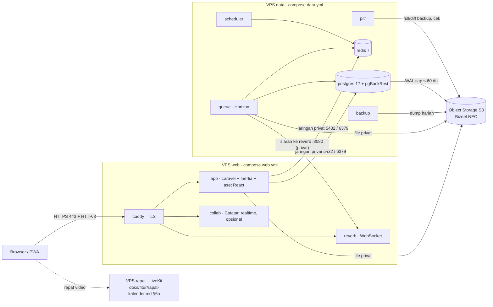

# Deploy ke dua VPS: web dan data

Server dibagi dua agar pekerjaan berat (database, antrean, ekspor, backup) tidak memperlambat halaman yang sedang dibuka karyawan. Satu server khusus RuangKerja tetap bisa memakai `compose.prod.yml` (`README.md` › Deploy).

## 1. Kenapa bukan "VPS frontend" dan "VPS backend" murni

RuangKerja memakai Laravel + Inertia. Halaman React **tidak** berdiri sendiri:
- tiap halaman dirender oleh Laravel (HTML + data props);
- file React/CSS hasil `npm run build` adalah file statis di dalam image aplikasi.

Memisahkan "frontend" ke server lain hanya memindahkan file statis, dan beban nyata tetap di PHP. Pembagian yang benar adalah **lapisan web** (melayani browser) dan **lapisan data & pekerja** (database dan proses latar).

## 2. Topologi



| VPS | Isi | Beban | Spesifikasi awal (±20–100 karyawan) |
|---|---|---|---|
| **web** | `caddy`, `app` (halaman + aset React/CSS), `reverb`, `collab` (bila `FEATURE_NOTES`) | Setiap klik dan WebSocket | 2–4 vCPU, 4 GB RAM, 40 GB SSD |
| **data** | `postgres`, `redis`, `queue` (Horizon: notifikasi, email, ekspor Excel/PDF, siaran), `scheduler` (tutup hari, pengingat, retensi), `backup` (dump harian), `pitr` (WAL archiving + base backup, `PITR.md`) | Database dan pekerjaan latar | 4 vCPU, 8 GB RAM, 80–100 GB SSD |
| **rapat** (opsional) | LiveKit + La Suite Meet | Video | 4 vCPU eksklusif, 8 GB, trafik tanpa kuota |

Ketiganya sebaiknya di **pusat data yang sama** (mis. Biznet Gio Jakarta) dan terhubung lewat **jaringan privat (VPC)**, supaya lalu lintas database tidak melewati internet.

## 3. Syarat wajib sebelum dipisah

1. **Jaringan privat** antara VPS web dan data. Catat IP privat masing-masing.
2. **Firewall** (UFW atau firewall Biznet):
   - VPS web: publik hanya 80, 443/tcp, 443/udp, dan SSH. Port 8080 (Reverb) dan 1234 (collab) hanya dari IP privat VPS data.
   - VPS data: **tidak ada port publik** selain SSH. Port 5432 dan 6379 hanya dari IP privat VPS web.
3. **File privat wajib di Object Storage (S3)**. Volume `storage` tidak lagi dibagi antar-server:
   - `FILESYSTEM_DISK=s3`, `ATTENDANCE_SELFIE_DRIVER=s3`, `REQUEST_ATTACHMENT_DISK=s3`, isi `AWS_*` (bucket privat Biznet NEO);
   - driver S3 memakai paket `league/flysystem-aws-s3-v3` (sudah terpasang). S3 bisa layanan Biznet NEO atau S3 sendiri (`docs/deploy/S3-SENDIRI.md`);
   - dengan cara ini selfie dan lampiran yang diunggah lewat VPS web bisa dibaca job di VPS data, dan sebaliknya.
4. **Image sama** di kedua VPS (`APP_IMAGE:APP_TAG`), dan `.env` hampir sama (lihat §4). `APP_KEY` **harus identik**.

## 4. Perbedaan `.env`

Mulai dari `.env.production.example`, lalu ubah:

| Kunci | VPS web | VPS data |
|---|---|---|
| `COMPOSE_FILE` | `compose.web.yml` | `compose.data.yml` |
| `WEB_PRIVATE_IP` | IP privat VPS web | — |
| `DATA_PRIVATE_IP` | — | IP privat VPS data |
| `DB_HOST` | IP privat VPS data | `postgres` |
| `REDIS_HOST` | IP privat VPS data | `redis` |
| `REVERB_HOST` / `REVERB_PORT` / `REVERB_SCHEME` | `reverb` / `8080` / `http` | IP privat VPS web / `8080` / `http` |
| `COLLAB_URL` | `http://collab:1234` | `http://<IP privat web>:1234` |
| `COMPOSE_PROFILES` | `collab` bila Catatan dinyalakan | kosong |
| `BACKUP_*` | tidak dipakai | isi (S3) |
| `POSTGRES_IMAGE` / `POSTGRES_TAG`, `PITR_*` | tidak dipakai | isi (`docs/deploy/PITR.md` §3; `PITR_CIPHER_PASS` dicadangkan di password manager) |

Kunci lain (`APP_KEY`, `APP_URL`, `DB_*` kredensial, `REDIS_PASSWORD`, `REVERB_APP_*`, `MAIL_*`, `AWS_*`, flag fitur) **sama** di kedua server.

## 5. Pemasangan pertama

Jalankan di masing-masing VPS (direktori `/opt/ruangkerja`), **VPS data dulu**:

1. Pasang Docker (`scripts/server-bootstrap.sh`) dan salin `compose.data.yml` / `compose.web.yml`, `docker/caddy/Caddyfile` (hanya web), `scripts/deploy-remote.sh`.
2. Buat `.env` sesuai §4, lalu `chmod 600 .env`.
3. VPS data:
   ```bash
   docker compose up -d --wait
   ```
4. VPS web:
   ```bash
   docker compose up -d --wait
   docker compose exec -T app php artisan migrate --force
   docker compose exec -T app php artisan db:seed --force
   ```
5. Cek: buka `https://<domain>/health`. Pada VPS data, `docker compose exec queue php artisan horizon:status` harus menjawab running.

## 6. Deploy berikutnya

Urutannya tetap **data dulu, lalu web**:
```bash
DEPLOY_PATH=/opt/ruangkerja APP_TAG=<sha> bash scripts/deploy-remote.sh
```
`deploy-remote.sh` membaca `COMPOSE_FILE` dari `.env`. Migrasi hanya dijalankan di server yang punya layanan `app` (VPS web). Horizon hanya dimulai ulang di server yang punya `queue` (VPS data).

Workflow GitHub `deploy.yml` saat ini menyasar satu server. Untuk dua server, jalankan langkah SSH dua kali (host data lalu host web), atau deploy manual dengan perintah di atas sampai workflow diperbarui.

## 7. Catatan

- **Aset React/CSS** sudah di-*cache* lama oleh browser (nama file berhash Vite) dan dikompres Caddy (zstd/gzip). CDN tidak diperlukan untuk puluhan karyawan. Bila nanti perlu, isi `ASSET_URL` ke bucket/CDN.
- **Backup**: kontainer `backup` di VPS data mengirim dump harian ke S3, dan `postgres` + `pitr` mengirim WAL (≤ 60 detik) serta base backup mingguan/harian ke bucket yang sama (prefiks `pgbackrest/`). Pemulihan ke titik waktu: `docs/deploy/PITR.md` §5, dijalankan di VPS data (VPS web cukup `docker compose stop app reverb` selama pemulihan). Uji pemulihan dump (`scripts/restore.sh`) tetap dari VPS data.
- **Kapan naik kelas**: CPU VPS web rata-rata > 60% → tambah vCPU web. Antrean Horizon sering menumpuk atau Postgres lambat → tambah RAM/vCPU data.
- **Satu server tetap boleh**: `compose.prod.yml` tidak diubah.
