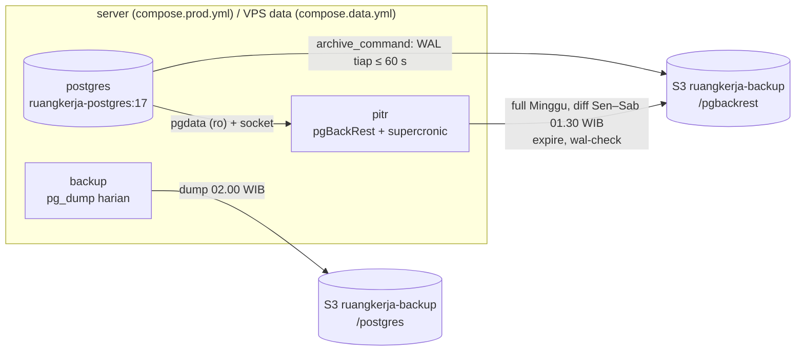

# Pemulihan ke titik waktu (PITR): WAL archiving + pgBackRest

Dump harian (`scripts/backup.sh`, 02.00 WIB) hanya bisa mengembalikan database ke kondisi jam 02.00. Kalau server hilang pukul 16.00, pekerjaan sehari bisa hilang. PITR menutup celah itu: setiap perubahan database (WAL) dikirim ke object storage paling lambat **±1 menit** setelah di-commit, sehingga database bisa dipulihkan ke **detik mana pun** dalam ±4 minggu terakhir.

| | Dump harian (`backup`) | PITR (`pitr`) |
|---|---|---|
| Isi | `pg_dump` logis, 1 file/hari | base backup fisik (full Minggu, diff harian) + WAL tiap ≤ 60 detik |
| Data hilang terburuk (RPO) | ≤ 24 jam | ≤ ±1 menit |
| Bisa kembali ke | jam 02.00 tiap hari, 30 hari | detik mana pun, ±4 minggu |
| Paling cocok untuk | ambil satu tabel/baris, pindah server/versi PostgreSQL, cadangan independen | server hilang, data terhapus/rusak pada jam tertentu |
| Alat | pg_dump + rclone | pgBackRest |

**Keduanya tetap jalan.** Dump harian adalah cadangan independen: tetap bisa dibaca bila repositori pgBackRest rusak atau `PITR_CIPHER_PASS` hilang.

## 1. Pilihan alat: pgBackRest

Dibandingkan dengan WAL-G (dua-duanya terawat aktif, keduanya mendukung S3 dengan endpoint sendiri):

| Kriteria | pgBackRest 2.58 (dipilih) | WAL-G |
|---|---|---|
| Ukuran di image | ±1 MB biner (+ libbz2, libssh2) dari paket Alpine resmi; image `ruangkerja-postgres` hanya ±15 MB lebih besar dari `postgres:17-alpine` (termasuk supercronic) | biner Go ±50–90 MB, rilis resmi untuk glibc (Ubuntu), tidak ada paket Alpine; harus dikompilasi sendiri untuk musl |
| S3 kustom (Biznet NEO, SeaweedFS) | `repo1-s3-endpoint`, `repo1-s3-uri-style=path`, CA sendiri; diuji lokal ke SeaweedFS HTTPS | `AWS_ENDPOINT`, `AWS_S3_FORCE_PATH_STYLE` |
| Enkripsi | AES-256-CBC sisi klien (`repo1-cipher-pass`), nama file & isi | libsodium / PGP |
| Retensi | bawaan per jenis backup (`retention-full`, `retention-diff`), WAL yang tidak dibutuhkan lagi ikut dihapus | `delete retain FULL n`, tanpa pola mingguan + harian |
| UX restore | satu perintah `restore --type=time --target=...` menulis `restore_command` + `recovery.signal` sendiri | `backup-fetch` lalu atur `restore_command`, target, dan signal secara manual |
| Pemeriksaan | `pgbackrest check` (paksa ganti WAL lalu tunggu sampai ada di repositori), `info --output=json` | `wal-verify`, `backup-list` |

Hal yang perlu diketahui: pgBackRest **hanya bicara HTTPS** ke S3 (NEO memang HTTPS) dan butuh akses langsung ke folder data PostgreSQL. Karena itu ia dipasang di image PostgreSQL sendiri, dan kontainer `pitr` membaca volume `pgdata` (read-only) serta socket PostgreSQL.

## 2. Cara kerja



| Bagian | Nilai | Diatur di |
|---|---|---|
| `wal_level=replica`, `archive_mode=on`, `archive_timeout=60` | RPO ≤ ±1 menit | `CMD` di `docker/postgres/Dockerfile` |
| `archive_command = pgbackrest-archive %p` | unggah asinkron bila `PITR_ENABLED=true`, selain itu WAL didaur ulang seperti biasa | `docker/postgres/pgbackrest-archive` |
| Full backup | Minggu 01.30 WIB (`PITR_FULL_SCHEDULE`) | `.env` |
| Diff backup | Senin–Sabtu 01.30 WIB (`PITR_DIFF_SCHEDULE`) | `.env` |
| Retensi | 4 full (`PITR_RETENTION_FULL`) + 7 diff (`PITR_RETENTION_DIFF`); WAL disimpan selama full tertua masih ada → jendela PITR ±4 minggu | `.env` |
| Enkripsi | AES-256-CBC, sandi `PITR_CIPHER_PASS` | `.env` (dibuat `server-init-env.sh`) |
| Kompresi | zstd; WAL yang dipotong `archive_timeout` hanya ±0,5–1 KB setelah kompresi (diukur lokal) | Dockerfile |
| Antrean maksimum | 4 GiB (`PITR_ARCHIVE_QUEUE_MAX`): bila S3 lama mati, WAL dibuang agar disk tidak penuh (PITR berlubang sampai backup berikutnya, wal-check `--deep` memberi alarm) | `.env` |
| Lokasi | bucket `PITR_S3_BUCKET` (bawaan `ruangkerja-backup`), prefiks `/pgbackrest`, kunci `BACKUP_S3_*` (identitas backup, bukan kunci aplikasi) | `.env` |

Image `ruangkerja-postgres` memakai tag tetap `POSTGRES_TAG=17`, bukan `APP_TAG`: deploy biasa **tidak** me-restart database. Build-nya reproducible, jadi digest hanya berubah saat `postgres:17-alpine` merilis versi minor baru (restart beberapa detik pada deploy berikutnya).

## 3. Mengaktifkan

Prasyarat: object storage backup sudah jalan (`docs/deploy/S3-SENDIRI.md` §0, `BACKUP_S3_*` terisi, `backup.sh` sudah berhasil sekali).

1. `.env` (dari `.env.production.example`; `server-init-env.sh` sudah membuat `PITR_CIPHER_PASS` dan mengisi `PITR_ENABLED=false`):
   ```dotenv
   POSTGRES_IMAGE=ghcr.io/<org>/ruangkerja-postgres
   POSTGRES_TAG=17
   PITR_ENABLED=true
   PITR_S3_ENDPOINT=nos.wjv-1.neo.id     # host saja, tanpa https://
   PITR_S3_BUCKET=ruangkerja-backup
   PITR_CIPHER_PASS=<openssl rand -hex 32>
   ```
2. **Simpan `PITR_CIPHER_PASS` di password manager** bersama `APP_KEY` dan kunci `BACKUP_S3_*`. Tanpa sandi ini backup PITR tidak bisa dibaca. Jangan diganti setelah repositori dibuat.
3. Terapkan (database restart sekali karena image dan konfigurasinya berubah):
   ```bash
   docker compose pull postgres pitr
   docker compose up -d --wait
   docker compose logs pitr          # "stanza ruangkerja ready", lalu full backup pertama
   docker compose exec pitr wal-check --deep
   docker compose exec pitr pitr info
   ```
   `wal-check --deep` harus berakhir `ok`, dan `pitr info` menampilkan `full backup`.
4. (Disarankan) buat cek di healthchecks.io atau Uptime Kuma (push, periode 10 menit, toleransi 30 menit) dan isi `PITR_HEARTBEAT_URL`.

Dua VPS: semua di atas dijalankan di **VPS data** (`compose.data.yml`). VPS web tidak berubah.

## 4. Pemantauan dan alarm

`pitr` menjalankan `wal-check` tiap 10 menit dan `wal-check --deep` tiap jam:

| Cek | Alarm bila |
|---|---|
| `pg_stat_archiver` | `archive_mode` bukan `on`; pengarsipan sedang gagal (gagal terakhir lebih baru dari sukses terakhir) |
| antrean `pg_wal/archive_status/*.ready` | > `PITR_MAX_READY_WAL` (32 segmen = 512 MB): S3 lambat/tak terjangkau, disk mulai terisi |
| `pgbackrest info` | stanza tidak `ok` (S3 tak terjangkau, kunci salah, sandi enkripsi beda), belum ada backup, backup terbaru > `PITR_MAX_BACKUP_AGE_HOURS` (30 jam) |
| `--deep`: `pgbackrest check` | WAL baru tidak sampai ke repositori dalam 60 detik |

Bila ada masalah:
- baris `[wal-check] ... ALERT ...` di `docker compose logs pitr`;
- `PITR_HEARTBEAT_URL/fail` dipanggil (sukses: `PITR_HEARTBEAT_URL`);
- setelah `PITR_ALERT_AFTER` (2) cek gagal berturut-turut kontainer `pitr` menjadi **unhealthy** (`docker compose ps`). Akibatnya `deploy-remote.sh` (`up --wait`) juga **gagal** sampai masalahnya diperbaiki. Ini disengaja supaya backup rusak tidak terlewat. Darurat: `PITR_ENABLED=false`, `docker compose up -d`, lalu perbaiki.

Perbaikan umum: cek kunci/endpoint (`docker compose exec pitr pgbackrest info`), kuota bucket, jaringan ke NEO. Setelah PITR berlubang (WAL dibuang karena antrean penuh), jalankan `docker compose exec pitr pitr backup full`.

## 5. Restore ke titik waktu

Perintah di bawah untuk satu server (`compose.prod.yml`). **Dua VPS**: jalankan di VPS data; hentikan `app`, `reverb` (dan `collab`) di VPS web, lalu di VPS data hanya `queue scheduler pitr backup postgres` (layanan `app`/`reverb` tidak ada di sana).

Waktu target ditulis lengkap dengan zona: `"2026-10-07 10:15:00+07"` (WIB). Database kembali ke kondisi **tepat sebelum** transaksi pertama yang di-commit setelah waktu itu. Target harus lebih awal dari WAL terakhir yang sudah terarsip (cek `docker compose exec pitr pitr info`, baris `wal archive min/max`). Bila tidak, PostgreSQL berhenti dengan "recovery ended before configured recovery target was reached".

### 5a. Server hilang: pulihkan di server baru

1. Server baru: pasang Docker (`scripts/server-bootstrap.sh`), salin file compose dan `docker/caddy/*` seperti pemasangan pertama (`README.md` › Deploy, atau `DUA-VPS.md` §5 untuk VPS data).
2. Pulihkan `.env` dari password manager. **Wajib sama**: `APP_KEY`, `DB_*`, `BACKUP_S3_*`, `PITR_S3_*`, `PITR_CIPHER_PASS`, `POSTGRES_IMAGE`. `chmod 600 .env`.
3. Pastikan server lama **benar-benar mati** (atau `PITR_ENABLED=false` di sana). Dua server yang menulis ke repositori yang sama akan merusak riwayat WAL.
4. Lihat titik yang tersedia, lalu pulihkan ke volume `pgdata` yang masih kosong:
   ```bash
   docker compose pull
   docker compose run --rm --no-deps postgres pitr-restore --list
   docker compose run --rm --no-deps postgres pitr-restore --time "2026-10-07 15:58:00+07"
   #   atau: pitr-restore --latest    (sampai WAL terakhir yang terarsip)
   ```
5. Jalankan PostgreSQL saja dan tunggu sampai promosi selesai:
   ```bash
   docker compose up -d postgres
   docker compose logs -f postgres
   #   "recovery stopping before commit ...", "selected new timeline ID: 2",
   #   "database system is ready to accept connections"
   docker compose exec postgres psql -U ruangkerja -d ruangkerja -c "select pg_is_in_recovery(), count(*) from users"
   ```
   `pg_is_in_recovery` harus `f`.
6. Jalankan semua layanan dan ambil full backup baru (titik awal timeline baru):
   ```bash
   docker compose up -d --wait
   docker compose exec pitr pitr backup full
   docker compose exec pitr wal-check --deep
   ```
7. Arahkan DNS ke server baru, cek `/health`, catat di log operasional.

### 5b. Kesalahan data di server yang sama (mis. data terhapus pukul 10.15)

Kembalikan database ke sesaat sebelum kejadian. **Semua perubahan setelah titik itu hilang**, termasuk yang benar. Bila hanya sebagian data yang perlu dikembalikan, pakai §5c dan salin datanya.

```bash
docker compose stop app queue scheduler reverb pitr backup postgres
docker compose run --rm --no-deps postgres pitr-restore --time "2026-10-07 10:14:00+07" --delta --yes
docker compose up -d postgres && docker compose logs -f postgres     # tunggu "ready to accept connections"
docker compose up -d --wait
docker compose exec pitr pitr backup full
```

`--delta` memakai ulang file yang ada dan hanya mengunduh yang berubah. Di VPS bersama, sertakan `-f compose.prod.yml -f compose.shared.yml` bila `COMPOSE_FILE` tidak di `.env`.

### 5c. Salinan samping untuk mengambil sebagian data

Database produksi tetap jalan. Salinan dipulihkan ke volume terpisah dengan **pengarsipan mati** (`PITR_ENABLED=false`) agar tidak menulis ke repositori produksi:

```bash
umask 077
docker compose exec -T pitr env | grep '^PGBACKREST_' > pitr.env
IMG=$(grep -E '^POSTGRES_IMAGE=' .env | cut -d= -f2):17
docker run --rm --env-file pitr.env -e PITR_ENABLED=false \
  -v ruangkerja_pulih:/var/lib/postgresql/data "$IMG" pitr-restore --time "2026-10-07 10:14:00+07"
docker run -d --name rk-pulih --env-file pitr.env -e PITR_ENABLED=false -e POSTGRES_PASSWORD=unused \
  -v ruangkerja_pulih:/var/lib/postgresql/data "$IMG"
docker exec rk-pulih psql -U ruangkerja -d ruangkerja -c "select pg_is_in_recovery()"     # tunggu sampai f
docker exec rk-pulih pg_dump -U ruangkerja -d ruangkerja --data-only -t <tabel> > tabel.sql
docker rm -f rk-pulih && docker volume rm ruangkerja_pulih && rm -f pitr.env
```

Jangan memakai `docker compose run` dengan volume `pgsocket` produksi untuk salinan yang **berjalan**: dua PostgreSQL di satu folder socket saling menimpa. Perintah di atas sengaja memakai `docker run` tanpa socket bersama. Cara yang sama bisa dipakai di laptop atau VPS sementara untuk latihan pemulihan, cukup dengan `pitr.env`.

## 6. Latihan pemulihan

- **Lokal (tanpa server, kapan saja)**: `bash scripts/pitr-uji.sh`. Skrip membangun image, menyalakan `postgres` + `pitr` asli dari `compose.prod.yml` dengan SeaweedFS HTTPS sementara (proyek `rkwaltest`, tanpa port di host), lalu: full backup → data A → diff → data B → catat T → data C + hapus sebagian A → `wal-check --deep` → restore ke T di instance baru → isi tabel identik (jumlah + md5) → salinan restore tidak menulis ke repositori → S3 dimatikan memicu ALERT + unhealthy → salinan samping `--latest` (§5c) identik dengan database aktif → restore di tempat (§5b, `--delta`) ke T, timeline baru terarsip, full backup + `wal-check --deep` ok. Semua kontainer, volume, dan image dihapus di akhir (`--keep` untuk memeriksa). Hasil 7 Okt 2026: **PASS** (±2 menit).
- **Produksi (bulanan, bersama drill dump `restore.sh`)**: §5c ke volume sementara dengan `--time` = 10 menit lalu, bandingkan beberapa jumlah baris dengan database aktif, catat hasilnya di log operasional.

## 7. Catatan perawatan

- **Upgrade versi mayor PostgreSQL** (17 → 18): data harus dipindah (dump/restore atau `pg_upgrade`), lalu `docker compose exec pitr pgbackrest stanza-upgrade` dan full backup baru. Ganti `POSTGRES_TAG` dan base image Dockerfile bersamaan.
- **Rotasi kunci S3**: ganti `BACKUP_S3_*`, `docker compose up -d` (postgres ikut restart karena env berubah). `PITR_CIPHER_PASS` **tidak bisa** dirotasi tanpa repositori baru (prefiks/bucket baru + full backup).
- **Menonaktifkan sementara**: `PITR_ENABLED=false` + `docker compose up -d`. WAL tidak lagi diarsipkan dan `pitr` diam; aktifkan lagi lalu `pitr backup full`.
- **Biaya NEO**: base backup terkompresi ±12% ukuran database (uji lokal: 29 MB → 3,5 MB), WAL tergantung jumlah tulisan. Perkiraan tahun pertama (database < 2 GB): 4 full + diff + WAL 4 minggu < 10 GB ≈ Rp10.000/bulan.
- **Belum diuji ke Biznet NEO sungguhan** (hanya SeaweedFS lokal, path-style + HTTPS). Langkah §3.3 adalah ujinya: `wal-check --deep` harus `ok`. Bila NEO menolak path-style, coba `PITR_S3_URI_STYLE=host`.
