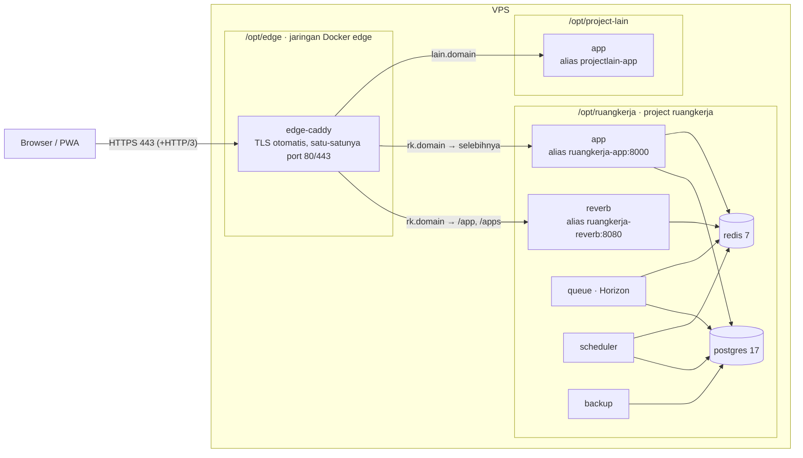

# Deploy ke VPS bersama (beberapa project di satu server)

Panduan ini untuk VPS yang **dipakai bersama project lain**. Server khusus RuangKerja saja tetap memakai langkah di `README.md` › *Deploy ke VPS dari nol* (stack dengan Caddy sendiri). Untuk memisah web dan database/antrean ke dua server: `docs/deploy/DUA-VPS.md`.

## 1. Topologi



| Bagian | Berkas di repo | Di server |
|---|---|---|
| Proxy edge bersama (Caddy) | `deploy/edge/{compose.yml,Caddyfile,reload.sh,sites/}` | `/opt/edge` (milik root, `sites/` bisa ditulis grup `deploy`) |
| Situs RuangKerja di edge | `docker/caddy/site.caddy.template` | `/opt/edge/sites/ruangkerja.caddy` (dibuat ulang tiap deploy) |
| Stack RuangKerja | `compose.prod.yml` + `compose.shared.yml` | `/opt/ruangkerja` (milik user `deploy`) |
| Pemilihan mode | `COMPOSE_FILE=compose.prod.yml:compose.shared.yml` di `.env` | dibaca Docker Compose & `scripts/deploy-remote.sh` |

Aturan untuk semua project di VPS ini:
- **Hanya `edge-caddy` yang membuka port host** (80, 443/tcp, 443/udp). Project lain tidak boleh mem-publish 80/443; database tidak boleh dibuka ke host.
- Setiap project bergabung ke jaringan `edge` hanya untuk layanan web-nya, dengan **alias berawalan nama project** (`ruangkerja-app`, `projectlain-app`) supaya dua project yang sama-sama punya layanan `app` tidak bentrok di DNS Docker.
- Setiap project menaruh satu berkas situs `sites/<project>.caddy`, lalu `/opt/edge/reload.sh` (validasi + reload tanpa downtime).
- `compose.shared.yml` memberi **batas memori/CPU** per layanan RuangKerja (total ≈ 9,3 GB, 8,5 CPU sebagai batas atas, bukan pemakaian) agar tidak mengganggu project lain. Ubah bila VPS lebih kecil.

## 2. Kondisi server (dicek 6 Okt 2026)

`root@187.77.118.216` (hostname `srv2037909`): Ubuntu 26.04 LTS x86_64, 8 vCPU, 31 GB RAM, disk 387 GB. Docker 29.8 + Compose v5.6 sudah terpasang. Belum ada kontainer, proxy, maupun project lain. Port yang terbuka hanya SSH 22. Firewall (ufw) belum aktif. User `deploy` belum ada.

## 3. Langkah sekali saja

Jalankan dari root repo di laptop. Ganti `rk.domainanda.co.id`, `it@domainanda.co.id`, dan pemilik GitHub sesuai milik Anda.

### 3.1 DNS
Buat record `A` `rk.domainanda.co.id` → `187.77.118.216` (dan `AAAA` bila server punya IPv6). Cek: `dig +short rk.domainanda.co.id`. Caddy baru bisa mengambil sertifikat setelah DNS mengarah ke server.

### 3.2 Bootstrap server (root)
Membuat user `deploy` (grup docker, kunci SSH root + kunci deploy GitHub), zona waktu UTC, ufw (SSH, 80, 443 tcp/udp), jaringan `edge`, menyalakan `edge-caddy` di `/opt/edge`, dan menyiapkan `/opt/ruangkerja`.

```bash
ssh root@187.77.118.216 'mkdir -p /root/rk-setup'
scp -r scripts/server-bootstrap.sh deploy/edge ~/.ssh/ruangkerja_deploy.pub root@187.77.118.216:/root/rk-setup/
ssh root@187.77.118.216 'bash /root/rk-setup/server-bootstrap.sh it@domainanda.co.id /root/rk-setup/ruangkerja_deploy.pub'
```

Kunci `~/.ssh/ruangkerja_deploy` (ed25519, tanpa passphrase) dibuat khusus untuk GitHub Actions; jangan dipakai untuk login harian. Skrip aman diulang.

### 3.3 `.env` produksi (user deploy)
`server-init-env.sh` menyalin `.env.production.example` dan mengisi rahasia acak (`APP_KEY`, sandi DB/Redis, Reverb, rahasia QR) tanpa menampilkannya, kecuali `REVERB_APP_KEY` yang memang publik.

```bash
scp .env.production.example scripts/server-init-env.sh deploy@187.77.118.216:/opt/ruangkerja/
ssh deploy@187.77.118.216 'cd /opt/ruangkerja && bash server-init-env.sh rk.domainanda.co.id <pemilik-github> it@domainanda.co.id'
ssh deploy@187.77.118.216 'nano /opt/ruangkerja/.env'
```

Yang masih harus diisi manual: SMTP (`MAIL_*`), Google (`GOOGLE_*`, lihat `docs/sprints/sprint-7/GOOGLE-API.md`), `BRANDING_COMPANY_NAME`, `PRIVACY_CONTACT`, dan bila ada object storage `AWS_*` + `ATTENDANCE_SELFIE_DRIVER=s3` + `BACKUP_REMOTE=backup:<bucket>/postgres` + `BACKUP_S3_*`.

> **Simpan `APP_KEY` di password manager** (salin dari `.env` server). Tanpa kunci itu NIK, token Google, dan TOTP Super Admin tidak bisa dibaca, termasuk dari backup.

Tanpa object storage, selfie & lampiran disimpan di volume `storage` dan dump database di volume `backups` di server yang sama. Ini cukup untuk uji coba, **bukan untuk produksi**: server hilang = data hilang. Siapkan bucket S3-compatible (mis. Cloudflare R2, Backblaze B2, Wasabi, IDCloudHost) sebelum dipakai seluruh karyawan.

### 3.4 GitHub
1. **Jadikan repo private dulu** (repo masih public):
   `gh repo edit faris315mfaf-ai/ruang-kerja --visibility private --accept-visibility-change-consequences`
2. *Settings → Environments → New environment* `production`, centang **Required reviewers**. Environment secrets:
   - `DEPLOY_SSH_KEY` = isi `~/.ssh/ruangkerja_deploy` (private key).
   - `DEPLOY_KNOWN_HOSTS` = keluaran `ssh-keyscan -p 22 187.77.118.216`.
3. *Settings → Secrets and variables → Actions → Variables*:

   | Variabel | Nilai |
   |---|---|
   | `APP_DOMAIN` | `rk.domainanda.co.id` |
   | `REVERB_APP_KEY` | nilai yang dicetak `server-init-env.sh` |
   | `DEPLOY_HOST` | `187.77.118.216` |
   | `DEPLOY_USER` | `deploy` |
   | `DEPLOY_PATH` | `/opt/ruangkerja` (opsional, default) |
   | `APP_NAME` | opsional, default `RuangKerja` |

4. Push: `git push -u origin main`. Workflow **CI** jalan; bila hijau, **Deploy** membangun image ke GHCR lalu menunggu persetujuan Anda di environment `production`.

### 3.5 Deploy pertama
Setujui deploy di tab Actions. `scripts/deploy-remote.sh` di server: pin `APP_TAG` → `docker compose pull` → `up -d --wait` (tanpa Caddy milik stack) → tulis `/opt/edge/sites/ruangkerja.caddy` dari template → `caddy validate` lalu `reload` (bila tidak valid, berkas lama dipulihkan dan deploy berhenti) → `migrate --force` → `db:seed` peran → `horizon:terminate`. Workflow lalu memanggil `https://<domain>/health`.

Lalu buat Super Admin:

```bash
ssh deploy@187.77.118.216
cd /opt/ruangkerja
docker compose exec app php artisan ruangkerja:create-super-admin it@domainanda.co.id --name="Admin Sistem" --company="PT Perusahaan" --generate-password
```

Karena `COMPOSE_FILE` ada di `.env`, perintah `docker compose …` di `/opt/ruangkerja` tidak perlu `-f`.

## 4. Operasional

| Kebutuhan | Perintah (di server) |
|---|---|
| Status | `cd /opt/ruangkerja && docker compose ps` · `docker ps --format '{{.Names}}\t{{.Status}}'` |
| Log aplikasi | `docker compose logs -f app queue` |
| Log proxy | `docker logs -f edge-caddy` |
| Reload proxy setelah ubah situs | `/opt/edge/reload.sh` |
| Pemakaian sumber daya | `docker stats --no-stream` |
| Rollback | `cd /opt/ruangkerja && DEPLOY_PATH=$PWD APP_TAG=<sha-sebelumnya> bash deploy-remote.sh` (riwayat di `.deploy-history`; salin `scripts/deploy-remote.sh` ke server bila belum ada) |
| Setelah ubah `.env` | `docker compose up -d --force-recreate` |
| Backup manual | `docker compose exec backup backup.sh` |

## 5. Menambah project lain ke VPS ini

1. Stack project baru **tanpa** `ports:` 80/443 dan tanpa membuka database ke host.
2. Layanan web-nya bergabung ke jaringan eksternal `edge` dengan alias berawalan nama project:
   ```yaml
   services:
     web:
       networks:
         default: {}
         edge:
           aliases: [projectlain-web]
   networks:
     edge:
       external: true
   ```
3. Buat `/opt/edge/sites/projectlain.caddy`:
   ```caddyfile
   lain.domainanda.co.id {
   	encode zstd gzip
   	reverse_proxy projectlain-web:3000
   }
   ```
4. `/opt/edge/reload.sh`. Project tanpa Docker (mis. layanan di host) bisa dicapai lewat `host.docker.internal` setelah menambah `extra_hosts: ["host.docker.internal:host-gateway"]` di `deploy/edge/compose.yml`.
5. Beri batas memori di compose project itu juga.

## 6. Keamanan

- Firewall hanya membuka 22, 80, 443. Docker memasang aturan iptables sendiri untuk port yang di-publish, jadi aturan "jangan publish port" di atas adalah pagar utamanya.
- Login SSH: setelah `deploy` bisa masuk dengan kunci, pertimbangkan mematikan login sandi (`PasswordAuthentication no`) dan root (`PermitRootLogin prohibit-password`) di `/etc/ssh/sshd_config.d/`.
- `.env` RuangKerja `chmod 600` milik `deploy`. Project lain sebaiknya memakai user deploy sendiri atau minimal direktori dan `.env` yang tidak bisa dibaca user lain. Catatan: anggota grup `docker` praktis setara root di host, jadi semua project yang berbagi grup ini saling percaya.
- Checklist go-live lengkap: `docs/CRITICAL.md` §5.
