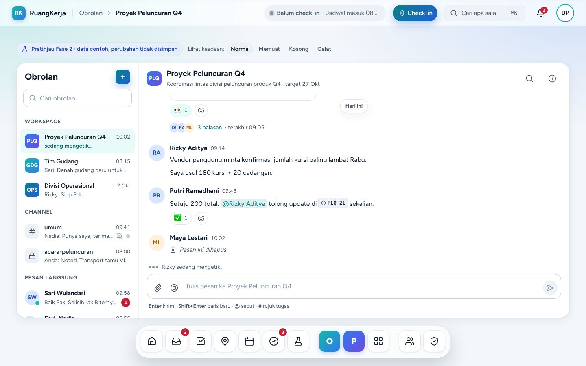
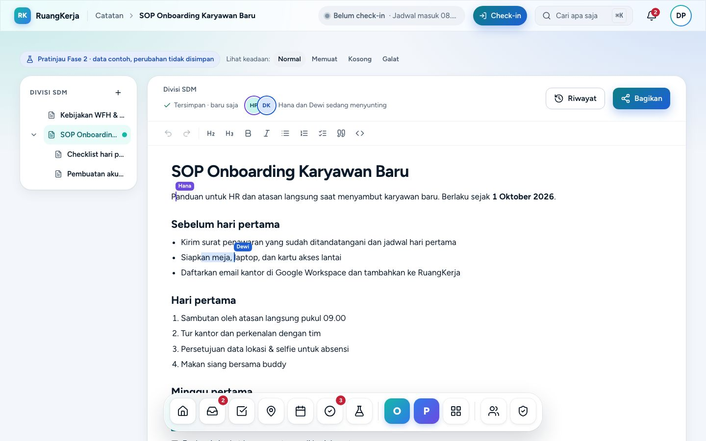
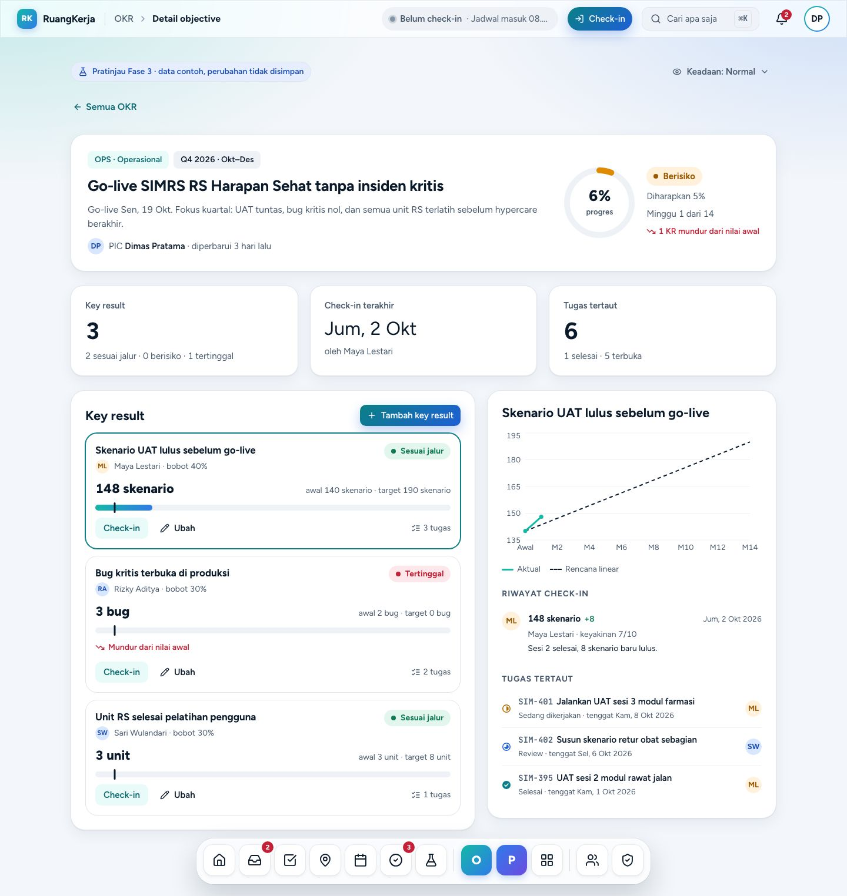
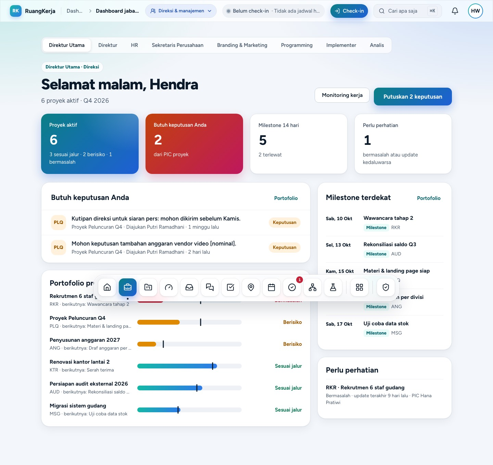
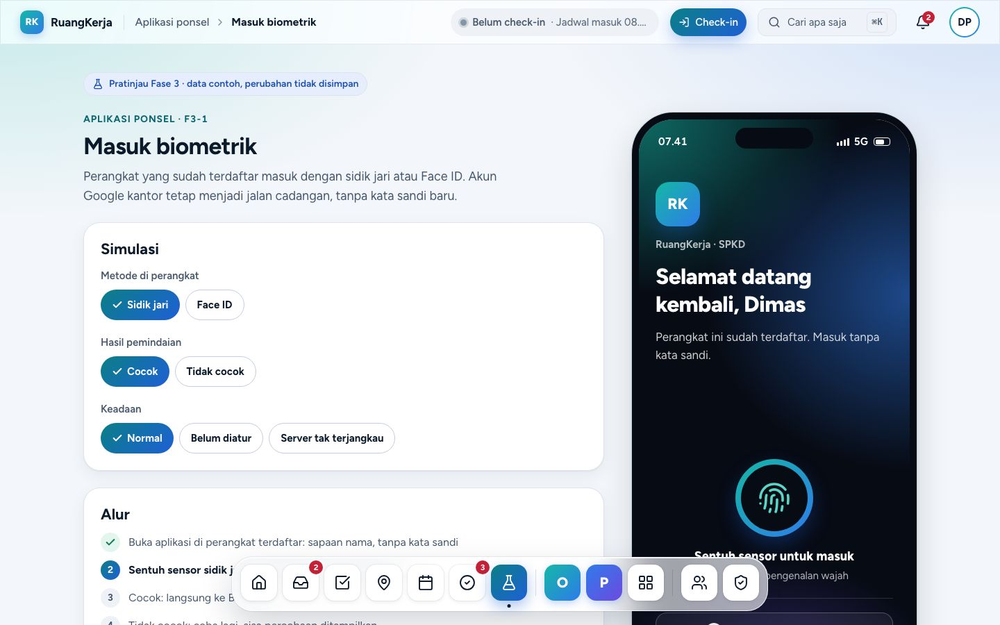

# Panduan pratinjau Fase 2 & 3

> Status per **6 Okt 2026** (keputusan pemilik produk). Dokumen ini menjelaskan modul pratinjau di `/pratinjau`: fitur apa yang sudah ada, apa yang belum, cara memakainya, fungsinya, dan apa yang dibutuhkan agar menjadi fitur nyata. Setiap klaim diverifikasi dengan membaca kode di `resources/js/features/<modul>` dan `resources/js/pages/<modul>` pada branch `claude/shell-mobile` (commit `ad89015`). Bila kode berubah, perbarui dokumen ini.
>
> Dibaca di aplikasi: **Pratinjau › Panduan pratinjau** (`/pratinjau/panduan`, gambar ikut tampil). Rincian teknis per modul ada di dokumen modul (tautan di tiap seksi).

> **Pembaruan 6 Okt 2026 (malam):** semua modul "Akan dibangun" sudah **Nyata** dengan backend, data tersimpan, dan flag sendiri (nyala lokal, mati produksi): Catatan bersama (`FEATURE_NOTES`, server kolaborasi `collab/`), Rapat, notulen & kalender (`FEATURE_MEETINGS`), Otomasi + Kinerja saya (`FEATURE_AUTOMATION`), OKR (`FEATURE_OKR`), Dashboard per jabatan (`FEATURE_ROLE_DASHBOARDS`). Cara pakai terbaru ada di dokumen modulnya ([catatan](catatan.md), [rapat-kalender](rapat-kalender.md), [otomasi-whatsapp](otomasi-whatsapp.md), [okr](okr.md), [dashboard-peran](dashboard-peran.md)); seksi §4 di bawah masih menggambarkan masa pratinjau. Yang tetap pratinjau & **ditahan**: WhatsApp, aplikasi ponsel, mesin fingerprint. Fitur baru permintaan pemilik (tanpa flag): [laporan harian](laporan-harian.md), [pengumuman](pengumuman.md), [hiring](hiring.md), [akun & kata sandi](akun-kata-sandi.md), [dashboard pimpinan](dashboard-pimpinan.md), [staf: pengajuan & workspace](staf-pengajuan-workspace.md).

## 1. Ringkasan status

Tiga label dipakai di seluruh dokumen ini:

| Label | Arti |
|---|---|
| **Nyata** | Data tersimpan di server, ada Policy, Action, test. Bisa dipakai sungguhan (di balik flag fitur). |
| **Pratinjau · Akan dibangun** | Layar tiruan dengan data contoh; backend nyata **akan dibangun berikutnya** (sedang dikerjakan agen lain). Panduan ini menjelaskan keadaan pratinjau saat ini. |
| **Pratinjau · Ditahan** | Layar tiruan tetap bisa dicoba, tetapi **tidak dikerjakan** sampai pemilik membuka lagi. |
| **Ditahan · belum ada** | Tidak ada layar sama sekali dan sengaja ditunda. |

### 1.1 Status per modul

| Modul | Status | Rute utama | Dokumen modul |
|---|---|---|---|
| Obrolan (channel, DM, grup, thread) | **Nyata** (flag `FEATURE_CHAT`) | `/obrolan` | [obrolan.md](obrolan.md) |
| Catatan bersama | **Nyata** | `/catatan` | [catatan.md](catatan.md) |
| Rapat & notulen | **Nyata** | `/rapat` | [rapat-kalender.md](rapat-kalender.md) |
| Kalender & jadwal manajemen | **Nyata** | `/kalender`, `/manajemen/jadwal` | [rapat-kalender.md](rapat-kalender.md) |
| Otomasi: aturan, tugas berulang, template | **Nyata** | `/otomasi` | [otomasi-whatsapp.md](otomasi-whatsapp.md) |
| Kinerja saya | **Nyata** | `/kinerja` | [otomasi-whatsapp.md](otomasi-whatsapp.md) |
| OKR divisi | **Nyata** | `/okr` | [okr.md](okr.md) |
| Dashboard per peran | **Nyata** | `/peran/{peran}` | [dashboard-peran.md](dashboard-peran.md) |
| Notifikasi WhatsApp + pemilihan provider | Pratinjau · **Ditahan** | `/pengaturan/whatsapp` | [otomasi-whatsapp.md](otomasi-whatsapp.md) |
| Aplikasi ponsel (login biometrik, integritas, offline, widget, check-in wajah, perangkat saya) | Pratinjau · **Ditahan** | `/pratinjau/ponsel` | [aplikasi-ponsel.md](aplikasi-ponsel.md) |
| Mesin fingerprint (ZKTeco ADMS) | Pratinjau · **Ditahan** | `/admin/mesin-absensi` | [mesin-fingerprint.md](mesin-fingerprint.md) |
| Integrasi Google: login Google, Google Drive & Docs (termasuk Meet/Calendar di pratinjau) | **Ditahan** | — | — |

### 1.2 Status per layar

Kolom **Desktop/Ponsel**: ✓ penuh · ◐ terbatas · — tidak ada. **Akun** = akun demo yang paling cocok (rute pratinjau tidak membatasi peran; lihat §2.4).

| Rute | Layar | Status | Desktop | Ponsel | Akun |
|---|---|---|---|---|---|
| `/pratinjau` | Hub pratinjau | — (navigasi) | ✓ | ✓ | siapa pun |
| `/pratinjau/panduan` | Panduan ini (+ dokumen modul di `/pratinjau/panduan/{dokumen}`) | — (dokumentasi) | ✓ | ✓ | siapa pun |
| `/obrolan`, `/obrolan/{id}` | Daftar obrolan, percakapan | Nyata | ✓ | ✓ | `kadiv@demo.test` |
| `/catatan` | Daftar catatan | **Nyata** | ✓ | ✓ | `kadiv@demo.test` |
| `/catatan/{id}` | Editor catatan, tab dokumen, warna & stabilo, ukuran huruf, mode catat, riwayat versi, bagikan | **Nyata** | ✓ | ✓ (strip tab, tanpa pohon) | `kadiv@demo.test` |
| `/dashboard` › **Mulai notulensi** | Notulensi cepat di workspace Pribadi + pil "Kembali ke notulensi" | **Nyata** | ✓ | ✓ | `anggota@demo.test` |
| `/rapat` | Agenda rapat | **Nyata** | ✓ | ◐ (tanpa tampilan "Minggu ini") | `kadiv@demo.test` |
| `/rapat/baru` | Jadwalkan rapat | **Nyata** | ✓ | ✓ | `kadiv@demo.test` |
| `/rapat/{id}` | Detail rapat & RSVP | **Nyata** | ✓ | ◐ (info ringkas) | `kadiv@demo.test` |
| `/rapat/{id}/notulen` | Notulen & tindak lanjut | **Nyata** | ✓ | ◐ (ubah butir/PIC/tenggat di desktop) | `kadiv@demo.test` |
| `/kalender` | Kalender rapat, tenggat, cuti, libur | **Nyata** | ✓ | ◐ (strip minggu + agenda) | `kadiv@demo.test` |
| `/manajemen/jadwal` | Jadwal & notulensi pimpinan | **Nyata** | ✓ | ✓ | `direksi@demo.test` |
| `/otomasi` | Aturan otomasi | **Nyata** | ✓ | ✓ | `kadiv@demo.test` |
| `/otomasi/berulang` | Tugas berulang | **Nyata** | ✓ | ✓ | `kadiv@demo.test` |
| `/otomasi/template` | Template tugas & workspace | **Nyata** | ✓ | ✓ | `kadiv@demo.test` |
| `/kinerja` | Kinerja saya | **Nyata** | ✓ | ◐ (tanpa panel per workspace & kehadiran) | siapa pun |
| `/okr`, `/okr/{id}` | OKR divisi, detail objective | **Nyata** | ✓ | ✓ | `kadiv@demo.test` |
| `/peran/{dirut,direktur,hr,corsec,marketing,programming,implementer,analis}` | Dashboard per peran | **Nyata** | ✓ | ✓ | `direksi@`, `hr@`, `programmer@demo.test` |
| `/pengaturan/whatsapp` | Pengaturan WhatsApp | Ditahan | ✓ | ✓ | siapa pun |
| `/pratinjau/ponsel` | Ringkasan aplikasi ponsel | Ditahan | ✓ | ✓ | siapa pun |
| `/pratinjau/ponsel/masuk` | Masuk biometrik | Ditahan | ✓ (bingkai ponsel) | ✓ (layar penuh) | siapa pun |
| `/pratinjau/ponsel/kunci` | Layar kunci | Ditahan | ✓ (bingkai) | ✓ | siapa pun |
| `/pratinjau/ponsel/widget` | Widget | Ditahan | ✓ (bingkai) | ✓ | siapa pun |
| `/pratinjau/ponsel/integritas` | Pemeriksaan integritas | Ditahan | ✓ (bingkai) | ✓ | siapa pun |
| `/pratinjau/ponsel/offline` | Antrean offline | Ditahan | ✓ (bingkai) | ✓ | siapa pun |
| `/pratinjau/ponsel/aksi-cepat` | Buat cepat | Ditahan | ✓ (panel) | ✓ (FAB) | siapa pun |
| `/absensi/wajah` | Check-in wajah | Ditahan | ◐ (banner "Tersedia di aplikasi ponsel" + bingkai) | ✓ | siapa pun |
| `/pengaturan/perangkat` | Perangkat saya | Ditahan | ✓ | ✓ | siapa pun |
| `/admin/mesin-absensi` | Mesin fingerprint | Ditahan | ✓ | ◐ (baca-saja) | `hr@demo.test` |

### 1.3 Ditahan · belum ada sama sekali

Hal berikut sengaja tidak punya layar dan **tidak dikerjakan** sampai pemilik membuka lagi:

- Login Google, Google Drive & Docs (pratinjau hanya menampilkan tombol tiruan seperti "Ekspor ke Google Docs" dan "Hubungkan Google Calendar").
- Notifikasi WhatsApp sungguhan dan pemilihan provider WhatsApp (Meta Cloud API resmi vs gateway; PRD §10 no. 2).
- Aplikasi ponsel native (Expo): login biometrik, integritas perangkat, mode offline, widget, check-in wajah, perangkat saya.
- Mesin fingerprint (endpoint ADMS `/iclock`).
- Fitur yang sengaja ditunda: folder Drive per tugas (bagian dari integrasi Google yang ditahan pemilik). Ekspor PNG struktur organisasi, tanda baca komentar, kehadiran per kartu board, dan pembatalan pengajuan yang sudah disetujui sudah tersedia sejak 7 Okt 2026.
- Infrastruktur: WAL archiving (cadangan `pg_dump` harian tetap jalan).
- Branding resmi SPKD (nama, logo, warna; PRD §10 no. 1).
- Sisa keputusan mobile-first (`docs/PLATFORM.md` §2.1): cari di bawah, tumpukan kartu persetujuan, geser untuk check-in. Yang sudah diterapkan hanya shell (tab bawah dengan Absen di tengah).

## 2. Memulai

### 2.1 Apa itu pratinjau

Pratinjau adalah **layar Fase 2 dan Fase 3 yang dibangun lebih dulu di frontend** agar alur, tata letak desktop & ponsel, teks, dan bentuk data bisa disepakati sebelum backend dibangun. Ciri-cirinya:

- Data berasal dari berkas contoh `resources/js/features/<modul>/fixtures.ts`. Hari ini di data contoh = **Senin, 5 Okt 2026**.
- Tombol simpan/kirim memakai `useFakeMutation` (`resources/js/features/prototype/use-fake-mutation.ts`): tombol berputar ±600 ms, perubahan diterapkan di layar, lalu toast hijau. Bila gagal (keadaan galat) muncul toast "Gagal menyimpan. Coba lagi sebentar." kecuali modul menulis pesan sendiri.
- Setiap layar menampilkan penanda `PrototypeBanner`: *"Pratinjau Fase 2 · data contoh, perubahan tidak disimpan"* (atau Fase 3).
- Rute pratinjau ada di `routes/prototype.php` (`Route::inertia`, tanpa controller).

**Obrolan bukan pratinjau lagi.** Sejak 6 Okt 2026 Obrolan memakai backend nyata (`routes/chat.php`, `app/Domain/Chat`), tidak menampilkan banner pratinjau, dan tidak lagi tercantum sebagai kartu di hub.

### 2.2 Cara menyalakan

Dua flag di `config/features.php`:

| Flag | Variabel `.env` | Bawaan | Mengatur |
|---|---|---|---|
| `prototype` | `FEATURE_PROTOTYPE` | nyala bila `APP_ENV` bukan `production` | Semua rute di `routes/prototype.php`, termasuk `/pratinjau` dan `/pratinjau/panduan`, ubin "Pratinjau" di Dock/Rail, baris "Fitur Fase 2 & 3" di tab Lainnya |
| `chat` | `FEATURE_CHAT` | sama | `/obrolan`, ubin/tab Obrolan |

- Saat flag mati, rutenya menjawab **404** (`app/Http/Middleware/EnsureFeatureEnabled.php`) dan pintu masuknya disembunyikan (prop bersama `features` dari `HandleInertiaRequests`).
- `.env.example` sudah berisi `FEATURE_PROTOTYPE=true` dan `FEATURE_CHAT=true`. Di produksi keduanya mati kecuali diisi dengan sengaja.
- Setelah mengubah `.env`: `php artisan config:clear`.

### 2.3 Cara masuk

1. Buka `https://ruangkerja.test/login` (atau situs worktree agen, mis. `https://ruangkerja-docs.test`).
2. Pilih salah satu akun di kartu **"Masuk cepat · demo lokal"** (`resources/js/features/auth/demo-login.tsx`). Kartu ini hanya tampil bila `APP_ENV=local` **dan** `DEMO_LOGIN_ENABLED=true` (`config/app.php`, `app/Domain/Organization/Demo/DemoAccounts.php`). Masuk lewat kartu tidak meminta sandi; masuk lewat formulir memakai sandi `password`.
3. Setelah masuk, pindah persona lewat **pemilih akun demo**: pil "Demo · {persona}" di menu bar (desktop) atau strip "Demo · {persona}" dengan tombol "Ganti akun" (tablet & ponsel). Pemilih memuat 5 persona: programmer, HR, Maya (marketing), Admin, Direksi.

| Akun | Nama | Peran | Cocok untuk |
|---|---|---|---|
| `kadiv@demo.test` | Dimas Pratama | Kepala Divisi | Obrolan (data obrolan contoh disusun untuk Dimas), Catatan, Rapat, Otomasi, OKR |
| `direksi@demo.test` | Hendra Wijaya | Direksi | `/manajemen/jadwal`, `/peran/dirut`, `/peran/direktur` |
| `hr@demo.test` | Hana Pratiwi | HR | `/admin/mesin-absensi`, `/peran/hr` |
| `programmer@demo.test` | Arif Nugroho | Anggota | `/peran/programming`, `/kinerja` |
| `maya.lestari@demo.test` | Maya Lestari | Anggota | `/peran/marketing`, `/peran/analis` |
| `anggota@demo.test` | Rizky Aditya | Anggota | Menguji bahwa anggota biasa juga bisa membuka pratinjau |
| `admin@demo.test` | Admin Sistem | Super Admin | Admin › Dokumentasi (membaca dokumen ini tanpa gambar) |

Pintu masuk ke hub:

| Lebar layar | Jalan ke `/pratinjau` |
|---|---|
| Desktop ≥ 1024 px | Ubin **Pratinjau** (ikon labu) paling kanan di Dock |
| Tablet 768–1023 px | Ubin Pratinjau di Rail kiri |
| Ponsel < 768 px | Tab **Lainnya** › seksi "Pratinjau" › **Fitur Fase 2 & 3** |

Di hub ada kartu **Panduan pratinjau** di bagian atas, lalu kartu modul per fase. Setiap kartu menampilkan kode sprint (F2-2 …) dan badge status **Akan dibangun** / **Ditahan** (`resources/js/features/prototype/guide.ts`).

### 2.4 Persona & hak akses di pratinjau

- **Rute pratinjau tidak membatasi peran.** Semua karyawan aktif yang sudah masuk bisa membuka semua layar pratinjau, termasuk `/admin/mesin-absensi` dan `/manajemen/jadwal`. Pembatasan peran baru dibuat saat backend nyata dibangun.
- **Persona sering tetap**, apa pun akun yang masuk:
  - Catatan dan Rapat selalu dilihat sebagai **Dimas Pratama** (`u-dimas` / `ME = 'dimas'`).
  - Dashboard per peran memakai persona tiap peran (Hendra, Agus, Hana, Nadia, Putri, Dimas sebagai Kadiv Programming, Bayu, Maya).
  - OKR memakai nama akun yang masuk hanya sebagai penulis check-in.
  - Otomasi, WhatsApp, Aplikasi ponsel, Mesin fingerprint tidak membaca akun.
- Akun hanya menentukan shell (Dock, chip absensi, izin rute Fase 1).

### 2.5 Keadaan Normal · Memuat · Kosong · Galat

Setiap layar pratinjau bisa ditampilkan dalam empat keadaan untuk meninjau skeleton, empty state, dan pesan galat. Caranya: pakai pengalih di samping banner, atau tambahkan `?keadaan=` di URL.

| Modul | Pengalih | Nilai `?keadaan=` | Parameter lain |
|---|---|---|---|
| Catatan | Tautan "Lihat keadaan: Normal · Memuat · Kosong · Galat" | `memuat`, `kosong`, `galat` | — |
| Rapat & kalender | Pil "Keadaan: Normal · Memuat · Kosong · Galat" | `memuat`, `kosong`, `galat`, `terputus` (kalender) | `?jam=10.42` (jam contoh, dua digit jam), `?final=1` (notulen final) |
| Otomasi, WhatsApp, Kinerja | Tautan "Lihat keadaan: Berisi · Kosong · Galat · Memuat" | `kosong`, `galat`, `memuat` | — |
| OKR, Mesin fingerprint, Dashboard peran | Tombol menu "Keadaan: …" | `memuat`, `kosong`, `galat` | — |
| Aplikasi ponsel | Panel **Simulasi** (desktop) atau tombol "Simulasi & alur" (ponsel) | `kosong`, `galat` (label berbeda per layar) | `?skenario=` (lihat §5.10) |
| Obrolan | Tidak ada (data nyata) | — | — |

Nilai yang tidak dikenal dianggap Normal. Tombol **Coba lagi** di keadaan galat memuat ulang halaman **tanpa** `?keadaan`.

### 2.6 Apa yang tidak tersimpan

| Modul | Bertahan saat pindah halaman? | Bertahan saat muat ulang? |
|---|---|---|
| Obrolan | Ya | **Ya** (server) |
| Catatan | Ya (store modul di klien) | Tidak |
| Semua pratinjau lain | Tidak (state per halaman) | Tidak |

Contoh nyata: rapat yang dijadwalkan di `/rapat/baru` tidak pernah muncul di `/rapat`; tugas hasil "Jadikan tugas" atau "Pakai template" tidak masuk ke Tugas saya; aturan otomasi baru hilang setelah muat ulang. **Tidak ada email, notifikasi, WhatsApp, atau panggilan Google yang dikirim dari pratinjau.**

## 3. Obrolan (Nyata)

**Fungsi.** Membawa koordinasi harian dari grup WhatsApp ke RuangKerja, di tempat yang sama dengan tugas (PRD §6, risiko "adopsi rendah"). Untuk semua karyawan. Rincian: [obrolan.md](obrolan.md).

### 3.1 Yang sudah ada

- **Daftar obrolan** dikelompokkan *Workspace · Channel · Pesan langsung*, kotak "Cari obrolan", badge belum dibaca, ikon bisu, titik online, petunjuk "sedang mengetik".
- **Channel workspace otomatis** untuk setiap workspace non-pribadi; anggota mengikuti workspace.
- **Obrolan baru** (tombol "+" desktop, FAB ponsel): tab *Pesan langsung* (1 orang = DM, membuka DM lama bila ada; 2–9 orang = grup) atau *Channel baru* (nama 2–80 karakter, topik, sakelar privat, undang anggota).
- **Kirim pesan**: desktop Enter kirim, Shift+Enter baris baru; ponsel tombol Kirim. Pesan tampil seketika lalu diganti salinan server; gagal = toast "Pesan gagal terkirim. Coba lagi."
- **@mention** (daftar "Sebut rekan", ↑/↓ + Enter) dan **#rujukan tugas** (`#PLQ-2`, daftar "Rujuk tugas" dari server). Mention hanya untuk orang yang bisa membaca obrolan dan memberi notifikasi.
- **Reaksi** 8 emoji, **Sunting** (pesan sendiri, label "(disunting)"), **Hapus** (pesan sendiri, dengan konfirmasi; jadi "Pesan ini dihapus"), **Salin teks**.
- **Thread** satu tingkat: kolom kanan ≥ 1280 px, Sheet kanan di bawahnya, bottom sheet di ponsel.
- **Tanda baca**: "Terkirim" → "Dibaca Sari, Maya +3" → "Dibaca semua".
- **Mengetik & online** realtime lewat Reverb; tanpa WebSocket halaman memuat ulang data tiap 30 detik.
- **Bisukan obrolan** (panel Detail): notifikasi berhenti, kecuali saat Anda disebut.
- **Lampiran Drive**: memilih file Drive yang **sudah tercatat** di workspace (maks. 10 per pesan), hanya file yang bisa dibuka semua anggota obrolan.
- **Cari di obrolan ini**: hanya pesan yang sudah dimuat; "Muat pesan sebelumnya" memuat 50 pesan lagi.
- **Notifikasi**: pesan DM/grup (in-app, satu notifikasi belum dibaca per obrolan) dan mention (in-app + email).

### 3.2 Yang belum ada

Pencarian pesan di ⌘K dan pencarian server di dalam channel; unggah file langsung dari perangkat; ubah/arsip channel dan tambah anggota setelah dibuat; pin pesan; thread bertingkat; tombol moderator untuk menghapus pesan orang lain (hanya ada di API); `?keadaan=` (data nyata).

### 3.3 Cara memakai (skenario)

1. Masuk sebagai `kadiv@demo.test` (Dimas). Buka **Obrolan** dari Dock (desktop) atau tab **Obrolan** (ponsel). Channel "Proyek Peluncuran Q4", `#umum`, dan DM dengan Sari menampilkan badge belum dibaca.
2. Buka "Proyek Peluncuran Q4" → ketik `Halo @sar` → Enter memilih Sari → ketik `#PLQ-2` → pilih tugasnya → Enter mengirim.
3. Arahkan kursor ke pesan → 👍, atau **Balas di thread** pada pesan dek yang sudah punya 3 balasan.
4. Ikon (i) → nyalakan **Bisukan obrolan** → ikon bisu muncul di daftar.
5. Klip kertas → pilih file Drive workspace → kirim sebagai kartu file.
6. Ganti akun ke Hana lewat pemilih akun demo → Hana tidak melihat `#acara-peluncuran` (channel privat) karena bukan anggota.

### 3.4 Kebutuhan & status

Sudah nyata. Produksi: jalankan migrasi, `php artisan chat:sync-workspace-channels` sekali, lalu `FEATURE_CHAT=true`. Data demo: `database/seeders/ChatDemoSeeder.php`.

## 4. Modul yang kini Nyata (uraian di bawah = keadaan pratinjau sebelumnya)

### 4.1 Catatan bersama · `/catatan`

> **Notulensi (6 Okt 2026, Nyata).** Coba: masuk `anggota@demo.test` → Dashboard → **Mulai notulensi** → editor dalam mode catat → **+** di "Tab dokumen" (ponsel: chip "+ Tab") → ⋯ pada tab › Tambah sub-tab → pilih teks → Warna teks / Stabilo → A+ → buka Tugas: pil "Kembali ke notulensi" → klik → kembali ke tab yang sama → buka menu Catatan: langsung ke notulensi → **Selesai mencatat** → pil hilang. Rincian: [catatan.md](catatan.md) §3.

**Fungsi.** Wiki, SOP, checklist onboarding, dan notulen ringan yang diedit bersama di dalam workspace, dengan riwayat versi dan pengaturan berbagi. Menggantikan Google Docs/pesan WhatsApp yang tercecer untuk dokumen ringan; dokumen formal tetap Google Docs (ADR #6). Untuk semua anggota workspace. Rincian: [catatan.md](catatan.md).

**Yang sudah ada di layar**

*Daftar `/catatan`* (`features/notes/notes-index.tsx`)
- **Catatan baru** (desktop; FAB di ponsel) → dialog/bottom sheet: Judul (wajib), Workspace, "Di bawah catatan" (hanya catatan tingkat atas). Judul kosong = "Judul catatan wajib diisi." **Buat catatan** menambah catatan dan membuka editornya (tanpa toast).
- Kotak "Cari judul atau isi catatan": semua kata harus cocok; induk tetap tampil. Tidak ada hasil = "Tidak ada catatan yang cocok" + **Hapus pencarian**.
- Filter workspace (Select desktop, chip berangka di ponsel).
- Pohon per workspace dengan tombol ciutkan; klik baris membuka catatan.
- Panel "Sedang disunting" dan "Baru diubah" (5 terbaru) di desktop.

*Editor `/catatan/{id}`* (`note.desktop.tsx`, `note.mobile.tsx`)
- Toolbar format **nyata** (Tiptap): Urungkan, Ulangi, Judul, Subjudul, Tebal, Miring, Daftar berpoin, Daftar bernomor, Checklist, Kutipan, Blok kode. URL yang diketik otomatis jadi tautan (tidak ada tombol tautan).
- Status simpan tiruan: "Menyimpan…" → "Tersimpan · baru saja" → "Tersimpan · N dtk lalu".
- Kursor "Hana" dan sorotan "Dewi" berpindah tiap ±2 detik (tiruan; diam dengan *reduced motion*; tidak pernah mengetik).
- **Riwayat** → daftar versi → pratinjau baca-saja → **Pulihkan versi ini** → konfirmasi → isi diganti, versi baru "Dipulihkan dari versi sebelumnya", toast "Versi dipulihkan. Semua penyunting melihat isi ini." Hanya `sop-onboarding` yang punya riwayat.
- **Bagikan** → akses umum (Workspace / Hanya diundang), peran per orang (Menyunting / Membaca / Hapus akses), **Undang** (masuk sebagai Membaca), **Salin tautan** (benar-benar menyalin ke papan klip), **Simpan akses** (toast "Akses catatan diperbarui.").
- Pohon workspace di kiri dan tombol "+" (≥ 1280 px).

**Yang belum ada / tiruan**
- Sunting bersama sungguhan (Yjs/Hocuspocus); kursor kolaborator hanya animasi.
- Simpan ke server; versi otomatis saat menyunting (versi hanya tercipta saat memulihkan).
- Pengaturan berbagi tidak berpengaruh pada akses; spanduk "Anda hanya dapat membaca" ada di kode tetapi tidak bisa dicapai.
- Menu perintah `/`, @mention di catatan, hapus/pindah catatan, pencarian catatan di ⌘K.

**Cara memakai (skenario Dimas menyiapkan onboarding)**
1. Masuk `kadiv@demo.test` → hub → **Catatan bersama › Semua catatan**.
2. Ketik `onboarding` di kotak cari → buka **SOP onboarding** (`/catatan/sop-onboarding`).
3. Tambahkan butir checklist lewat tombol Checklist → status berubah "Menyimpan…" lalu "Tersimpan".
4. **Riwayat** → pilih "Kemarin 16.02" → **Pulihkan versi ini** → **Pulihkan**.
5. **Bagikan** → ubah ke "Hanya diundang" → undang Rizky → **Simpan akses**.
6. Kembali ke `/catatan` → **Catatan baru** → judul "Notulen rapat mingguan 5 Okt", workspace OPS → **Buat catatan**.

Contoh id: `sop-onboarding`, `checklist-hari-pertama`, `akun-sistem`, `kebijakan-wfh`, `sop-penerimaan`, `format-surat-jalan`, `notulen-ops-28-sep`, `panduan-shift`, `brief-peluncuran`, `notulen-kickoff`. Id lain = "Catatan tidak ditemukan".

**Di ponsel** (PLATFORM.md §3, §6): editor layar penuh tanpa pohon; Riwayat & Bagikan di app bar; toolbar menempel di atas tab bar/keyboard; riwayat berupa bottom sheet; tidak ada "Catatan baru" di layar editor.

**Kebutuhan agar nyata**
- Tabel `notes`, `note_versions` (`docs/DATABASE.md` §7) + keputusan berbagi (`notes.access`, `note_shares`) dan kolom `label` versi.
- `NotePolicy` + scope `visibleTo`; Actions `CreateNote`, `MoveNote`, `RestoreNoteVersion`, `UpdateNoteShare` (audit), `DeleteNote`.
- **Server Hocuspocus (Node)** di `compose.prod.yml` dengan token berumur pendek dari Laravel, persistensi Yjs, snapshot versi berkala, awareness untuk kursor. Paket baru: Yjs, `@hocuspocus/provider`, ekstensi kolaborasi Tiptap.
- Pencarian ⌘K; test Pest matriks Policy, pemulihan versi, siklus induk.

### 4.2 Rapat & notulen · `/rapat`

**Fungsi.** Menyatukan agenda rapat, undangan dengan tautan Meet, deteksi bentrok jadwal, notulen, dan tindak lanjut yang menjadi tugas. Untuk semua karyawan (peserta/notulis) dan penyelenggara. Rincian: [rapat-kalender.md](rapat-kalender.md). Jam contoh **Sen 5 Okt 2026 10.25 WIB**, berjalan real time.

**Yang sudah ada di layar**

*Agenda `/rapat`*
- Kartu **Rapat berikutnya** ("Koordinasi peluncuran Q4 · Mulai 5 menit lagi") dengan **Gabung lewat Google Meet**, **Salin tautan** (benar-benar menyalin), **Buka notulen**.
- Tampilan **Per hari** (Sen–Jum) atau **Minggu ini**. Tombol baris sesuai keadaan: **Gabung** (≤ 15 menit sebelum mulai/berlangsung), **Lengkapi notulen**, **Lihat notulen**, **Detail**.
- Panel "Tindak lanjut untuk Anda" (menaut ke notulen) dan "Pengingat rapat" (**Atur WhatsApp** → `/pengaturan/whatsapp`, **Lihat contoh pemberitahuan**).
- Pil keadaan "Rapat berlangsung" (`?jam=10.42`) → banner "Sedang berlangsung · 12 menit" + **Gabung**.
- Pemberitahuan rapat dimulai: toast kaca (desktop: **Gabung**, **Tunda 5 mnt**) atau bottom sheet (ponsel: **Gabung**, **Salin tautan**, **Kabari terlambat**).

*Jadwalkan `/rapat/baru`*
- **Isi contoh** mengisi "Review vendor logistik" besok 13.30 → kartu bentrok menampilkan dua baris (Bayu 13.00–14.00, Anda 1-on-1 dengan Hendra 14.00–14.30) dan "Usulan waktu kosong semua peserta: 14.30." → **Pakai 14.30**.
- Isian: Judul, Tanggal, Mulai, Durasi, Tempat (Google Meet / Zoom + tautan & kode sandi / Tatap muka + ruangan), Peserta (cari nama/jabatan/divisi, ↑/↓ + Enter; email = "Undang tamu"), Agenda (Enter menambah baris), Notulis, Ulangi, Workspace, Pengingat 30/15/5 menit. Sakelar WhatsApp selalu mati.
- **Periksa & kirim undangan** → validasi per isian, atau ringkasan → **Kirim undangan** → toast "Undangan rapat terkirim" + kartu "Undangan terkirim ke N peserta" (**Jadwalkan lagi**, **Ke daftar rapat**).
- Pesan validasi: "Isi judul rapat.", "Judul minimal 3 karakter.", "Pilih tanggal rapat.", "Tanggal sudah lewat…", "Isi jam mulai, misalnya 13.30.", "Rapat harus selesai di hari yang sama.", "Undang minimal satu peserta selain Anda.", "Tempel tautan Zoom lengkap…", "Pilih ruangan.", "Tambahkan minimal satu butir agenda."

*Detail `/rapat/{id}`*
- Hitung mundur, kartu tautan (Salin tautan), agenda, peserta + RSVP, info rapat, "Kehadiran Anda" (Hadir/Mungkin/Tidak → toast "Kehadiran Anda: Hadir. Penyelenggara diberi tahu."), **Uji pemberitahuan**, **Mulai/Buka notulen**.

*Notulen `/rapat/{id}/notulen`*
- Kehadiran (chip hadir/absen), catatan per agenda (simpan otomatis tiruan "Disimpan HH.MM · N versi"), keputusan (tambah/hapus), tabel tindak lanjut (butir, penanggung jawab, tenggat).
- **Jadikan tugas** / **Jadikan semua tugas** → butir mendapat kunci `OPS-156`, `OPS-157`… + toast.
- **Finalkan & bagikan** → bila belum lengkap muncul daftar "Lengkapi dulu sebelum difinalkan"; bila lengkap status Final. **Buka kembali draf** (desktop) mengembalikannya.

**Yang belum ada / tiruan**
- **Gabung** tidak membuka Meet/Zoom (toast "Membuka Google Meet…").
- **Tunda 5 mnt**, **Kabari terlambat**, **Kirim undangan**, **Ekspor ke Google Docs**, **Ingatkan N PIC** (ponsel), RSVP, dan **Finalkan & bagikan** hanya toast; tidak ada email/notifikasi.
- **Jadikan tugas** tidak membuat tugas sungguhan.
- Rapat baru tidak masuk daftar/kalender; tidak ada ubah atau batalkan rapat; dokumen terkait tidak bisa diklik.
- Tidak ada pemeriksaan hak: notulen draf rapat mana pun bisa disunting; notulen final masih bisa dicentang dan "Jadikan tugas".
- Catatan notulen berupa textarea (belum editor dengan @mention).

**Cara memakai (skenario Dimas)**
1. Masuk `kadiv@demo.test` → `/rapat` → lihat "Koordinasi peluncuran Q4 · Mulai 5 menit lagi" → **Salin tautan**.
2. Pil **Rapat berlangsung** → banner → **Gabung** → kartu "Anda sudah bergabung".
3. **Jadwalkan rapat** → **Periksa & kirim undangan** tanpa isian (lihat galat) → **Isi contoh** → **Pakai 14.30** → **Periksa & kirim undangan** → **Kirim undangan**.
4. `/rapat/koordinasi-q4` → "Kehadiran Anda" = Mungkin.
5. `/rapat/standup-ops/notulen` → centang kehadiran, tulis keputusan → **Jadikan semua tugas** → **Finalkan & bagikan**.

Contoh id: `standup-ops`, `koordinasi-q4`, `review-vendor`, `rapat-direksi`, `demo-simrs`; id lain = "Rapat tidak ditemukan".

**Di ponsel**: agenda hanya per hari, kartu rapat ringkas hanya **Gabung**, tanpa panel pengingat; detail ringkas dengan bilah "Gabung lewat …"; notulen: keputusan & centang tindak lanjut bisa, tetapi mengubah butir/PIC/tenggat hanya di desktop ("Tambahkan di desktop.").

**Kebutuhan agar nyata** (tugas #2 di `docs/PEMBAGIAN-TUGAS.md`, brief `docs/tugas/02-f2-rapat-kalender.md`)
- Tabel `calendar_events` (§7) + tabel rapat & `meeting_participants` (usul), notulen di `notes` dengan status & `finalized_at`; perbarui `docs/DATABASE.md`.
- Actions `ScheduleMeeting`, `UpdateRsvp`, `SaveMinutes`, `FinalizeMinutes`, `ConvertActionItemsToTasks` (memakai penomoran tugas yang ada), `RemindActionOwners`; `MeetingPolicy`, `MinutesPolicy`.
- Integrasi **Google Calendar + Meet** (job antrean dengan retry; di test di-mock) — penyalaan dengan akun Google sungguhan mengikuti status **ditahan** integrasi Google.
- Job pengingat 15 & 5 menit, event broadcast "rapat dimulai", audit finalisasi.

### 4.3 Kalender & jadwal manajemen · `/kalender`, `/manajemen/jadwal`

**Fungsi.** Satu kalender untuk rapat, tenggat tugas, cuti disetujui, dan hari libur; serta jadwal & notulensi rapat pimpinan untuk Direksi. Rincian: [rapat-kalender.md](rapat-kalender.md).

**Yang sudah ada di layar**
- `/kalender`: grid **Bulan** (maks. 3 chip per hari, "+N lainnya") dan **Minggu** (grid jam 08–18, baris "Sehari", garis merah "sekarang"); ‹ / **Hari ini** / ›; tombol lapisan **Rapat · Tenggat tugas · Cuti disetujui · Libur** (lapisan terakhir tidak bisa dimatikan); panel agenda hari terpilih; chip rapat menaut ke detail rapat.
- **Sinkronkan** → toast "Kalender tersinkron dengan Google Calendar". `?keadaan=terputus` → kartu "Google Calendar belum terhubung" + **Hubungkan Google Calendar**.
- `/manajemen/jadwal`: grid minggu 08–17, panel **Notulensi** (Semua / Draf / Tindak lanjut terbuka), **Tindak lanjut rapat pimpinan** (Terlambat/Berjalan/Selesai, **Lihat semua (N)**).

**Yang belum ada / tiruan**: Sinkronkan dan Hubungkan hanya toast (tidak ada OAuth); tidak ada pembatasan peran untuk `/manajemen/jadwal`; tenggat di grid manajemen tidak bisa diklik.

**Cara memakai (skenario Hendra)**
1. Masuk `direksi@demo.test` → `/manajemen/jadwal` → filter Notulensi "Draf" → buka notulen.
2. `/kalender` → matikan lapisan "Tenggat tugas" → klik tanggal 23 → "HUT perusahaan (libur kantor)".
3. Tab **Minggu** → klik blok rapat → detail rapat.

**Di ponsel**: kalender berupa strip minggu + agenda (tanpa grid bulan/minggu, tanpa tombol Jadwalkan rapat); jadwal manajemen dengan segmen **Agenda | Notulen**.

**Kebutuhan agar nyata**: endpoint kalender gabungan (tenggat terbuka, cuti disetujui, libur, rapat) dari tabel Fase 1 yang sudah ada + `calendar_events`; hubungkan/putuskan Google Calendar (`google_accounts`, scope `calendar.events`) — ditahan bersama integrasi Google; scope `dashboard.view_company` untuk jadwal manajemen.

### 4.4 Otomasi: aturan, tugas berulang, template · `/otomasi`

**Fungsi.** Mengurangi pekerjaan manual berulang di workspace: aturan *Jika → Dan → Maka*, tugas yang dibuat otomatis per jadwal, dan template tugas/workspace. Untuk pemilik/admin workspace. Rincian: [otomasi-whatsapp.md](otomasi-whatsapp.md).

**Yang sudah ada di layar**

*Aturan otomasi `/otomasi`* (`features/automation/rules/*`)
- KPI **Aturan aktif**, **Eksekusi 7 hari** (menghitung semua log contoh), **Gagal**.
- Sakelar aktif/jeda per aturan (toast `"…" aktif` / `"…" dijeda`); menu ⋯ **Lihat log** (log tersaring), **Duplikat** (salinan nonaktif), **Hapus** (langsung, **tanpa konfirmasi**).
- **Aturan baru** → pembangun: Nama aturan, Workspace, **Jika** (pindah ke kategori kolom / lewat tenggat / dibuat berlabel), **Dan** opsional (prioritas atau orang), **Maka** 1–3 aksi (beri tahu, tugaskan, tambah label, pindahkan ke kolom); kalimat pratinjau berubah langsung. **Simpan** → "Aturan disimpan dan langsung aktif".
- Validasi: "Beri nama aturan.", "Pilih workspace.", "Pilih kategori kolom.", "Pilih label.", "Lengkapi kondisi atau hapus.", "Tambahkan minimal satu aksi.", "Pilih tujuan aksi.", dan penjaga loop "Aksi ini memicu aturan yang sama lagi. Pilih kolom lain."

*Tugas berulang `/otomasi/berulang`*
- Daftar dengan pola, penanggung jawab, jadwal berikutnya; sakelar jeda ("Dijeda. Tugas tidak dibuat sampai dilanjutkan."); ⋯ **Ubah**, **Buat sekarang** (toast "Tugas OPS-… dibuat"), **Hapus** (tanpa konfirmasi; "Dihapus. Tugas yang sudah dibuat tetap ada.").
- **Tugas berulang baru**: Judul tugas, Workspace, Penanggung jawab, Ulangi (harian hari kerja / mingguan pilih hari / bulanan tanggal 1–31 / tiap N minggu), Mulai, Berakhir (opsional), pratinjau 5 tanggal berikutnya. Tidak ada isian prioritas.
- Validasi: "Isi judul tugas.", "Pilih workspace.", "Pilih minimal satu hari.", "Tanggal harus 1–31.", "Jarak minggu harus 1–12.", "Isi tanggal mulai.", "Tanggal berakhir harus setelah tanggal mulai.", "Tidak ada jadwal di antara tanggal mulai dan berakhir."

*Template `/otomasi/template`*
- Tab **Tugas / Workspace**. **Pakai template** tugas → workspace, judul, tenggat → toast "Tugas OPS-131 dibuat dari template …" (tugas tidak benar-benar dibuat).
- **Pakai template** workspace → nama, kode diusulkan otomatis + validasi (`^[A-Z][A-Z0-9]{1,9}$`, unik), visibilitas, pratinjau kolom → toast "Workspace … dibuat dengan N kolom" (**workspace tidak dibuat**).
- **Template tugas baru** → nama, judul bawaan, estimasi (0,5–999 jam), checklist → muncul di daftar ("Template disimpan").

**Yang belum ada / tiruan**: tidak ada eksekusi aturan sungguhan, tidak ada job pembuat tugas berulang, template tidak membuat tugas/workspace; hapus tanpa konfirmasi; "Simpan sebagai template" dari Pengaturan workspace belum ada; tidak ada pembatasan peran.

**Cara memakai (skenario Dimas)**
1. `/otomasi` → **Aturan baru** → **Simpan** kosong (lihat galat).
2. Isi nama "Review → kabari Kadiv", Jika "Tugas pindah ke kolom kategori Review", Maka "Beri tahu Kepala Divisi" → **Simpan**.
3. Coba aksi "Pindahkan ke kolom" kategori yang sama dengan pemicu → ditolak penjaga loop.
4. `/otomasi/berulang` → **Tugas berulang baru** → "Laporan mingguan gudang", mingguan Jumat → lihat 5 tanggal berikutnya → Simpan.
5. `/otomasi/template` → tab Workspace → **Pakai template** "Proyek standar" → nama "Peluncuran Produk X" (kode `PPX` diusulkan).

**Di ponsel**: dialog menjadi bottom sheet + FAB; tabel menjadi kartu.

**Kebutuhan agar nyata**: tabel `automation_rules`, `automation_runs`, `recurring_tasks`, `task_templates`, `workspace_templates` (usul di dokumen modul, tulis di `docs/DATABASE.md`); listener pada `TaskMoved`/`TaskCreated` + job harian lewat tenggat; penjaga loop & batas kedalaman; job harian pembuat tugas berulang (port `recurrence.ts` ke PHP); Policy owner/admin workspace; test Pest.

### 4.5 Kinerja saya · `/kinerja`

**Fungsi.** Karyawan melihat data output dirinya sendiri (prinsip "output, bukan pengawasan"; ADR #8: **tanpa skor gabungan**). Untuk semua karyawan; atasan langsung & HR nanti ikut melihat. Rincian: [otomasi-whatsapp.md](otomasi-whatsapp.md).

**Yang sudah ada**: filter **8 minggu · Bulan ini · Kuartal**; metrik berdampingan Penyelesaian, Tepat waktu, Lead time, Hadir tepat waktu + "Terlambat sekarang"; tombol info "Cara menghitung …" per metrik; grafik "Tugas selesai per minggu" (selalu 8 minggu terakhir) dengan tabel untuk pembaca layar; "Selesai per workspace"; "Kehadiran · {bulan}"; catatan privasi.

**Yang belum ada**: data nyata per orang, akses atasan/HR, tautan dari Beranda (hanya lewat hub).

**Cara memakai**: buka `/kinerja` → ganti ke "Kuartal" → baca definisi lewat tombol info → bandingkan "Tepat waktu" (33/37 = 89%) dengan grafik mingguan.

**Di ponsel**: KPI 2×2 dan grafik; panel per workspace & kehadiran tidak ditampilkan.

**Kebutuhan agar nyata**: query di `app/Domain/Analytics` untuk satu orang (memakai MetricDefinitions Fase 1, tanpa tabel baru), Policy pemilik/atasan/HR, cache 5 menit, tautan dari Beranda.

### 4.6 OKR divisi · `/okr`

**Fungsi.** Menjawab "apakah pekerjaan ini menggerakkan target divisi kuartal ini?": objective per divisi per kuartal, key result (KR) terukur berbobot, check-in berkala, dan tugas tertaut. Untuk anggota (lihat & check-in KR miliknya), Kepala Divisi (kelola), Direksi/HR (lihat semua). Rincian: [okr.md](okr.md).

**Yang sudah ada di layar**
- `/okr`: pemilih kuartal **Q4 2026 · berjalan / Q3 2026 · selesai**, filter divisi (Select desktop, chip ponsel), KPI Progres rata-rata / Sesuai jalur / Berisiko / Tertinggal, kartu objective (cincin progres, status, penanda "diharapkan"). Filter tanpa hasil → **Tampilkan semua divisi**.
- `/okr/{id}`: daftar KR (progres, "bobot N%" = porsi dari total bobot, "Mundur dari nilai awal"); panel KR (grafik rencana vs aktual, riwayat check-in maks. 6, tugas tertaut).
- **Check-in** → Nilai terbaru (desimal koma), Keyakinan 1–10, Catatan → toast "Check-in tersimpan", progres & status dihitung ulang.
- **Tambah key result** / **Ubah** → judul (5–160 karakter), satuan (Angka/Persen/Rupiah/Hari), awal, target, saat ini, bobot 1–100, pemilik → "Key result ditambahkan/diperbarui".
- Rumus status: progres − bagian kuartal yang berlalu; ≥ −10 poin Sesuai jalur, ≥ −25 poin Berisiko, selainnya Tertinggal.

**Yang belum ada / tiruan**: **Tautkan tugas** hanya toast; tidak ada buat/ubah objective dan hapus KR; tidak ada pembatasan siapa yang boleh mengubah. Perhatian: titik dianggap pemisah ribuan, jadi "1.5" dibaca 15 (pakai "1,5").

**Cara memakai (skenario Dimas)**
1. `/okr` → divisi Operasional → kartu "Go-live SIMRS RS Harapan Sehat tanpa insiden kritis" (`/okr/q4-ops-1`, Berisiko).
2. Pilih KR skenario UAT → lihat grafik & tugas tertaut SIM-401 dst.
3. **Check-in** → nilai baru, keyakinan 8 → **Simpan check-in** → status dihitung ulang.
4. **Tambah key result** → "Waktu tanggap tiket P1" satuan Hari, awal 14 target 4 (makin kecil makin baik).

Contoh id: `q4-ops-1`, `q4-ops-2`, `q4-prg-1`, `q4-imp-1`, `q4-anl-1`, `q4-brd-1`, `q4-hr-1`, `q3-ops-1`, `q3-prg-1`, `q3-imp-1`, `q3-brd-1`; id lain = "Objective tidak ditemukan".

**Di ponsel**: detail KR berupa bottom sheet dengan **Check-in progres**; **Tambah key result** lewat FAB.

**Kebutuhan agar nyata**: tabel `objectives`, `key_results` (§8) + `key_result_checkins`, `key_result_tasks`; rumus dipindah ke `app/Domain/Analytics`; Actions & Policy; pengingat check-in mingguan.

### 4.7 Dashboard per peran · `/peran/{peran}`

**Fungsi.** Beranda khusus jabatan SPKD dengan satu aksi utama yang membuka alur kerja paling sering. Untuk Direktur Utama, Direktur, HR, Sekretaris Perusahaan, dan Kepala Divisi SPKD. Rincian: [dashboard-peran.md](dashboard-peran.md).

**Yang sudah ada di layar**
- Pemilih peran (tab di desktop, chip di ponsel); URL berganti tanpa menambah riwayat dan menghapus `?keadaan`.
- Templat: sapaan, 4 KPI, daftar kerja, batang progres, jadwal terdekat (tautan **Rapat** → `/rapat`), panel samping.
- Aksi utama membuka alur di Sheet 560 px (desktop) atau bottom sheet (ponsel):

| Peran | Aksi utama | Alur yang bisa dicoba | Toast |
|---|---|---|---|
| `dirut` | Putuskan perpanjangan DEP | Pilih opsi A/B/C → **Putuskan opsi X** | "Keputusan opsi X terkirim" |
| `direktur` | Setujui 4 item | **Setujui/Tolak** per item + **Urungkan** | "{item} disetujui/ditolak" |
| `hr` | Tinjau cuti Sari | Kalender Okt + 4 pemeriksaan → **Setujui cuti**, atau **Tolak** + alasan ≥ 5 karakter → **Kirim penolakan** | "Cuti Sari disetujui · saldo menjadi 5 hari" |
| `corsec` | Disposisi surat | Centang tujuan & instruksi → **Kirim disposisi ke N tujuan** (nonaktif bila 0) | "Disposisi terkirim ke N tujuan" |
| `marketing` | Review brosur tender | Pin komentar 1–3, **Tandai selesai** → **Setujui & kirim**; **Minta revisi** | "Brosur disetujui dan dikirim ke Sekretariat" |
| `programming` | Tangani bug kritis | Stepper → **Jadwalkan deploy 21.00** | "Direktur dan RS Harapan Sehat diberi tahu jadwal deploy" |
| `implementer` | Perbarui tiket P1 | Status (radio), **Foto** → **Simpan update** | "Tiket tersimpan · klien diberi tahu" |
| `analis` | Jalankan UAT SIMRS | **Lulus/Gagal** per skenario (148/200) | "Skenario N lulus" |

**Yang belum ada / tiruan**: semua keputusan hanya state lokal + toast; aksi sekunder (Ekspor PDF, Rekap absensi, Kalender konten, Laporan sprint, Portofolio, Kapasitas tim, dll.) hanya toast "… tersedia saat modul aktif"; **Minta revisi** dan tombol **Foto** tiruan; nomor telepon PIC klien contoh; layar P\* kedua belum dibangun; tidak ada pembatasan peran.

**Cara memakai**: masuk `hr@demo.test` → `/peran/hr` → **Tinjau cuti Sari** → **Tolak** → tulis "Bentrok go-live" → **Kirim penolakan** → **Urungkan keputusan**. Lalu pilih tab "Direktur Utama" → **Putuskan perpanjangan DEP** → opsi B → **Putuskan opsi B**.

**Di ponsel**: kartu hero, 2 ubin, 2 tombol aksi (label lebih pendek), baris pertama daftar membuka alur.

**Kebutuhan agar nyata**: **keputusan pemilik** apakah dashboard jabatan menggantikan atau melengkapi dashboard Saya/Divisi/HR/Portofolio dan pemetaan jabatan ke peran global; controller yang mengisi data nyata (Action Fase 1 `ApproveStep`/`RejectStep`, keputusan proyek); modul baru bila disetujui (surat & disposisi, tiket klien, UAT, pipeline konten); Policy per jabatan.

## 5. Modul Ditahan

Modul berikut tetap bisa dicoba sebagai pratinjau, tetapi **tidak dikerjakan** sampai pemilik membuka lagi.

### 5.1 WhatsApp · `/pengaturan/whatsapp`

**Fungsi.** Notifikasi lewat WhatsApp karena email sering tidak dibaca: verifikasi nomor, pilih kejadian yang dikirim ke WhatsApp, jam tenang. Untuk semua karyawan (nomornya sendiri); Super Admin memilih penyedia. Rincian: [otomasi-whatsapp.md](otomasi-whatsapp.md).

**Yang sudah ada di layar**
- **Nomor WhatsApp** → **Kirim kode** (toast "Kode dikirim ke …", hitung mundur **Kirim ulang** 60 detik) → **Kode verifikasi** 6 digit → **Verifikasi**. Kode contoh `246810` ditampilkan di layar. Salah = "Kode salah. Sisa N percobaan."; 3 kali = "Terlalu banyak percobaan. Minta kode baru." **Ganti nomor** kembali ke awal.
- Validasi nomor: "Isi nomor WhatsApp Anda.", "Nomor hanya boleh berisi angka.", "Hanya nomor Indonesia (+62) yang didukung.", "Nomor ponsel diawali 08 atau +62 8.", "Nomor terlalu pendek."
- Tabel **Kirim lewat WhatsApp** dengan kolom Aplikasi / Email (tanda baca-saja) / **WhatsApp** (sakelar, aktif setelah terhubung).
- **Jam tenang** (sakelar, Mulai/Selesai per 30 menit, "Prioritas tinggi tetap dikirim").
- **Pratinjau pesan** (pilih kejadian, "Tampilkan variabel"), **Kirim pesan uji**, **Putuskan sambungan** (konfirmasi).
- Kartu **Layanan WhatsApp** (info admin, **baca-saja**): penyedia "Belum dipilih (Meta Cloud API / gateway)".

**Yang belum ada**: OTP & pesan sungguhan, penyimpanan nomor, **pemilihan provider** (tidak ada kontrolnya), tab WhatsApp di halaman Pengaturan lain.

**Cara memakai**: ketik `021-555` → **Kirim kode** (galat) → `0812-3456-7890` → **Kirim kode** → `111111` (salah) → `246810` → nyalakan WhatsApp untuk "Persetujuan baru" → **Kirim pesan uji**.

**Kebutuhan agar nyata (ditahan)**: **keputusan pemilik** provider (Meta Cloud API resmi vs gateway); `WhatsappChannel` di balik `NotificationChannel` (ADR #9); penyimpanan nomor terverifikasi, OTP berhash dengan rate limit, tabel template, job antrean dengan retry; perluasan `notification_settings` untuk jam tenang WA.

### 5.2 Aplikasi ponsel · `/pratinjau/ponsel`

**Fungsi.** Spesifikasi hidup untuk aplikasi React Native (Expo) Fase 3: masuk biometrik, check-in wajah dengan liveness, integritas perangkat (anti fake GPS), antrean offline, layar kunci, widget, buat cepat, perangkat saya. Untuk semua karyawan di ponselnya. Rincian: [aplikasi-ponsel.md](aplikasi-ponsel.md).

**Cara melihat.** `/pratinjau/ponsel` menaut ke 8 layar (hub hanya menaut 3). Di desktop/tablet layar tampil di **PhoneStage**: penjelasan, panel **Simulasi**, daftar **Alur**, "Catatan untuk aplikasi Expo", dan bingkai ponsel 390×844. Di ponsel layar tampil penuh dengan tombol "Simulasi & alur" (bottom sheet) dan **Tutup pratinjau**. Tablet selalu memakai versi desktop.

| Layar | Yang bisa dicoba | Simulasi |
|---|---|---|
| Masuk biometrik `/pratinjau/ponsel/masuk` | Ketuk sensor → "Memverifikasi…" → "Berhasil · membuka beranda"; 3 kali "Tidak cocok" → dikunci → **Masuk dengan Google** | `?skenario=sidik-jari|wajah`; keadaan kosong (belum diatur) / galat (server tak terjangkau) |
| Layar kunci `/pratinjau/ponsel/kunci` | **Setujui** cuti Sari (Face ID tiruan) + Urungkan; **Nanti** ("Pengingat check-in ditunda 10 menit"); **Check-in sekarang** → `/absensi/wajah`; **Bersihkan** | keadaan galat |
| Widget `/pratinjau/ponsel/widget` | Check-in → "Masuk 07.52", Check-out; ketuk tugas → `/tugas` | `?skenario=kecil|sedang`; kosong (libur), galat (belum diperbarui) |
| Check-in wajah `/absensi/wajah` | Centang 2 pernyataan → **Setuju & daftarkan wajah** → **Mulai pemindaian** (posisi, kedip, toleh kiri) → **Check-in dengan wajah** → "Check-in berhasil · Wajah cocok 98%" | `?skenario=cocok|liveness|tidak-cocok`; data wajah belum/sudah terdaftar; kosong (tidak ada jadwal), galat (server tak terjangkau) |
| Integritas `/pratinjau/ponsel/integritas` | 4 pemeriksaan berurutan → penolakan ramah + cara memperbaiki → **Periksa ulang** atau **Ajukan koreksi** (alasan minimal 10 karakter → "KOR-2026-10-0007") | `?skenario=aman|lokasi-palsu|root|tidak-resmi` (bawaan lokasi palsu) |
| Offline `/pratinjau/ponsel/offline` | **Coba kirim sekarang** → antrean terkirim satu per satu, satu konflik → **Coba lagi** → "Semua perubahan tersinkron" | Jaringan tanpa sinyal/terhubung; antrean kosong / ada yang gagal |
| Aksi cepat `/pratinjau/ponsel/aksi-cepat` | FAB → Check-in, Tugas baru, Ajukan cuti, Catatan, Jadwalkan rapat, Lapor kendala; judul kosong = "Tulis judulnya dulu." | — |
| Perangkat saya `/pengaturan/perangkat` | Sakelar masuk biometrik, **Cabut** (konfirmasi), **Hapus data wajah** ("Data wajah dihapus, persetujuan biometrik dicabut") | — |

**Yang tiruan**: sidik jari, Face ID, Google, Play Integrity/App Attest, pencocokan wajah & liveness (kamera depan sungguhan menyala di `/absensi/wajah` bila diizinkan, tetapi gambar tidak dianalisis; ambang 85% hanya teks), catatan suara, push notifikasi, gestur geser bottom sheet. Setelah "Masuk dengan Google" pada keadaan kosong tidak ada langkah lanjutan.

**Kebutuhan agar nyata (ditahan)**: aplikasi Expo + `routes/api.php` (Sanctum); tabel `devices`, `face_templates` (§8) dengan persetujuan biometrik berversi (UU PDP); verifikasi Play Integrity/App Attest di server; `CheckIn` method `face`; antrean offline idempoten (`client_id`); aksi notifikasi layar kunci; endpoint widget.

### 5.3 Mesin fingerprint · `/admin/mesin-absensi`

**Fungsi.** Mesin ZKTeco di gudang/cabang mengirim log langsung lewat ADMS sehingga HR tidak merekap manual. Untuk HR & Super Admin. Rincian: [mesin-fingerprint.md](mesin-fingerprint.md).

**Yang sudah ada di layar**
- KPI Mesin online (2/4), Log masuk hari ini, PIN belum dipetakan, Push terakhir; tabel mesin dengan status Online / Offline / Menunggu push pertama.
- **Detail** → Sheet: info mesin, **Uji koneksi** (online selalu berhasil "… terhubung", offline selalu gagal), tab **Log masuk** dan **Pemetaan PIN · N belum** (pilih karyawan untuk PIN → log ikut terpetakan, toast "PIN … dipetakan ke …").
- **Tambah mesin** → SN (8–20 huruf/angka, unik), nama (≥ 3 karakter), lokasi, zona waktu → "Mesin ditambahkan · menunggu push pertama" → langkah 2 instruksi ADMS dengan tombol salin (alamat server, port, URL `iclock`, SN).

**Yang belum ada / tiruan**: tidak ada mesin sungguhan, endpoint `/iclock`, atau log yang masuk ke absensi; uji koneksi ditentukan status contoh ("respons 182 ms" tetap); tidak ada sinkron pengguna ke mesin; tidak ada pembatasan peran.

**Di ponsel**: baca-saja — banner "Kelola di desktop", 2 KPI, kartu mesin (PLATFORM.md ◐).

**Kebutuhan agar nyata (ditahan)**: tabel `fingerprint_devices`, `device_pins`, `device_punches`; endpoint publik ADMS dengan rate limit; job `ProcessDevicePunches` → `CheckIn`/`CheckOut` method `fingerprint`; Policy `attendance.manage`; uji dengan mesin fisik.

## 6. Glosarium

| Istilah | Arti |
|---|---|
| **Pratinjau** | Layar frontend dengan data contoh untuk menyepakati alur sebelum backend dibangun. |
| **Hub** | Halaman `/pratinjau` berisi daftar modul pratinjau. |
| **Data contoh (fixture)** | Data tetap di `features/<modul>/fixtures.ts`; tanggal contoh Sen 5 Okt 2026. |
| **Mutasi tiruan** | Tombol simpan yang hanya mengubah layar + toast (`useFakeMutation`). |
| **Keadaan** | Normal · Memuat · Kosong · Galat; dipilih lewat pengalih atau `?keadaan=`. |
| **Skenario** | Variasi alur aplikasi ponsel lewat `?skenario=`. |
| **Persona** | Orang yang "dipakai" layar pratinjau (mis. Dimas), terlepas dari akun yang masuk. |
| **Flag fitur** | Sakelar di `config/features.php` (`FEATURE_PROTOTYPE`, `FEATURE_CHAT`). |
| **Akan dibangun** | Modul yang backend nyatanya dikerjakan berikutnya. |
| **Ditahan** | Modul yang tidak dikerjakan sampai pemilik membuka lagi. |
| **PhoneStage** | Panggung desktop untuk layar aplikasi ponsel: penjelasan, Simulasi, bingkai 390×844. |
| **ADMS / iclock** | Protokol push log dari mesin fingerprint ZKTeco. |
| **Hocuspocus** | Server Node untuk sunting bersama Yjs (dibutuhkan Catatan bersama). |
| **KR** | Key result, hasil terukur di bawah objective OKR. |

## 7. Pertanyaan umum

**Kenapa perubahan saya hilang?**
Pratinjau tidak menyimpan ke server. Semua perubahan hilang saat halaman dimuat ulang; kebanyakan juga hilang saat berpindah halaman (§2.6). Hanya Obrolan yang tersimpan.

**Kenapa rute pratinjau menjawab 404?**
Flag `FEATURE_PROTOTYPE` mati (bawaan di produksi). Isi `FEATURE_PROTOTYPE=true` lalu `php artisan config:clear`. Untuk `/obrolan` flagnya `FEATURE_CHAT`. 404 juga muncul bila id di URL memuat huruf besar atau karakter selain `a-z0-9-` (mis. `/catatan/SOP`), atau `/peran/` diisi peran yang tidak dikenal.

**Kenapa saya diarahkan ke halaman masuk?**
Semua rute pratinjau butuh login. Pakai akun demo di `/login`.

**Kenapa kartu "Masuk cepat · demo lokal" tidak muncul?**
Butuh `APP_ENV=local` dan `DEMO_LOGIN_ENABLED=true`. Di luar itu masuk dengan formulir (sandi akun demo `password`).

**Kenapa nama di layar Dimas padahal saya masuk sebagai Hana?**
Catatan dan Rapat memakai persona tetap (§2.4). Dashboard per peran memakai persona tiap peran.

**Kenapa saya bisa membuka layar admin seperti Mesin fingerprint sebagai anggota?**
Rute pratinjau sengaja tidak membatasi peran agar semua orang bisa meninjau. Pembatasan dibuat bersama backend nyata.

**Apakah ada email, WhatsApp, atau undangan Google yang terkirim?**
Tidak. Semua tombol "kirim", "gabung", "sinkronkan", "ekspor" di pratinjau hanya toast.

**Kenapa "1.5" di OKR terbaca 15?**
Titik adalah pemisah ribuan. Tulis desimal dengan koma: `1,5`.

**Kenapa `?keadaan=` tidak berpengaruh di Obrolan?**
Obrolan sudah memakai data nyata; keadaannya mengikuti data (kosong bila belum ada obrolan).

**Kenapa gambar tidak tampil di Admin › Dokumentasi?**
Admin › Dokumentasi sengaja mengganti gambar dengan teks alt. Buka panduan ini lewat **Pratinjau › Panduan pratinjau** (`/pratinjau/panduan`) atau di GitHub/editor Markdown.

**Kapan modul "Akan dibangun" menjadi nyata?**
Urutan dan pemegang tugas ada di `docs/PEMBAGIAN-TUGAS.md`. Saat sebuah modul nyata, rutenya pindah dari `routes/prototype.php` ke berkas rutenya sendiri (seperti `routes/chat.php`) dan status di dokumen ini diperbarui.

**Bagaimana memperbarui gambar?**
`npm run build`, lalu `node scripts/docs-screenshots.mjs <modul>` (semua gambar modul) atau `node scripts/ui-shots.mjs <rute> --akun <email> --lebar 1440,390 --tema terang --keluar docs/fitur/img/<modul>`. Gambar di folder `docs/fitur/img/<modul>/` dengan nama huruf kecil berakhiran `-desktop.jpg`/`-ponsel.jpg` otomatis tampil di panduan.

## 8. Kode yang terkait dengan panduan ini

| Berkas | Isi |
|---|---|
| `routes/prototype.php` | Rute pratinjau, termasuk `prototype.guide`, `prototype.guide.show`, `prototype.guide.image` |
| `app/Http/Controllers/Prototype/PrototypeGuideController.php` | Halaman panduan dan gambar |
| `app/Domain/Documentation/Services/DocumentRenderer.php` | Renderer Markdown bersama Admin › Dokumentasi (HTML mentah di-escape) |
| `app/Domain/Documentation/Services/PrototypeGuideLinks.php` | Tautan antardokumen panduan dan gambar `docs/fitur/img` (nama divalidasi, `realpath` di dalam folder) |
| `config/docs.php` | Daftar dokumen; grup `features` = dokumen panduan |
| `resources/js/pages/prototype/guide.tsx`, `features/prototype/guide*.ts(x)` | Tampilan panduan, status modul di hub |
| `tests/Feature/Prototype/PrototypeGuideTest.php` | Akses, flag, traversal path gambar |
