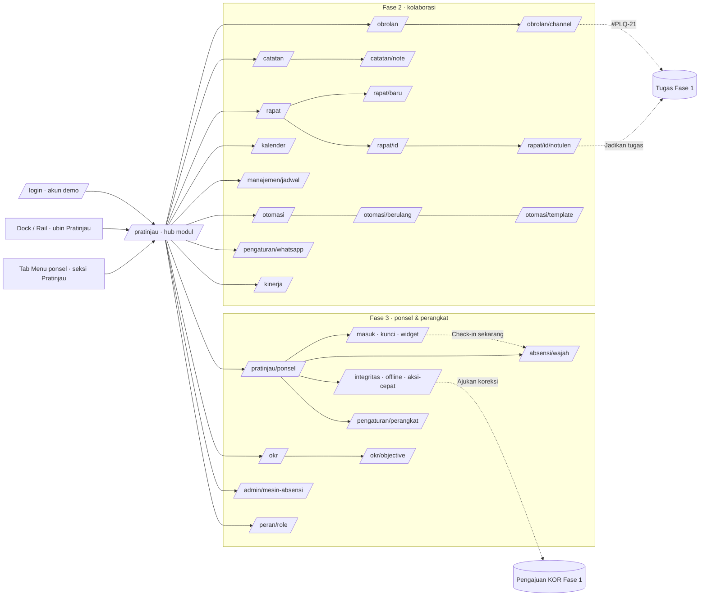

# Fitur & pratinjau Fase 2 dan 3

> **Status per 6 Okt 2026 (keputusan pemilik):** Obrolan **Nyata** (`FEATURE_CHAT`). **Akan dibangun** dengan backend nyata: Rapat & notulen, Kalender & jadwal manajemen, Catatan bersama, Otomasi (aturan, tugas berulang, template), Kinerja saya, OKR divisi. **Nyata** juga: Dashboard per jabatan (`FEATURE_ROLE_DASHBOARDS`). **Ditahan** (tidak dikerjakan sampai pemilik membuka lagi): notifikasi WhatsApp + pemilihan provider, Aplikasi ponsel, Mesin fingerprint, login Google, Google Drive & Docs, serta semua hal yang belum ada sama sekali. Panduan pemakaian lengkap (apa yang sudah ada, apa yang belum, cara memakai, kebutuhan): **[PANDUAN-PRATINJAU.md](PANDUAN-PRATINJAU.md)**, juga dibaca di aplikasi lewat **Pratinjau › Panduan pratinjau** (`/pratinjau/panduan`, dengan gambar).

> Status per 6 Okt 2026 · worktree `claude/project-overview-status-ebff38` · dibangun lima agen frontend (A–E), diperiksa Agen Cek Bug (`docs/sprints/fase-2-3-prototipe/BUG-REPORT.md`).

Folder ini menjelaskan **alur frontend Fase 2 dan Fase 3** RuangKerja yang sudah bisa dicoba di browser sebagai **pratinjau** (prototipe). Setiap layar memakai **data contoh** di frontend dan tidak menyimpan apa pun ke server. Backend Fase 2/3 (migrasi, Action, Policy, job, integrasi Google/WhatsApp/Hocuspocus/ADMS) **belum dibangun**. Setiap dokumen modul menutup dengan checklist pekerjaan backend agar tim tinggal mengirim props yang bentuknya sama dengan data contoh.

> **Pembaruan 6 Okt 2026 (malam):** semua modul "Akan dibangun" sudah **Nyata** dengan backend, data tersimpan, dan flag sendiri (nyala lokal, mati produksi): Catatan bersama (`FEATURE_NOTES`, server kolaborasi `collab/`), Rapat, notulen & kalender (`FEATURE_MEETINGS`), Otomasi + Kinerja saya (`FEATURE_AUTOMATION`), OKR (`FEATURE_OKR`), Dashboard per jabatan (`FEATURE_ROLE_DASHBOARDS`). Cara pakai terbaru ada di dokumen modulnya ([catatan](catatan.md), [rapat-kalender](rapat-kalender.md), [otomasi-whatsapp](otomasi-whatsapp.md), [okr](okr.md), [dashboard-peran](dashboard-peran.md)); seksi §4 di bawah masih menggambarkan masa pratinjau. Yang tetap pratinjau & **ditahan**: WhatsApp, aplikasi ponsel, mesin fingerprint. Fitur baru permintaan pemilik (tanpa flag): [laporan harian](laporan-harian.md), [pengumuman](pengumuman.md), [hiring](hiring.md), [akun & kata sandi](akun-kata-sandi.md), [dashboard pimpinan](dashboard-pimpinan.md), [staf: pengajuan & workspace](staf-pengajuan-workspace.md).

## 1. Apa itu pratinjau

| Hal | Keputusan |
|---|---|
| Tujuan | Menyepakati alur, tata letak desktop & ponsel, teks, dan bentuk data **sebelum** backend dibangun. Pemilik produk dan pengguna kunci bisa mencoba langsung. |
| Data | `resources/js/features/<modul>/fixtures.ts`, dengan tipe di `features/<modul>/types.ts` yang mengikuti tabel `docs/DATABASE.md` §7 (Fase 2) dan §8 (Fase 3). Hari ini di data contoh = **Senin, 5 Okt 2026**. Persona: Dimas (Kepala Divisi Operasional), Hana (HR), Hendra (Direktur Utama), Rizky/Sari/Maya (anggota). |
| Interaksi | Kirim, simpan, pindah, setujui = state lokal di klien + `useFakeMutation` (jeda ±600 ms lalu toast). Muat ulang halaman = kembali ke data contoh. |
| Penanda | Setiap layar menampilkan `PrototypeBanner`: *"Pratinjau Fase 2 · data contoh, perubahan tidak disimpan"*. |
| Keadaan | Setiap layar bisa dilihat dalam keadaan **Normal · Memuat · Kosong · Galat** lewat pengalih di samping banner atau query `?keadaan=memuat|kosong|galat`. |
| Rute | `routes/prototype.php` (`Route::inertia`, tanpa controller), dilindungi `EnsurePrototypeEnabled` + `auth` + `verified`. |
| Navigasi | Hub **`/pratinjau`** (`pages/prototype/hub.tsx`, daftar modul di `features/prototype/modules.ts`), ubin "Pratinjau" di Dock/Rail, dan seksi "Pratinjau" di tab Menu ponsel. |

### Cara menyalakan

Flag fitur `prototype` di `config/features.php`:

```php
'prototype' => (bool) env('FEATURE_PROTOTYPE', env('APP_ENV', 'production') !== 'production'),
```

- **Lokal/staging:** menyala otomatis (`APP_ENV` bukan `production`). `.env.example` sudah berisi `FEATURE_PROTOTYPE=true`.
- **Produksi:** **mati** kecuali `FEATURE_PROTOTYPE=true` diisi dengan sengaja. Saat mati, semua rute pratinjau menjawab **404** dan ubin Dock/baris Menu disembunyikan (prop bersama `features.prototype` dari `HandleInertiaRequests`).
- Setelah mengubah `.env`: `php artisan config:clear`.

### Cara mencoba

1. Buka **https://ruangkerja-proto.test/pratinjau** (worktree pratinjau) atau **https://ruangkerja.test/pratinjau** setelah digabung ke `main`.
2. Masuk lewat **Masuk cepat (demo lokal)** di `/login`. Sandi semua akun demo: `password`.

| Akun | Cocok untuk |
|---|---|
| `kadiv@demo.test` | Hampir semua modul (persona Dimas): Obrolan, Catatan, Rapat, Otomasi, Kinerja, Aplikasi ponsel, OKR |
| `direksi@demo.test` | `/manajemen/jadwal`, dashboard peran Direktur Utama & Direktur |
| `hr@demo.test` | `/admin/mesin-absensi`, dashboard peran HR |
| `admin@demo.test` | Admin › Dokumentasi (membaca dokumen ini di aplikasi) |

Catatan: persona di data contoh **tetap** (mis. Obrolan selalu dilihat sebagai Dimas) apa pun akun yang masuk. Akun hanya menentukan shell (Dock, izin rute Fase 1).

3. Ubah lebar jendela untuk melihat tiga shell: ≥ 1024 px (MenuBar + Dock), 768–1023 px (Rail), < 768 px (app bar + tab bar). Ganti tema sistem untuk mode Malam.

## 2. Modul

| Modul | Sprint | Rute | Dokumen |
|---|---|---|---|
| Obrolan (channel, DM, grup, thread) · **Nyata** | F2-1 | `/obrolan`, `/obrolan/{channel}` | [obrolan.md](obrolan.md) |
| Catatan bersama (Tiptap + Yjs) · **Akan dibangun** | F2-2 | `/catatan`, `/catatan/{note}` | [catatan.md](catatan.md) |
| Rapat, notulen & kalender (Google Calendar & Meet) · **Akan dibangun** | F2-3 | `/rapat`, `/rapat/baru`, `/rapat/{id}`, `/rapat/{id}/notulen`, `/kalender`, `/manajemen/jadwal` | [rapat-kalender.md](rapat-kalender.md) |
| Otomasi, tugas berulang, template, Kinerja saya · **Akan dibangun**; WhatsApp · **Ditahan** | F2-4 | `/pengaturan/whatsapp`, `/otomasi`, `/otomasi/berulang`, `/otomasi/template`, `/kinerja` | [otomasi-whatsapp.md](otomasi-whatsapp.md) |
| Aplikasi ponsel (biometrik, wajah, integritas, offline, widget) · **Ditahan** | F3-1 · F3-2 | `/pratinjau/ponsel/*`, `/absensi/wajah`, `/pengaturan/perangkat` | [aplikasi-ponsel.md](aplikasi-ponsel.md) |
| OKR divisi · **Akan dibangun** | F3-3 | `/okr`, `/okr/{objective}` | [okr.md](okr.md) |
| Mesin fingerprint ZKTeco (ADMS) · **Ditahan** | F3-3 | `/admin/mesin-absensi` | [mesin-fingerprint.md](mesin-fingerprint.md) |
| Dashboard per jabatan SPKD · **Nyata** (`FEATURE_ROLE_DASHBOARDS`) | SPKD | `/peran/{dirut,direktur,hr,corsec,marketing,programming,implementer,analis}` | [dashboard-peran.md](dashboard-peran.md) |

Gambar di setiap dokumen ada di `docs/fitur/img/<modul>/` dengan pola `<layar>-desktop.jpg` (1440×900 terang), `<layar>-desktop-malam.jpg` (1440×900 Malam), dan `<layar>-ponsel.jpg` (390×844, skala 2). Semua dibuat ulang dengan:

```bash
node scripts/docs-screenshots.mjs                 # semua modul
node scripts/docs-screenshots.mjs obrolan,okr     # sebagian
DOCS_BASE_URL=https://ruangkerja.test node scripts/docs-screenshots.mjs
```

Skrip masuk sekali per akun demo (mengulang bila kena batas laju 429), lalu memotret setiap layar dan keadaan penting (dialog, sheet, thread, langkah liveness). Aplikasi harus berjalan dari aset build terbaru (`npm run build`).

## 3. Peta alur keseluruhan



## 4. Pola kode bersama

| Bagian | Lokasi | Catatan |
|---|---|---|
| Rute pratinjau | `routes/prototype.php` | `Route::inertia` / closure yang meneruskan id dari URL (`channelId`, `noteId`, `meetingId`, `objectiveId`, `role`). Saat backend siap, ganti dengan controller yang mengirim props sesuai `types.ts`. |
| Flag | `config/features.php`, `app/Http/Middleware/EnsurePrototypeEnabled.php` | 404 saat mati. |
| Kit bersama | `resources/js/features/prototype/` | `PrototypeBanner`, `useFakeMutation` (aksi simpan palsu + toast + `processing`), `modules.ts` (isi hub). |
| Halaman | `resources/js/pages/<modul>/*.tsx` | Pola `pages/manajemen/dashboard.tsx`: `useBreakpoint()` memilih `*.desktop.tsx` / `*.mobile.tsx` (null = skeleton), `Page.layout = { breadcrumbs, title, back?, width? }`. |
| Fitur | `resources/js/features/<modul>/` | `types.ts` (bentuk props), `fixtures.ts` (data contoh), `lib.ts`/`logic.ts` (fungsi murni + test Vitest), hook data bersama desktop & ponsel, komponen tampilan. |
| Keadaan pratinjau | `features/<modul>/preview-state.tsx` atau `preview.ts` | Membaca `?keadaan=` dari `usePage().url` (aman SSR). |
| Uji | `features/<modul>/*.test.ts` (Vitest, logika murni), `tests/e2e/prototype-smoke.spec.ts` (Playwright: 36 rute × 6 proyek) | `npx vp test run resources/js/features/<modul>`; e2e: `E2E_BASE_URL=https://ruangkerja-proto.test npx playwright test tests/e2e/prototype-smoke.spec.ts --workers=2 --retries=1`. |

Tidak ada paket npm baru untuk pratinjau: Tiptap, Radix, recharts, sonner, lucide, dan `@zxing`/`useCamera` yang sudah terpasang dipakai ulang. Tidak ada hex/rgb di `.tsx` (dijaga `resources/js/lib/color-tokens.test.ts`).

## 5. Batasan prototipe

- **Tidak ada persistensi.** State hidup di klien (modul store `useSyncExternalStore` di Obrolan/Catatan, state halaman di modul lain). Muat ulang = data contoh. Channel/catatan baru yang dibuka setelah muat ulang tampil "tidak ditemukan".
- **Tidak ada realtime sungguhan.** "Sedang mengetik", balasan otomatis, kursor kolaborator, dan "ikut mengedit" disimulasikan dengan timer.
- **Tidak ada integrasi eksternal.** Google Meet/Calendar, Picker Drive, WhatsApp, kamera wajah (hanya bila izin kamera diberikan), Play Integrity, dan mesin ZKTeco semuanya tiruan.
- **Persona tetap** per modul (lihat tabel akun). Hak akses per peran belum ditegakkan; semua karyawan yang masuk bisa membuka semua rute pratinjau.
- Rute pratinjau **tidak** masuk Admin › Dokumentasi sebagai tautan aktif; di Admin › Dokumentasi gambar tampil sebagai teks alt (lihat catatan di bawah). Di **Pratinjau › Panduan pratinjau** (`/pratinjau/panduan/fitur`) dokumen yang sama tampil dengan gambar.
- Bug terbuka yang diketahui: `docs/sprints/fase-2-3-prototipe/BUG-REPORT.md` §3.

> **Catatan Admin › Dokumentasi.** `DocumentRenderer` sengaja mengganti gambar dengan teks alt-nya (gambar repo tidak disajikan dan tidak ada permintaan ke host lain) dan menampilkan diagram Mermaid sebagai blok kode. Untuk melihat gambar, buka dokumen ini lewat `/pratinjau/panduan` (semua karyawan, flag `prototype` nyala; gambar `docs/fitur/img` disajikan rute `prototype.guide.image` yang memvalidasi path). Diagram Mermaid hanya tampil di GitHub/editor Markdown.
