# Catatan bersama (F2-2)

> **Status:** **Akan dibangun** (keputusan pemilik 6 Okt 2026): backend nyata dikerjakan berikutnya; dokumen ini menjelaskan keadaan pratinjau saat ini. Panduan pemakaian: [PANDUAN-PRATINJAU.md](PANDUAN-PRATINJAU.md).
>
> Pratinjau Fase 2 · dibangun Agen A · rute `/catatan`, `/catatan/{note}` · data contoh, tidak menyimpan apa pun. Indeks: [README](README.md).

## 1. Tujuan & masalah

SOP, wiki ringan, checklist onboarding, dan notulen singkat sekarang ditulis di Google Docs terpisah atau pesan WhatsApp, sehingga sulit dicari dari workspace. **Catatan bersama** adalah editor ringan di dalam workspace yang:

- bisa **diedit bersamaan** (kursor dan avatar penyunting lain terlihat, Tiptap + Yjs + Hocuspocus di produksi);
- tersusun sebagai **pohon induk/anak** per workspace;
- menyimpan **riwayat versi** yang bisa dipratinjau dan dipulihkan;
- punya pengaturan **berbagi** (seluruh workspace atau hanya orang yang diundang, peran Menyunting/Membaca).

Dokumen formal tetap Google Docs (ADR #6 di `docs/ARCHITECTURE.md`).

## 2. Peran yang memakai

Semua anggota workspace (membaca & menyunting sesuai akses). Pemilik/admin workspace mengatur berbagi. Di pratinjau penonton = Dimas Pratama.

## 3. Layar

### Daftar catatan · `/catatan`

Panel per workspace dengan pohon induk/anak (bisa diciutkan), pencarian judul/isi (induk tetap tampil agar konteks tidak hilang), filter workspace (Select di desktop, chip di ponsel), panel "Sedang disunting" dan "Baru diubah".

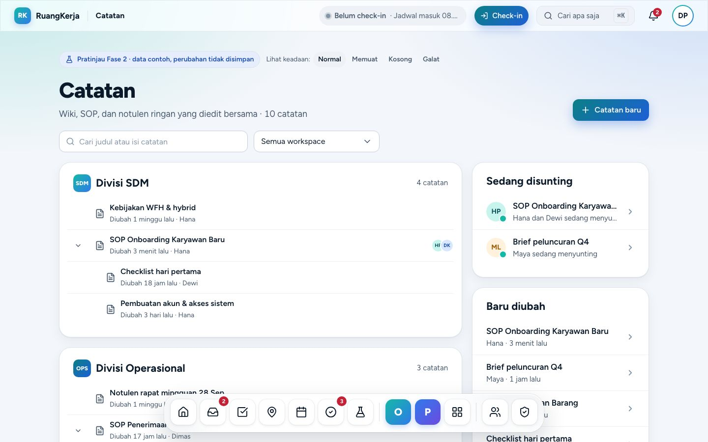

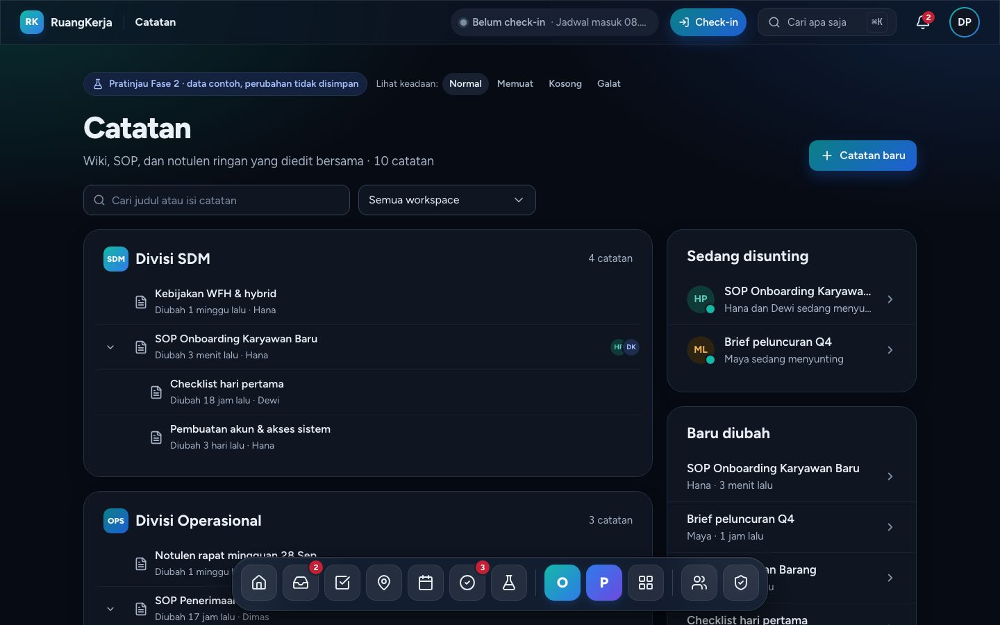

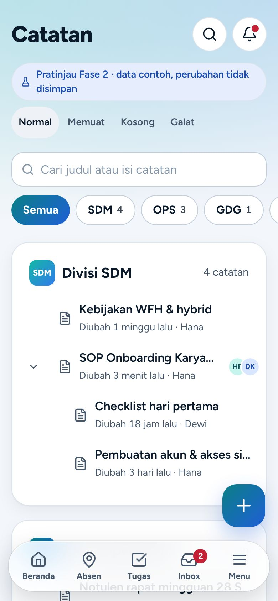

"Catatan baru" meminta judul (wajib), workspace, dan induk opsional, lalu membuka editor.

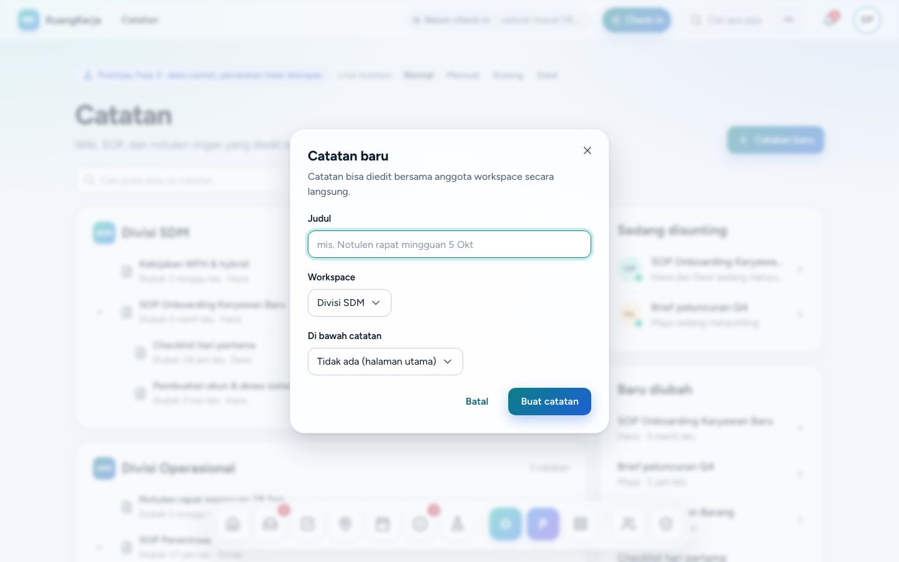

### Editor · `/catatan/{note}`

Pohon workspace di kiri (≥ 1280 px), lokasi `workspace › induk`, avatar Hana & Dewi berbingkai warna kursornya, kursor "Hana" dan sorotan "Dewi" yang bergerak, status simpan otomatis ("Menyimpan…" → "Tersimpan · baru saja"), toolbar Urungkan/Ulangi/H2/H3/B/I/daftar/bernomor/checklist/kutipan/kode. Contoh id: `sop-onboarding`, `checklist-hari-pertama`, `akun-sistem`, `kebijakan-wfh`, `sop-penerimaan`, `format-surat-jalan`, `notulen-ops-28-sep`, `panduan-shift`, `brief-peluncuran`, `notulen-kickoff`.

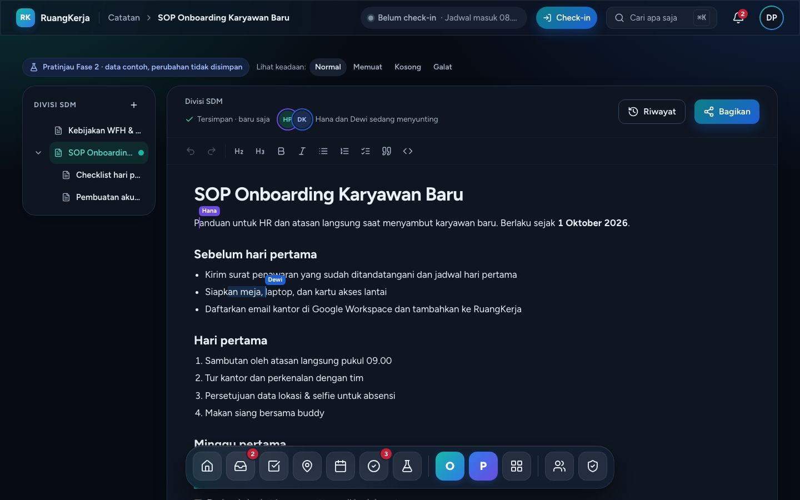

Ponsel: editor layar penuh, app bar berisi Riwayat & Bagikan, toolbar format menempel di atas tab bar (atau di atas keyboard saat terbuka).

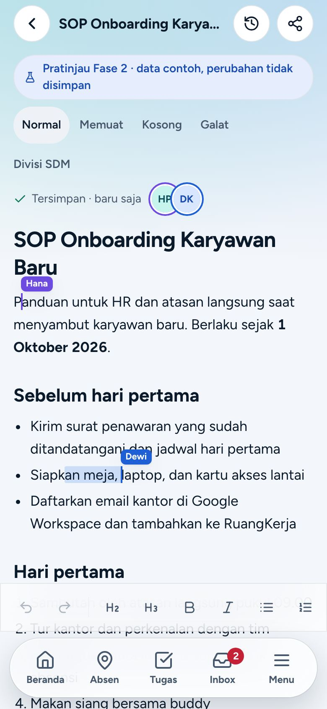

### Riwayat versi

Daftar versi (terbaru berlabel "Versi saat ini") → pilih versi → pratinjau baca-saja → "Pulihkan versi ini" (dialog konfirmasi). Di ponsel berupa bottom sheet (daftar → pratinjau → Pulihkan / kembali ke Daftar).

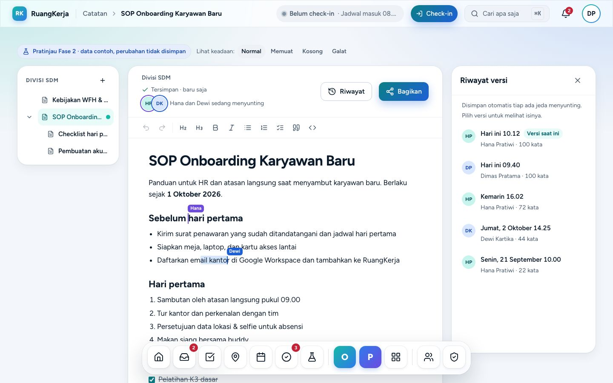

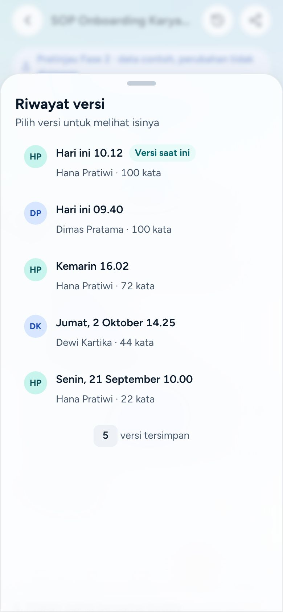

### Bagikan

Akses umum (Workspace / Hanya diundang), peran per orang (Menyunting/Membaca/Hapus akses), undang orang, Salin tautan, Simpan akses.

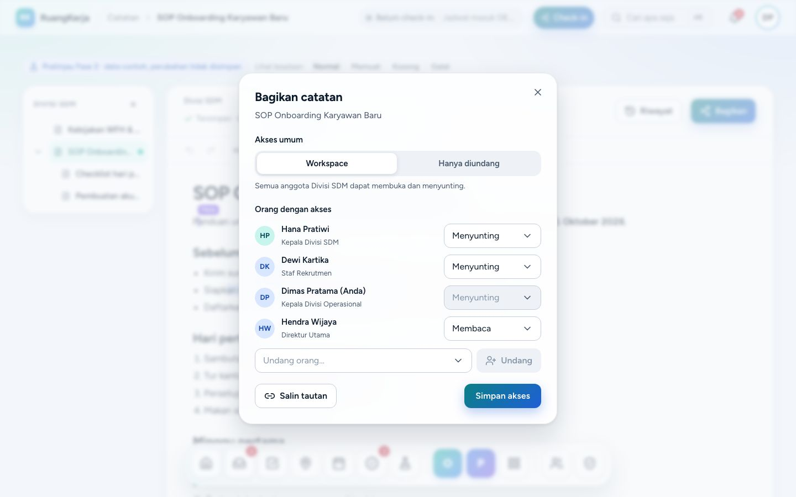

## 4. Alur langkah demi langkah

1. `/catatan` → cari judul atau pilih workspace → buka catatan `sop-onboarding` (SOP onboarding).
2. Ketik di isi → label berubah "Menyimpan…" → "Tersimpan · baru saja" → "Tersimpan · N dtk lalu". Enter di judul memindahkan fokus ke isi.
3. Perhatikan kursor Hana dan sorotan Dewi bergerak tiap ±2 detik (diam bila `prefers-reduced-motion`).
4. **Riwayat** → pilih "Kemarin 16.02" → pratinjau → **Pulihkan versi ini** → konfirmasi → isi diganti, versi baru "Dipulihkan dari versi sebelumnya" muncul + toast.
5. **Bagikan** → ubah akses ke "Hanya diundang", ubah peran seseorang ke Membaca atau undang orang baru → **Simpan akses** (mutasi tiruan + toast).
6. Kembali ke `/catatan` → **Catatan baru** → judul + workspace + induk → editor terbuka.

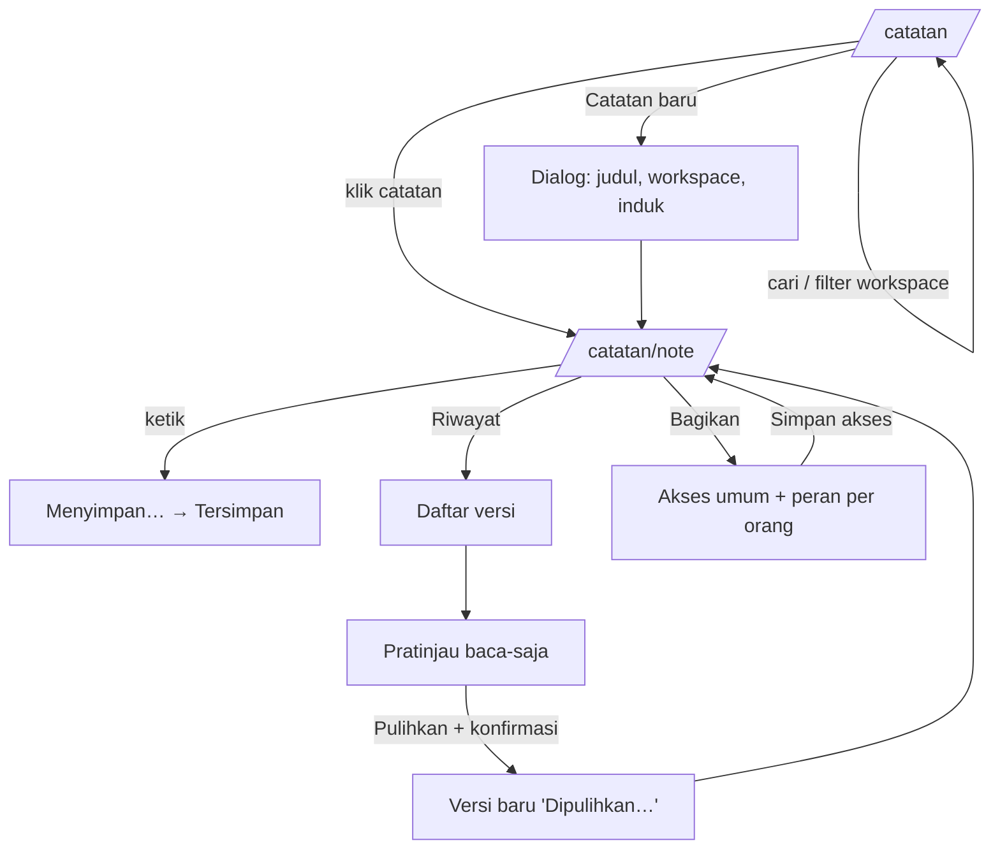

Alur backend nanti (sunting bersama):

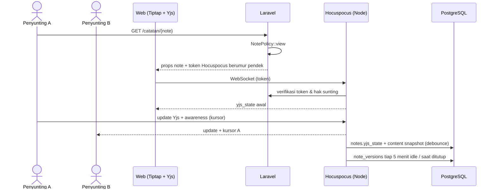

## 5. Penjelasan kode

| File | Peran |
|---|---|
| `resources/js/pages/notes/index.tsx`, `pages/notes/show.tsx` | Halaman Inertia; `show` menerima prop `noteId`. |
| `features/notes/types.ts` | `NotePerson`, `NoteWorkspace`, `Note` (`content` = snapshot JSON dokumen Yjs), `NoteVersion`, `NoteShare`, `NotesState` (+ `activeEditors` untuk presence). |
| `features/notes/fixtures.ts` | `NOTE_PEOPLE`, `NOTE_WORKSPACES`, `NOTES` (10 catatan bertingkat), `NOTE_VERSIONS`, `NOTE_SHARES`, `initialNotesState()`. |
| `features/notes/store.ts` | Store modul: `useNotesState`, `updateNote`, `snapshotVersion`, `restoreVersion`, `createNote`, `saveShare`, `shareFor`, `resetNotesState`. |
| `features/notes/use-note-session.ts` | Hook bersama editor desktop & ponsel: catatan aktif, simpan otomatis (debounce), label simpan, penyunting aktif. |
| `features/notes/lib.ts` (+ `lib.test.ts`, 11 test) | `buildTree`/`flattenTree` (pencarian menyertakan induk, induk hilang, ciutkan), `docText`/`wordCount`, `ancestors`, `savedLabel`, `canEdit`, `cursorAt`, `editorsLabel`. |
| `features/notes/collab-cursors.ts` | Ekstensi ProseMirror `CollabCursors`: widget/inline decoration berwarna token (`fill-violet`, `accent-blue-strong`, `primary`). Posisinya diumpan timer dengan meta transaksi (`addToHistory: false`), siap diganti Yjs awareness. |
| `features/notes/note-editor.tsx`, `note-parts.tsx` | Editor Tiptap + toolbar. Skala judul lewat utilitas varian Tailwind pada pembungkus (`NOTE_PROSE`/`NOTE_PROSE_VIEW`) tanpa mengubah `rich-text.css` bersama. Fokus ke isi lewat callback berbasis ref (React Compiler tidak membaca `editor.commands` saat render). |
| `note-tree.tsx`, `notes-index.tsx` (satu komponen dengan prop `mobile`), `note.desktop.tsx`, `note.mobile.tsx`, `version-history.tsx`, `share-dialog.tsx`, `new-note-dialog.tsx` | Tampilan. Tombol app bar ponsel (Riwayat/Bagikan) memakai store mikro di `note.mobile.tsx`. |

Keadaan pratinjau memakai `features/notes/preview-state.tsx` (`PreviewBar`: Normal · Memuat · Kosong · Galat).

## 6. Bentuk data → tabel DATABASE.md

| Tipe frontend | Tabel | Catatan |
|---|---|---|
| `Note` | `notes` (`workspace_id`, `parent_id`, `title`, `yjs_state` bytea, `content` jsonb snapshot, `created_by`, `updated_by`) | `yjs_state` tidak pernah dikirim ke klien Inertia |
| `NoteVersion` | `note_versions` (`note_id`, `yjs_state`, `created_by`, `created_at`) | `title`/`content`/`label` diturunkan untuk pratinjau; **kolom `label` belum ada di DATABASE.md** |
| `NoteShare` | **belum ada**: usul `notes.access` (`workspace`/`restricted`) + `note_shares` (`note_id`, `user_id`, `role` edit/view) | Perlu diputuskan & ditulis di DATABASE.md |
| `activeEditors` | awareness Hocuspocus (tidak disimpan) | |

## 7. Pekerjaan backend tersisa

- [ ] Migrasi `notes`, `note_versions` (§7) + keputusan berbagi (`notes.access`, `note_shares`), perbarui `docs/DATABASE.md`.
- [ ] `NotePolicy` (anggota workspace; "hanya diundang" membaca `note_shares`; workspace pribadi hanya pemilik) + scope `visibleTo`.
- [ ] Server **Hocuspocus** (Node) di `compose.prod.yml`: autentikasi token dari Laravel (endpoint token berumur pendek per catatan), persistensi Yjs ke `notes.yjs_state` + snapshot `content`/teks untuk pencarian, snapshot `note_versions` berkala (mis. 5 menit idle) dan saat ditutup, awareness untuk kursor (menggantikan `CollabCursors` versi timer).
- [ ] Actions: `CreateNote`, `MoveNote` (ubah induk, cegah siklus), `RestoreNoteVersion` (tulis versi baru + broadcast ke Hocuspocus), `UpdateNoteShare` (+ `audit_logs`), `DeleteNote` (soft delete/arsip).
- [ ] Pencarian catatan di command palette (⌘K).
- [ ] Test Pest: matriks Policy, pemulihan versi, siklus induk ditolak, akses "hanya diundang".

## 8. Keadaan kosong/galat & aksesibilitas

- `?keadaan=memuat|kosong|galat` lewat `PreviewBar`; catatan tak dikenal = "Catatan tidak ditemukan"; hasil pencarian kosong punya pesan sendiri.
- Pohon memakai tombol ciutkan dengan `aria-expanded`; chevron 120 ms `ease-brand`.
- Kursor kolaborator diam saat `prefers-reduced-motion`. Warna kursor dari token, dengan label nama (bukan warna saja).
- Ponsel: toolbar format bergulir ke samping, target ≥ 44 px, judul catatan diperbesar (ukuran di-*override* inline karena aturan global input 17 px).

## 9. Batasan prototipe

- Kursor kolaborator hanya bergerak antarposisi; tidak ada simulasi orang lain mengetik.
- Versi baru hanya dibuat saat memulihkan; menyunting biasa tidak menambah riwayat.
- Tidak ada menu perintah `/`, tidak ada mention di catatan, catatan baru hilang saat muat ulang.
