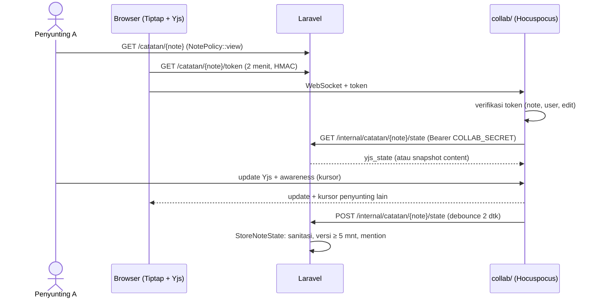

# Catatan bersama (F2-2)

> **Status: Nyata** (Okt 2026) · flag `FEATURE_NOTES` (nyala lokal, mati produksi) · rute `/catatan`, `/catatan/{note}`, tab `/w/{key}/catatan` · server kolaborasi `collab/` (Hocuspocus + Yjs). Indeks: [README](README.md).

## 1. Tujuan

SOP, wiki ringan, checklist onboarding, notulen singkat, dan catatan pribadi ditulis di dalam workspace, bisa **disunting bersamaan** (kursor penyunting lain terlihat), tersusun dalam **folder** dan sub-catatan, punya **riwayat versi**, dan pengaturan **berbagi**. Dokumen formal tetap Google Docs (ADR #6).

## 2. Siapa melihat apa

| Catatan | Membaca | Menyunting | Mengatur akses / menghapus |
|---|---|---|---|
| Workspace **pribadi** | hanya pemilik | pemilik | pemilik (tanpa berbagi) |
| `access = workspace` | semua yang bisa membuka workspace (anggota, workspace internal, Direksi) | anggota owner/admin/member | penulis atau admin/owner workspace |
| `access = restricted` ("Hanya diundang") | penulis + orang yang diundang | penulis + undangan "Menyunting" | penulis atau admin/owner workspace yang bisa membukanya |

- Undangan (`note_shares`) mengalahkan peran workspace untuk catatan itu (mis. anggota diturunkan ke "Membaca").
- Direksi, HR, Super Admin **tidak** otomatis melihat catatan "Hanya diundang". Tidak terlihat = 404.
- Workspace diarsipkan → baca saja. Mengubah akses dicatat di `audit_logs` (`note.share_updated`) dan memutus sesi penyuntingan yang sedang terbuka agar semua tersambung ulang dengan hak baru.

## 3. Layar & alur

### Catatan pribadi (alur paling sederhana)
1. Buka workspace **Pribadi** (Dock › Workspace › Pribadi, atau Menu di ponsel) → tab **Catatan** (`/w/{key}/catatan`).
2. **Folder baru** → judul → folder muncul di atas daftar (toast "Folder … dibuat").
3. Menu "…" pada folder → **Catatan baru di sini** (atau tombol **Catatan baru**, pilih letak folder) → editor terbuka.
4. Ketik → label "Menyimpan…" → "Tersimpan · baru saja". Muat ulang: isi tetap ada.

Ponsel: tombol bulat (FAB) membuka lembar bawah "Catatan baru" dengan pilihan Catatan/Folder; menu "…" per baris untuk folder/catatan.

### Daftar `/catatan`
Panel per workspace (judul panel menaut ke tab Catatan workspace itu) dengan pohon folder/catatan, pencarian judul + isi di server (`?q=`, full-text `simple` + judul), filter workspace (Select desktop, chip ponsel), "Baru diubah", tombol Folder baru / Catatan baru.

### Editor `/catatan/{note}`
Pohon workspace di kiri (≥ 1280 px), lokasi `workspace › folder`, status simpan, "Tersambung · N orang" + avatar berbingkai warna kursor penyunting lain, toolbar format, judul (disimpan sendiri, ~0,7 dtk setelah berhenti mengetik), isi. Tombol **Riwayat**, **Bagikan** (bila boleh), menu "…" (Pindahkan, Hapus). Ponsel: app bar Riwayat/Bagikan/Aksi, toolbar menempel di atas tab bar/keyboard.

- **Riwayat**: daftar versi (dimuat saat panel dibuka) → pratinjau baca-saja → **Pulihkan versi ini**. Isi sekarang disimpan dulu sebagai versi, lalu versi berlabel "Dipulihkan dari versi …"; server kolaborasi mengganti isi dokumen yang terbuka sehingga semua penyunting langsung melihatnya.
- **Bagikan**: akses umum (Workspace / Hanya diundang), undang orang, peran Menyunting/Membaca/Hapus akses, Salin tautan.
- **@mention**: sebut orang workspace; hanya orang yang bisa membuka catatan yang mendapat mention + notifikasi (sekali per catatan).
- **Mode tanpa kolaborasi**: bila server kolaborasi tidak diatur atau tidak tersinkron dalam 5 detik, banner muncul dan editor menyimpan langsung (`PATCH /catatan/{note}/isi`) dengan kunci `updated_at`; bila orang lain menyimpan lebih dulu → 409 + banner "Muat ulang".
- ⌘K: grup **Catatan** (hanya catatan yang boleh dibuka).
- Tampilan dirampingkan 9 Okt 2026: lihat **Editor minimalis** di bawah (status & aksi pindah ke ikon app bar / lembar / dropdown; toolbar format auto-hide).

### Notulensi cepat (keputusan pemilik 6 Okt 2026)

Untuk mencatat secepat mungkin, termasuk saat mendesak. Notulensi = **catatan biasa** di workspace **Pribadi** (bisa dipindah atau dibagikan kemudian).

1. **Mulai notulensi** ada di header semua dashboard (Saya, Divisi, HR, Direksi, `/manajemen`; ponsel: tombol 52px di bawah kartu absensi/judul) dan di ⌘K (aksi cepat). Satu ketukan membuat catatan berjudul `Notulensi · Selasa, 06/10/2026 14.05` (waktu kantor) dengan templat: Tanggal & jam, Peserta, Agenda, Pembahasan, Keputusan, Tindak lanjut (checklist), lalu membukanya dalam **mode catat** (`/catatan/{id}?mode=catat`; parameter dihapus dari URL setelah dibaca). Menu ▾ di sebelahnya (ponsel: tombol riwayat) memuat **Notulensi terakhir** (3 terbaru, dimuat saat dibuka: `GET /catatan/notulensi`).
2. **Tab & sub-tab** ala Google Docs: dokumen = catatan induk, **tab** = catatan anak, **sub-tab** = cucu (maks. 2 tingkat di UI; data memakai `parent_id`). Desktop ≥ 1024: panel kiri "Tab dokumen" (+ tab "Workspace" berisi pohon lama di ≥ 1280) atau dropdown di header (editor minimalis 9 Okt); tablet: panel bisa diciutkan; ponsel: tombol daftar di app bar → lembar "Tab dokumen" (Tab baru, Sub-tab, Ganti nama, Hapus; strip chip di bawah app bar dihapus 9 Okt — lihat "Editor minimalis"). Menghapus tab kembali ke dokumen di atasnya (`?kembali=induk`); sub-tab-nya naik satu tingkat.
3. **Warna teks & stabilo**: tombol di toolbar membuka palet (nama palet `lib/palette.ts`, warna dari `--tag-*` sehingga ikut mode terang/Malam), plus "Warna bawaan/Tanpa stabilo" dan "Hapus warna". Ctrl/⌘ + Shift + H = stabilo terakhir. Disimpan sebagai mark `textColor`/`highlight` (hanya nama palet; server membuang nilai lain).
4. **Ukuran huruf**: A− / 100% / A+ (90–160%, langkah 10%) hanya untuk isi editor catatan, diingat per perangkat (`localStorage rk.notes.scale.v1`). Ukuran dasar per perangkat: ponsel 17px, tablet 18px, desktop 17px. Desktop: Ctrl/⌘ + Alt + `=` / `-` / `0`. Ponsel: tombol "Aa" di toolbar atau lembar "Tab dokumen" › Ukuran huruf → lembar "Tampilan teks" (sejak editor minimalis 9 Okt; sebelumnya Aksi catatan).
5. **Mode catat** (`localStorage rk.notes.session.v1`, per pengguna, sinkron antar-tab peramban):
   - pita "Mode catat aktif" + **Selesai mencatat** di editor — satu-satunya cara keluar (konfirmasi, simpan paksa judul/isi dulu); sejak editor minimalis 9 Okt pita diganti sakelar mode catat yang tonal saat aktif di app bar/header;
   - pil melayang **"Notulensi berjalan · {judul} · Kembali"** di semua halaman lain (desktop di atas Dock, tablet kanan bawah, ponsel di atas tab bar, tanpa tombol tutup) → kembali ke tab terakhir yang dibuka;
   - membuka menu **Catatan** (`/catatan`, dari Dock/Rail/Lainnya) langsung kembali ke notulensi aktif (pencarian `?q=` tetap menampilkan daftar);
   - tombol **Mode catat** di editor memulai mode untuk catatan lain (bila tidak ada notulensi berjalan);
   - catatan aktif dihapus atau aksesnya hilang (404/403) → mode berakhir otomatis dengan pesan.

### Editor minimalis (9 Okt 2026)

Keputusan pemilik 9 Okt 2026: layar editor dirampingkan supaya fokus menulis — informasi status dipindah ke ikon/tempat tersembunyi, bukan baris-baris di atas isi.

- **Ponsel — app bar hanya judul + 3 ikon**:
  1. **Status simpan/online gabungan**: satu ikon (`SaveStatusIcon`: awan berputar saat menyambung/menyimpan, awan centang hijau saat tersimpan & tersambung, segitiga peringatan untuk luring/konflik). Mengetuknya membuka lembar bawah detail: baris status simpan, baris koneksi, daftar **Penyunting lain** dengan avatar berbingkai warna kursor, dan aksi "Muat ulang" saat konflik.
  2. **Tab dokumen**: tombol daftar membuka lembar **"Tab dokumen"** (`DocumentTabsSheet`) untuk pindah/buat tab & sub-tab, plus baris aksi catatan: Riwayat versi, Bagikan, Ukuran huruf, Pindahkan, Hapus catatan.
  3. **Mode catat**: sakelar ikon pena-buku (`MinutesModeIconButton`), tonal saat aktif; mengetuk saat aktif membuka konfirmasi **Selesai mencatat**.

  Baris **SaveStatus**, **presence** ("Tersambung · N orang" + avatar), **NotePath**, **strip tab dokumen**, dan **pita mode catat** dihapus dari alur konten — sisanya murni judul dan isi.
- **Toolbar format auto-hide**: muncul saat ada seleksi atau editor difokuskan, menyembunyikan diri ±1,8 dtk (±1.800 ms, `TOOLBAR_IDLE_MS`) setelah aktivitas terakhir atau saat blur (keyboard ditutup); seleksi yang belum dilepas menahannya tetap tampil. Pengganjal setinggi toolbar menjaga caret tak tertutup; transisi `duration-180 ease-brand` menghormati `prefers-reduced-motion`. Ponsel: menempel di atas tab bar/keyboard; desktop: sticky di bawah MenuBar.
- **Desktop — header satu baris ramping**: lokasi catatan ringkas (`NotePath` compact) + ikon status (popover detail yang sama dengan ponsel) + dropdown tab dokumen + sakelar mode catat + menu "…" (Riwayat versi, Bagikan, Pindahkan, Hapus). Toolbar format sticky auto-hide. Panel kiri (tab dokumen/Workspace) dan panel kanan Riwayat **tetap**.
- **Ukuran huruf**: tombol "Aa" di toolbar (ponsel membuka lembar "Tampilan teks"); pintasan Ctrl/⌘ + Alt tetap berlaku.
- **Rencana dikte di mode catat**: [catatan-stt.md](catatan-stt.md).

Berkas kunci baru: `editor/toolbar-visibility.ts` + `toolbar-visibility.test.ts` (logika & hook visibilitas toolbar), `savePhase()` di `lib.ts` (status gabungan jadi satu fase: `syncing`/`saved`/`offline`/`conflict`), `SaveStatusIcon`/`SaveStatusDetail` di `note-parts.tsx`, `DocumentTabsSheet` di `document-tabs.tsx`, `MinutesModeIconButton` di `minutes-mode.tsx`.

## 4. Arsitektur

| Bagian | Berkas |
|---|---|
| Domain | `app/Domain/Notes/{Actions,Enums,Queries,Services,Notifications}` — `CreateNote`, `RenameNote`, `MoveNote`, `DeleteNote`, `UpdateNoteShare`, `StoreNoteState`, `SaveNoteContent`, `RestoreNoteVersion`, `SyncNoteMentions`; `CollabToken`, `CollabBridge`, `NoteContent`, `NoteAudience`; `NoteLibrary` |
| HTTP | `routes/notes.php`, `NoteController`, `WorkspaceNotesController`, `CollabStateController` (di luar grup web, `VerifyCollabSecret`, throttle 600/mnt) |
| Policy | `NotePolicy`, `NoteVersionPolicy`, `NoteSharePolicy` |
| Frontend | `resources/js/features/notes/*` (`use-collab.ts` = HocuspocusProvider + awareness, `use-note-session.ts`, `note-editor.tsx` = Collaboration + CollaborationCaret, `tree-actions.tsx`, `workspace-notes.tsx`), `pages/notes/*`, `pages/workspaces/notes.tsx` |
| Server kolaborasi | `collab/src/{server,notes-extension,token,laravel,prosemirror}.js`, `collab/Dockerfile` |
| Notulensi | `StartQuickMinutes`, `QuickMinutesController` (`POST/GET /catatan/notulensi`), `NotePreset`; frontend `quick-minutes-button.tsx`, `document-tabs.tsx` (panel + `DocumentTabsSheet`), `minutes-session.ts` (store), `minutes-mode.tsx` (`MinutesModeIconButton`), `minutes-return-pill.tsx` (dipasang sekali di `layouts/app-layout.tsx`), `minutes-navigation.ts`, `note-scale.ts`, `editor/color-marks.ts`, `editor/toolbar-extras.tsx`, `editor/toolbar-visibility.ts` (toolbar auto-hide, editor minimalis 9 Okt) |
| Seeder | `NoteDemoSeeder` (SOP SDM + riwayat, OPS + satu catatan "Hanya diundang" untuk HR, GDG, PLQ, PRG, folder "Ide & draf" di Pribadi Dimas) |

Konfigurasi `config/collab.php`: `COLLAB_SECRET` (≥ 32 karakter, sama untuk Laravel & collab; kosong = mode tanpa kolaborasi), `COLLAB_PORT` (1234), `COLLAB_URL` (Laravel → collab, HTTP internal), `VITE_COLLAB_URL` (browser → collab, WebSocket; dibaca Laravel saat runtime dan dipakai juga di CSP `connect-src`).

## 5. Menjalankan server kolaborasi lokal

1. Sekali: `npm --prefix collab ci`.
2. Isi di `.env` (oleh pengguna sendiri): `COLLAB_SECRET=<acak ≥ 32 karakter>` (mis. `php -r "echo bin2hex(random_bytes(32));"`), `COLLAB_PORT=1234`, `COLLAB_URL=http://127.0.0.1:1234`, `VITE_COLLAB_URL=ws://127.0.0.1:1234`, lalu `php artisan config:clear`.
3. `composer run dev` (atau `dev:win`) sudah menjalankan `node --env-file-if-exists=.env collab/src/server.js`. Sendiri: `node --env-file-if-exists=.env collab/src/server.js`. Server membaca `APP_URL` untuk memanggil Laravel dan otomatis memercayai CA Herd untuk `https://*.test` (atau `COLLAB_CA_FILE`). Tanpa secret/paket ia hanya memberi peringatan dan diam (catatan tetap jalan dalam mode simpan biasa).
4. Cek: `curl http://127.0.0.1:1234/health` → `{"ok":true,…}`.
5. Docker (opsional): `docker compose --profile collab up -d collab` (butuh `COLLAB_APP_URL` yang terjangkau dari container).

### Uji dua sesi
- Buka catatan yang sama di dua jendela dengan akun berbeda (mis. jendela biasa `kadiv@demo.test` dan jendela penyamaran `anggota@demo.test` pada catatan OPS). Status menjadi "Tersambung · 2 orang", avatar penyunting lain berbingkai warna, kursor + label nama bergerak, ketikan muncul langsung di jendela lain, dan setelah ±2 detik tersimpan (muat ulang tetap ada).
- `viewer` workspace atau undangan "Membaca": editor baca-saja; server menolak perubahan dari koneksi itu.
- Otomatis: `node --test collab/test` (termasuk `integration.test.js`: server Hocuspocus nyata + Laravel tiruan + dua `HocuspocusProvider`, sinkron, baca-saja, token salah, endpoint ganti isi).

## 6. Produksi

Layanan `collab` di `compose.prod.yml` (profil `collab`, image `COLLAB_IMAGE` dari `collab/Dockerfile`), Caddy meneruskan `wss://domain/collab` ke layanan itu dan menolak `/internal/*` dari luar. Laravel ↔ collab lewat jaringan internal (`http://app:8000`, `http://collab:1234`).

## 7. Ditahan / belum

- Sematan gambar, video, dan berkas di catatan (fase berikutnya; struktur `notes.kind` siap diperluas).
- Presence di daftar `/catatan` ("Sedang disunting") — hanya di editor.
- Judul tidak ikut Yjs: penyunting lain melihat judul baru setelah memuat ulang.
- Memindah catatan antar-workspace.
- Pencabutan akses memutus sesi yang terbuka; token yang sudah diterbitkan berlaku ≤ 2 menit hanya untuk tersambung, bukan sesudahnya.
- Dikte (speech-to-text) di mode catat — riset selesai, belum dibangun; menunggu keputusan privasi pemilik: [catatan-stt.md](catatan-stt.md).
