# Dashboard per jabatan SPKD

> **Status: Nyata** (data server, alur nyata) · Fase 3 · flag `FEATURE_ROLE_DASHBOARDS` (`config/features.php` `role_dashboards`; nyala lokal, mati produksi) · rute `/peran`, `/peran/{dirut,direktur,hr,corsec,marketing,programming,implementer,analis}` (`routes/roles.php`) · Indeks: [README](README.md).

## 1. Tujuan & keputusan pemilik

Dashboard Fase 1 dibagi per **peran akses** (Saya, Kepala Divisi, HR, Portofolio, Manajemen). Di SPKD, pekerjaan harian tiap **jabatan** berbeda: Direktur Utama memutuskan proyek, Direktur menyetujui pengajuan, HR meninjau cuti, Kepala Divisi memantau tugas divisinya.

- Dashboard jabatan **melengkapi**, tidak menggantikan, Dashboard Saya/Divisi/HR, Portofolio, dan Manajemen.
- Penyesuaian 6 Okt: Dirut & Direktur **tidak** menampilkan metrik kerja/kehadiran (tingkat penyelesaian, lead time, kedisiplinan, keterlambatan, tren, kehadiran hari ini, beban kerja, tugas terlambat). Monitoring kerja ada di `/dashboard` (tombol "Monitoring kerja"). HR **tidak** menduplikasi kehadiran; tautan ke `/absensi/hari-ini`.

## 2. Siapa membuka apa

HR memetakan jabatan ke dashboard di **Admin › Organisasi › Jabatan** (field "Dashboard jabatan", kolom `positions.dashboard_role`).

| Kunci | Jabatan | Isi | Alur |
|---|---|---|---|
| `dirut` | Direktur Utama | Proyek aktif & kesehatan, butuh keputusan, milestone 14 hari, perlu perhatian, portofolio (progres vs rencana, milestone berikutnya) | **Putuskan** (nyata) |
| `direktur` | Direktur | Antrean persetujuan, proyek aktif, butuh keputusan Direksi, milestone, portofolio | **Persetujuan beruntun** (nyata) |
| `hr` | HR | Menunggu keputusan Anda, menunggu langkah HR, cuti disetujui 14 hari, diputus bulan ini, antrean per jenis, cuti mendatang | **Tinjau pengajuan** (nyata) |
| `corsec` | Sekretaris Perusahaan | Tugas, tenggat, beban kerja, kehadiran unit | Ditahan: surat masuk & disposisi |
| `marketing` | Branding & Marketing | sama (divisi) | Ditahan: review materi & pipeline konten |
| `programming` | Programming | sama (divisi) | Ditahan: bug sprint & integrasi Git |
| `implementer` | Implementer | sama (divisi) | Ditahan: tiket klien & check-in di klien |
| `analis` | Analis | sama (divisi) | Ditahan: skenario & eksekusi UAT |

**Akses** (Gate `viewRoleDashboard`): pemegang jabatan membuka **kuncinya sendiri**; Direksi & Super Admin membuka **semua kunci** (pemilih jabatan tampil). Selain itu **404**. `/peran` mengalihkan ke dashboard jabatan sendiri (Direksi tanpa jabatan ber-dashboard → `dirut`). Entri "Dashboard jabatan" di Dock/Rail/Menu hanya muncul bila flag nyala **dan** pengguna punya akses.

Jabatan divisi memakai divisi pengguna bila ia Kepala Divisi/penonton perusahaan (Direksi bisa memilih divisi; bawaan = divisi pemegang jabatan). Staf yang memegang jabatan divisi hanya melihat **datanya sendiri**.

Akun demo (`password`): `direksi@` → Dirut (lihat semua), `lestari.anggraini@` → Direktur, `hr@` → HR, `kadiv@` → Implementer (Operasional), `putri.ramadhani@` → Marketing, `yudi.hartono@` → Programming. Corsec & Analis tidak punya jabatan demo; buka sebagai `direksi@`.

## 3. Layar

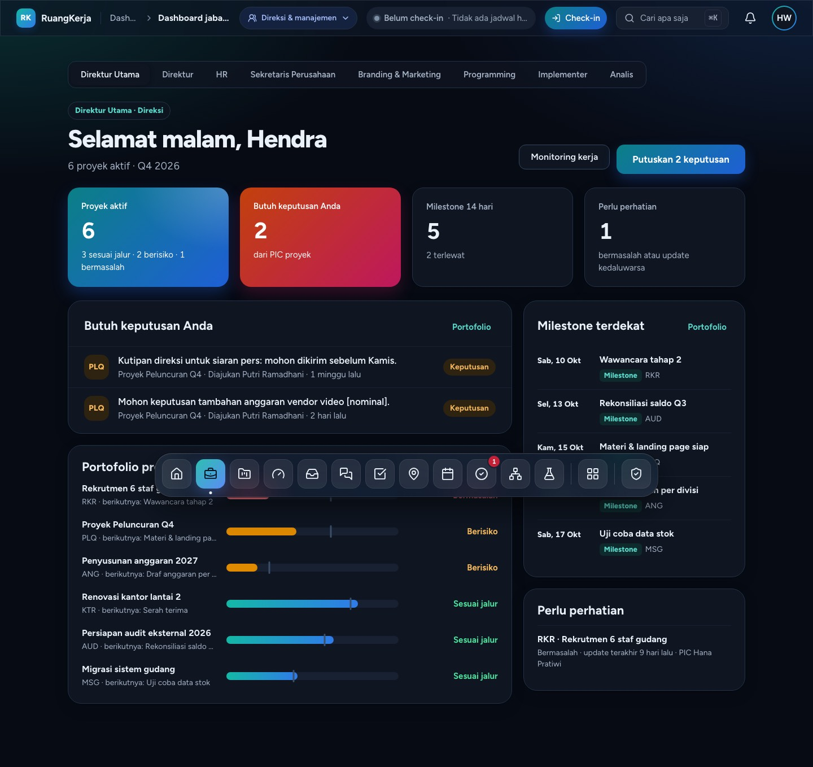

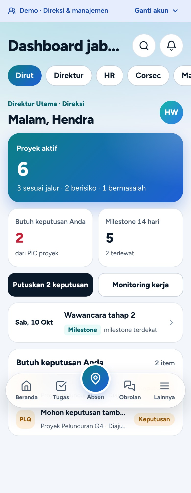

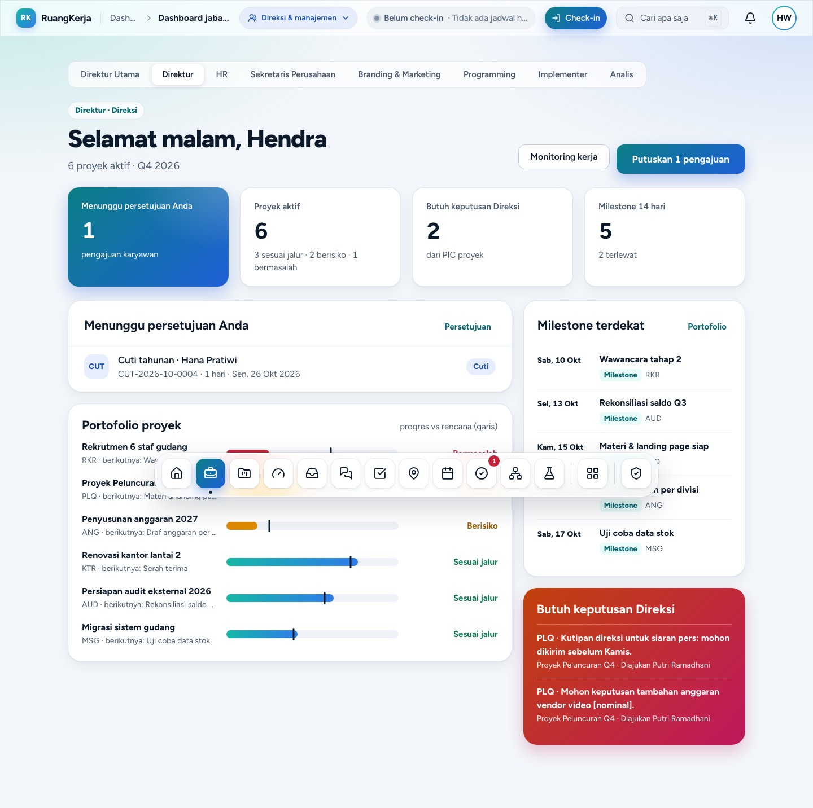

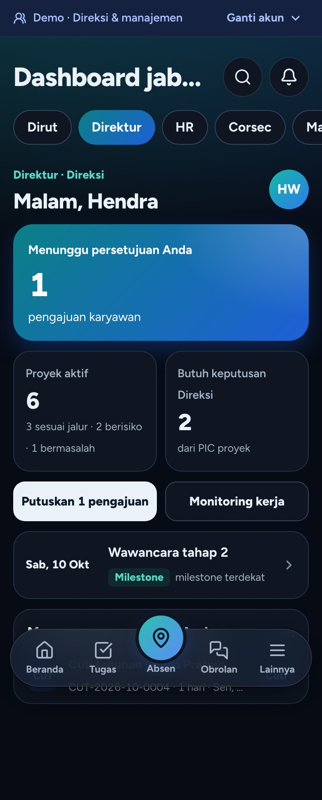

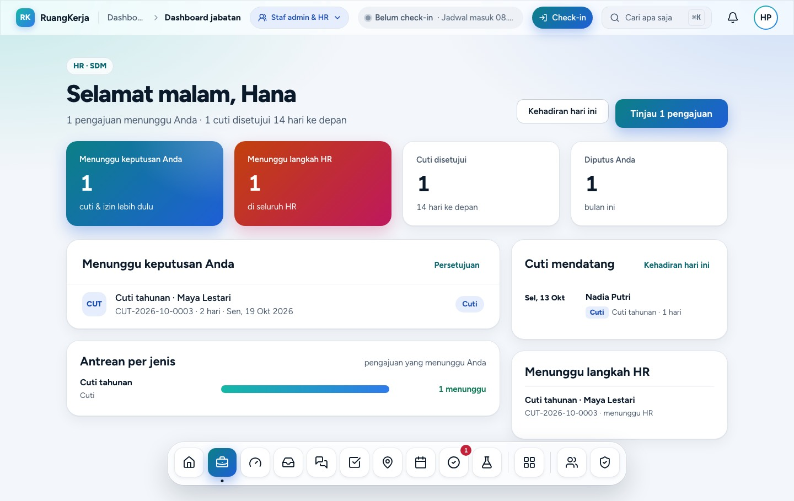

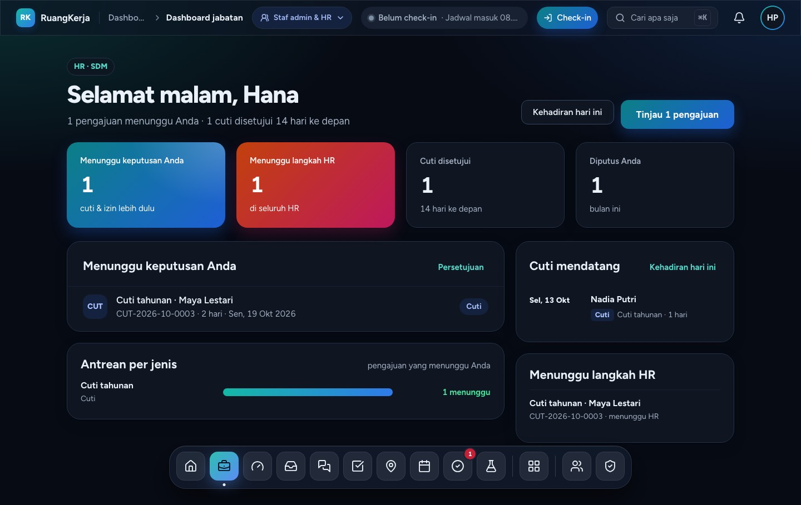

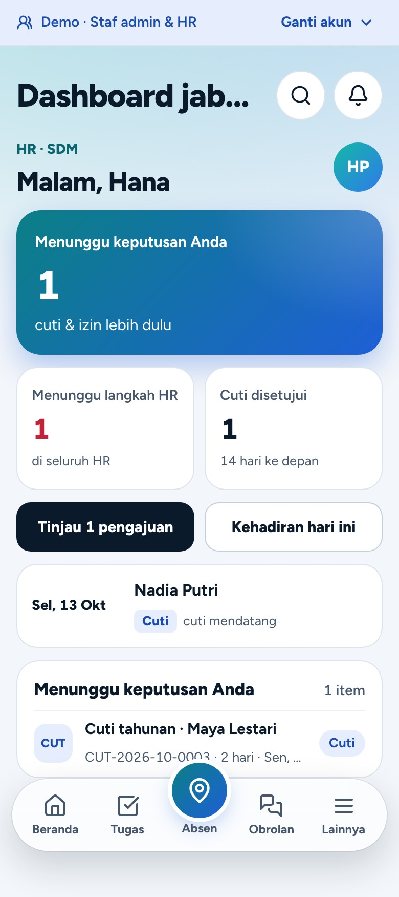

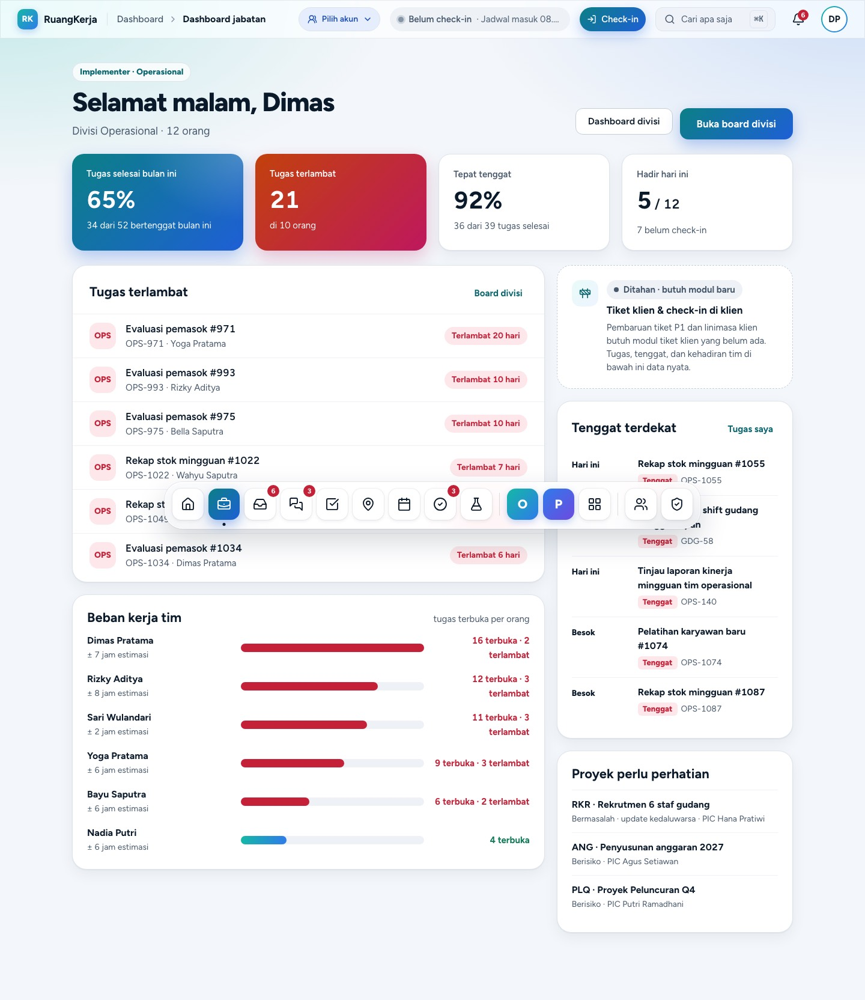

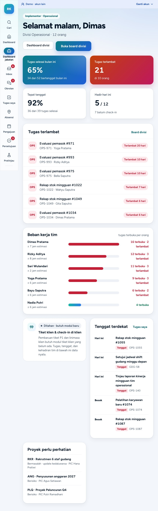

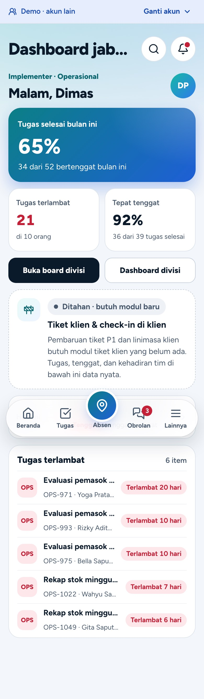

## 4. Alur

1. **Dirut · Putuskan** (sheet 560 px / bottom sheet): pilih keputusan (chip kode proyek) → progres vs rencana, ringkasan, hambatan → tulis keputusan (opsional) → **Putuskan**: teks dikirim ke PIC sebagai arahan (`GiveProjectDirection`) lalu keputusan ditutup (`ResolveProjectDecision`, audit `project.decision_resolved`, notifikasi). **Minta update** → `RequestProjectUpdate`.
2. **Direktur · Persetujuan**: tiap pengajuan **Setujui** atau **Tolak** (alasan wajib) → `ApproveStep`/`RejectStep`. Item hilang seketika (optimistic) dan kembali dengan toast bila server menolak. Keputusan final (tidak ada urungkan).
3. **HR · Tinjau pengajuan**: cuti/izin/sakit/dinas lebih dulu; detail lengkap (`RequestDetailCard`: periode, saldo, rekan yang absen, jejak persetujuan) → **Setujui** / **Tolak** / **Revisi** (catatan wajib untuk tolak & revisi). Pengajuan lain dimuat sesuai permintaan (`?pilih=`, partial reload `flow`).
4. **Jabatan divisi**: aksi utama "Buka board divisi", sekunder "Dashboard divisi"; kartu **"Ditahan · butuh modul baru"** menjelaskan alur desain yang menunggu modul (tanpa tombol palsu).

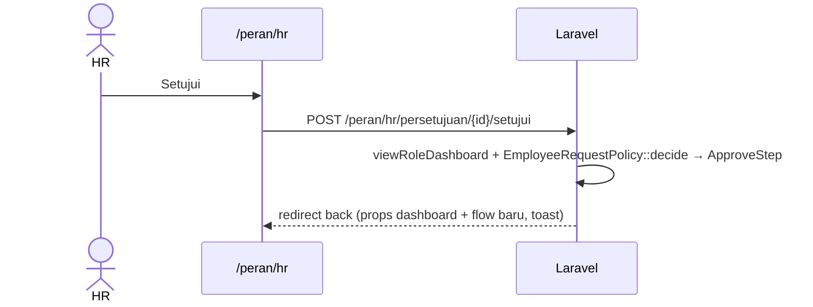

## 5. Kode

| Berkas | Isi |
|---|---|
| `app/Domain/RoleDashboards/Enums/DashboardRole.php` | 8 kunci, `label()`, `flow()`, `heldModule()` |
| `Services/RoleDashboardAccess.php` | aturan akses, `landing()` untuk `/peran` |
| `Queries/RoleDashboardPresenter.php` | prop `dashboard` (deferred) & `flow` (live) |
| `Queries/BoardRoleDashboard.php` | Dirut/Direktur dari `PortfolioDashboard` + `ApprovalQueue` (cache 5 menit, view `peran`) |
| `Queries/HrRoleDashboard.php` | antrean keputusan, `HrDashboard::pendingHr` (baca saja), cuti mendatang |
| `Queries/UnitRoleDashboard.php` | jabatan divisi dari `DivisionDashboard::metrics` + `TodayAttendance` |
| `Actions/DecideProjectFromDashboard.php` | arahan + tutup keputusan |
| `app/Http/Controllers/RoleDashboards/*` | `RoleDashboardController`, `RoleDecisionController`, `RoleApprovalController` |
| `resources/js/pages/roles/show.tsx` | halaman (Deferred + skeleton + galat) |
| `resources/js/features/role-dashboards/*` | templat desktop/ponsel, pemilih jabatan & divisi, `flows/{decision,approvals,leave-review}-flow.tsx`, `flows/submit.ts` |

Tidak ada tabel baru; hanya kolom `positions.dashboard_role` (`docs/DATABASE.md`).

## 6. Keadaan & aksesibilitas

- Memuat: skeleton berbentuk tata letak; galat: EmptyState + "Coba lagi"; kosong: tiap panel punya teks kosong.
- Pemilih jabatan: SegmentedTabs (WAI-ARIA tabs) di desktop/tablet, ChipScroller di ponsel; pemilih divisi: Select berlabel.
- Sheet alur memakai Dialog Radix (fokus terjebak, Esc menutup); target sentuh ≥ 44 px; maks. satu gradien hangat per layar (diuji).

## 7. Yang ditahan

- Modul baru: surat masuk & disposisi (Corsec), tiket klien & check-in di klien (Implementer), skenario UAT (Analis), review materi & pipeline konten (Marketing), bug sprint & integrasi Git (Programming).
- Jadwal rapat (`calendar_events`): panel jadwal memakai tenggat tugas / milestone / cuti yang sudah ada.
- Layar P\* kedua dari desain (PDirutPortofolio, PDirekturKapasitas, PHRLive, dll.).

## 8. Test

`tests/Feature/RoleDashboards/RoleDashboardAccessTest.php` (matriks akses per kunci, Direksi/Super Admin, 404, nonaktif, `/peran`, flag mati, field jabatan, CHECK, seeder demo), `RoleDashboardFlowsTest.php` (presenter dengan data terkontrol, alur HR/Direktur/Dirut lewat endpoint dengan Policy & audit, perusahaan lain, jabatan divisi), `PageQueryCountTest` (`/peran/dirut|direktur|hr|implementer`), `resources/js/features/role-dashboards/lib.test.ts`.
