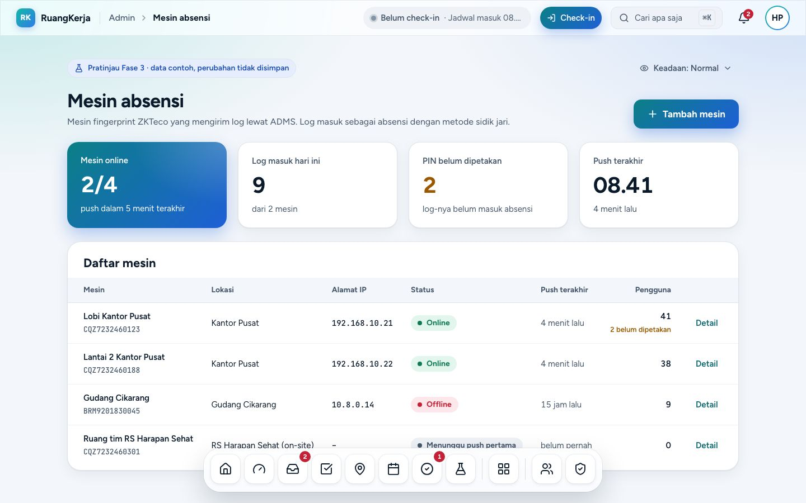
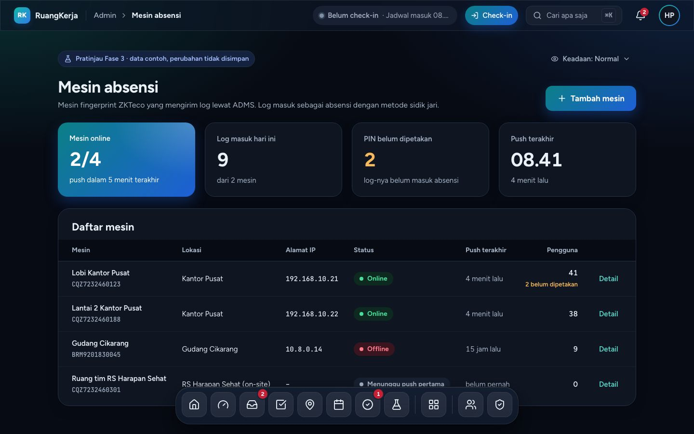
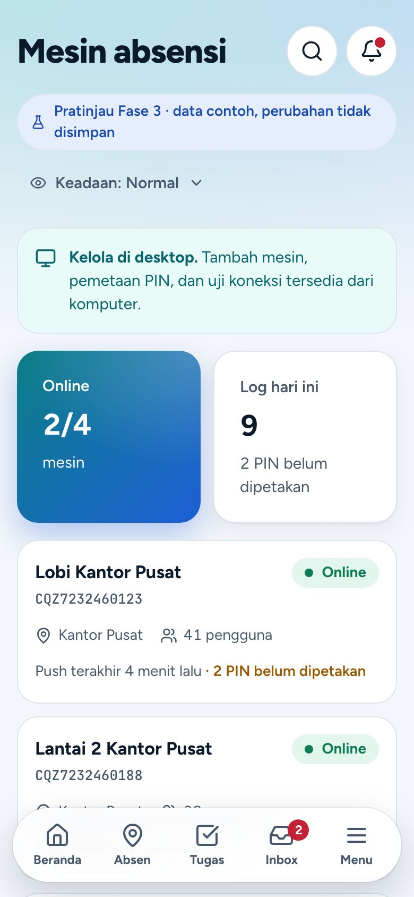
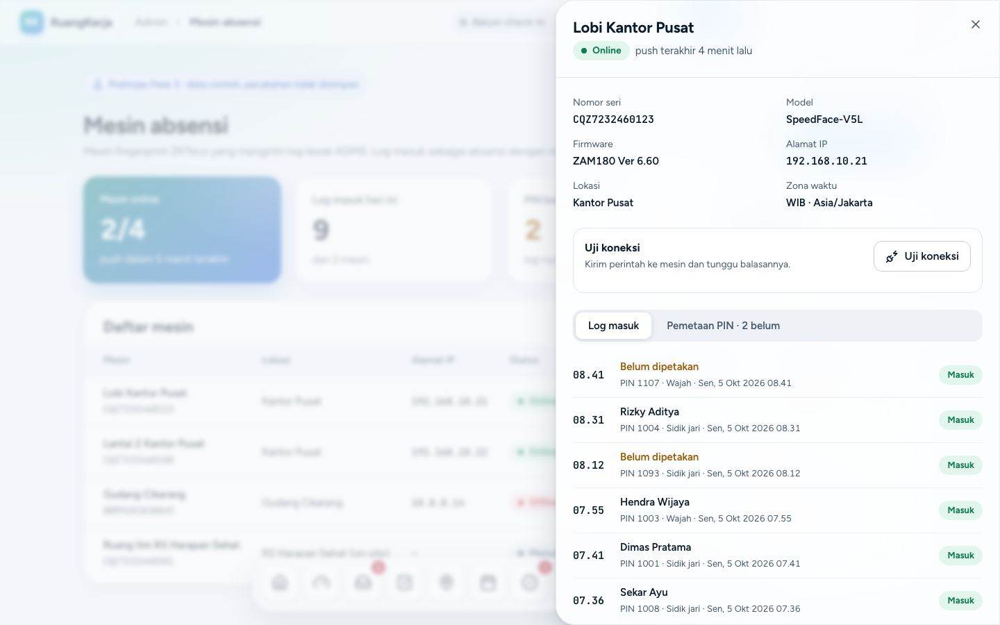
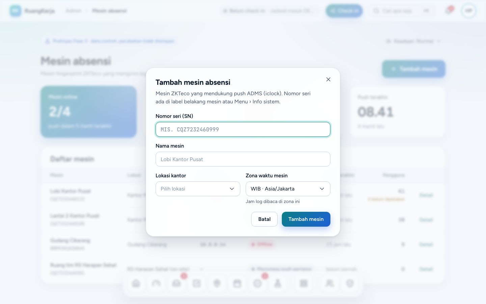
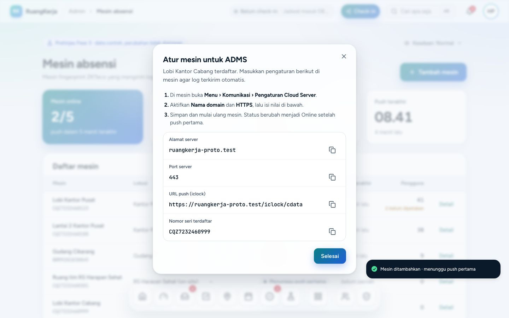
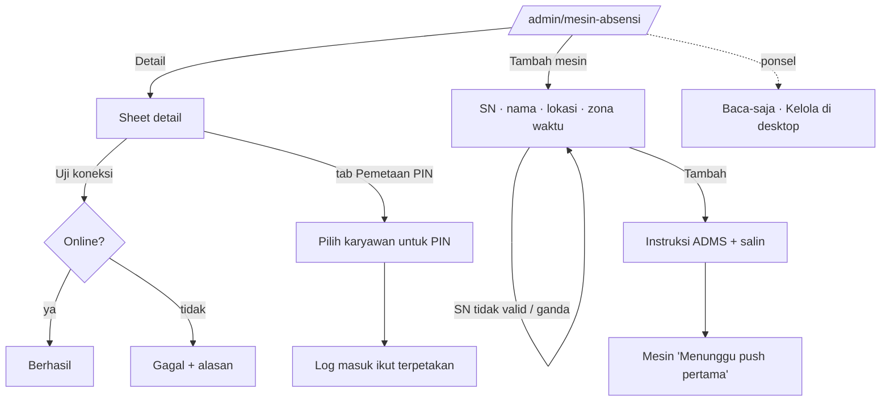
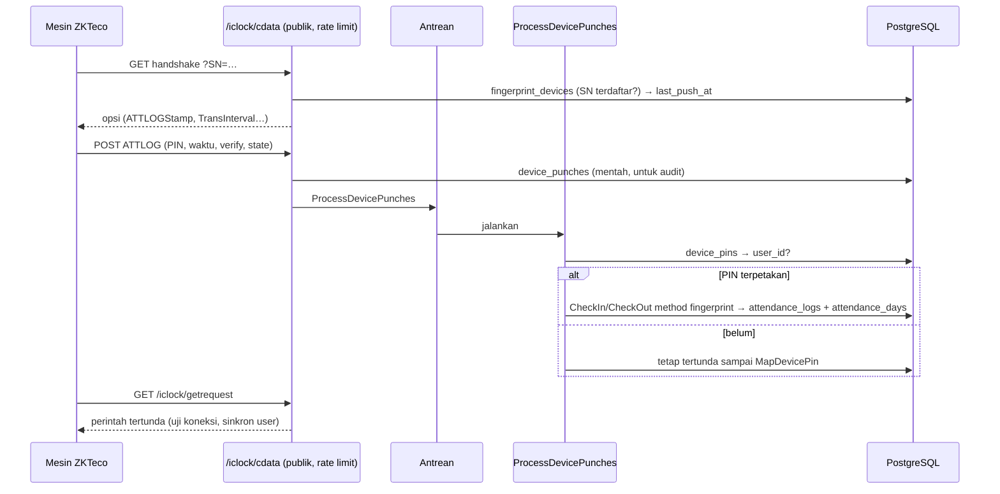

# Mesin fingerprint ZKTeco · ADMS (F3-3)

> **Status:** **Ditahan** (keputusan pemilik 6 Okt 2026): tidak dikerjakan sampai pemilik membuka lagi; layar pratinjau tetap bisa dicoba. Panduan pemakaian: [PANDUAN-PRATINJAU.md](PANDUAN-PRATINJAU.md).
>
> Pratinjau Fase 3 · dibangun Agen E · rute `/admin/mesin-absensi` · data contoh, tidak menyimpan apa pun. Indeks: [README](README.md).

## 1. Tujuan & masalah

Sebagian lokasi (gudang, kantor cabang) sudah punya mesin fingerprint ZKTeco, tetapi lognya direkap manual. PRD §7 menargetkan mesin mengirim log langsung ke RuangKerja lewat protokol **ADMS / iclock** (push dari mesin), sehingga `attendance_logs` mendapat baris `method = fingerprint` tanpa campur tangan HR. Halaman ini memberi HR:

- daftar mesin + status koneksi (online bila push terakhir ≤ 5 menit), KPI log hari ini & PIN belum dipetakan;
- detail mesin: info, **Uji koneksi**, tab **Log masuk** dan **Pemetaan PIN** (PIN di mesin → karyawan);
- **Tambah mesin** dua langkah: data mesin (SN unik) lalu instruksi ADMS yang diketik di mesin (alamat server, port, URL iclock, SN) dengan tombol salin.

## 2. Peran yang memakai

HR dan Super Admin (`attendance.manage`). Di ponsel halaman ini **baca-saja** (PLATFORM.md ◐): banner "Kelola di desktop" + KPI + daftar kartu. Pratinjau: masuk sebagai `hr@demo.test`.

## 3. Layar

Panel detail (Sheet kanan): info mesin, Uji koneksi, Log masuk, Pemetaan PIN.

Tambah mesin, langkah 1 (SN, nama, lokasi kantor, zona waktu) dan langkah 2 (instruksi ADMS):

## 4. Alur langkah demi langkah

1. Masuk `hr@demo.test` → `/admin/mesin-absensi` → KPI + tabel mesin.
2. **Detail** pada mesin online → **Uji koneksi** → sukses. Pada mesin gudang (offline) → gagal dengan alasan.
3. Tab **Pemetaan PIN** → pilih karyawan untuk PIN yang belum dipetakan → log di tab **Log masuk** ikut terpetakan + toast.
4. **Tambah mesin** → SN (8–20 karakter, unik), nama, lokasi, zona waktu (WIB/WITA/WIT) → **Tambah mesin** → langkah 2: salin alamat server, port, URL `iclock`, SN → **Selesai** → mesin baru berstatus "Menunggu push pertama" (detailnya menampilkan instruksi ADMS lagi).

Alur backend nanti (push log dari mesin):

## 5. Penjelasan kode

| File | Peran |
|---|---|
| `pages/okr/fingerprint-devices.tsx` | Halaman (berada di folder `okr` karena placeholder rute dibuat bersama modul F3-3). `useBreakpoint()` memilih `FingerprintDesktop` / `FingerprintMobile`. |
| `features/fingerprint/types.ts` | `FingerprintDevice`, `DevicePunch` (`verify_type`, `punch_state`), `PinMapping`, `OfficeLocationRef`, `DeviceTimezone`, `FingerprintPageProps`. |
| `features/fingerprint/fixtures.ts` | `FINGERPRINT_NOW` (Sen 5 Okt 08.45 WIB), `EMPLOYEES`, `LOCATIONS`, `DEVICES`, `PUNCHES`, `MAPPINGS`, `FINGERPRINT_PAGE`. |
| `features/fingerprint/lib.ts` (+ `lib.test.ts`) | `deviceStatus` (online bila ≤ 5 menit), `admsSettings(appUrl)` (alamat/port/URL iclock dari `window.location.origin`), `normalizeSerial`, `validateDeviceDraft`, `unmappedCount`, `punchesToday`, `mapPin`. |
| `use-fingerprint.ts` | State halaman: tambah mesin (lewat `useFakeMutation`), uji koneksi (jeda 1,2 detik), pemetaan PIN (langsung + toast). |
| `fingerprint.desktop.tsx`, `fingerprint.mobile.tsx`, `device-sheet.tsx`, `add-device-dialog.tsx` (+ `AdmsInstructions`), `parts.tsx` | Tampilan. |

Keadaan pratinjau memakai `features/okr/preview.ts` + `preview-state.tsx`.

## 6. Bentuk data → tabel DATABASE.md

| Tipe frontend | Tabel | Catatan |
|---|---|---|
| `FingerprintDevice` | **belum ada**: `fingerprint_devices` (`company_id`, `office_location_id`, `name`, `serial_number` unik, `model`, `firmware`, `ip_address` inet, `timezone`, `last_push_at`, `users_count`, soft delete) | Tambah ke DATABASE.md §8 |
| `PinMapping` | **belum ada**: `device_pins` (`device_id`, `pin`, `device_name`, `user_id` null; unik `device_id + pin`) | |
| `DevicePunch` | **belum ada**: `device_punches` (ATTLOG mentah) → `attendance_logs` (`method = fingerprint`) | `attendance_logs.method` sudah menyiapkan `fingerprint` |
| `OfficeLocationRef` | `office_locations` | Sudah ada |

## 7. Pekerjaan backend tersisa

- [ ] Migrasi `fingerprint_devices`, `device_pins`, `device_punches`; perbarui DATABASE.md.
- [ ] Endpoint ADMS publik `/iclock/cdata` (GET handshake, POST ATTLOG/USERINFO) dan `/iclock/getrequest` (perintah), validasi SN terdaftar, rate limit, di luar CSRF; dokumentasikan di ARCHITECTURE.md.
- [ ] Job `ProcessDevicePunches`: ATTLOG → `CheckIn`/`CheckOut` method `fingerprint` hanya bila PIN terpetakan; PIN belum terpetakan disimpan dan diproses ulang setelah dipetakan. Zona waktu mesin → UTC.
- [ ] Actions: `AddFingerprintDevice`, `MapDevicePin` (+ proses ulang tertunda, `audit_logs`), `TestDeviceConnection` (antrekan perintah, tunggu balasan).
- [ ] Policy: `attendance.manage` (HR/Super Admin) + test matriks. Status online diturunkan dari `last_push_at` ≤ 5 menit.
- [ ] Test Pest: handshake SN tak terdaftar ditolak, ATTLOG idempoten, pemetaan memproses ulang punch tertunda.

## 8. Keadaan kosong/galat & aksesibilitas

- Menu "Keadaan" atau `?keadaan=memuat|kosong|galat` (kosong = "Belum ada mesin" + aksi Tambah mesin).
- Status mesin = titik + teks (Online / Offline / Menunggu push pertama). Tombol salin punya `aria-label` "Salin …".
- Form: label, galat SN diumumkan, Select lokasi & zona waktu 44 px.

## 9. Batasan prototipe

- Uji koneksi tiruan: mesin online selalu sukses, offline selalu gagal.
- Waktu uji koneksi & mesin baru memakai jam nyata, sedangkan data contoh memakai "sekarang" fixture 5 Okt 08.45 (bug kosmetik #6).
- Tidak ada sinkron pengguna ke mesin (USERINFO) di UI.
