# Obrolan (F2-1)

> **Fitur nyata sejak tugas #1 (6 Okt 2026)** · rute `/obrolan`, `/obrolan/{channel}` (`routes/chat.php`) di balik `FEATURE_CHAT` (nyala lokal, mati produksi sampai rilis) · data tersimpan di `channels`, `channel_members`, `messages`, realtime Reverb. Gambar di bawah berasal dari masa pratinjau; tata letaknya sama. Indeks: [README](README.md).

## 1. Tujuan & masalah

Saat ini koordinasi harian tim tersebar di grup WhatsApp, sehingga keputusan dan rujukan tugas hilang dari RuangKerja (risiko "adopsi rendah" di PRD §9). Obrolan membawa percakapan ke tempat yang sama dengan tugas:

- **Channel per workspace** dibuat otomatis (anggota mengikuti workspace), ditambah channel bebas (publik/privat), **pesan langsung (DM)**, dan **grup kecil**.
- **Thread** agar diskusi panjang tidak menenggelamkan channel.
- **@mention** orang dan **#rujukan tugas** (`PLQ-21`) yang tampil sebagai chip sama seperti di komentar tugas.
- Reaksi emoji, sunting/hapus pesan sendiri, lampiran dari Google Drive, tanda baca ("Dibaca Putri, Rizky +1"), pencarian di dalam channel, bisukan obrolan.

## 2. Peran yang memakai

Semua karyawan. Daftar berisi channel tempat pengguna menjadi anggota plus semua channel publik. Akses (`ChannelPolicy`, keputusan pengguna 6 Okt 2026): channel workspace mengikuti akses workspace (Direksi bukan anggota hanya membaca), channel publik untuk karyawan satu perusahaan, **channel privat, DM, dan grup hanya anggotanya — Super Admin, HR, dan Direksi pun tidak bisa membaca**. Tak terlihat = 404. Pesan sendiri berlabel "(Anda)".

## 3. Layar

### Daftar obrolan · `/obrolan`

Desktop: kartu setinggi layar dengan tiga kolom (daftar 300 px · percakapan · thread/detail 380 px). Daftar dikelompokkan **Workspace / Channel / Pesan langsung**, dengan badge belum dibaca, titik online, ikon bisu, dan "sedang mengetik…".

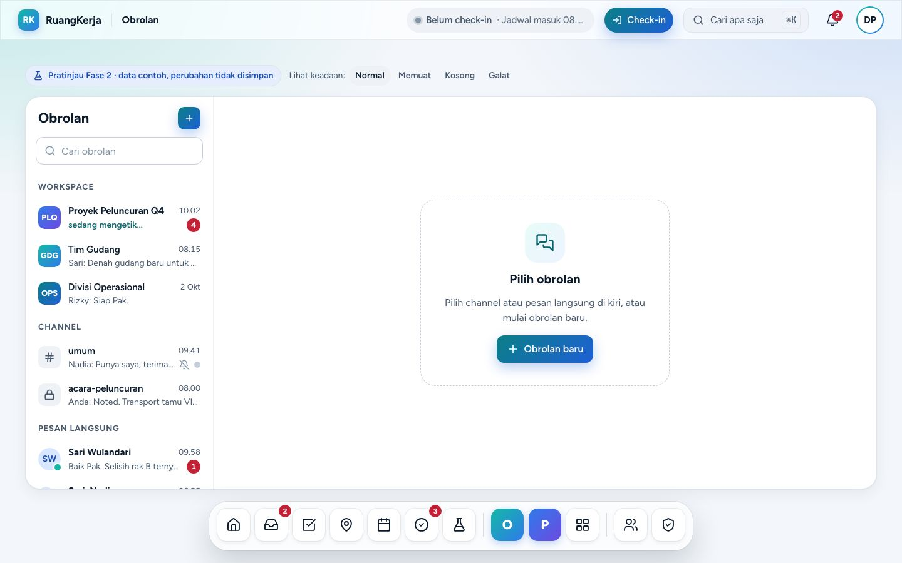

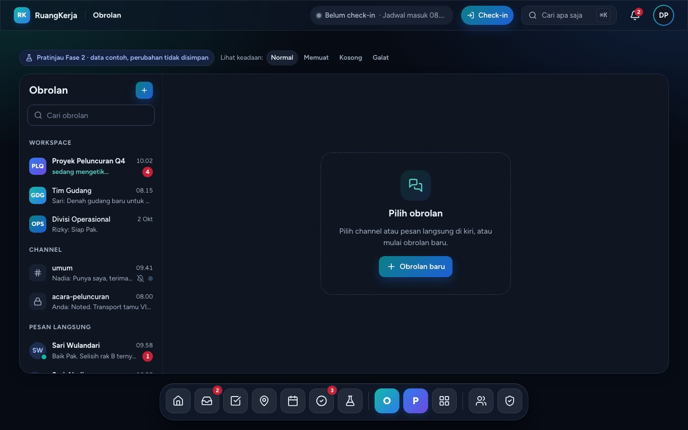

Ponsel: daftar layar penuh dengan FAB "Obrolan baru" di atas tab bar.

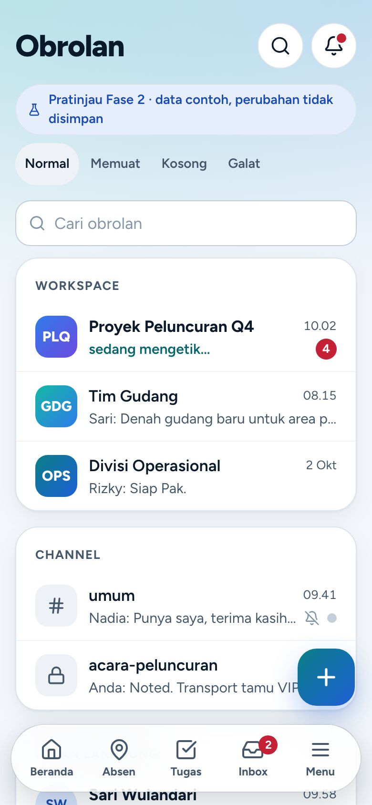

### Percakapan · `/obrolan/{channel}`

Pesan dikelompokkan per hari (penanda hari menempel) dan per pengirim. Kotak tulis di bawah: lampirkan, sebut, Enter kirim (desktop), Shift+Enter baris baru. Contoh id: `umum`, `plq`, `gdg`, `ops`, `acara`, `dm-sari`, `dm-hendra`, `grp-shift`; id tak dikenal menampilkan keadaan "tidak ditemukan".

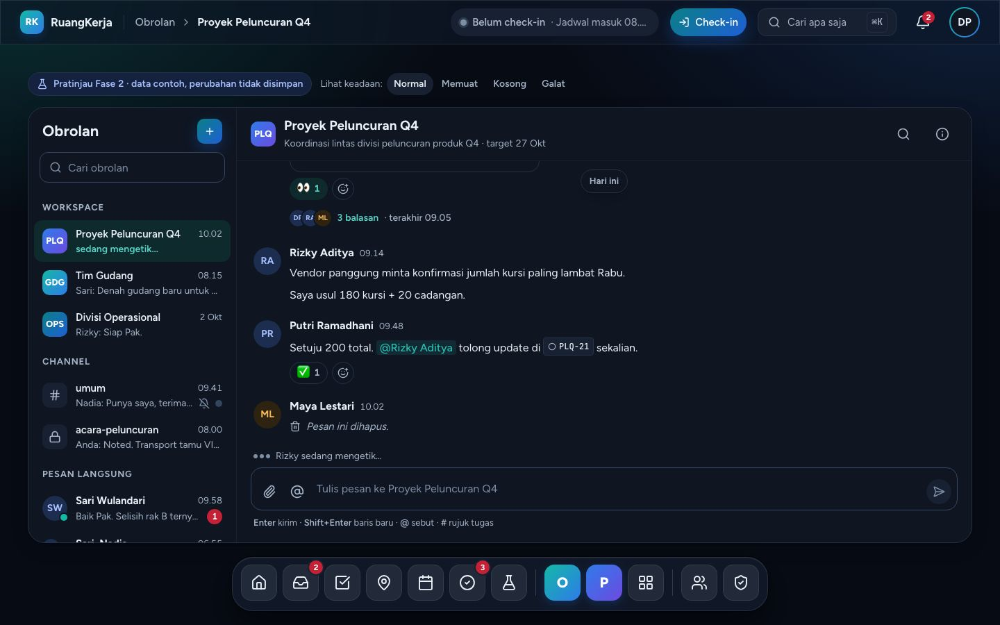

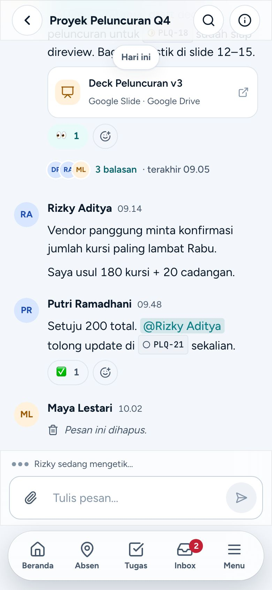

### Saran @mention

Mengetik `@sar` memunculkan popup orang (↑/↓ + Enter memilih). `#PLQ-2` memunculkan tugas yang terlihat oleh penonton.

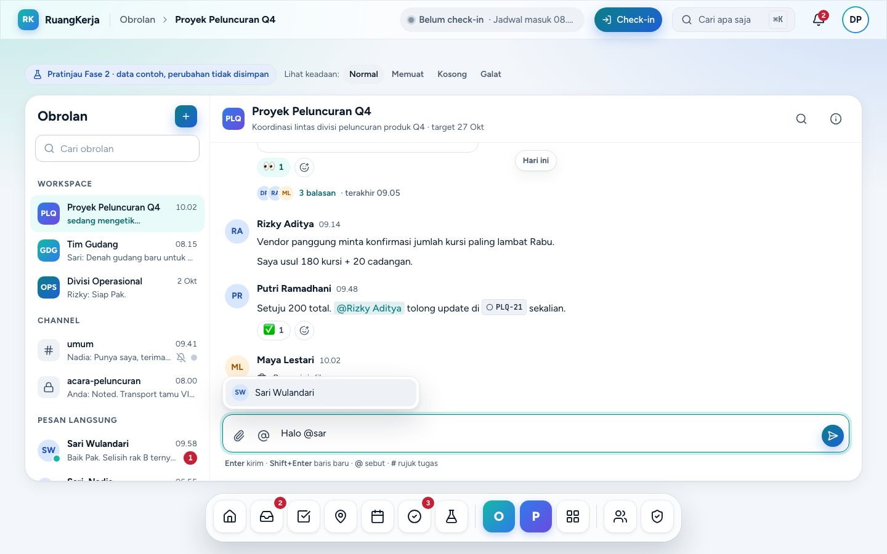

### Thread

"3 balasan" membuka thread di kolom kanan (≥ 1280 px) atau Sheet kanan (< 1280 px dan tablet). Di ponsel thread berupa bottom sheet.

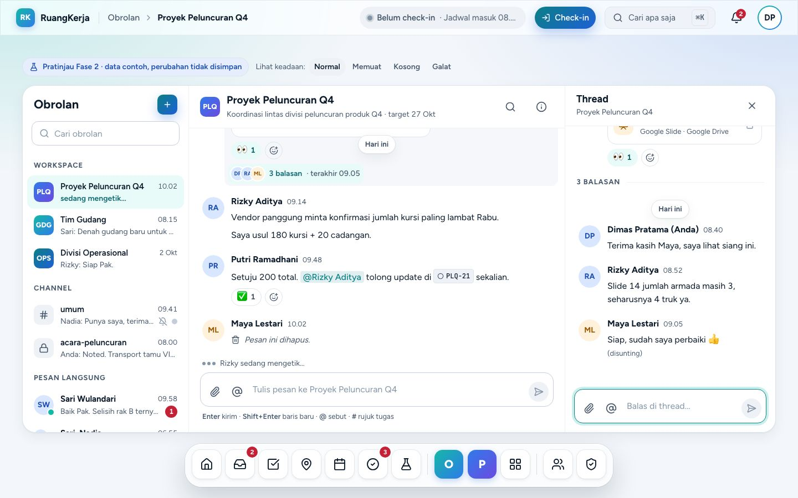

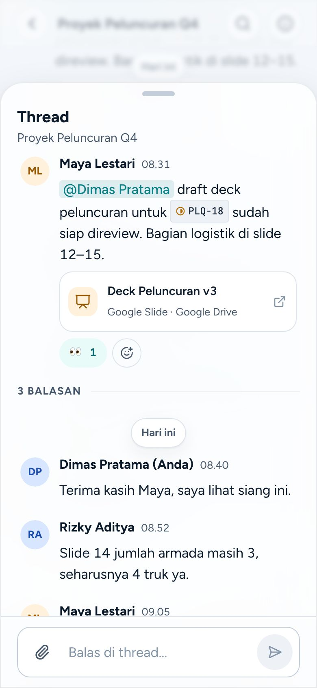

### Obrolan baru

Tab **Pesan langsung** (1 orang = DM, 2+ orang = grup; DM yang sudah ada dibuka ulang) atau **Channel baru** (validasi nama, pratinjau `#slug`, topik, sakelar privat, undang anggota).

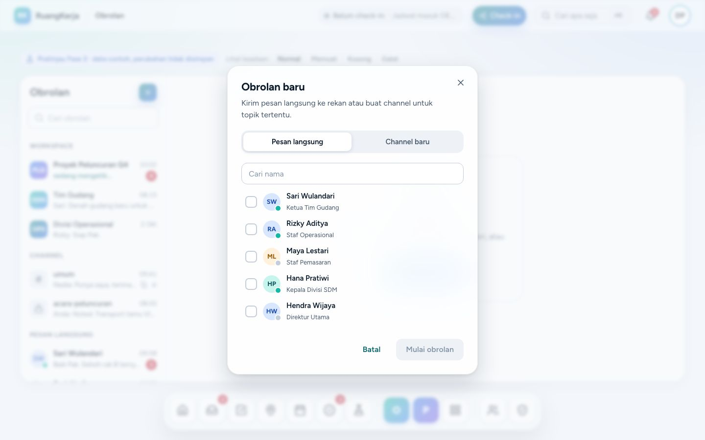

### Keadaan kosong

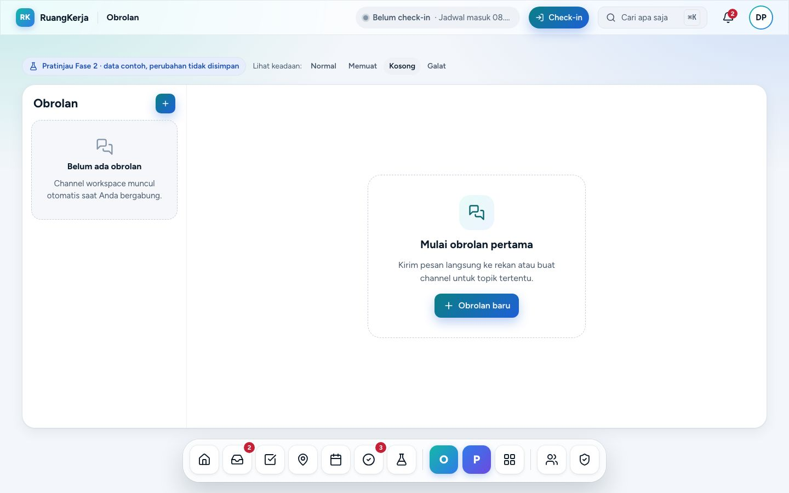

## 4. Alur langkah demi langkah

1. **Buka channel.** `/obrolan` → klik "Proyek Peluncuran Q4". Sekitar 7 detik kemudian Rizky selesai mengetik dan pesannya masuk (simulasi realtime).
2. **Kirim dengan mention & rujukan.** Ketik `Halo @sar` → Enter memilih Sari → ketik `#PLQ-2` → Enter memilih PLQ-21 → Enter mengirim. Pesan tampil dengan chip mention & tugas; status "Terkirim" berubah "Dibaca Putri, Rizky +1", lalu muncul "…sedang mengetik" dan balasan otomatis.
3. **Aksi pesan.** Arahkan kursor/fokus ke pesan → toolbar: reaksi cepat (👍 ✅ 👀), pemilih 8 emoji, Balas di thread, menu (Salin teks; Sunting/Hapus untuk pesan sendiri). Hapus memakai dialog konfirmasi → "Pesan ini dihapus"; sunting → "(disunting)".
4. **Thread.** Klik "3 balasan" → balas di panel kanan; ada indikator mengetik dan balasan otomatis.
5. **Cari.** Ikon kaca pembesar → ketik `kursi` → hasil disorot, "1/2", panah atau Enter/Shift+Enter berpindah hasil, Esc menutup.
6. **Detail.** Ikon (i) → topik, tautan workspace, sakelar "Bisukan obrolan" (toast + ikon bisu di daftar), anggota online/offline, file yang dibagikan.
7. **Lampiran Drive.** Ikon klip → pemilih Drive tiruan → kartu file di kotak tulis → terkirim sebagai kartu file.
8. **Ponsel.** Ketuk obrolan → layar penuh. Kotak tulis menempel di atas tab bar dan naik tepat di atas keyboard saat terbuka. Ketuk pesan → bottom sheet (8 reaksi, Balas di thread, Salin, Sunting, Hapus). Di ponsel Enter menambah baris; kirim dengan tombol Kirim.

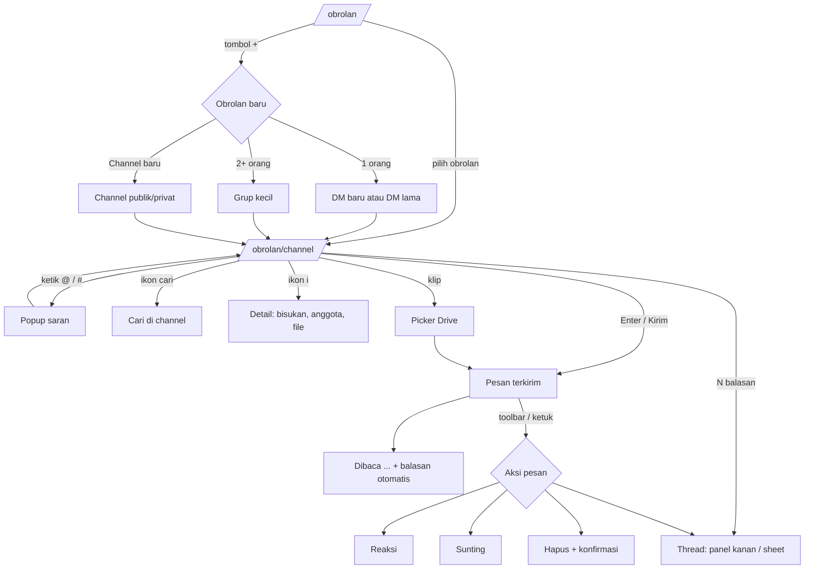

Alur backend nanti (kirim pesan):

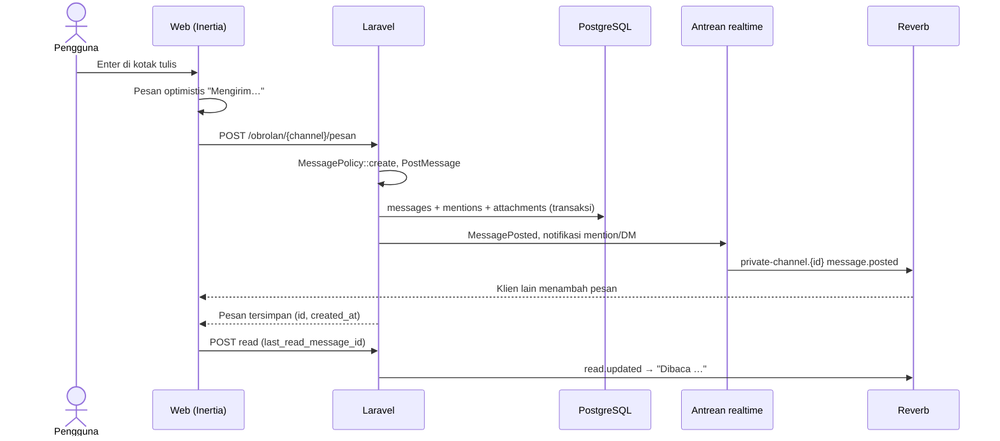

## 5. Penjelasan kode

| File | Peran |
|---|---|
| `resources/js/pages/chat/index.tsx`, `pages/chat/show.tsx` | Halaman Inertia. `useBreakpoint()` memilih `ChatDesktop` / `ChatMobile` (null = skeleton). `show` menerima prop `channelId` dari rute. |
| `features/chat/types.ts` | Bentuk props: `ChatPerson`, `Channel` (+ `ChannelMember`), `Message` (+ `MessageReaction`, `MessageAttachment`), `ChatTask`, `ChatState`. |
| `features/chat/fixtures.ts` | `CHAT_PEOPLE`, `CHAT_CHANNELS`, `CHAT_MESSAGES` (isi dibuat dengan `parseMessage` agar `body` = Tiptap JSON), `CHAT_TASKS`, `CHAT_DRIVE_FILES`, `AUTO_REPLIES`, `initialChatState()`. Penonton `VIEWER_ID = 'u-dimas'`. Jam = Sen 5 Okt 2026 10.15 WIB + waktu sejak halaman dimuat (`prototypeNow()`), jadi label "Hari ini/Kemarin" konsisten. |
| `features/chat/store.ts` | Store modul (`useSyncExternalStore`): `useChatState`, `sendMessage`, `editMessage`, `deleteMessage`, `reactToMessage`, `markRead`, `setMuted`, `createChannel`, `openDirect`, `resetChatState`. State bertahan antarhalaman Inertia, hilang saat muat ulang. |
| `features/chat/use-conversation.ts` | Hook bersama desktop & ponsel: pesan terkelompok, thread aktif, pencarian, mengetik. |
| `features/chat/lib.ts` (+ `lib.test.ts`, 17 test) | Fungsi murni: `groupMessages` (hari & pengirim), `groupChannels`, `channelTitle`/`channelSubtitle`, `unreadCount`, `readers`/`receiptLabel`, `findTrigger`/`applySuggestion`/`matchPeople`/`matchTasks`, `parseMessage` (mention, `#KEY-n`, tautan → Tiptap JSON), `toggleReaction`, `threadSummary`, `searchMessages`, `typingLabel`, `slugifyChannelName`. |
| `features/chat/chat.desktop.tsx`, `chat.mobile.tsx`, `mobile-ui.tsx` | Tampilan. Tombol app bar ponsel (Cari/Detail) dirender layout lewat `appBarActions` dan berbicara dengan halaman lewat store mikro di `mobile-ui.tsx`. |
| `channel-list.tsx`, `channel-avatar.tsx`, `channel-details.tsx`, `channel-search-bar.tsx`, `message-list.tsx`, `message-run.tsx`, `thread-panel.tsx`, `composer.tsx`, `drive-picker.tsx`, `attachment-card.tsx`, `new-chat-dialog.tsx` | Komponen. Isi pesan dirender dengan `RichTextView` milik modul Tugas sehingga chip @mention & `PLQ-18` sama dengan komentar. Kotak tulis = textarea + popup saran buatan sendiri (bukan editor Tiptap) agar Enter/Shift+Enter dan keyboard ponsel sederhana. |
| `features/chat/preview-state.tsx` | `usePreviewState()` + `PreviewBar` (Normal · Memuat · Kosong · Galat). Juga dipakai modul Catatan. |

## 6. Bentuk data → tabel DATABASE.md

| Tipe frontend | Tabel (`docs/DATABASE.md` §7) | Catatan |
|---|---|---|
| `Channel` | `channels` (`workspace_id` null, `type` workspace/public/private/dm/group, `name` null untuk DM/grup, `topic`, `created_by`, `archived_at`) | `workspace` = ringkasan turunan |
| `ChannelMember` | `channel_members` (`last_read_message_id`, `muted`, `role`) | |
| `Message` | `messages` (`parent_id` thread, `body` jsonb, `body_text`, `edited_at`, soft delete) | Indeks `(channel_id, id)` |
| `MessageReaction` | `reactions` (morph ke `messages`, daftar tetap `Reaction::EMOJI`) | Dikelompokkan per emoji |
| `MessageAttachment` | `attachments` (morph ke `messages`, `source = drive`) → `drive_files` | |
| mention di `body` | `mentions` (morph ke `messages`) | Hanya orang yang punya akses |
| `ChatTask` | `tasks` (yang terlihat penonton) | Untuk chip `#KEY-n` |

## 7. Status backend

Selesai di tugas #1 (`docs/PEMBAGIAN-TUGAS.md`, branch `claude/f2-obrolan`):

- [x] Migrasi `channels`, `channel_members`, `messages` (+ `search_vector` GIN) — `docs/DATABASE.md` §7. Reaksi, mention, lampiran memakai tabel morph yang ada.
- [x] `ChannelPolicy` / `MessagePolicy` + `Channel::visibleTo` (test matriks, `tests/Feature/Chat/ChatPolicyTest.php`).
- [x] Actions (`app/Domain/Chat/Actions`): `CreateChannel`, `OpenDirectConversation` (dipakai ulang lewat `direct_key`), `PostMessage`, `EditMessage`, `DeleteMessage` (moderasi diaudit), `ToggleMessageReaction`, `MarkChannelRead`, `SetChannelMuted`, `AttachMessageFiles` (file hanya bila setiap pembaca channel bisa membukanya), `SyncWorkspaceChannel` (+ listener `WorkspaceCreated`/`WorkspaceMembersChanged`, command `chat:sync-workspace-channels`).
- [x] Queries `ChatInbox`, `ChannelTimeline` (halaman 50 pesan + "Muat pesan sebelumnya"), `AttachableDriveFiles`; controller tipis; FormRequest 404 sebelum validasi; limiter `messages`.
- [x] Realtime: private `chat.{id}` (`message.posted|updated|deleted`, `read.updated`, event tipis), whisper "mengetik", presence `chat-online.{company}`, `chat.activity` ke kanal user; polling 30 dtk tanpa WebSocket.
- [x] Notifikasi: `chat.message` (DM/grup, satu belum dibaca per obrolan, selesai saat dibaca; tidak untuk obrolan dibisukan) dan mention (juga di obrolan dibisukan). Preferensi "Pesan langsung & grup obrolan" (in-app saja secara default).
- [x] Frontend memakai props server + mutasi optimistis (`store.ts`, `api.ts`, `realtime.ts`); tile Obrolan di Dock/Rail dan baris Menu dengan badge `chatUnread`.
- [x] Data demo `ChatDemoSeeder`; uji anti-N+1 `/obrolan`, `/obrolan/{id}`, `/pesan`.

Belum (di luar cakupan tugas #1): pencarian pesan di ⌘K dan pencarian server di dalam channel (sekarang mencari pesan yang sudah dimuat), unggah file langsung, ubah/arsip channel & tambah anggota setelah dibuat, uji dua pengguna dengan Reverb menyala di lingkungan agen.

**Produksi:** setelah migrasi, jalankan sekali `php artisan chat:sync-workspace-channels` agar setiap workspace yang sudah ada mendapat channel otomatis; workspace baru mendapatkannya lewat listener. Nyalakan dengan `FEATURE_CHAT=true`.

## 8. Keadaan kosong/galat & aksesibilitas

- `?keadaan=memuat` = skeleton daftar & pesan; `kosong` = empty state "Mulai obrolan pertama" dengan aksi Obrolan baru (daftar: "Belum ada obrolan"); `galat` = pesan galat dengan "Coba lagi"; id channel tak dikenal = "Obrolan tidak ditemukan".
- Toolbar pesan muncul saat hover **dan** fokus keyboard; semua tombol ikon punya `aria-label`. Popup saran memakai pola listbox (↑/↓, Enter, Esc).
- Ponsel: kotak tulis 44 px (perbaikan bug #7), input 17 px, aksi pesan lewat bottom sheet (tidak bergantung hover).
- Animasi kecil: titik "mengetik" (`animate-pulse`), toolbar pesan muncul lewat opacity 120 ms `ease-brand`; berhenti dengan `prefers-reduced-motion`.

## 9. Batasan (sejak masa pratinjau)

- State hanya di klien; channel baru hilang saat muat ulang.
- Tidak ada pin pesan, unggah file dari perangkat (hanya Picker Drive tiruan), notifikasi mention, atau tautan dari Inbox ke pesan.
- Penanda hari yang menempel di desktop melayang di atas baris pesan saat menggulir (gaya Slack), mungkin perlu dipoles.
- Chip reaksi bersama (`features/tasks/detail/reactions.tsx`) 36 px di ponsel (bug terbuka #3); reaksi juga tersedia lewat bottom sheet.
