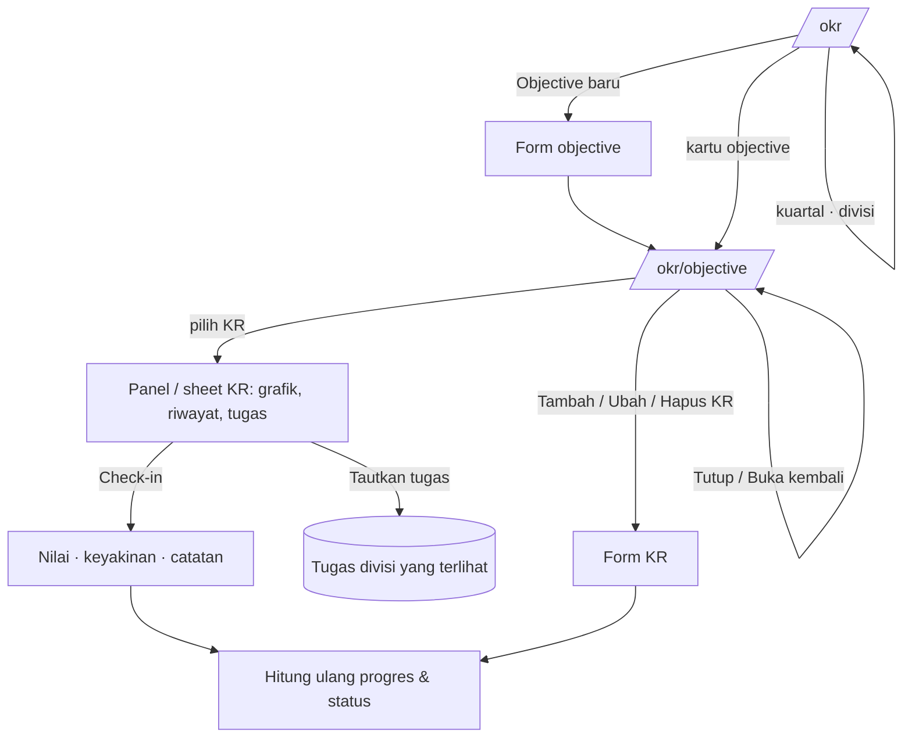

# OKR divisi (F3-3)

> **Status: Nyata** (backend + frontend, Okt 2026) · rute `/okr`, `/okr/{objective}` · flag `FEATURE_OKR` (nyala lokal, mati produksi; mati = 404 dan tile/menu hilang) · data tersimpan di PostgreSQL (`docs/DATABASE.md` §8 "OKR divisi"). Indeks: [README](README.md).

## 1. Tujuan & masalah

Dashboard Fase 1 mengukur **output tugas** (selesai, tepat waktu, terlambat), tetapi tidak menjawab "apakah pekerjaan ini menggerakkan target divisi kuartal ini?". PRD §7 (dan pertanyaan terbuka no. 6) menempatkan **KPI/OKR divisi** di Fase 3:

- **Objective** per divisi per kuartal, dengan **key result (KR)** terukur (angka, persen, rupiah, hari) yang berbobot.
- **Check-in KR** berkala (nilai, keyakinan 1–10, catatan) membentuk grafik **rencana vs aktual**.
- KR **ditautkan ke tugas** divisi sehingga progres output terlihat di samping hasil.
- Status dihitung dari selisih progres vs bagian kuartal yang sudah lewat (tanpa skor gabungan per orang).

## 2. Peran & akses

| Peran | Lihat | Objective (buat/ubah/tutup) | KR (tambah/hapus) | KR (ubah, check-in, tautkan tugas) |
|---|---|---|---|---|
| Anggota divisi | OKR divisinya | — | — | KR miliknya |
| Pemilik objective | ✓ | — (kecuali Kadiv/Direksi) | ✓ | ✓ |
| Kepala Divisi | divisinya (+ sub-divisi) | ✓ | ✓ | ✓ |
| Direksi | semua divisi | ✓ (semua divisi) | — | — |
| HR · Super Admin | semua divisi | — | — | — |
| Divisi lain / perusahaan lain / nonaktif | **404** | | | |

Pemilik KR di luar divisi tetap bisa melihat objective-nya. Objective **ditutup** = hanya baca (403 untuk perubahan); Kepala Divisi/Direksi bisa **Buka kembali**. Pemilik objective/KR harus karyawan aktif atau kepala divisi itu. Sumber: `ObjectivePolicy`, `KeyResultPolicy`, `Objective::visibleTo`.

## 3. Layar

### Daftar OKR · `/okr`

Kuartal (tab, `?kuartal=2026-Q3`) dan divisi (Select di desktop, chip di ponsel, `?divisi=<id>`) disaring di server; KPI agregat; kartu objective per divisi (cincin progres, status, penanda "diharapkan", badge Draf/Ditutup). Kepala Divisi & Direksi melihat **Objective baru** (tombol di desktop, FAB di ponsel).

### Detail objective · `/okr/{objective}`

Header (divisi, kuartal, status, PIC, **Ubah objective**, **Tutup objective** / **Buka kembali**), KPI, daftar KR (progres, status, bobot, pemilik, tombol sesuai hak). Memilih KR membuka panel kanan (desktop) berisi grafik rencana vs aktual, riwayat check-in, tugas tertaut (tautan ke tugas, **Tautkan tugas**, lepas tautan); di ponsel berupa bottom sheet. Objective yang tidak ada/tidak terlihat = 404.

(Gambar diambil dari pratinjau; tata letaknya sama, tombol kini mengikuti hak akses.)

## 4. Cara pakai

1. `/okr` → pilih kuartal & divisi → **Objective baru** (divisi, kuartal: sebelumnya/berjalan/berikutnya, judul, deskripsi, pemilik, Aktif/Draf).
2. Di detail objective → **Tambah key result** (judul, satuan, nilai awal/target/saat ini dengan koma desimal, bobot 1–100, pemilik). KR "makin kecil makin baik" didukung (awal 14 → target 4).
3. **Check-in** → nilai, keyakinan, catatan → tersimpan dengan tanggal kantor; tampilan langsung diperbarui (optimistis) dan dibatalkan bila server menolak.
4. **Tautkan tugas** → cari judul atau `KEY-12` di antara tugas divisi yang terlihat → **Tautkan**; lepas dengan ikon di baris tugas.
5. Akhir kuartal → **Tutup objective** (hanya baca, pengingat berhenti).

Akun demo (`OkrDemoSeeder`): `kadiv@` (Operasional, 2 objective kuartal berjalan + 1 ditutup), `programmer@`/`yudi.hartono@` (Programming), `maya.lestari@`/`putri.ramadhani@` (Pemasaran), `hr@` (SDM), `direksi@` (semua).

## 5. Rumus (`app/Domain/Analytics/Okr`, cermin `features/okr/lib.ts`)

- Progres KR mentah = (kini − awal) ÷ (target − awal); tampil dibatasi 0–100%, status memakai nilai yang dibatasi −100…100% sehingga KR yang **mundur dari nilai awal** menarik status turun.
- Progres objective = rata-rata berbobot (bobot ≤ 0 semua → sama rata).
- Bagian kuartal berlalu = hari lewat (tanggal kantor, inklusif) ÷ hari kuartal.
- Selisih = progres − berlalu: ≥ −10 poin **Sesuai jalur**, ≥ −25 poin **Berisiko**, selainnya **Tertinggal**.

Test: `tests/Unit/Okr/OkrProgressTest.php` (kasus yang sama dengan `lib.test.ts`).

## 6. Backend

| Bagian | File |
|---|---|
| Rute | `routes/okr.php` (`okr.*`), pencarian tugas dibatasi `throttle:search` |
| Controller | `Okr/OkrController` (index, show, store, update, close), `KeyResultController` (store, update, destroy, checkin), `KeyResultTaskController` (cari JSON, tautkan, lepas) |
| FormRequest | `ObjectiveRequest`, `KeyResultRequest`, `CheckinRequest` (otorisasi sebelum validasi → 404, bukan 422) |
| Actions | `CreateObjective`, `UpdateObjective` (termasuk buka kembali), `CloseObjective`, `CreateKeyResult`, `UpdateKeyResult`, `DeleteKeyResult`, `RecordKeyResultCheckin` (transaksi + row lock), `LinkTaskToKeyResult`, `UnlinkTaskFromKeyResult`, `NotifyObjectiveAtRisk` |
| Queries / Services | `Queries/OkrIndex`, `Queries/ObjectiveDetail`, `Services/{OkrPresenter, OkrPeople, LinkableTasks, ObjectiveHealth}` |
| Notifikasi | `okr.checkin_reminder` (job `SendKeyResultCheckinReminders`, Jumat 15.00 WIB, satu per pemilik per minggu) dan `okr.objective_at_risk` (status objective aktif memburuk → pemilik objective + Kepala Divisi, sekali per tingkat per kuartal). Baris pengaturan "OKR: pengingat check-in & objective berisiko" (in-app nyala, email mati) |
| Seeder | `OkrDemoSeeder` (idempoten, tanpa notifikasi) |
| Test | `tests/Feature/Okr/*` (policy matriks, actions, pengingat, HTTP, seeder, jumlah query), blok OKR di `PageQueryCountTest` |

## 7. Frontend

| File | Peran |
|---|---|
| `pages/okr/index.tsx`, `pages/okr/show.tsx` | Halaman Inertia (props `OkrIndexProps` / `ObjectiveDetailProps`), skeleton sampai breakpoint diketahui |
| `features/okr/okr-list.tsx` | Filter via query string, KPI, kartu, form objective baru |
| `features/okr/objective-detail.tsx`, `use-objective.ts`, `api.ts` | Detail + mutasi (kunjungan Inertia, galat validasi ke form, toast galat HTTP/jaringan, check-in optimistis + rollback) |
| `objective-form-dialog.tsx`, `kr-form-dialog.tsx`, `checkin-dialog.tsx`, `link-task-dialog.tsx` | Dialog desktop / bottom sheet ponsel |
| `lib.ts` (+ `lib.test.ts`, `forms.test.ts`) | Rumus, format, validasi form; `test-fixtures.ts` hanya untuk Vitest |
| Navigasi | tile **OKR** di Dock/Rail (`okrNavItem`) dan baris "OKR divisi" di Lainnya, saat `features.okr` |

`preview.ts` / `preview-state.tsx` tetap ada karena dipakai halaman pratinjau mesin fingerprint & dashboard peran (bukan modul OKR).

## 8. Keadaan & aksesibilitas

- Memuat: skeleton; filter yang sedang dimuat meredupkan isi (`aria-busy`). Kosong: EmptyState dengan aksi "Objective baru" (bila berhak) atau "Tampilkan semua divisi". Galat: validasi di field, galat lain sebagai toast; objective tidak ditemukan = 404 server.
- Grafik KR punya tabel `sr-only`. Status selalu ikon + teks. Form: label, galat per field (`aria-invalid`/`aria-describedby`), angka berformat Indonesia.

## 9. Yang ditahan / belum

- Tidak ada layar desain khusus OKR; gaya diturunkan dari DPortofolio/DProyek.
- Hapus objective belum ada (tutup sebagai gantinya); urutan KR mengikuti urutan dibuat (tanpa drag).
- KR belum dihitung otomatis dari tugas tertaut (nilai diisi lewat check-in).
