# OKR divisi (F3-3)

> **Status:** **Akan dibangun** (keputusan pemilik 6 Okt 2026): backend nyata dikerjakan berikutnya; dokumen ini menjelaskan keadaan pratinjau saat ini. Panduan pemakaian: [PANDUAN-PRATINJAU.md](PANDUAN-PRATINJAU.md).
>
> Pratinjau Fase 3 · dibangun Agen E · rute `/okr`, `/okr/{objective}` · data contoh, tidak menyimpan apa pun. Indeks: [README](README.md).

## 1. Tujuan & masalah

Dashboard Fase 1 mengukur **output tugas** (selesai, tepat waktu, terlambat), tetapi tidak menjawab "apakah pekerjaan ini menggerakkan target divisi kuartal ini?". PRD §7 (dan pertanyaan terbuka no. 6) menempatkan **KPI/OKR divisi** di Fase 3:

- **Objective** per divisi per kuartal, dengan **key result (KR)** terukur (angka, persen, rupiah, hari) yang berbobot.
- **Check-in KR** berkala (nilai, keyakinan 1–10, catatan) membentuk grafik **rencana vs aktual**.
- KR **ditautkan ke tugas** sehingga progres output terlihat di samping hasil.
- Status dihitung dari selisih progres vs bagian kuartal yang sudah lewat (tanpa skor gabungan per orang).

## 2. Peran yang memakai

| Peran | Akses (rencana) |
|---|---|
| Anggota divisi | Lihat OKR divisinya, check-in KR miliknya |
| Kepala Divisi | Kelola objective & KR divisinya |
| Direksi · HR | Lihat semua divisi |

Pratinjau: persona Dimas (Kadiv Operasional), hari ini 5 Okt 2026 = minggu 1 dari 14 di Q4.

## 3. Layar

### Daftar OKR · `/okr`

Pemilih kuartal (Q4 2026 berjalan / Q3 2026 selesai) dan divisi (Select di desktop, chip di ponsel), KPI agregat, kartu objective per divisi (cincin progres, status, penanda "diharapkan").

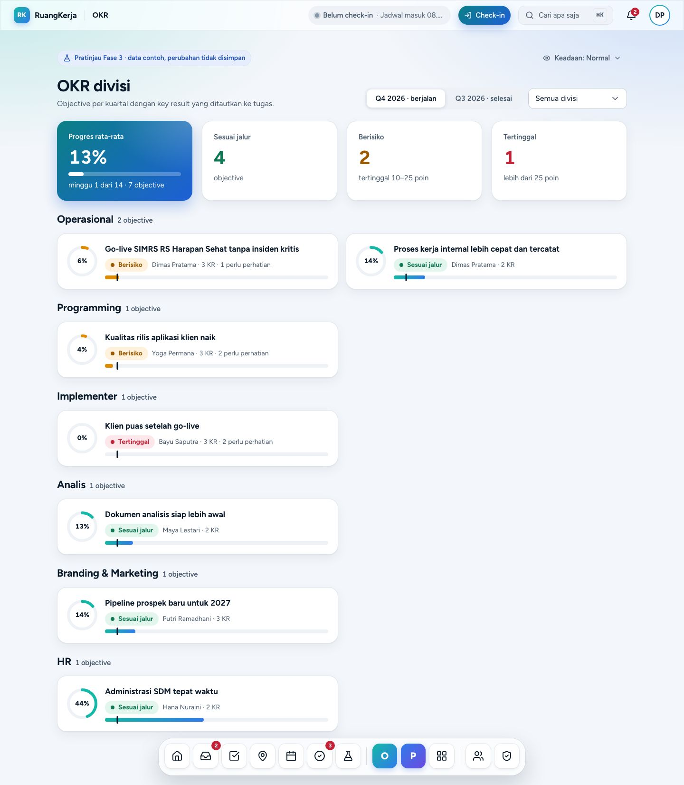

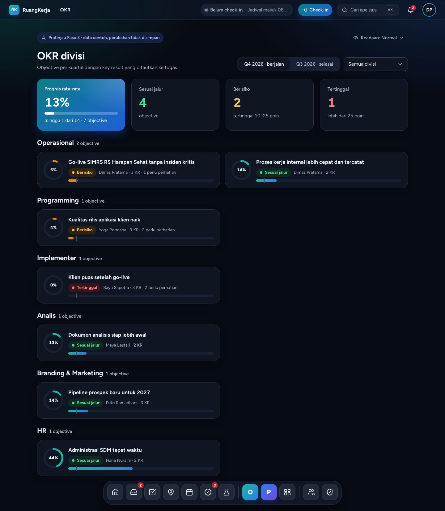

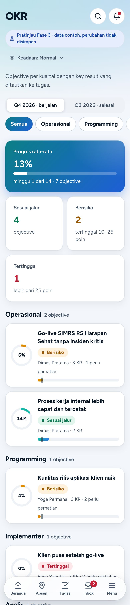

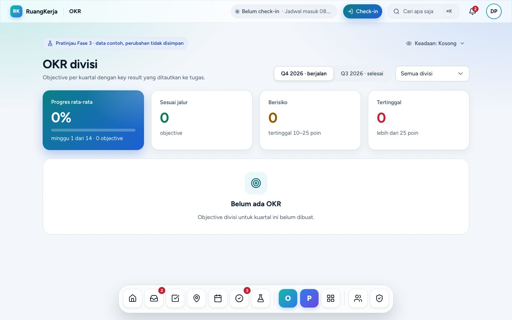

### Detail objective · `/okr/{objective}`

Daftar KR (progres, status, bobot, pemilik). Memilih KR membuka panel kanan (desktop) berisi grafik rencana vs aktual, riwayat check-in, tugas tertaut; di ponsel berupa bottom sheet. Contoh: `q4-ops-1`, `q4-prg-1`, `q4-imp-1`, `q3-prg-1`; id tak dikenal = "Objective tidak ditemukan".

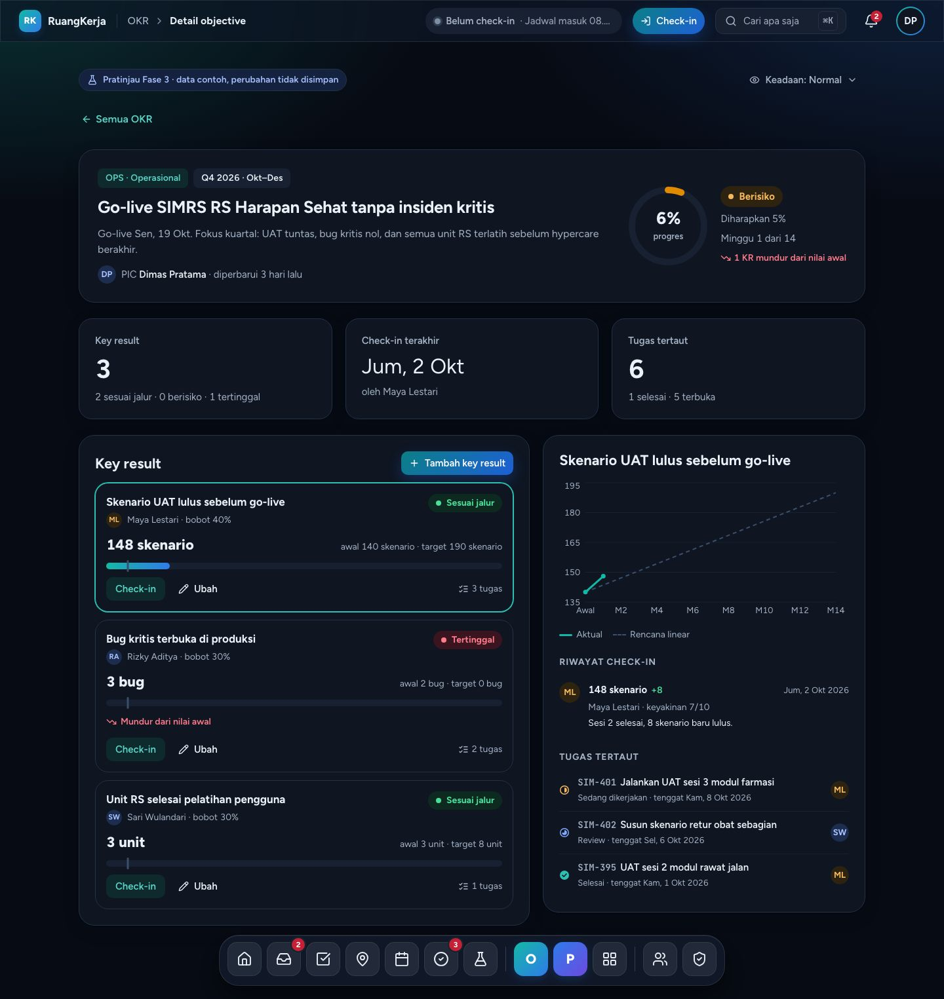

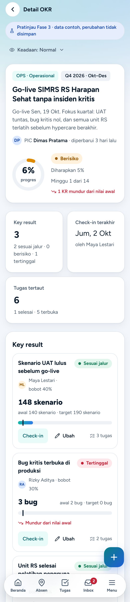

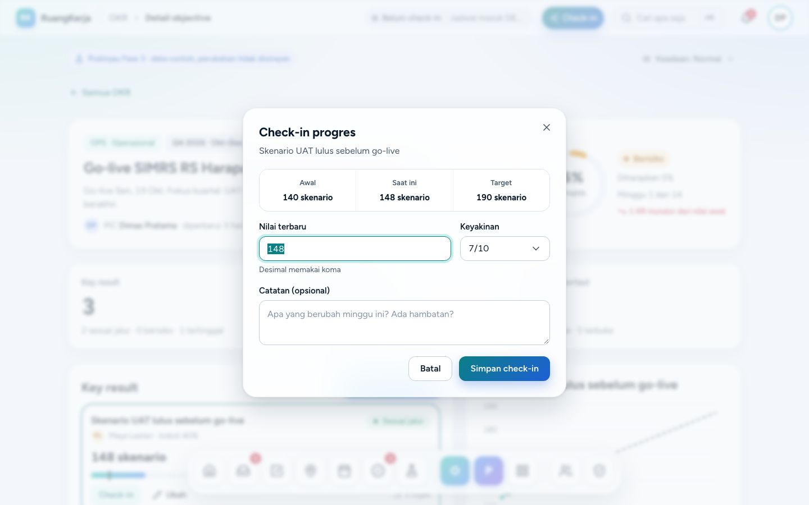

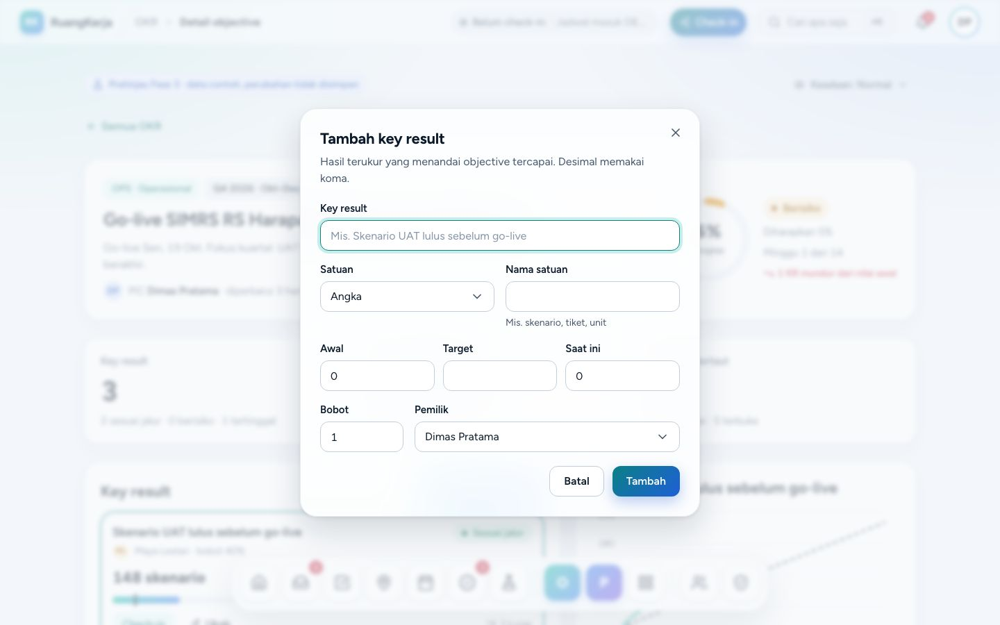

## 4. Alur langkah demi langkah

1. `/okr` → ganti kuartal & divisi → klik kartu objective (mis. "Go-live SIMRS").
2. Pilih KR → panel kanan/bottom sheet: grafik rencana vs aktual, riwayat check-in, tugas tertaut.
3. **Check-in** → isi nilai (desimal memakai koma), keyakinan, catatan → progres & status dihitung ulang + toast.
4. **Tambah key result** (FAB di ponsel) atau **Ubah** → judul, satuan, nilai awal/target/saat ini, bobot 1–100, pemilik. Validasi: judul wajib, angka berkoma, target ≠ awal, persen 0–100, bobot 1–100. KR "makin kecil makin baik" didukung (awal 14 → target 4).

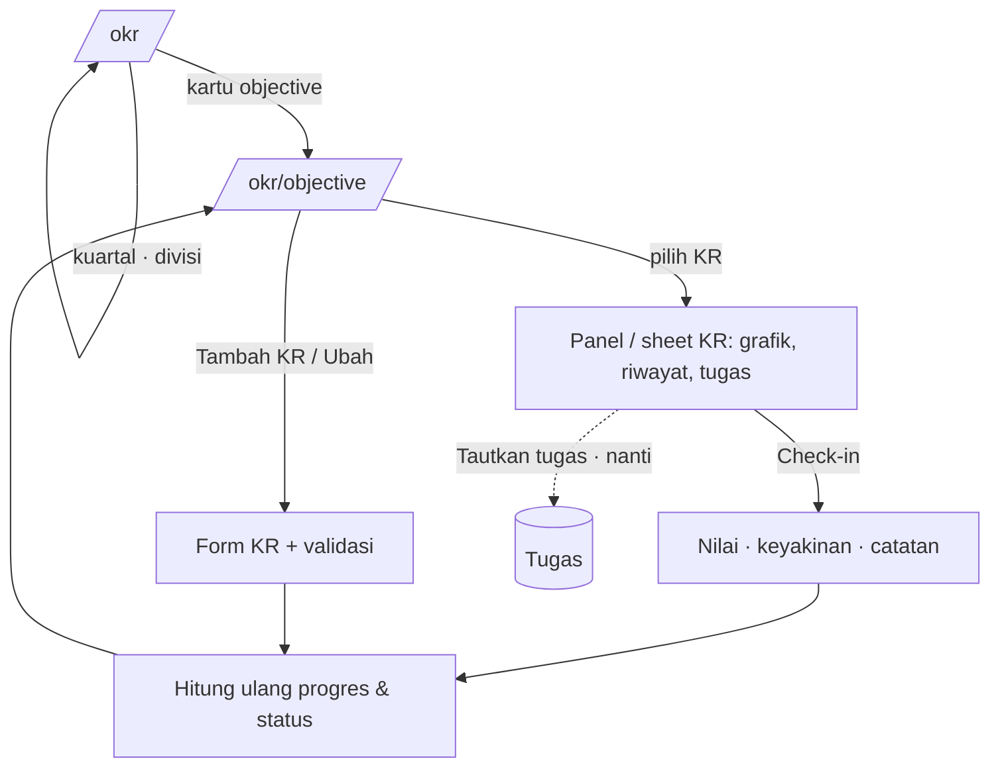

Rumus status (`features/okr/lib.ts`, akan dipindah ke `app/Domain/Analytics`):

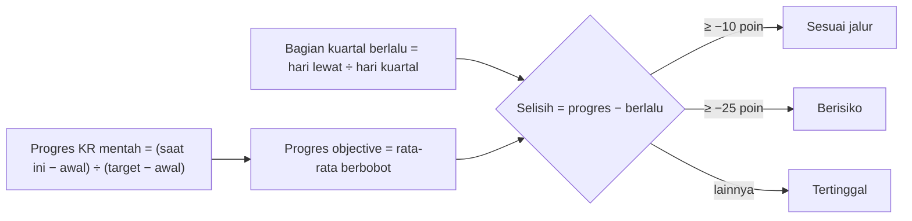

Alur backend nanti (check-in KR):

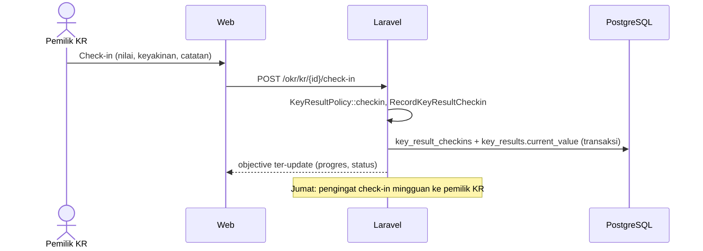

## 5. Penjelasan kode

| File | Peran |
|---|---|
| `pages/okr/index.tsx`, `pages/okr/show.tsx` | Halaman; `show` menerima `objectiveId` dan memakai `findObjective()`. |
| `features/okr/types.ts` | `Objective`, `KeyResult` (`unit` number/percent/currency/days, `start/target/current_value`, `weight`), `KrCheckin`, `LinkedTask`, `DivisionRef`, `QuarterKey` (`YYYY-Qn`), `OkrIndexProps`. |
| `features/okr/fixtures.ts` | `OKR_TODAY`, `OKR_NOW`, `PEOPLE`, `DIVISIONS`, `OBJECTIVES` (Q4 & Q3), `OKR_INDEX`, `findObjective()`. Teks dengan `#angka` hanya di fixture `.ts` agar uji `color-tokens` (regex hex di `.tsx`) tidak salah tangkap. |
| `features/okr/lib.ts` (+ `lib.test.ts`) | Kuartal (`quarterRange`, `quarterElapsed`, `quarterWeek`, `quarterLabel`), progres (`krRawProgress`, `krProgress`, `weightedProgress`), `statusFor`/`krStatus`, `summarizeObjective`, `aggregate`, `filterObjectives`, `groupByDivision`, `formatKrValue`, `krChartSeries`, `validateKrDraft`/`applyKrDraft`, `applyCheckin`. |
| `use-objective.ts` | State objective di halaman detail (check-in, tambah/ubah KR). |
| `okr-list.tsx`, `objective-detail.tsx`, `kr-chart.tsx` (recharts + tabel `sr-only`), `kr-form-dialog.tsx`, `checkin-dialog.tsx`, `parts.tsx` (cincin progres SVG berwarna `stroke-fill-*`) | Tampilan. |
| `preview.ts`, `preview-state.tsx` | `parsePreviewState` + `PreviewHeader` (PrototypeBanner + menu "Keadaan"), dipakai juga oleh Mesin fingerprint & Dashboard peran. |

## 6. Bentuk data → tabel DATABASE.md

| Tipe frontend | Tabel (`docs/DATABASE.md` §8 `objectives`/`key_results`) | Catatan |
|---|---|---|
| `Objective` | `objectives` (`company_id`, `division_id`, `quarter` `YYYY-Qn`, `title`, `description`, `owner_id`, soft delete) | Rinci kolomnya di DATABASE.md |
| `KeyResult` | `key_results` (`objective_id`, `title`, `unit`, `unit_label`, `start_value`/`target_value`/`current_value` numeric, `weight` 1–100, `owner_id`) | |
| `KrCheckin` | **belum ada**: `key_result_checkins` (`key_result_id`, `date`, `value`, `confidence` null, `note`, `author_id`, `created_at`; append-only) | |
| `LinkedTask` | **belum ada**: pivot `key_result_tasks` (`key_result_id`, `task_id`) → `tasks` | |

## 7. Pekerjaan backend tersisa

- [ ] Migrasi `objectives`, `key_results`, `key_result_checkins`, `key_result_tasks`; tulis kolomnya di DATABASE.md §8.
- [ ] Pindahkan rumus ke `app/Domain/Analytics` (ambang −10/−25 poin vs bagian kuartal berlalu, tanggal kantor) + test Pest dengan `travelTo`.
- [ ] Actions: `CreateObjective`, `CreateKeyResult`, `UpdateKeyResult`, `RecordKeyResultCheckin` (transaksi), `LinkTaskToKeyResult`.
- [ ] `ObjectivePolicy`/`KeyResultPolicy` (lihat = divisi sendiri/Kadiv/Direksi/HR; ubah = pemilik objective, pemilik KR, Kadiv divisi) + test matriks.
- [ ] `OkrController@index` (props `OkrIndexProps`) dan `@show` (props `Objective` + `today`).
- [ ] Notifikasi pengingat check-in KR mingguan (Jumat) lewat Notification + `notification_preferences`.

## 8. Keadaan kosong/galat & aksesibilitas

- Menu "Keadaan" di samping banner atau `?keadaan=memuat|kosong|galat`; objective tak dikenal punya keadaan sendiri.
- Grafik KR punya tabel `sr-only` (dibungkus `div.sr-only`, perbaikan bug #4). Status selalu ikon + teks.
- Form KR: label, galat per field, angka berformat Indonesia (koma desimal, titik ribuan).

## 9. Batasan prototipe

- Tidak ada layar desain khusus OKR; gaya diturunkan dari DPortofolio/DProyek.
- Belum ada buat/ubah objective (hanya KR). "Tautkan tugas" masih toast.
- Di minggu 1 Q4, status hanya "Berisiko"/"Tertinggal" bila ada KR yang mundur dari nilai awal (UI menampilkan "N KR mundur dari nilai awal"); progres tampil dibatasi 0–100% tetapi status memakai progres mentah.
