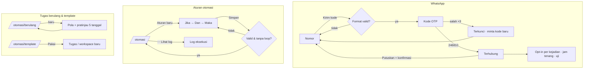
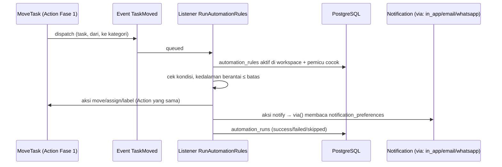

# Otomasi, WhatsApp, tugas berulang, template & Kinerja saya (F2-4)

> Pratinjau Fase 2 · dibangun Agen C · rute `/pengaturan/whatsapp`, `/otomasi`, `/otomasi/berulang`, `/otomasi/template`, `/kinerja` · data contoh, tidak menyimpan apa pun. Indeks: [README](README.md).

## 1. Tujuan & masalah

| Bagian | Masalah | Solusi |
|---|---|---|
| **WhatsApp** | Notifikasi email sering tidak dibaca; karyawan hidup di WhatsApp (PRD §9 "adopsi rendah"). | Verifikasi nomor (OTP), opt-in per kejadian, jam tenang khusus WA, pratinjau template pesan. Provider (Meta Cloud API vs gateway) **belum diputuskan** (PRD §10 no. 2), jadi kanal tetap di balik antarmuka `NotificationChannel` (ADR #9). |
| **Aturan otomasi** | Langkah berulang manual: "kalau tugas pindah ke Review, kabari Kadiv". | Pembangun aturan *Jika → Dan → Maka* per workspace dengan log eksekusi. |
| **Tugas berulang** | Laporan mingguan/bulanan dibuat ulang tangan. | Pola Harian / Mingguan / Bulanan / Tiap N minggu dengan pratinjau 5 tanggal berikutnya. |
| **Template** | Struktur tugas & workspace proyek dibuat ulang tiap kali. | Template tugas (checklist, label, estimasi) dan template workspace (kolom status, label). |
| **Kinerja saya** | Karyawan tidak bisa melihat data dirinya sendiri (PRD §9 "merasa diawasi"). | Metrik output pribadi berdampingan, **tanpa skor gabungan** (ADR #8). |

## 2. Peran yang memakai

- **Semua karyawan**: WhatsApp (nomor sendiri), Kinerja saya.
- **Pemilik/admin workspace**: aturan otomasi, tugas berulang, template.
- **Super Admin**: memilih penyedia WhatsApp (panel "Layanan WhatsApp", info admin).

## 3. Layar

### WhatsApp · `/pengaturan/whatsapp`

Kartu sambungan (nomor → kode OTP → Terhubung), tabel kejadian dengan kolom In-app / Email / **WhatsApp**, jam tenang, pratinjau pesan (gelembung chat, sakelar "Tampilkan variabel" `{{1}}`), kirim pesan uji, putuskan sambungan, panel "Layanan WhatsApp".

### Aturan otomasi · `/otomasi`

KPI (aktif, eksekusi, gagal), daftar aturan dengan sakelar jeda/aktif, menu ⋯ (Lihat log, Duplikat, Hapus), log eksekusi.

Pembangun aturan: nama, workspace, **Jika** (pindah ke kategori kolom / lewat tenggat / dibuat berlabel), **Dan** opsional (prioritas / penanggung jawab), **Maka** 1–3 aksi (beri tahu orang/peran/penanggung jawab/pengamat, tugaskan, tambah label, pindahkan kolom). Kalimat pratinjau berubah langsung.

### Tugas berulang · `/otomasi/berulang`

Daftar dengan pola ("Setiap 2 minggu, hari Selasa dan Kamis"), penanggung jawab, jadwal berikutnya, jumlah dibuat; sakelar jeda; ⋯ Ubah / Buat sekarang / Hapus.

### Template · `/otomasi/template`

Tab Tugas / Workspace, kartu template dengan jumlah pemakaian, Pakai template, Template tugas baru.

### Kinerja saya · `/kinerja`

Filter 8 minggu / Bulan ini / Kuartal, empat metrik terpisah (tingkat penyelesaian, ketepatan waktu, lead time, kedisiplinan hadir) + Terlambat sekarang, definisi metrik (tooltip desktop + "Cara menghitung metrik"), grafik batang bertumpuk per minggu (tepat waktu vs lewat tenggat) dengan tabel `sr-only`, selesai per workspace, kehadiran bulan lalu, catatan privasi.

## 4. Alur langkah demi langkah

**WhatsApp**
1. `/pengaturan/whatsapp` → ketik `021-555` → **Kirim kode** → galat "Nomor ponsel diawali 08 atau +62 8."
2. Ketik `0812-3456-7890` → **Kirim kode** (toast, hitung mundur kirim ulang 60 detik).
3. Kode `111111` → "Kode salah. Sisa 2 percobaan." (3 kali salah = terkunci, minta kode baru). Kode `246810` → **Terhubung** (kode contoh sengaja ditampilkan di layar).
4. Nyalakan/matikan WhatsApp per kejadian → ubah jam tenang (Select per 30 menit; prioritas tinggi tetap dikirim) → pratinjau pesan → **Kirim pesan uji** → **Putuskan sambungan** (dialog konfirmasi).

**Aturan otomasi**
1. `/otomasi` → sakelar jeda/aktif → ⋯ Lihat log (log tersaring).
2. **Aturan baru** (dialog desktop / FAB + bottom sheet ponsel) → **Simpan** tanpa isian → galat per isian.
3. Isi Jika "Tugas pindah ke kolom kategori Review", Maka "Beri tahu Kepala Divisi" → kalimat pratinjau → Simpan. Aksi "pindahkan ke kolom" yang sama dengan pemicu ditolak (mencegah loop).

**Tugas berulang**: **Tugas berulang baru** → judul, workspace, penanggung jawab → pola (Harian hanya hari kerja / Mingguan pilih hari / Bulanan tanggal 1–31, 31 = akhir bulan / Tiap N minggu) → mulai & berakhir → pratinjau 5 tanggal berikutnya dari Sen 5 Okt 2026 → Simpan.

**Template**: tab Tugas → **Pakai template** → workspace, judul, tenggat, cek checklist & label → toast "Tugas OPS-131 dibuat". Tab Workspace → **Pakai template** → nama → kode diusulkan otomatis ("PPX") + validasi format/unik, visibilitas, pratinjau kolom status.

**Kinerja saya**: `/kinerja` → ganti periode → baca definisi metrik → grafik per minggu (tetap 8 minggu terakhir).

Alur backend nanti (eksekusi aturan):

## 5. Penjelasan kode

| File | Peran |
|---|---|
| `pages/automation/{whatsapp,rules,recurring,templates,performance}.tsx` | Halaman. Setiap halaman memakai satu komponen layar dengan prop `mobile` (dialog di desktop/tablet, BottomSheet + FAB di ponsel; tabel di desktop, kartu di ponsel), bukan file `*.desktop/*.mobile` terpisah, karena perbedaannya kecil. |
| `features/automation/types.ts` | `WhatsappSettings` (+ `WhatsappEvent`, `WhatsappTemplate`), `AutomationProps` (`AutomationRule` dengan `RuleTrigger`/`RuleCondition`/`RuleAction`/`RuleTarget`, `RuleRun`), `RecurringProps` (`RecurringTask`, `RecurrencePattern`), `TemplatesProps` (`TaskTemplate`, `WorkspaceTemplate`), `PerformanceProps` (`PeriodCounts`, `WeekBucket`, `OverdueTask`). |
| `features/automation/fixtures.ts` | `TODAY = '2026-10-05'`, `PEOPLE`, `WORKSPACES`, `LABELS`, `WHATSAPP`, `DEMO_OTP = '246810'`, `AUTOMATION`, `RECURRING`, `TEMPLATES`, `PERFORMANCE`. Setiap halaman menerima **satu prop** berbentuk sama dengan fixture-nya (`whatsapp`, `automation`, `recurring`, `templates`, `performance`) karena prop bersama `workspaces` dari `HandleInertiaRequests` akan tertimpa bila digabung. |
| `phone.ts` | `normalizePhone` (E.164 `+62…`), `formatPhone` (`+62 812-3456-7890`), `maskPhone`. |
| `rules.ts` | `describeRule`/`describeAction` (kalimat pratinjau), `validateRule` (termasuk penjaga loop), `encodeTarget`/`decodeTarget`. Pemicu memakai **kategori** status, bukan nama kolom (PRD M4). |
| `recurrence.ts` | `nextOccurrences` (tanggal 31 di bulan pendek, jangkar tiap N minggu), `describePattern`, `validateRecurring`. |
| `performance.ts` | `rate`, `median`, `computeMetrics`, `weekBars`, `isEmptyPerformance`. Rumus PRD M7 (ketepatan waktu 33/37 = 89%). |
| `helpers.ts`, `automation.test.ts` (35 test) | `renderTemplate`/`boldSegments`, jam tenang lintas tengah malam, kunci workspace, `previewStateFromUrl`; test juga memastikan **tidak ada skor gabungan**. |
| `whatsapp/use-whatsapp.ts` + `connection-card.tsx`, `event-optins.tsx`, `side-cards.tsx`, `settings-header.tsx`, `whatsapp-screen.tsx` | Hook status sambungan/OTP/opt-in + tampilan. `settings-header.tsx` = salinan header Pengaturan dengan tab "WhatsApp". |
| `rules/rule-builder.tsx`, `rules/rules-screen.tsx`, `recurring/*`, `templates/*`, `performance/week-chart.tsx`, `performance/performance-screen.tsx` | Tampilan per layar. |
| `preview-state.tsx`, `automation-nav.tsx`, `form-fields.tsx`, `form-surface.tsx` | `PreviewBar`, navigasi antar layar otomasi, field berlabel, permukaan Dialog/BottomSheet. |

## 6. Bentuk data → tabel DATABASE.md

| Tipe frontend | Tabel | Catatan |
|---|---|---|
| `WhatsappEvent` (in_app/email/whatsapp) | `notification_preferences` (`channel = whatsapp`) | Sudah ada |
| `WhatsappSettings.phone`, `connected_at` | **belum ada**: `employee_profiles.phone` + `whatsapp_verified_at`, atau tabel `whatsapp_channels` | |
| `quiet_hours` WA | perluas `notification_settings` (`wa_quiet_start/end`, `wa_allow_high_priority`) | |
| `WhatsappTemplate` | **belum ada**: `whatsapp_templates` (name, event, body, status persetujuan) | |
| `AutomationRule`, `RuleRun` | **belum ada**: `automation_rules` (workspace_id, name, trigger/condition/actions jsonb, is_active, created_by, last_run_at, run_count), `automation_runs` (rule_id, task_id, result, detail, ran_at) | |
| `RecurringTask` | **belum ada**: `recurring_tasks` (workspace_id, title, assignee_id, priority, pattern jsonb, starts_on, ends_on, is_active, created_count, last_created_on) | PRD Fase 2 "task berulang" |
| `TaskTemplate`, `WorkspaceTemplate` | **belum ada**: `task_templates`, `workspace_templates` | |
| `PerformanceProps` | tanpa tabel baru: `tasks`, `task_assignees`, `attendance_days` (MetricDefinitions di `app/Domain/Analytics`) | |

## 7. Pekerjaan backend tersisa

- [ ] **Keputusan pemilik:** provider WhatsApp (Meta Cloud API resmi vs gateway).
- [ ] WhatsApp: penyimpanan nomor terverifikasi, `SendWhatsappOtp` (rate limit, kode berumur pendek, simpan hash, maks. 3 percobaan), `VerifyWhatsappOtp`, `DisconnectWhatsapp` (+ `audit_logs`). Kanal `WhatsappChannel` di balik `NotificationChannel`, tabel template, job antrean dengan retry/backoff.
- [ ] Otomasi: migrasi `automation_rules`, `automation_runs`; Policy (hanya owner/admin workspace); listener pada `TaskMoved`/`TaskCreated` + job harian "lewat tenggat"; penjaga loop & batas kedalaman berantai; aksi memakai Action yang ada (`AssignTask`, `MoveTask`, label, Notification).
- [ ] Tugas berulang: migrasi `recurring_tasks`; job terjadwal 07.00 WIB memanggil `CreateTask` (idempoten per tanggal) dengan porting `recurrence.ts` ke PHP + test Pest.
- [ ] Template: migrasi `task_templates`, `workspace_templates`; `ApplyTaskTemplate`, `CreateWorkspaceFromTemplate` (key `^[A-Z][A-Z0-9]{1,9}$`, unik termasuk `previous_keys`); "Simpan sebagai template" di Pengaturan workspace.
- [ ] Kinerja saya: query `app/Domain/Analytics` untuk satu orang (periode, tren 8 minggu, per workspace, terlambat, rata-rata jam masuk); akses pemilik/atasan langsung/HR (Policy + test matriks), cache 5 menit.
- [ ] Shell: tab "WhatsApp" di `settingsLinks()` (`layouts/settings/layout.tsx`), tautan "Kinerja saya" dari Beranda (SBeranda "Ringkasan · Kinerja saya").
- [ ] Perbarui DATABASE.md untuk semua tabel baru.

## 8. Keadaan kosong/galat & aksesibilitas

- "Lihat keadaan: Berisi · Kosong · Galat · Memuat" di samping banner (atau `?keadaan=`).
- Grafik Kinerja punya tabel `sr-only` (dibungkus `div.sr-only`, perbaikan bug #4); metrik selalu angka + teks hitungan, tidak warna saja.
- Jam tenang memakai Select "21.00" (bukan `input type=time` yang mengikuti locale).
- OTP memakai `InputOTP` (`autocomplete="one-time-code"`). Galat nomor diumumkan di bawah field.
- Tablet 834: baris tugas berulang turun ke bawah judul (perbaikan bug #5).

## 9. Batasan prototipe

- Grafik per minggu selalu 8 minggu terakhir (tidak ikut filter periode), sama dengan desain. Ketepatan waktu 89% (rumus PRD) sedangkan desain menulis 88%.
- Kode OTP contoh `246810` ditampilkan di layar.
- Tab "WhatsApp" hanya ada di header salinan halaman ini; halaman Pengaturan lain belum menampilkannya.
- `/kinerja` hanya bisa dibuka dari hub `/pratinjau`.
