# Rapat, notulen & kalender (F2-3)

> **Fitur nyata sejak Okt 2026** (branch `claude/f2-rapat`) · rute `/rapat`, `/rapat/baru`, `/rapat/{meeting}`, `/rapat/{meeting}/ubah`, `/rapat/{meeting}/notulen`, `/kalender`, `/manajemen/jadwal` (`routes/meetings.php`) di balik `FEATURE_MEETINGS` (nyala lokal, mati produksi sampai rilis) · data tersimpan di `meetings`, `meeting_participants`, `meeting_minutes`, `meeting_minute_versions`, `meeting_action_items` (`docs/DATABASE.md` §7). **Integrasi Google Calendar/Meet dan WhatsApp ditahan pemilik.** **Video RuangKerja** (rapat video bawaan di server LiveKit sendiri, §6a) dibangun 7 Okt 2026: `/rapat/{id}/gabung`, `/rapat/{id}/ruang`, tabel `meeting_attendances`, aktif bila `LIVEKIT_*` diisi; panduan pengguna & tampilan baru arah C "Notulen Hidup": [rapat-video](rapat-video.md), privasi: [rapat-video-privasi](rapat-video-privasi.md). Gambar di bawah berasal dari masa pratinjau; tata letaknya sama, kontrol Google kini berlabel "Ditahan". Indeks: [README](README.md).

## 1. Tujuan & masalah

Undangan rapat selama ini dibuat manual, notulen ditulis terpisah, dan tindak lanjut rapat tidak pernah menjadi tugas sehingga tidak terlacak. Modul ini menyatukan:

- **Agenda rapat** saya minggu ini dengan aksi sesuai keadaan (Gabung, Lengkapi notulen, Lihat notulen).
- **Jadwalkan / ubah / batalkan rapat**, termasuk rapat berulang (setiap hari kerja, setiap minggu, Senin-Rabu-Jumat) dengan tanggal akhir opsional, deteksi **bentrok** jadwal peserta terhadap rapat RuangKerja lain dan usulan jam kosong.
- **Notulen per kemunculan rapat**: kehadiran, catatan per butir agenda (tersimpan otomatis, berversi), keputusan, **tindak lanjut** yang bisa **"Jadikan tugas"** (nomor `OPS-156` dst. di workspace rapat), finalisasi yang mengunci dan dibagikan ke peserta.
- **Kalender** gabungan: rapat, tenggat tugas saya, cuti/izin/sakit/dinas yang disetujui, hari libur (lapisan bisa dinyalakan/dimatikan).
- **Jadwal & notulensi manajemen** untuk Direksi/HR: rapat pimpinan minggu ini, notulen terbaru, dan tindak lanjut lintas divisi.

## 2. Peran & akses

| Siapa | Bisa |
|---|---|
| Peserta internal (diundang) | Melihat rapat & notulen, menjawab kehadiran (Hadir/Mungkin/Tidak), mencentang tindak lanjut miliknya |
| Notulis | + menulis notulen draf, finalkan & bagikan, jadikan tugas, ingatkan PIC |
| Penyelenggara | + ubah & batalkan rapat, buka kembali notulen final |
| Direksi · HR · Super Admin (`dashboard.view_company`) | `/manajemen/jadwal`; **rapat pimpinan** (`leadership`) terlihat (baca saja) walau tidak diundang; hanya mereka yang bisa menandai rapat sebagai rapat pimpinan |
| Lainnya (termasuk Super Admin untuk rapat biasa) | Tidak melihat apa pun — **404** |
| Tamu eksternal (email) | Disimpan sebagai peserta, belum menerima email (undangan kalender Google ditahan), tidak pernah melihat isi aplikasi |

Sumber kebenaran: `App\Policies\MeetingPolicy` = `Meeting::visibleTo()` (diuji identik).

## 3. Layar

### Agenda · `/rapat`

Kartu gradien "Rapat berikutnya" (Gabung membuka tautan di tab baru, Salin tautan, Buka notulen), tab hari Sen–Jum atau "Minggu ini" (`?minggu=YYYY-MM-DD` untuk minggu lain), baris rapat dengan aksi sesuai keadaannya, panel "Tindak lanjut untuk Anda" (butir terbuka yang belum menjadi tugas). Banner hangat saat rapat sedang berlangsung.

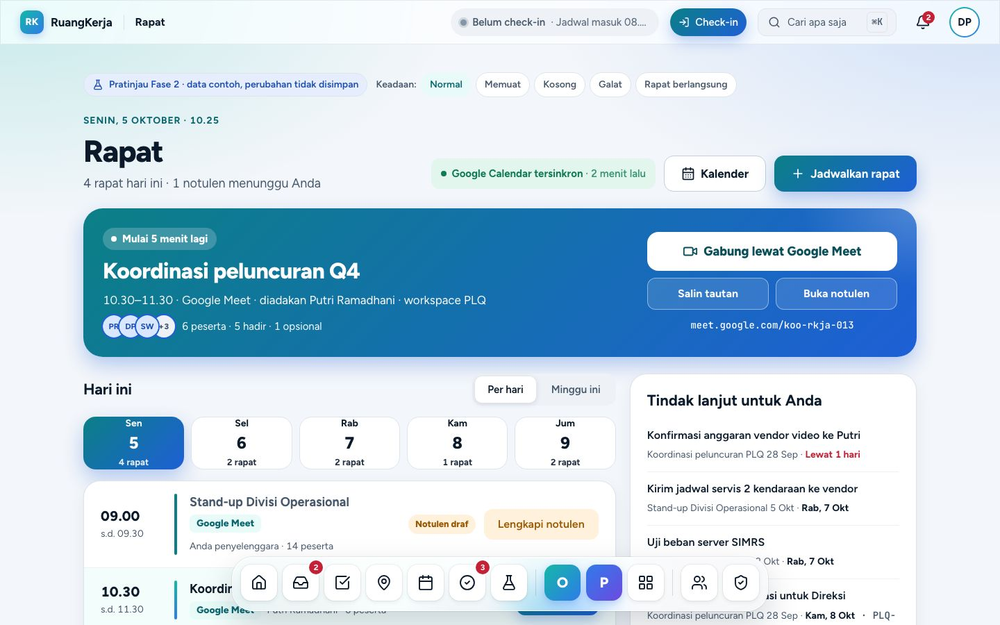

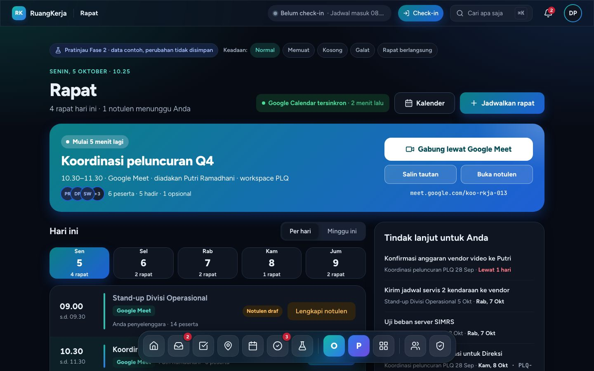

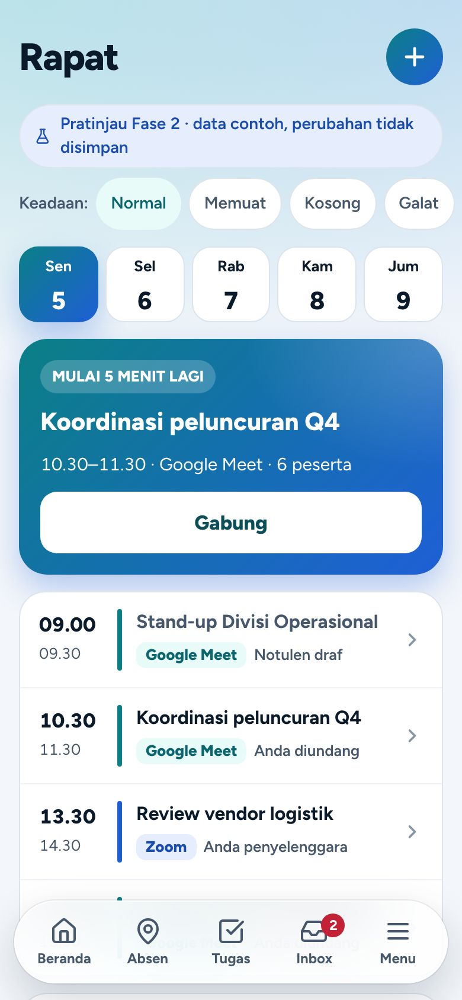

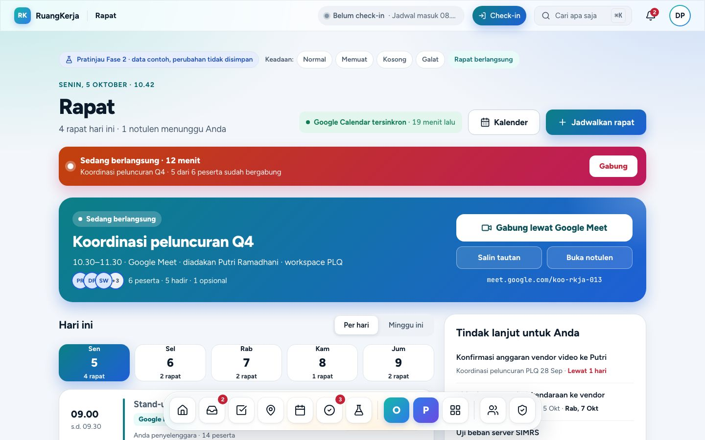

**Pemberitahuan rapat dimulai** (DNotifRapat/MNotifRapat): muncul sendiri mulai 5 menit sebelum rapat (jam perangkat, tanpa polling) sampai rapat selesai, kecuali sudah ditutup di tab itu; **Tunda 5 mnt**, Gabung, Salin tautan. Server juga mengirim notifikasi `meeting.starting` sesuai pengingat rapat (Inbox + email sesuai preferensi).

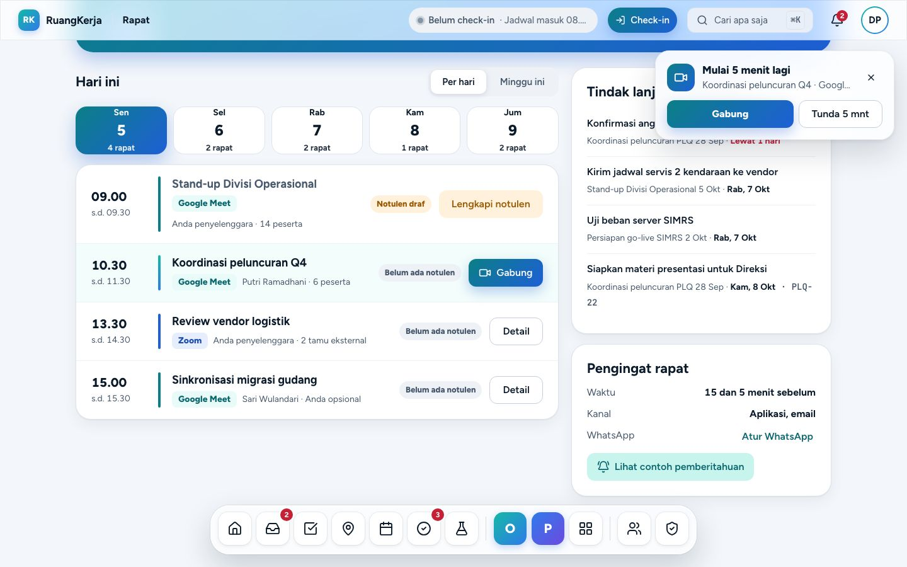

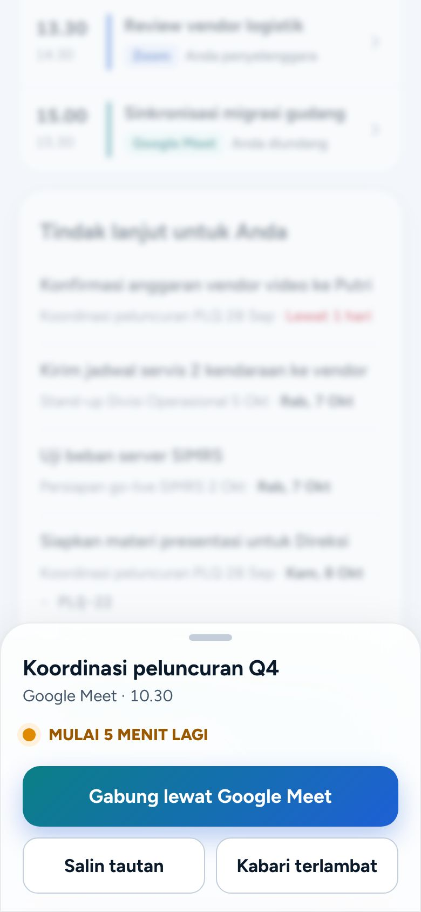

### Jadwalkan / ubah rapat · `/rapat/baru`, `/rapat/{id}/ubah`

Judul, tanggal, jam mulai (pilihan 24 jam per 15 menit, tidak mengikuti locale browser), durasi, tempat (**Video RuangKerja**: ruang video bawaan tanpa tautan, pilihan bawaan bila server LiveKit sudah diatur; **Google Meet** / Zoom: tempel tautan; Tatap muka / Di klien: ruangan atau alamat), peserta (combobox ARIA, tamu lewat email), agenda, notulis, ulangi + "berulang sampai", workspace (dipakai "Jadikan tugas"), pengingat (30/15/5 menit), dan sakelar **Rapat pimpinan** untuk Direksi/HR. Kartu **bentrok** + "Pakai 14.30" diperbarui langsung dari `GET /rapat/bentrok`. Galat per isian (klien + server) dan fokus pindah ke galat pertama; ringkasan sebelum kirim (dialog di desktop, sheet di ponsel). Setelah tersimpan, halaman pindah ke detail rapat dengan toast "Undangan rapat terkirim ke N peserta".

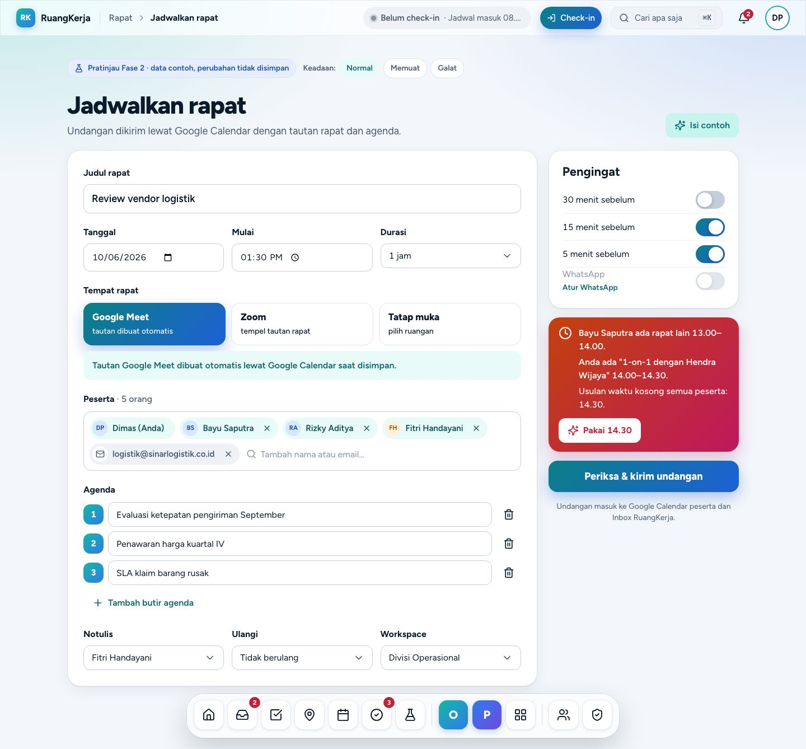

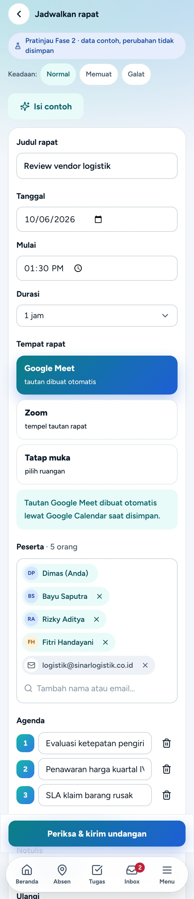

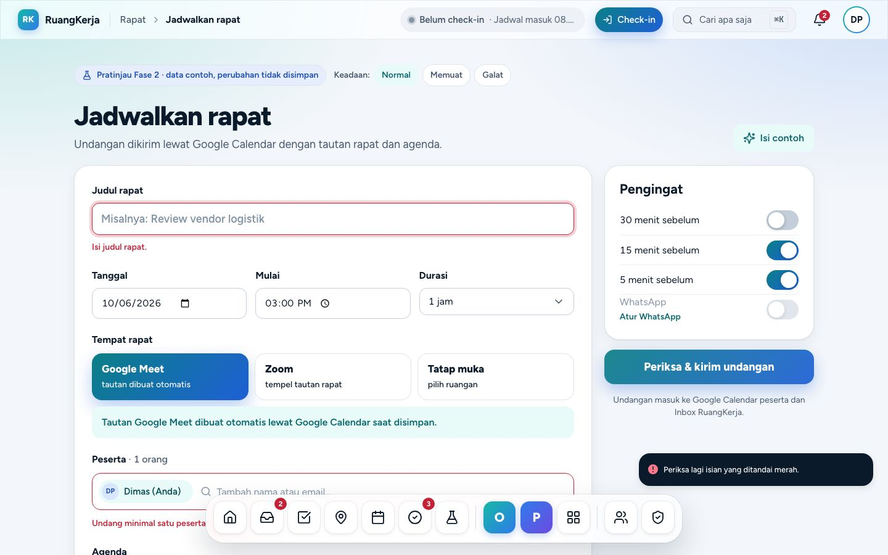

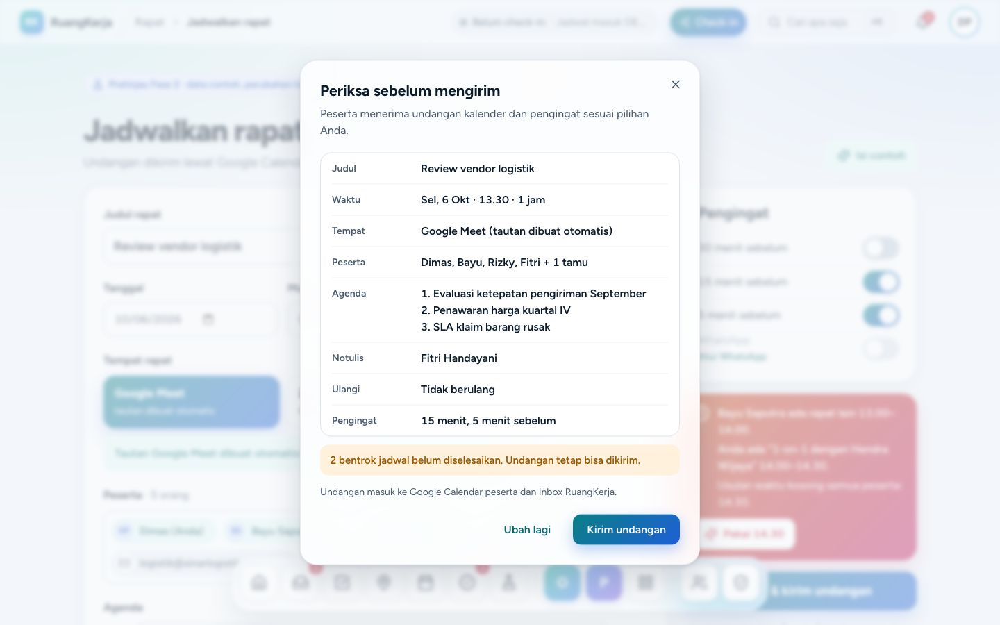

### Detail rapat · `/rapat/{meeting}`

Status (hitung mundur / berlangsung / selesai / **Dibatalkan**), kartu tautan rapat (atau ruangan), keterangan, agenda, peserta + RSVP, detail, "Kehadiran Anda" (simpan optimistis, kembali bila gagal), **Ubah** dan **Batalkan** (konfirmasi) untuk penyelenggara. Rapat berulang membuka kemunculan hari ini/berikutnya, atau `?tanggal=YYYY-MM-DD`.

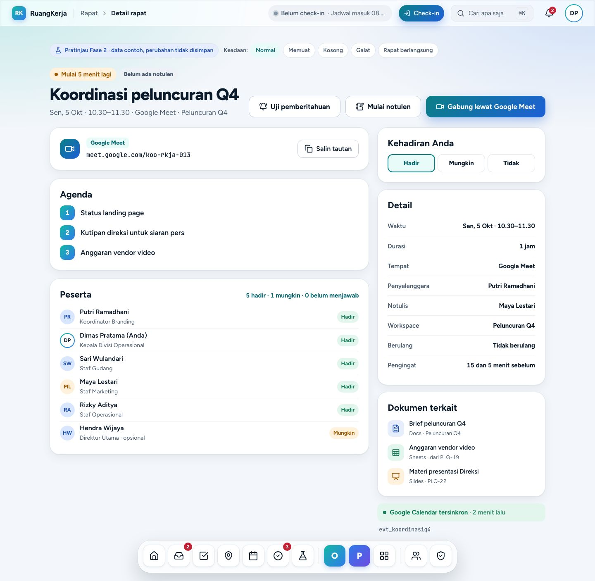

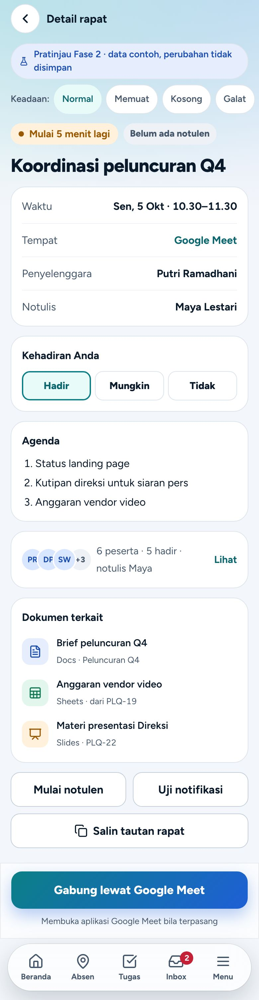

Rapat **Video RuangKerja**: kartu gabung menggantikan kartu tautan — "N orang di ruang rapat" (diperbarui tiap 30 detik selama ruang terbuka), hitung mundur "Dibuka dalam 12 menit" sebelum jendela gabung, tombol **Gabung rapat video**, Salin tautan; panel **Hadir di rapat video** (jam masuk–keluar, durasi, "Di ruang"). Server belum diatur → catatan ramah, tanpa tombol.

### Gabung & ruang rapat video · `/rapat/{meeting}/gabung`, `/rapat/{meeting}/ruang`

Layar penuh tanpa Dock/menu bar, arah desain **C "Notulen Hidup"** (pemilik, 7 Okt 2026; menggantikan tampilan mirip Google Meet): pra-gabung dengan pilihan sumber notulen, tindak lanjut terbuka, dan kartu persetujuan notulen otomatis; ruang dengan pita video di atas, notulen hidup di tengah (kolaboratif bila Catatan bersama + server kolaborasi aktif), Bagian di kiri, Waktu bicara/Kehadiran di kanan, bilah kontrol gelap ringkas; ponsel tab Video | Notulen. Panduan bergambar: [rapat-video](rapat-video.md); kontrak data: `docs/fitur/rapat-video-kontrak.md`.

### Notulen · `/rapat/{meeting}/notulen`

Draf: chip kehadiran, catatan per agenda (tersimpan otomatis ±1 detik setelah berhenti mengetik: "Disimpan HH.MM · N versi"), keputusan, tabel tindak lanjut (butir, penanggung jawab, tenggat, **Jadikan tugas** / **Jadikan semua tugas**; rapat tanpa workspace → pilih workspace dulu), **Finalkan & bagikan** (daftar masalah bila belum lengkap). Final: terkunci, tindak lanjut menjadi checklist (penanggung jawab boleh mencentang), **Ingatkan N PIC**, **Buka kembali draf** (penyelenggara). Tanpa `?tanggal` sebuah seri membuka kemunculan terakhir yang sudah dimulai.

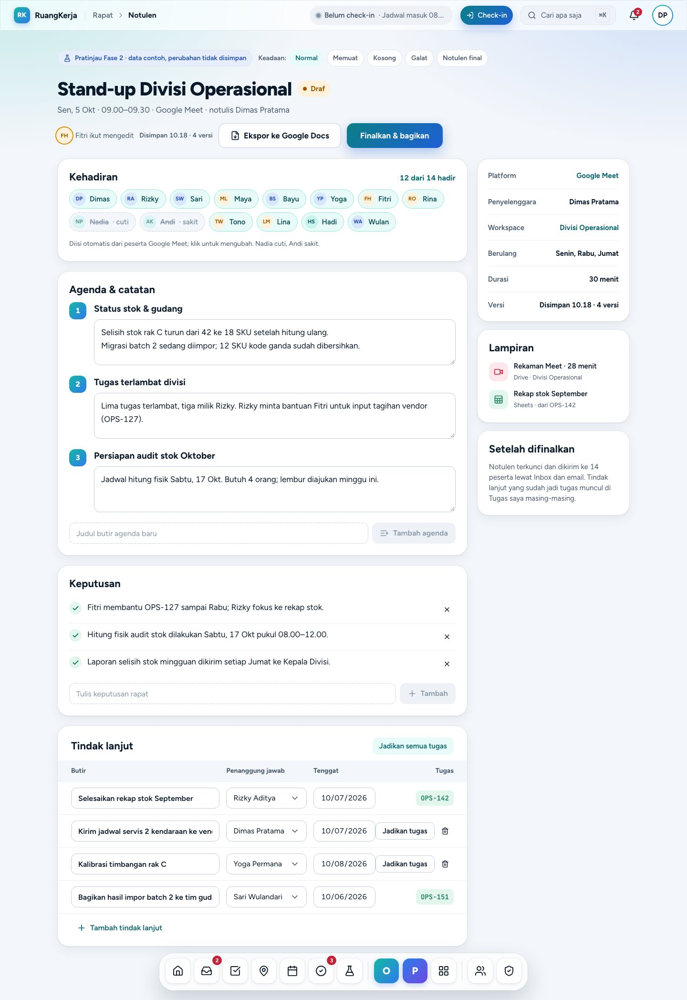

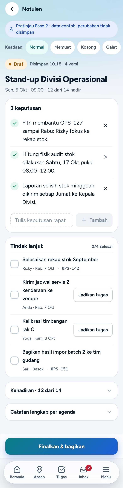

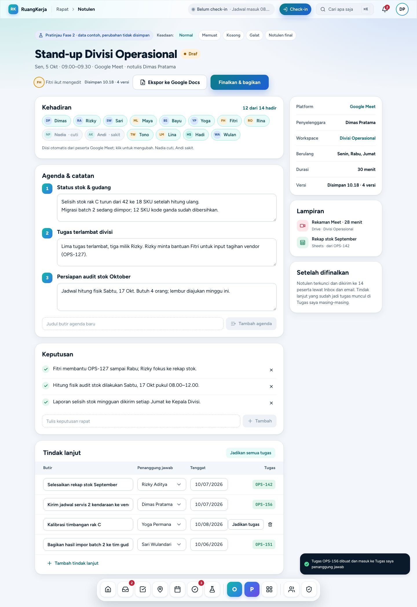

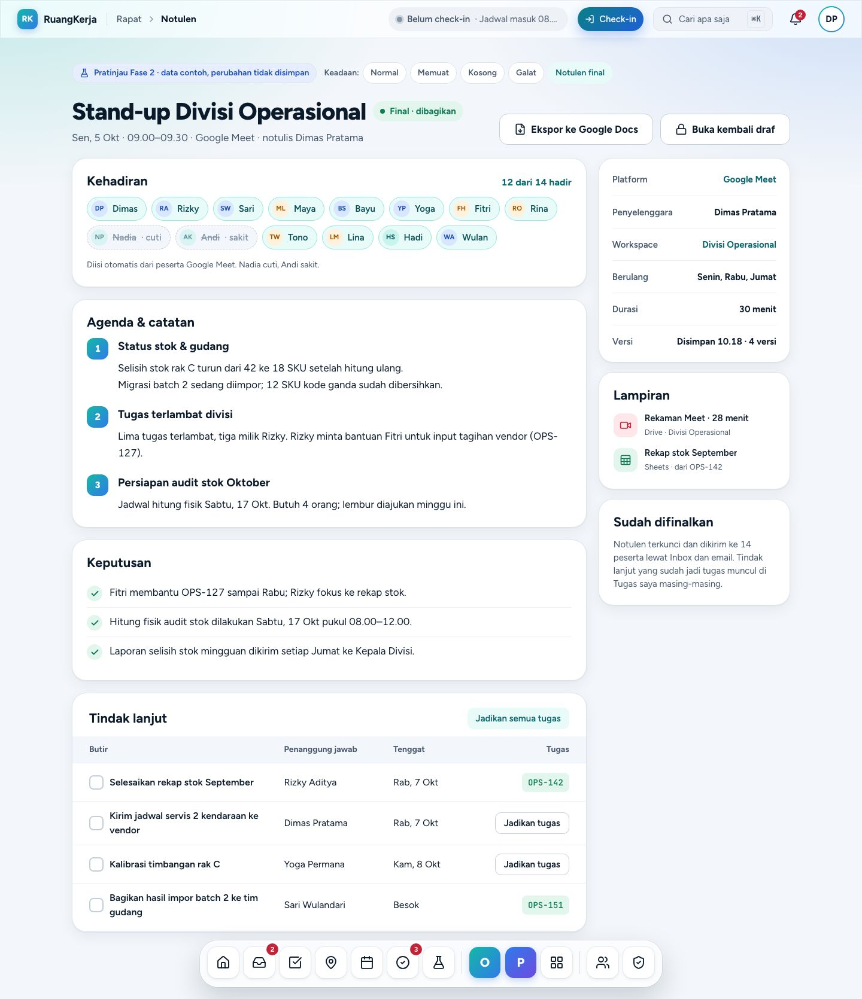

### Kalender · `/kalender?bulan=YYYY-MM`

Grid bulan dengan chip per lapisan, "+N lainnya", panel agenda hari terpilih, ‹ / Hari ini / › (bulan lain dimuat dengan kunjungan parsial), tab Minggu, lapisan (diingat per browser, lapisan terakhir tidak bisa dimatikan). Ponsel: strip minggu + agenda.

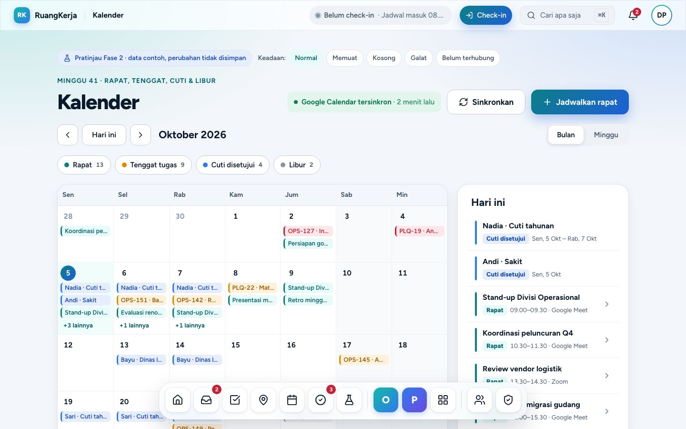

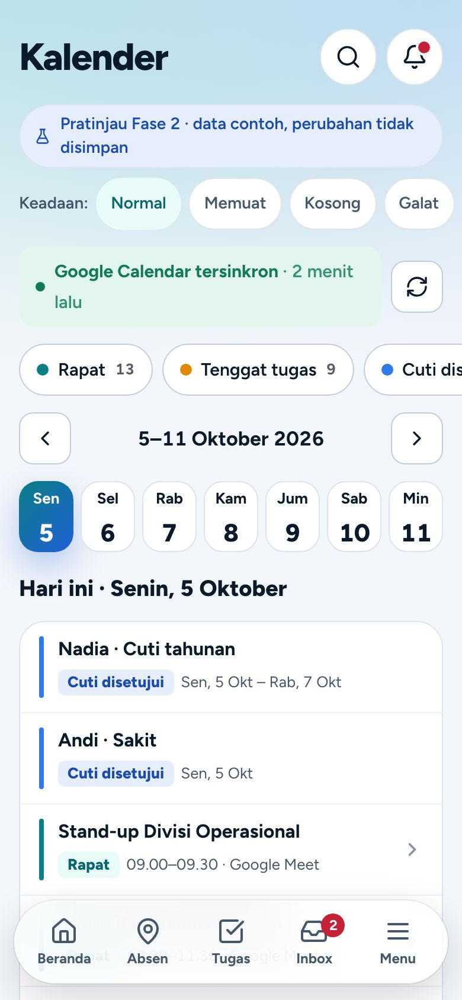

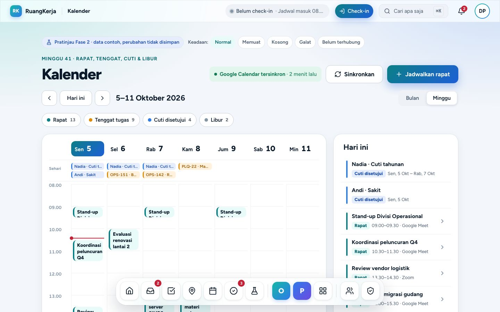

### Jadwal manajemen · `/manajemen/jadwal`

Grid minggu jam 08–17 dengan garis "sekarang", panel Notulensi (Semua/Draf/Tindak lanjut terbuka), Tindak lanjut rapat pimpinan (Terlambat/Berjalan/Selesai). Data: rapat pimpinan 4 minggu ke belakang sampai akhir minggu ini.

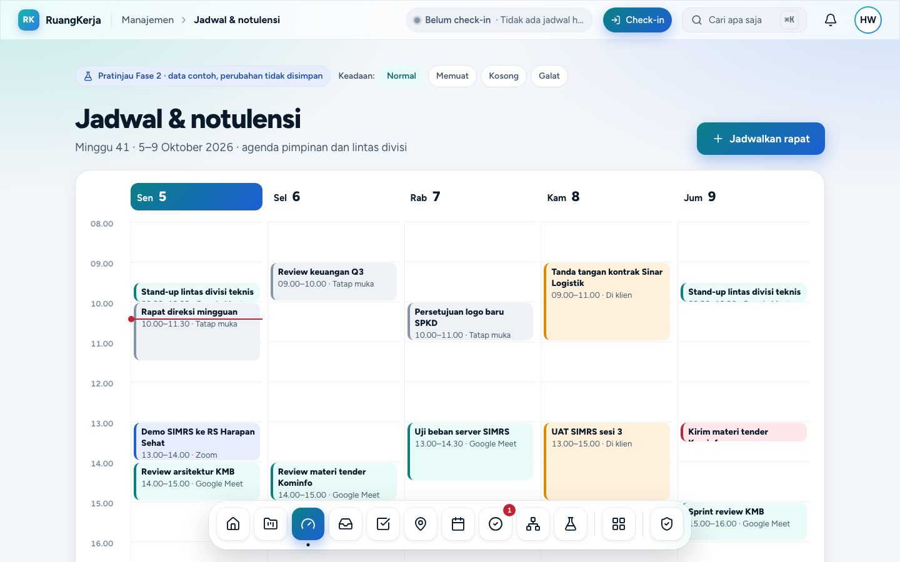

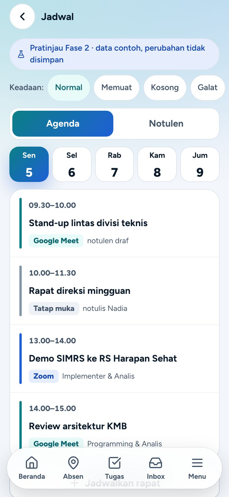

## 4. Cara mencoba (lokal)

1. `FEATURE_MEETINGS=true` (bawaan lokal), `php artisan migrate --seed` atau `php artisan db:seed --class=MeetingDemoSeeder`. Data demo relatif terhadap minggu berjalan: stand-up Operasional Sen/Rab/Jum (Dimas) dengan notulen final Jumat lalu — butir pertamanya sudah menjadi tugas OPS — dan draf kemunculan terbaru minggu ini; koordinasi peluncuran Q4 (Putri, PLQ); review vendor logistik lewat Zoom dengan tamu eksternal; rapat direksi mingguan dan sprint review RuangKerja (rapat pimpinan); 1:1 Dimas & Sari.
2. `kadiv@demo.test` → **Rapat** di Dock (Rail di tablet, **Lainnya › Kalender & rapat** di ponsel) → buka stand-up → **Notulen** → ketik catatan, tambah keputusan & tindak lanjut → **Jadikan tugas** → **Finalkan & bagikan** → muat ulang: semua tersimpan.
3. **Jadwalkan rapat** → undang Bayu pada jam stand-up → kartu bentrok + "Pakai 09.30" → **Periksa & kirim undangan**. `anggota@demo.test` melihat undangan di Inbox dan menjawab "Kehadiran Anda".
4. `direksi@demo.test` → `/manajemen/jadwal`; `anggota@demo.test` → `/manajemen/jadwal` = 403.
5. Pengingat: `php artisan schedule:work` (atau jalankan `App\Domain\Meetings\Jobs\SendMeetingReminders` / `SendActionItemReminders`).

## 5. Penjelasan kode

| Lapisan | Berkas |
|---|---|
| Skema | `database/migrations/2026_10_11_100100_create_meetings_tables.php`; model `App\Models\{Meeting,MeetingParticipant,MeetingMinutes,MeetingMinuteVersion,MeetingActionItem}`; enum `App\Domain\Meetings\Enums\{MeetingPlatform,Rsvp,Recurrence,MinutesStatus}` |
| Aturan | `App\Policies\MeetingPolicy`, `Meeting::visibleTo` / `involving` / `overlapping` |
| Actions | `ScheduleMeeting`, `UpdateMeeting` (ubah jam → RSVP peserta kembali "Belum menjawab" + notifikasi), `CancelMeeting`, `UpdateRsvp`, `SaveMinutes` (versi maks. satu per orang per 5 menit), `FinalizeMinutes` & `ReopenMinutes` (audit), `AddActionItem`, `UpdateActionItem`, `RemoveActionItem`, `ConvertActionItemsToTasks` (memakai `CreateTask`, butuh `WorkspacePolicy::editTasks`, idempoten), `RemindActionItemOwners` |
| Query | `AgendaQuery`, `FindConflicts` (+ saran slot 30 menit sampai 17.00), `CalendarFeed`, `ManagementSchedule`, `MeetingFeed` (pemuat bersama, tanpa N+1), `EditableWorkspaces`; layanan `MeetingOccurrences` (pengembangan seri), `MinutesStore`, `MeetingParticipants` |
| Notifikasi & jadwal | `MeetingInvitedNotification` (undangan/berubah/dibatalkan), `MeetingStartingNotification`, `MinutesFinalizedNotification`, `ActionItemDueNotification`; job `SendMeetingReminders` (tiap menit) dan `SendActionItemReminders` (07.05) di `routes/console.php` |
| HTTP | `App\Http\Controllers\Meetings\{MeetingController,MinutesController,CalendarController,ManagementScheduleController}`, FormRequest `App\Http\Requests\Meetings\*` (rapat tak terlihat → 404 sebelum validasi), `MeetingPresenter` |
| Frontend | `pages/meetings/*`; `features/meetings/{types,api,meetings-context,lib}.ts(x)`; hook `use-agenda`, `use-meeting-form`, `use-minutes`, `use-calendar`, `useMeetingDetail`, `useSchedule`; tampilan desktop/tablet/ponsel seperti masa pratinjau |
| Video RuangKerja | `config/livekit.php`; `App\Domain\Meetings\Services\{VideoRooms,LiveKitTokens,LiveKitRoomService}`, Actions `IssueVideoToken`, `RecordVideoEvent`, `MuteVideoParticipant`, `RemoveVideoParticipant`, Query `VideoAttendance`; `MeetingVideoController`, `LiveKitWebhookController`, `VideoPresenter`, model `MeetingAttendance`; frontend `features/meetings/video/*` (`prejoin`, `room`, `room-stage`, `room-panels`, `room-notices`, `use-video-room`, `video-join-card`, `lib`), halaman `pages/meetings/{join,room}.tsx` |
| Uji | `tests/Feature/Meetings/*` (policy, action, seri & bentrok, pengingat, HTTP, seeder, **`MeetingVideoTest`**: token & klaim JWT, jendela, webhook valid/invalid/replay, kehadiran, moderasi dengan `Http::fake`), blok Rapat di `PageQueryCountTest` (termasuk halaman video), `features/meetings/lib.test.ts`, `features/meetings/video/lib.test.ts`; manual dua pengguna `tests/e2e/rapat-video-two-users.mjs` |

## 6. Ditahan (tidak dibangun)

- Tautan **Google Meet otomatis**, sinkron **Google Calendar** (tabel `calendar_events`), **freeBusy** Google untuk bentrok, email/undangan kalender untuk **tamu eksternal**, ekspor notulen ke **Google Docs**: tampil sebagai label/tombol nonaktif "Ditahan".
- Pengingat **WhatsApp**: baris "WhatsApp · Ditahan".
- Belum ada: pembatalan satu kemunculan saja (pembatalan berlaku untuk seluruh seri), lampiran Drive di rapat, ko-editor realtime notulen, "Kabari terlambat". Chip "rapat 5 menit lagi" di MenuBar **tidak dibangun** (keputusan pemilik 6 Okt 2026); pengingat cukup lewat notifikasi `meeting.starting`.

## 6a. Video rapat sendiri pengganti Google Meet (keputusan pemilik 6–7 Okt 2026)

Tujuan: rapat video yang semirip mungkin dengan Google Meet dan serealtime mungkin, berjalan di server sendiri tanpa kuota bandwidth dan tanpa biaya per menit.

**Status (7 Okt 2026): dibangun sebagai "Video RuangKerja"** — pemilik memilih alternatif *layar rapat sendiri di RuangKerja dengan `@livekit/components-react`* (bukan La Suite Meet). Server: VPS rapat Biznet Gio NEO Lite Pro dengan LiveKit dari generator resmi (`livekit.spkd.store`, TURN `turn.spkd.store`), panduan `docs/deploy/RAPAT-VIDEO.md`; lokal `docs/SETUP-LOKAL.md` › "Rapat video". Ringkasan teknis:

| Bagian | Isi |
|---|---|
| Platform | `MeetingPlatform::Video` (`video`, "Video RuangKerja"), tanpa tautan; ditawarkan & jadi bawaan rapat baru bila `LIVEKIT_URL/KEY/SECRET` terisi (`config/livekit.php`, `VideoRooms::configured`) |
| Ruang | satu ruang LiveKit per kemunculan: `rk-{meeting}-{yyyymmdd}` (seri = ruang baru tiap tanggal) |
| Akses | `MeetingPolicy::openVideo` (penyelenggara, notulis, peserta internal; rapat dibatalkan 403; pengamat rapat pimpinan yang tidak diundang 403; lainnya 404), `joinVideo` = + **jendela gabung 15 menit sebelum mulai s.d. 2 jam sesudah selesai** (penyelenggara kapan saja), `moderateVideo` = penyelenggara |
| Token | `POST /rapat/{id}/video/token` (30/menit): JWT HS256 dibuat sendiri dengan `firebase/php-jwt` — `iss` kunci API, `sub` id pengguna, `name`, `nbf/exp` (10 menit; server LiveKit memperbarui token selama tersambung, klien minta token baru saat sambung ulang), grant `video` {room, roomJoin, canPublish, canSubscribe, canPublishData, canUpdateOwnMetadata} — **tanpa `roomAdmin`**, juga untuk penyelenggara (moderasi hanya lewat aplikasi, audit `docs/security/AUDIT-RAPAT-2026-10.md` R-03), `metadata` {avatar_url, organizer}. Jawaban `{url, token, room, identity, name, expires_at}`; 503 bila server belum diatur |
| Moderasi | `POST /rapat/{id}/video/peserta/{user}/bisukan` (track SID mikrofon) dan `DELETE /rapat/{id}/video/peserta/{user}` → Room Service API (Twirp HTTP, token admin 60 detik); keluarkan diaudit `meeting.video_participant_removed`. Belum ada larangan masuk ulang |
| Kehadiran | `POST /api/livekit/webhook` (tanpa sesi/CSRF, tanda tangan JWT + sha256 badan, anti-replay) → `meeting_attendances` per sesi → "Hadir di rapat video", jumlah di ruang, **isian awal kehadiran notulen** (peserta ditandai hadir bila pernah masuk ruang) |
| Notifikasi | `meeting.starting` rapat video: tombol utama **Gabung** → pra-gabung, sekunder "Lihat detail" |
| Klien | `livekit-client` + `@livekit/components-react` (hook saja, gaya Arus — tanpa `@livekit/components-styles`); adaptiveStream, dynacast, simulcast VP8 180/360/720p, berbagi layar 1080p/15 + lapisan 720p/5, Opus DTX + RED, peredam gema/bising |

**Sisa / berikutnya:** uji coba nyata 1–2 minggu di VPS rapat (≤ 20 orang, 4G, CPU & trafik — `RAPAT-VIDEO.md` §6); ruang tunggu/izin masuk (tamu eksternal belum didukung, semua peserta karyawan internal); larangan masuk ulang setelah dikeluarkan; reaksi emoji; latar blur; rekaman (Egress). Transkrip otomatis ke notulen dibangun sebagai **notulen otomatis** (worker `transcriber/`, ringkasan AI, menolak per orang; kontrak `docs/fitur/notulen-otomatis-kontrak.md`): [rapat-video](rapat-video.md) §3.4, [rapat-video-privasi](rapat-video-privasi.md), `docs/deploy/RAPAT-VIDEO.md` §7–§10.

Catatan pilihan awal (6 Okt 2026), untuk riwayat:

**Pilihan teknologi**
- **La Suite Meet** (`suitenumerique/meet`, lisensi MIT) di atas **LiveKit** (SFU WebRTC, Apache-2.0). Tampilan mirip Meet: ruang tunggu, grid, sorotan pembicara, chat, beberapa layar dibagikan, 100+ peserta, rekaman lewat LiveKit Egress (beta), transkrip & ringkasan (beta, tidak bersamaan dengan rekaman). Dipasang dengan Docker Compose.
- Alternatif setelah uji coba: layar rapat sendiri di RuangKerja dengan `@livekit/components-react`. Lebih terpadu dengan Rapat dan Notulensi; perlu paket baru dan 1–2 sprint.
- Jitsi Meet adalah cadangan (paling cepat dipasang, rekaman Jibri berat).

**Server rapat (terpisah dari VPS aplikasi)**
| Kebutuhan | Tanpa rekaman | Dengan 1 rekaman |
|---|---|---|
| CPU | 4 vCPU **eksklusif** | 8 vCPU |
| RAM | 8 GB | 16 GB |
| Disk | 40 GB SSD (rekaman ke object storage S3) | sama |
| Jaringan | IP publik statis, port 1 Gbps, **trafik tanpa kuota**, UDP masuk dibuka | sama |

- Kandidat: **Biznet Gio NEO Lite Pro** (vCPU/RAM eksklusif, kapasitas 10 Gbps tanpa biaya trafik tambahan, pusat data Indonesia).
- Sebelum membeli, tanyakan ke sales:
  1. Ada batas pemakaian wajar (FUP) untuk trafik keluar 60–100 Mbps selama 1–2 jam/hari (±1,5 TB/bulan)?
  2. Kecepatan port dijamin, atau dibagi?
  3. UDP (rentang media + 3478) tidak diblokir firewall atau proteksi DDoS?
  4. Ada IPv4 statis?
  5. Paket mana yang 4 vCPU eksklusif / 8 GB, dan berapa harganya?
- Hindari VPS dengan kuota trafik keluar (mis. OVH Singapura: 1–3 TB lalu 10 Mbps) dan VPS OpenVZ.
- Perkiraan trafik: rapat 20 orang 720p ±60 Mbps keluar, ±25–35 GB/jam. Peserta perlu ≥ 3 Mbps unduh, ≥ 1,5 Mbps unggah.

**Agar serealtime mungkin**
- Server di Jakarta; ping < 20 ms dari ISP Indonesia.
- UDP langsung. TURN/TLS 443 hanya cadangan untuk jaringan yang memblokir UDP.
- Simulcast + dynacast + adaptive stream.
- Opus DTX + RED.
- vCPU eksklusif.

**Langkah uji coba (sprint rapat)**
1. Sewa VPS rapat, pasang LiveKit + La Suite Meet (Docker Compose, domain mis. `rapat.<domain-kantor>`, TLS otomatis).
2. Uji 1–2 minggu dengan rapat nyata hingga 20 orang. Catat: jeda suara, putus-sambung, CPU, trafik, kualitas di 4G.
3. Bila lolos:
   - login tunggal (OIDC) dari RuangKerja;
   - rapat dengan `platform = meet` mendapat tautan ruang otomatis (menggantikan tempel tautan manual);
   - tombol **Gabung** di detail rapat.
4. Tahap berikutnya (opsional): rekaman ke Biznet NEO Object Storage, transkrip otomatis ke Notulensi (Whisper lokal), atau layar rapat sendiri dengan LiveKit.

Privasi: rekaman dan transkrip = data pribadi. Wajib pemberitahuan "rapat direkam" ke semua peserta, retensi terbatas, dan akses hanya peserta rapat.

## 7. Keadaan & aksesibilitas

- Skeleton saat breakpoint belum diketahui dan saat kalender memuat bulan lain; EmptyState untuk agenda/kalender/notulen kosong; galat jaringan → toast + rollback (RSVP, tindak lanjut) atau "Perubahan belum tersimpan" (autosave).
- Form: label pada semua input, galat diumumkan, fokus ke galat pertama; `PeoplePicker` = combobox ARIA (↑/↓, Enter, Esc); RSVP = radiogroup dengan panah.
- Ponsel: target sentuh ≥ 44 px, bilah aksi bawah di atas tab bar.
