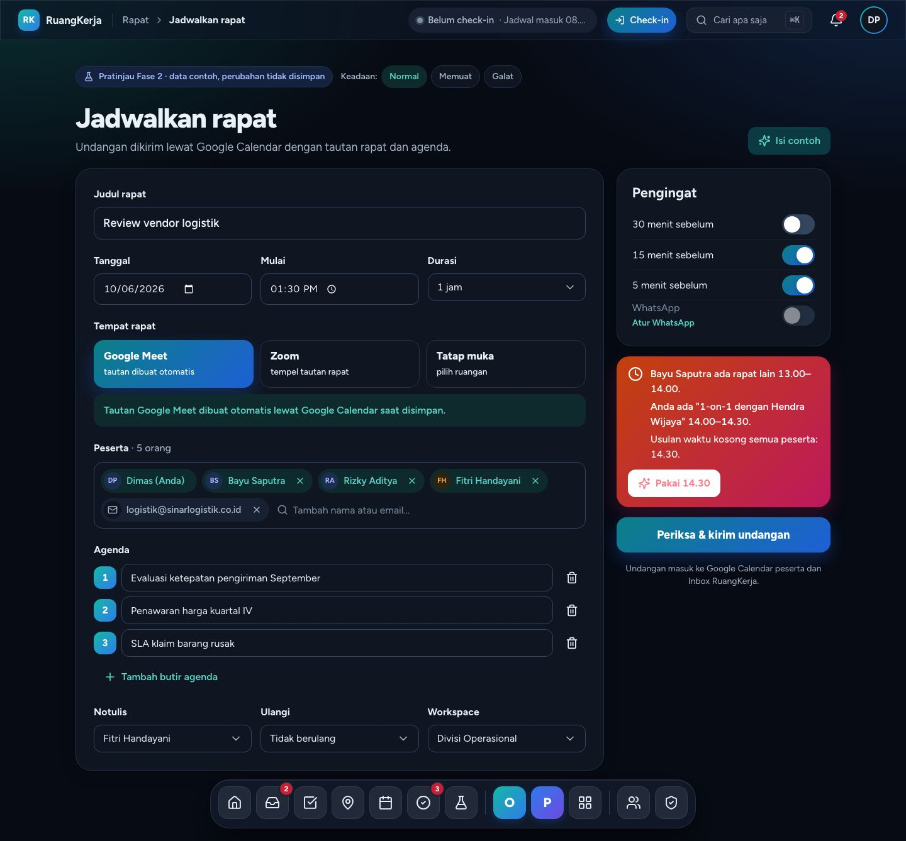
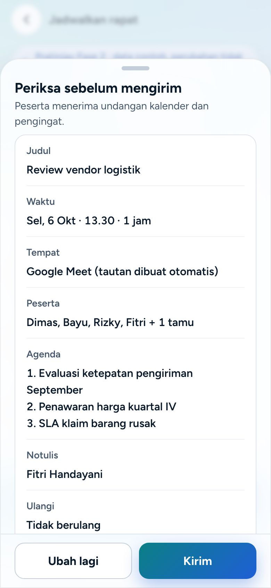
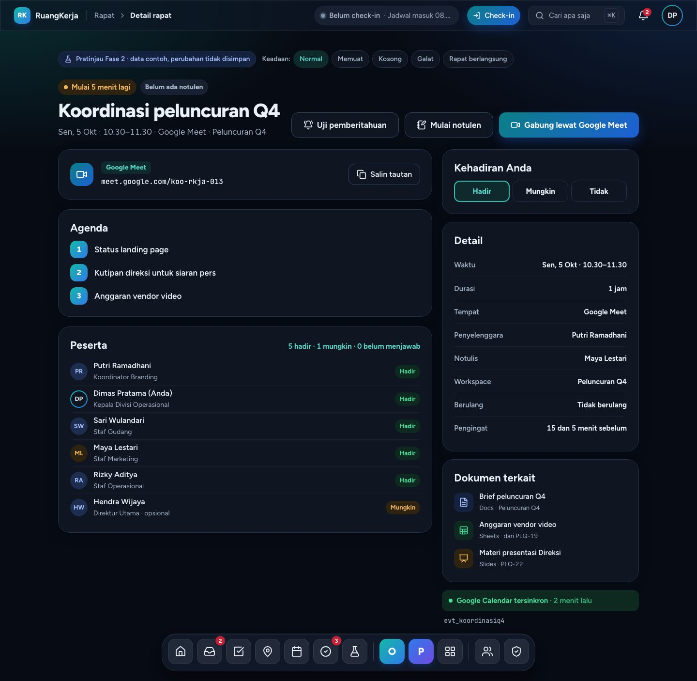
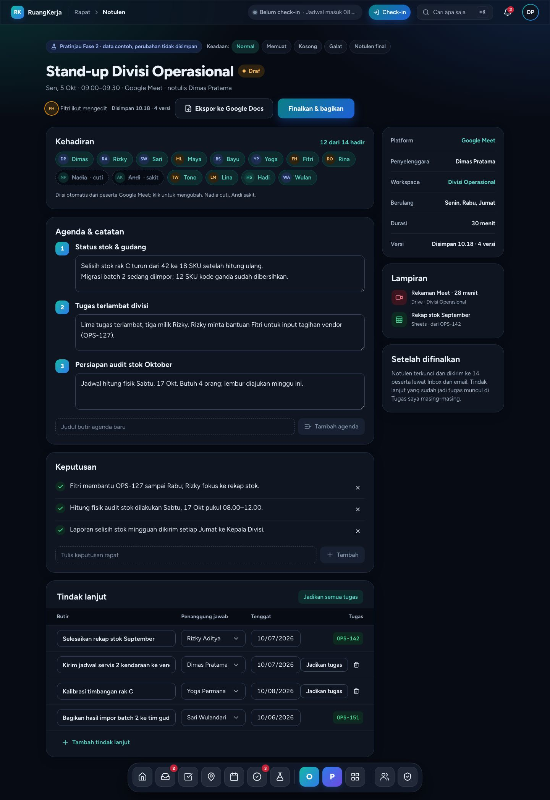
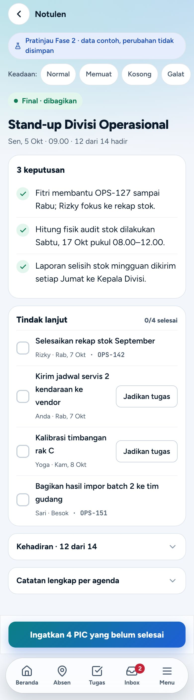
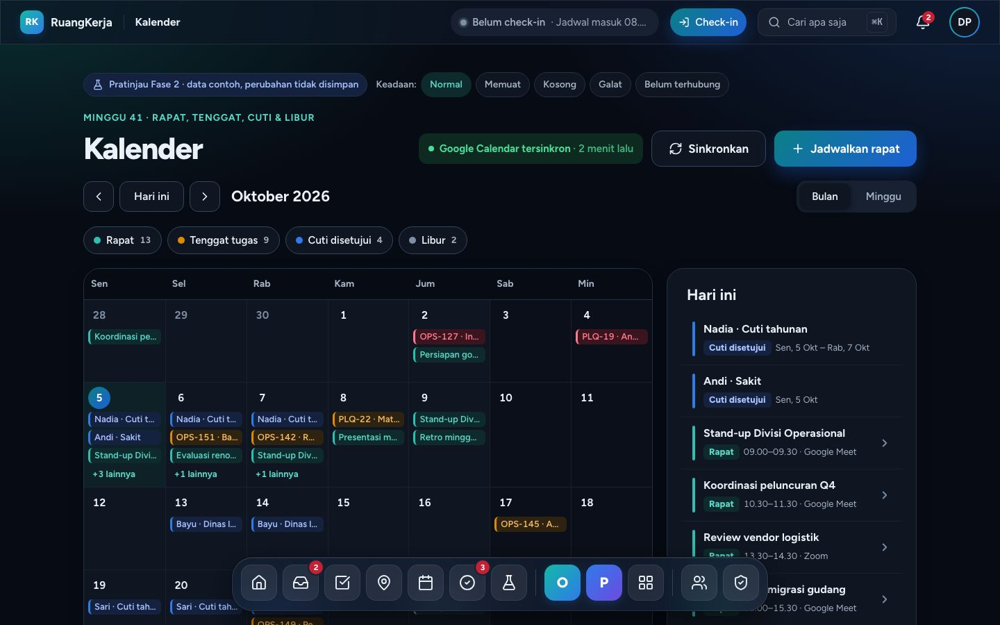
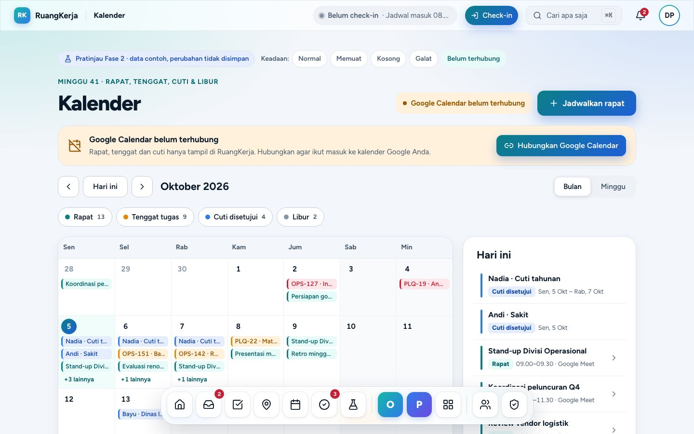
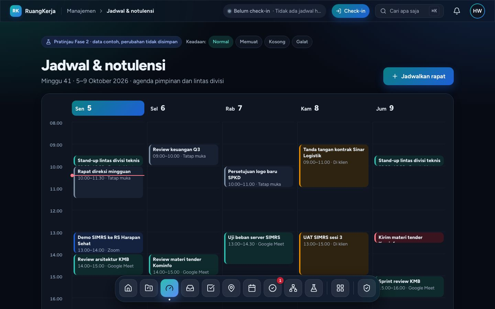
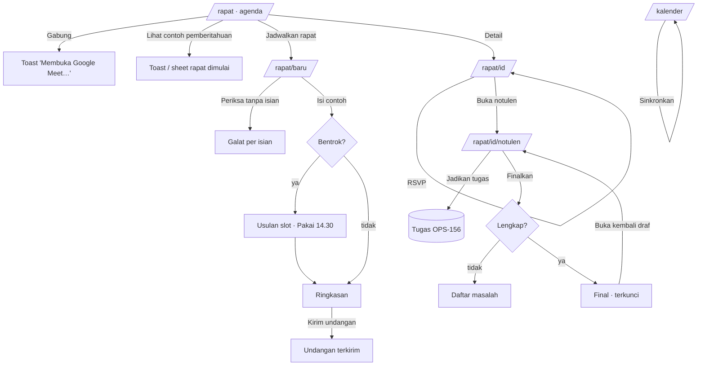
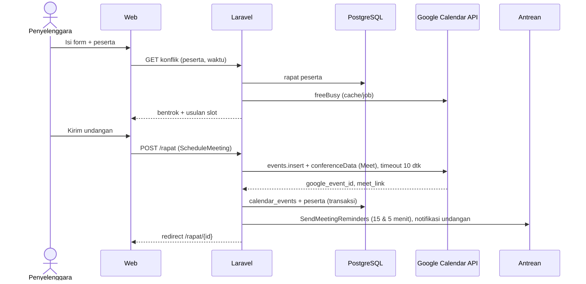

# Rapat, notulen & kalender (F2-3)

> Pratinjau Fase 2 · dibangun Agen B · rute `/rapat`, `/rapat/baru`, `/rapat/{meeting}`, `/rapat/{meeting}/notulen`, `/kalender`, `/manajemen/jadwal` · data contoh, tidak menyimpan apa pun. Indeks: [README](README.md).

## 1. Tujuan & masalah

PRD §6 menjadikan **Google Calendar + Meet** sebagai "video call tanpa membangun sendiri". Masalah saat ini: undangan rapat dibuat manual di Google Calendar, notulen ditulis terpisah, dan tindak lanjut rapat tidak pernah menjadi tugas sehingga tidak terlacak. Modul ini menyatukan:

- **Agenda rapat** saya hari ini/minggu ini dengan aksi sesuai keadaan (Gabung, Lengkapi notulen, Lihat notulen).
- **Jadwalkan rapat** dengan tautan Meet otomatis, deteksi **bentrok** jadwal peserta (rapat RuangKerja + blok sibuk Google Calendar) dan usulan slot kosong.
- **Notulen** per agenda: kehadiran, keputusan, **tindak lanjut** yang bisa **"Jadikan tugas"** (nomor `OPS-156` dst.), finalisasi yang mengunci.
- **Kalender** gabungan: rapat, tenggat tugas, cuti disetujui, hari libur (lapisan bisa dinyalakan/dimatikan).
- **Jadwal & notulensi manajemen** untuk Direksi (rapat pimpinan + tindak lanjut lintas divisi), mengisi panel kosong di `/manajemen`.

## 2. Peran yang memakai

| Peran | Layar |
|---|---|
| Semua karyawan | `/rapat`, detail, notulen (sebagai peserta/notulis), `/kalender` |
| Penyelenggara | `/rapat/baru`, ubah rapat, finalkan notulen |
| Direksi · HR · Super Admin (`dashboard.view_company`) | `/manajemen/jadwal` |

Pratinjau: persona Dimas, jam contoh **Sen 5 Okt 2026 10.25 WIB** yang berjalan real time (tick 15 detik), sehingga "Mulai 5 menit lagi" benar-benar bergerak.

## 3. Layar

### Agenda · `/rapat`

Kartu gradien "Rapat berikutnya" (Gabung, Salin tautan, Buka notulen), tab hari Sen–Jum atau "Minggu ini", baris rapat dengan aksi sesuai keadaannya.

Chip Keadaan "Rapat berlangsung" (`?jam=10.42`) menampilkan banner "Sedang berlangsung · 12 menit".

**Pemberitahuan rapat dimulai** (DNotifRapat/MNotifRapat): toast kaca di kanan atas (desktop) atau bottom sheet (ponsel) dengan Gabung, Tunda 5 mnt, Salin tautan, Kabari terlambat.

### Jadwalkan rapat · `/rapat/baru`

Judul, tanggal/jam/durasi, peserta (combobox ARIA, tamu lewat email), platform (Google Meet / Zoom / Tatap muka), agenda, Ulangi, Notulis, Workspace, pengingat. Kartu **bentrok** + usulan slot.

Validasi per isian (fokus pindah ke galat pertama):

Ringkasan sebelum mengirim undangan (dialog di desktop, sheet di ponsel):

### Detail rapat · `/rapat/{meeting}`

Hitung mundur, kartu tautan Meet, agenda, peserta + RSVP, dokumen terkait, info rapat, status sinkron Google Calendar, "Kehadiran Anda" (Hadir/Mungkin/Tidak). Contoh: `koordinasi-q4`, `standup-ops`.

### Notulen · `/rapat/{meeting}/notulen`

Draf dengan "Fitri ikut mengedit", chip kehadiran, catatan per agenda (simpan otomatis "Disimpan HH.MM · N versi"), keputusan, tabel tindak lanjut (butir, penanggung jawab, tenggat, Jadikan tugas), Finalkan & bagikan.

Setelah "Jadikan tugas", butir mendapat kunci tugas:

Notulen final (terkunci, tindak lanjut jadi checklist; ponsel punya "Ingatkan N PIC yang belum selesai"):

### Kalender · `/kalender`

Grid bulan dengan chip per lapisan, "+N lainnya", panel agenda hari terpilih, ‹ / Hari ini / ›, tombol lapisan, Sinkronkan.

### Jadwal manajemen · `/manajemen/jadwal`

Grid minggu jam 08–17 dengan garis "sekarang", panel Notulensi (Semua/Draf/Tindak lanjut terbuka), Tindak lanjut rapat pimpinan (Terlambat/Berjalan/Selesai). Tablet memakai tata letak TfJadwal, ponsel MgPJadwal (segmen Agenda | Notulen).

## 4. Alur langkah demi langkah

1. **Agenda.** Masuk sebagai `kadiv@demo.test` → `/rapat`. Kartu "Koordinasi peluncuran Q4 · Mulai 5 menit lagi". Pilih Sel–Jum atau "Minggu ini".
2. **Rapat berlangsung.** Chip "Rapat berlangsung" (`?jam=10.42`) → banner → **Gabung** → banner hilang, kartu menampilkan "Anda sudah bergabung" (toast "Membuka Google Meet…", URL contoh tidak dibuka).
3. **Pemberitahuan.** "Lihat contoh pemberitahuan" (atau "Uji pemberitahuan" di detail) → toast/sheet → Tunda 5 mnt.
4. **Jadwalkan.** `/rapat/baru` → **Periksa & kirim undangan** tanpa isian → galat per isian. **Isi contoh** → kartu "Bayu Saputra ada rapat lain 13.00–14.00…" + **Pakai 14.30**. Ketik "gudang" di Peserta (↑/↓ + Enter) atau email tamu + Enter. Ganti platform ke Zoom (tautan divalidasi) atau Tatap muka (ruangan wajib). **Periksa** → ringkasan → **Kirim undangan** → "Undangan terkirim ke N peserta". `?keadaan=galat` = pengiriman gagal + toast.
5. **Detail & RSVP.** `/rapat/koordinasi-q4` → ubah "Kehadiran Anda" → jumlah RSVP berubah + toast. `/rapat/tidak-ada` = "Rapat tidak ditemukan".
6. **Notulen.** `/rapat/standup-ops/notulen` → ubah kehadiran, tulis catatan agenda, tambah/hapus keputusan, ubah butir tindak lanjut → **Jadikan tugas** (OPS-156, OPS-157 …) atau **Jadikan semua tugas** → **Finalkan & bagikan** (bila ada isian kosong, daftar masalah tampil) → Final & terkunci → **Buka kembali draf**.
7. **Kalender.** `/kalender` → klik tanggal → panel agenda; tab **Minggu**; matikan lapisan (lapisan terakhir tidak bisa dimatikan); **Sinkronkan** → "Tersinkron … lalu". `?keadaan=terputus` = kartu "Hubungkan Google Calendar".
8. **Manajemen.** Masuk `direksi@demo.test` → `/manajemen/jadwal` → filter notulensi, lihat tindak lanjut terlambat.

Alur backend nanti (jadwalkan rapat):

## 5. Penjelasan kode

| File | Peran |
|---|---|
| `pages/meetings/{index,create,show,minutes,calendar,management-schedule}.tsx` | Halaman Inertia. `show`/`minutes` menerima `meetingId`. Notulen & kalender diberi `key` per URL agar state lokal ter-reset saat keadaan berganti. |
| `features/meetings/types.ts` | `Person`, `Meeting` (+ `Participant`, `CalendarEventLink`, `RelatedDocument`), `Minutes` (+ `AttendanceMark`, `MinutesSection`, `ActionItem`), `BusyBlock`, `CalendarEntry`, `GoogleSync`, `TaskDue`, `ApprovedLeave`, `Holiday`. |
| `features/meetings/fixtures.ts` | `NOW = 2026-10-05T10:25:00+07:00`, `ME = 'dimas'`, `PEOPLE`, `MEETINGS`, `LEADERSHIP_DEADLINES`, `MINUTES`, `BUSY` (blok sibuk Google), `ROOMS`, `TASKS_DUE`, `LEAVES`, `HOLIDAYS`, `GOOGLE_SYNC`. |
| `features/meetings/lib.ts` (+ `lib.test.ts`, 17 test) | Tanggal kantor (`officeDate`, `weekDates`, `monthGrid`, `isoWeekNumber`), fase rapat & hitung mundur (`meetingPhase`, `phaseLabel`, `nextMeeting`), `rsvpCounts`, `findConflicts`, `suggestFreeSlot` (per 30 menit sampai 17.00), `validateMeetingForm`, tindak lanjut (`actionStatus`, `convertToTasks`, `nextTaskKey`), `minutesProblems`, `buildCalendarEntries`, `toggleLayer`. |
| `use-preview.ts` | `readPreviewQuery` (`?keadaan=memuat|kosong|galat|terputus`, `?jam=HH.MM`, `?final=1`), `useDemoClock()`. |
| Hook per layar: `use-agenda.ts`, `use-meeting-form.ts`, `use-minutes.ts`, `use-calendar.ts` (+ `useMeetingDetail`, `useSchedule` di komponennya) | Data & mutasi bersama desktop/tablet dan ponsel (PLATFORM.md §5). |
| `agenda.desktop.tsx`, `agenda.mobile.tsx`, `agenda-parts.tsx`, `meeting-form.tsx`, `create-meeting.tsx`, `meeting-detail.tsx`, `minutes-view.tsx`, `calendar-view.tsx`, `schedule-view.tsx` | Tampilan. |
| `day-tabs.tsx`, `people-picker.tsx` (combobox ARIA), `week-time-grid.tsx` (dipakai kalender & jadwal manajemen), `meeting-notice.tsx` (`MeetingStartNotice`, `LiveMeetingBanner`), `meeting-ui.tsx` (`PreviewBar`) | Komponen kecil khusus modul. |

Pemetaan warna: Meet = `link`/teal, Zoom = `info`, tatap muka = netral, di klien = `warning`; lapisan kalender rapat = teal, tenggat = warning (terlambat = danger), cuti = info, libur = netral. Gradien hangat hanya satu per layar (banner berlangsung atau kartu bentrok).

## 6. Bentuk data → tabel DATABASE.md

| Tipe frontend | Tabel | Catatan |
|---|---|---|
| `Meeting.calendar_event` | `calendar_events` (§7: `google_event_id`, `calendar_id`, `source_type/id`, `user_id`, `meet_link`, `synced_at`) | |
| `Meeting` (judul, agenda, platform, lokasi, `join_url`, penyelenggara, notulis, workspace, ulangi, pengingat) | **belum ada**: usul tabel `meetings` atau kolom tambahan di `calendar_events` | Perlu ditulis di DATABASE.md |
| `Participant` | **belum ada**: usul `meeting_participants` (`user_id`/`email`, `rsvp`, `optional`) | |
| `Minutes` | `notes` (`content` jsonb: attendance, sections, decisions, action_items) + `note_versions` | + `status` draft/final, `finalized_at` |
| `ActionItem.task_key` | `tasks` (penomoran `task_sequence` dengan row lock) | |
| `TaskDue`, `ApprovedLeave`, `Holiday` | `tasks`, `requests` (approved), `holidays` | Sudah ada di Fase 1 |
| `GoogleSync` | `google_accounts` (scope `calendar.events`) | |

## 7. Pekerjaan backend tersisa

- [ ] Migrasi `calendar_events` + tabel/kolom rapat + `meeting_participants`; notulen di `notes` dengan status & `finalized_at`. Perbarui DATABASE.md.
- [ ] Actions: `ScheduleMeeting` (event Google Calendar + `conferenceData` Meet, sinkron dengan timeout 10 detik atau lewat job), `UpdateRsvp`, `SaveMinutes` (autosave + versi), `FinalizeMinutes` (kunci + bagikan), `ConvertActionItemsToTasks`, `RemindActionOwners`.
- [ ] Query `FindConflicts` (rapat peserta + freeBusy Google, cache) + saran slot.
- [ ] Policy: `MeetingPolicy` (lihat = peserta / Direksi untuk rapat pimpinan; ubah = penyelenggara), `MinutesPolicy` (sunting = notulis/penyelenggara selama draf). Scope untuk `/manajemen/jadwal` (`dashboard.view_company`).
- [ ] Jobs: `SyncGoogleCalendar` (pull/push, `synced_at`, retry/backoff), `SendMeetingReminders` (15 & 5 menit, `via()` membaca `notification_preferences`).
- [ ] Event broadcast: `MeetingStarting` (toast/sheet), `MinutesUpdated` + presence `presence-meeting.{id}` (co-editor).
- [ ] Endpoint kalender (tenggat terbuka, cuti disetujui, libur, rapat); hubungkan/putuskan Google Calendar.
- [ ] Chip "rapat 5 menit lagi" di MenuBar/Dock (shell bersama), notifikasi browser PWA, email undangan.
- [ ] Audit log saat notulen difinalkan/dibuka kembali; test Pest `ScheduleMeeting`, `FindConflicts`, `FinalizeMinutes`, `ConvertActionItemsToTasks`, matriks Policy.

## 8. Keadaan kosong/galat & aksesibilitas

- Chip "Keadaan:" di samping banner: Normal / Memuat / Kosong / Galat (+ "Rapat berlangsung", "Belum terhubung", "Notulen final"). Galat punya tombol "Coba lagi".
- Form: label pada semua input, galat diumumkan, fokus ke galat pertama; `PeoplePicker` = combobox ARIA (↑/↓, Enter, Esc).
- Ponsel: tombol hapus keputusan/butir 44 px dan area sentuh checkbox 44 px (perbaikan bug #6), chip peserta & tautan "Atur WhatsApp" ≥ 44 px (#8).
- Radix Select diberi pengaman agar nilai kosong diabaikan (Select mengirim `''` saat daftar item berubah).

## 9. Batasan prototipe

- Input `type=date/time` mengikuti locale browser (`03:00 PM` di Chromium en-US; 24 jam di browser id-ID).
- Rapat baru dari `/rapat/baru` tidak masuk ke daftar `/rapat` (state tidak dibagi). Tugas hasil "Jadikan tugas" hanya berupa kunci contoh.
- Catatan notulen memakai textarea per agenda (belum Tiptap dengan @mention/#rujukan); "Fitri ikut mengedit" statis.
- Mengubah penanggung jawab & tenggat tindak lanjut hanya di desktop (◐ di ponsel).
