# Rapat video & notulen otomatis: panduan pengguna

> **Status 8 Okt 2026.** **Video RuangKerja** arah desain **C "Notulen Hidup"** (keputusan pemilik 7 Okt 2026) sudah dibangun: dokumen notulen menjadi pusat layar, video menjadi pita di atas. **Notulen otomatis** (transkrip setelah rapat + draf notulen dari AI) juga sudah dibangun; di server produksi masih menunggu pemasangan worker transkripsi (`docs/deploy/RAPAT-VIDEO.md` §7.5) dan keputusan pemilik (§8). **Subtitle langsung** tampil begitu server GPU tahap 2 ada. Fitur di balik `FEATURE_MEETINGS` + `LIVEKIT_*`; notulen otomatis butuh `TRANSCRIBER_*`. Gambar memakai data contoh "Rapat mingguan Operasional". Privasi: [rapat-video-privasi](rapat-video-privasi.md) · operasional: `docs/deploy/RAPAT-VIDEO.md` · jadwal, notulen & kalender: [rapat-kalender](rapat-kalender.md) · indeks: [README](README.md).

| Saya… | Baca |
|---|---|
| Diundang rapat video | [§2 Untuk semua peserta](#2-untuk-semua-peserta) |
| Notulis rapat | [§3 Untuk notulis](#3-untuk-notulis) |
| Penyelenggara rapat | [§4 Untuk penyelenggara](#4-untuk-penyelenggara) |
| HR atau pimpinan | [§5 Untuk HR & pimpinan](#5-untuk-hr--pimpinan) |
| Mengalami masalah | [§7 Mengatasi masalah](#7-mengatasi-masalah) |

## 1. Sekilas

- **Video RuangKerja** adalah tempat rapat bawaan: tanpa tautan Meet/Zoom, langsung dari detail rapat, di server rapat perusahaan di Indonesia. Rapat **tidak direkam**; obrolan tidak disimpan.
- **Notulen Hidup**: selama rapat, notulen terbuka di tengah layar (bagian per agenda, keputusan, tindak lanjut yang bisa langsung menjadi tugas), wajah peserta di pita atas, **Waktu bicara** di kanan.
- **Notulen otomatis** (bila dinyalakan penyelenggara): setelah rapat, suara peserta ditulis menjadi transkrip berlabel nama, lalu AI menyiapkan draf untuk diperiksa notulis. Setiap orang boleh menolak suaranya ditranskrip.
- **Kehadiran** tercatat otomatis dari ruang (jam masuk, terlambat, belum masuk).

## 2. Untuk semua peserta

### 2.1 Sebelum rapat: perangkat

- **Browser**: Chrome, Edge, Firefox, atau Safari versi terbaru, di laptop atau ponsel.
- **Jaringan**: minimal ±3 Mbps unduh dan ±1,5 Mbps unggah. Wi-Fi kantor dan 4G sama-sama bisa; jaringan yang memblokir UDP tetap bisa masuk lewat port 443.
- **Suara**: pakai headset agar tidak bergema; matikan mikrofon saat tidak bicara. Tutup aplikasi lain yang memakai kamera/mikrofon.

### 2.2 Gabung rapat

1. Buka rapat dari **Rapat**, **Kalender**, notifikasi **"Rapat dimulai"** (tombol **Gabung**), notifikasi **"Rapat sudah dimulai — Gabung"** bila Anda dipanggil (§4.3), atau Inbox.
2. Di detail rapat, kartu video menampilkan "N orang di ruang rapat". Tekan **Gabung rapat video**. Ruang dibuka **15 menit sebelum** mulai sampai **2 jam sesudah** selesai (sebelumnya: *"Ruang dibuka 08.45"* + hitung mundur). Penyelenggara bisa masuk kapan saja. Hanya orang yang diundang yang bisa masuk.
3. **Pra-gabung**: izinkan kamera dan mikrofon, periksa pratinjau, nyalakan/matikan mikrofon dan kamera, pilih perangkat (tombol setelan). Pilihan perangkat diingat di browser itu.
4. Bila notulen otomatis aktif, kartu **"Notulen otomatis aktif"** di bagian atas kolom kanan (di atas pilihan notulen; di ponsel di bawah pratinjau kamera) menjelaskan: audio dihapus segera setelah transkripsi; transkrip disimpan 90 hari dan hanya bisa dibuka peserta rapat; ringkasan diproses oleh penyedia AI (disebut namanya bila di luar Indonesia); Anda bisa memilih **Jangan transkrip suara saya** (§2.5).
5. Kartu kanan menunjukkan notulen yang dipakai (*"Notulen memakai Lanjutkan notulen rapat lalu · dipilih Sari."*) dan **Tindak lanjut terbuka** dari rapat sebelumnya. Tekan **Masuk dan buka notulen**.

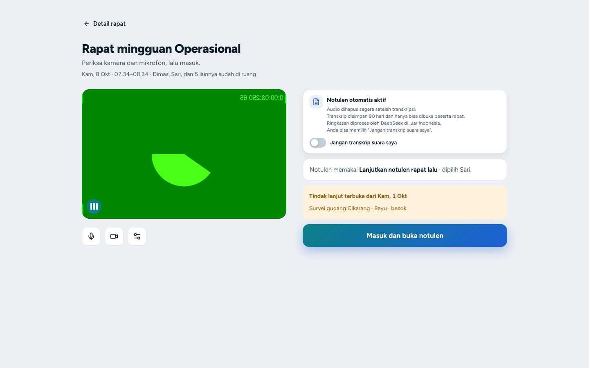

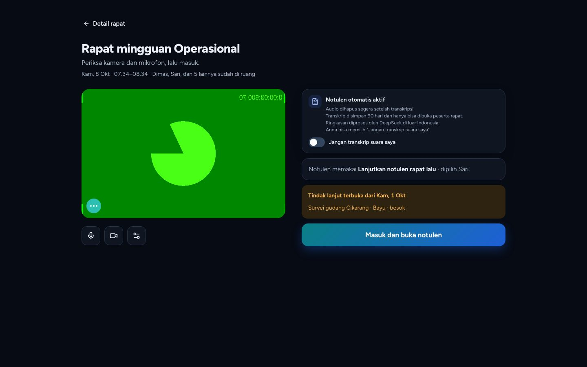

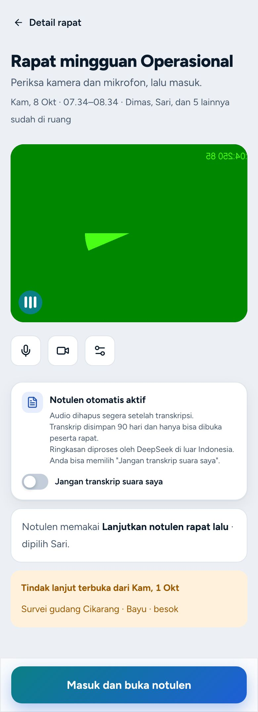

### 2.3 Di ruang rapat

| Bagian | Isi |
|---|---|
| Pita video (atas) | semua peserta; pembicara aktif berbingkai dan lebih lebar; kamera mati = avatar inisial; jam rapat di kanan |
| Kiri: **Bagian** | butir agenda + Keputusan + Tindak lanjut; klik untuk melompat |
| Tengah: **notulen** | dokumen notulen rapat ini; siapa yang bisa mengetik tergantung mode (§3.2) |
| Kanan | chip **"Notulen otomatis aktif"** (+ "· Subtitle ID"), **Waktu bicara** (§3.3), atau panel yang dibuka (Kehadiran, Obrolan, Setelan) |
| Bilah kontrol (bawah) | mikrofon · kamera · bagikan layar · angkat tangan · subtitle (hanya bila ada) · obrolan · **Kehadiran** · ⋯ (Setelan perangkat & transkrip, Pintasan keyboard) · **Keluar** |

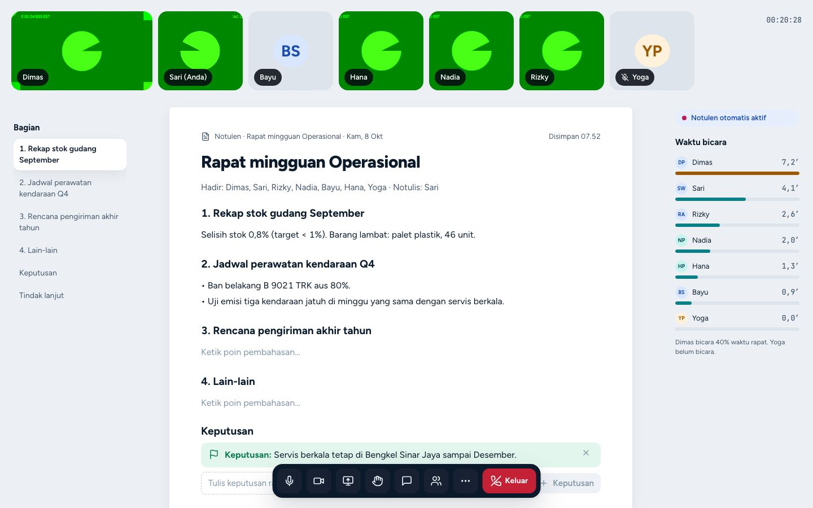

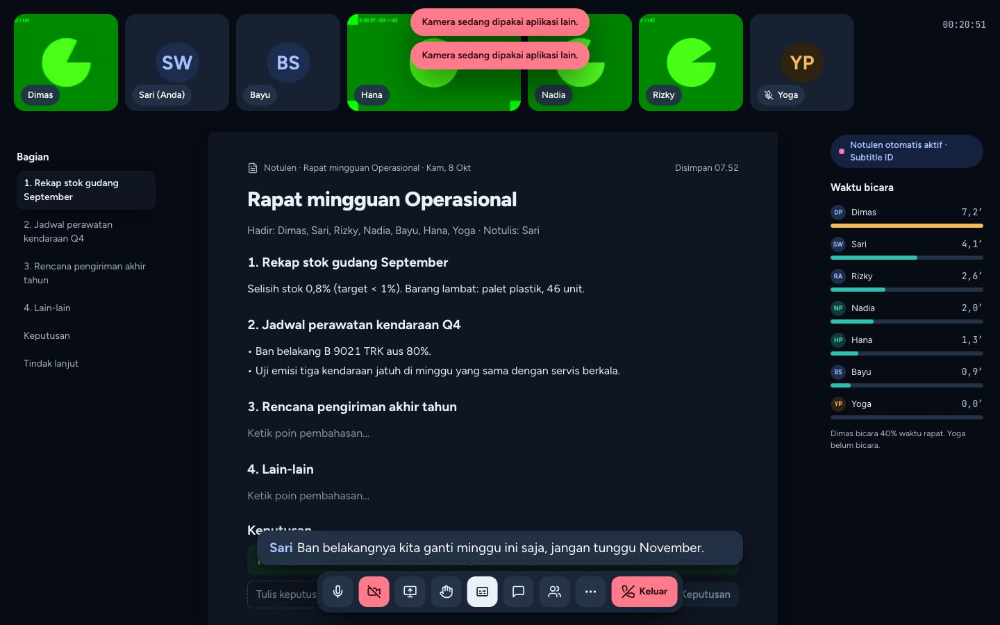

- **Presentasi**: layar yang dibagikan tampil besar di kiri, notulen mengecil ke kolom kanan dan **tetap bisa diketik**.
- **Angkat tangan** terlihat oleh semua peserta (urut siapa duluan).
- **Obrolan** hanya berlaku selama rapat dan tidak disimpan.
- **Tablet**: tata letak sama dengan kolom lebih sempit. **Ponsel**: dua tab **Video | Notulen**, bilah kontrol di bawah, subtitle lewat menu ⋯.
- Suara tidak terdengar saat baru masuk? Tekan **Aktifkan suara rapat**. Koneksi putus sebentar → *"Menyambungkan ulang…"*, lalu kembali sendiri.

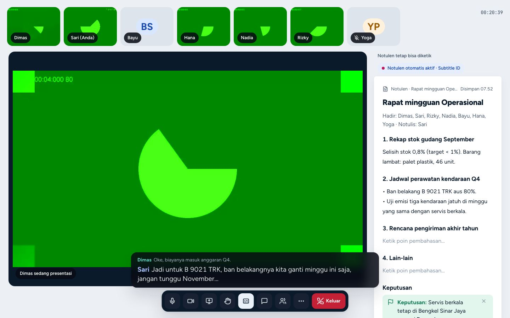

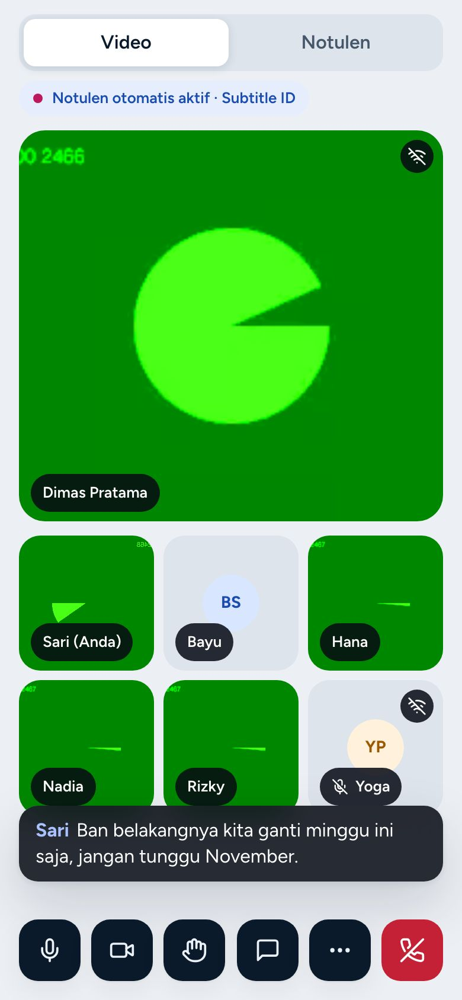

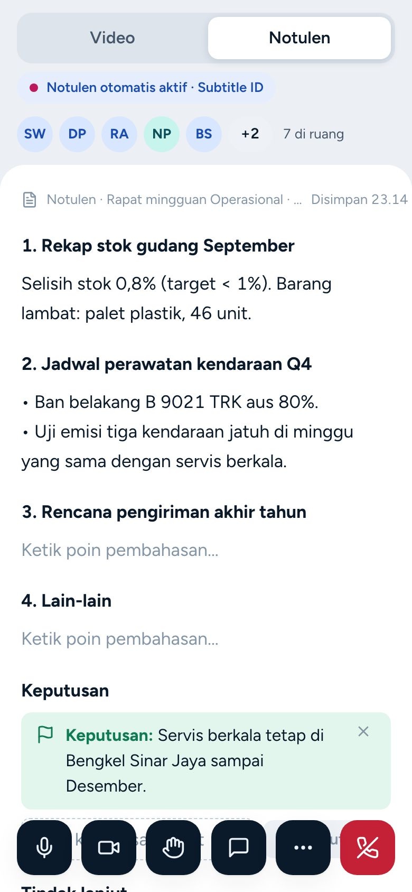

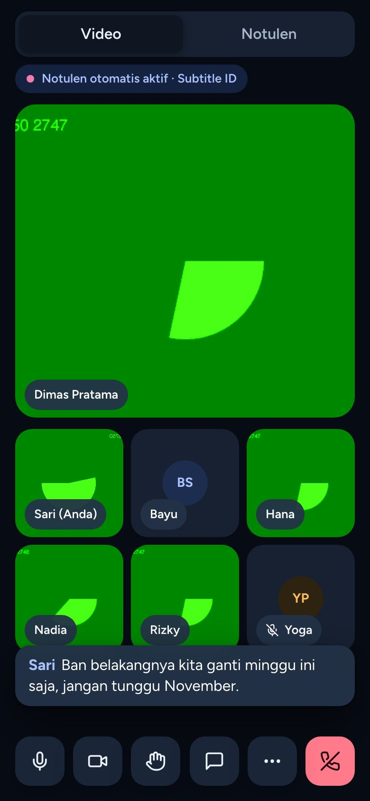

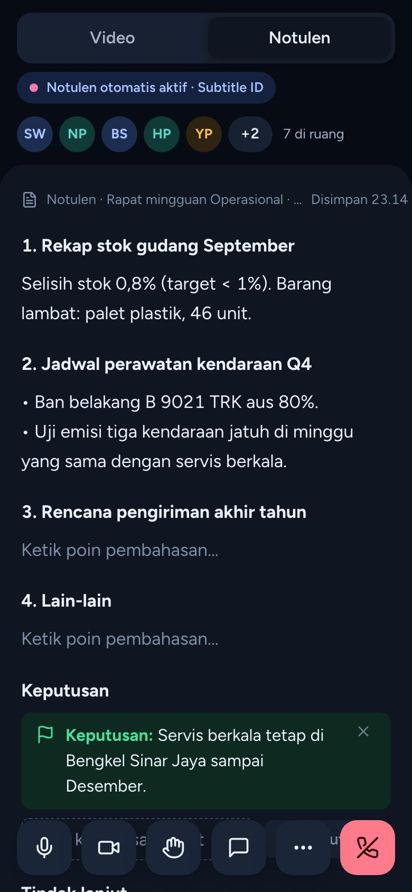

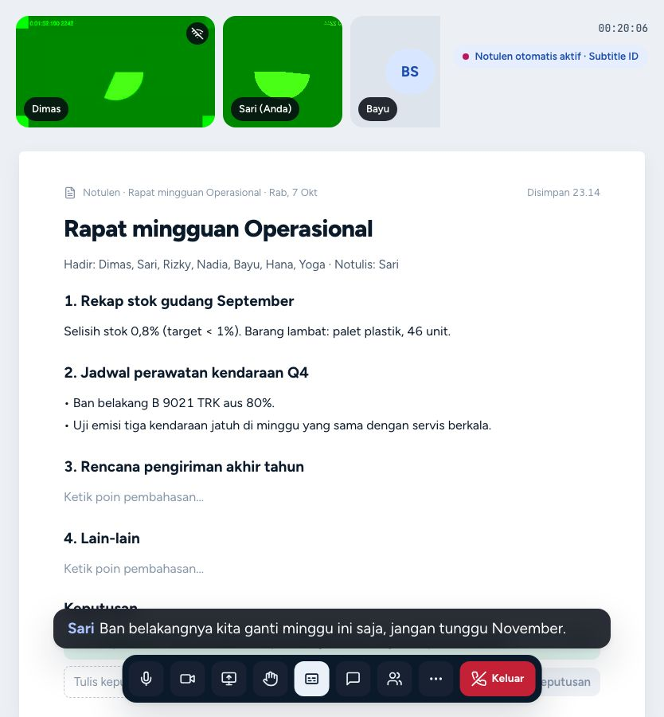

Pintasan keyboard (⋯ › Pintasan keyboard): ⌘/Ctrl+D mikrofon, ⌘/Ctrl+E kamera, ⌘/Ctrl+Alt+C obrolan, ⌘/Ctrl+Alt+P kehadiran, ⌘/Ctrl+Alt+H angkat tangan, ⌘/Ctrl+Alt+S subtitle.

### 2.4 Subtitle

Bila server subtitle (tahap 2) aktif, kotak di atas bilah kontrol menampilkan ucapan terbaru dengan **nama pembicara** (baris sebelumnya lebih kecil), chip menjadi **"Notulen otomatis aktif · Subtitle ID"**, dan tombol subtitle muncul di bilah kontrol (ponsel: ⋯ › Tampilkan/Sembunyikan subtitle). Tanpa server subtitle, tidak ada yang tampil. Subtitle hanya diterima dari mesin notulen RuangKerja; suara orang yang menolak transkrip tidak pernah menjadi subtitle.

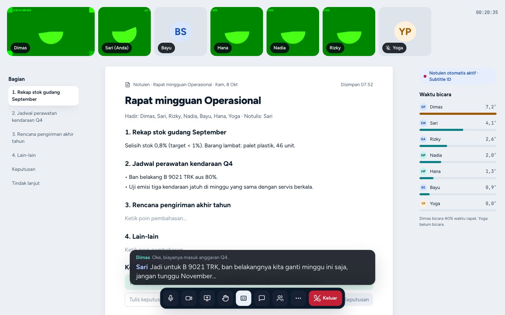

### 2.5 Notulen otomatis dan menolak transkrip

- Hanya berjalan bila **penyelenggara menyalakannya** untuk rapat itu; Anda selalu melihat kartu pemberitahuan sebelum masuk dan chip di ruang.
- Yang diproses hanya **suara mikrofon** (bukan video, bukan layar). Audio dihapus segera setelah ditulis menjadi teks; transkrip hanya untuk penyelenggara, notulis, dan peserta yang diundang, dan dihapus otomatis 90 hari setelah rapat.
- **Jangan transkrip suara saya** berlaku untuk rapat itu (seluruh seri bila berulang) sampai Anda mematikannya. Tempatnya: kartu di pra-gabung, di ruang **⋯ › Setelan perangkat & transkrip**, dan kartu **Notulen otomatis** di detail rapat (juga sesudah rapat).
  - sebelum masuk: suara Anda tidak pernah dikirim ke mesin transkripsi;
  - di tengah rapat: perekaman suara Anda berhenti dan rekaman yang sudah ada dihapus;
  - sesudah rapat: ucapan Anda dihapus dari transkrip dan draf AI, **kecuali** bagian yang sudah dimasukkan notulis ke notulen.
- Pilihan Anda **privat**: hanya server yang meneruskannya ke mesin transkripsi; peserta lain tidak melihatnya. Halaman draf hanya menyebut jumlahnya (*"1 orang memilih tidak ditranskrip"*). Peserta lain tetap mendengar Anda seperti biasa.
- Rincian & hak Anda: [rapat-video-privasi](rapat-video-privasi.md).

### 2.6 Keluar

Tekan **Keluar**. Layar *"Anda keluar dari rapat"* menawarkan gabung lagi, kembali ke detail, atau membuka notulen. Jam keluar tercatat otomatis. Bila dikeluarkan penyelenggara: *"Penyelenggara mengeluarkan Anda dari rapat"*; Anda baru bisa masuk lagi setelah penyelenggara menekan **Izinkan masuk lagi**. Rapat dibatalkan saat berlangsung → *"Rapat dibatalkan"*, ruang ditutup.

## 3. Untuk notulis

Semua di bagian ini juga bisa dilakukan **penyelenggara**.

### 3.1 Pilih notulen sebelum masuk

Di pra-gabung, notulis memilih sumber notulen **sekali untuk tiap tanggal rapat**; pilihan pertama yang berlaku, sesudahnya semua orang melihat "Notulen memakai: …".

| Pilihan | Yang terjadi |
|---|---|
| **Lanjutkan notulen rapat lalu** (disarankan bila masih ada tindak lanjut terbuka) | menambah bagian **"Tindak lanjut rapat lalu"** berisi satu baris per tindak lanjut yang belum selesai, mis. *"• Kirim jadwal servis ke vendor — Rizky Aditya · tenggat 3 Okt · OPS-1270"* |
| **Templat** (namanya mengikuti rapat: "Templat Rapat mingguan", "Templat Rapat harian", "Templat Rapat Sen–Rab–Jum", atau "Templat {judul rapat}") | satu bagian per butir agenda; isi yang sudah ada tidak dihapus |
| **Dokumen kosong** | mengosongkan bagian bila notulen belum berisi apa-apa |

Kartu kuning **"Tindak lanjut terbuka dari …"** menampilkan hingga 20 tindak lanjut rapat lalu yang belum selesai.

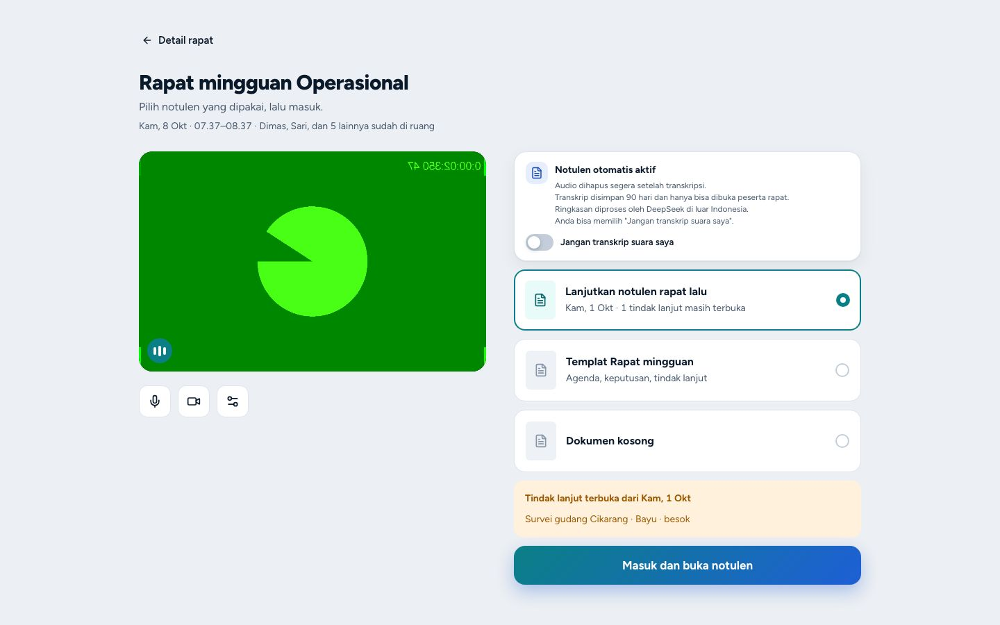

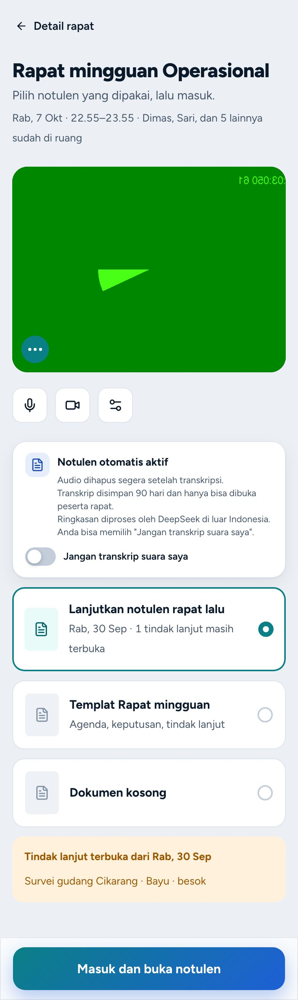

### 3.2 Menulis notulen hidup

Notulen di ruang berjalan dalam salah satu dari dua mode (diatur admin):

| | **Kolaboratif** (Catatan bersama aktif + server kolaborasi) | **Satu penyunting** (selain itu) |
|---|---|---|
| Siapa mengetik | semua yang diundang (penyelenggara, notulis, peserta), selama draf | notulis dan penyelenggara |
| Bersamaan | digabung otomatis, kursor dan nama rekan terlihat | simpanan terakhir yang berlaku; petunjuk *"Sari sedang menyunting"* |
| Kehadiran, finalkan | notulis/penyelenggara | notulis/penyelenggara |

- Tulis di bagian per agenda (*"Ketik poin pembahasan…"*), tambah **keputusan** (*"Tulis keputusan rapat"*), dan **tindak lanjut** (apa yang harus dikerjakan, penanggung jawab, tenggat). **Jadikan tugas** membuat tugas di workspace rapat (mis. `OPS-1284`).
- Tersimpan otomatis dan berversi (*"Menyimpan…"*, *"Disimpan 23.14"*). Peserta lain melihat perubahan dalam hitungan detik.
- Kehadiran terisi otomatis dari ruang video; pilihan "Jangan transkrip suara saya" **tidak** mengubah kehadiran.
- Setelah rapat: **Finalkan & bagikan** di halaman notulen (`/rapat/{id}/notulen`); penyelenggara bisa **Buka kembali draf**. Orang yang dikeluarkan dari ruang tidak bisa menyunting sampai diizinkan masuk lagi.

### 3.3 Waktu bicara

Panel kanan menampilkan lama bicara tiap orang (menit, bilah, persen), mis. *"Dimas bicara 40% waktu rapat. Yoga belum bicara."* ("Belum bicara" = sudah masuk ruang tetapi belum bicara). Browser tiap peserta melaporkan waktu bicaranya sendiri tiap 15 detik; angkanya disimpan per tanggal rapat, dilihat peserta rapat, dan dihapus bersama transkrip (90 hari). Ini alat untuk membagi giliran, **bukan** penilaian kinerja.

### 3.4 Setelah rapat: periksa draf notulen otomatis

Perekaman berhenti ±1,5 menit setelah orang terakhir keluar; transkrip biasanya siap beberapa menit sampai ±40 menit kemudian (tergantung lama bicara). Kartu **Notulen otomatis** di detail rapat menunjukkan status (Merekam → Mentranskrip → Meringkas → Siap, atau Gagal) dan tombol **Periksa draf notulen** / **Buka transkrip & draf**. Halaman `/rapat/{id}/notulen-otomatis`:

| Kiri: **Transkrip** | Kanan: **Draf notulen** (*"Diringkas AI · periksa sebelum final"*) |
|---|---|
| bagian bicara tiap orang (persen), **Cari di transkrip…**, jam, nama, kalimat; kalimat sumber keputusan disorot | **Ringkasan**, **Keputusan** (jam di kanan menaut ke kalimat sumbernya), **Usulan tindak lanjut** (penanggung jawab, tenggat, **Jadikan tugas** → nomor tugas), **Perlu dicek** |
| *"Audio sudah dihapus setelah transkripsi. Transkrip hanya bisa dibuka peserta, disimpan 90 hari."* | |

Kepala halaman: jumlah peserta, *"1 orang memilih tidak ditranskrip"*, status, **Buang draf**, **Masukkan ke notulen**, dan **Ringkas ulang** bila draf gagal. Ponsel: tab **Draf | Transkrip**.

1. Baca ringkasan dan keputusan; klik jamnya untuk melihat kalimat asli.
2. Selesaikan setiap **Perlu dicek** (penanggung jawab hanya diisi otomatis bila namanya cocok dengan peserta yang berbicara).
3. **Jadikan tugas** untuk usulan yang disetujui (rapat tanpa workspace: pilih workspace). Tidak ada usulan yang menjadi tugas tanpa klik Anda.
4. **Masukkan ke notulen** (sekali): poin ditambahkan di bawah tulisan Anda dengan penanda *"[Draf otomatis — periksa sebelum final]"*, ringkasan menjadi bagian **"Ringkasan (draf otomatis)"**, keputusan baru berakhiran *"(draf otomatis)"*, usulan menjadi tindak lanjut. Tulisan Anda tidak ditimpa (di mode kolaboratif, editor yang sedang terbuka ikut diperbarui). Lalu rapikan dan **Finalkan & bagikan**.
5. Atau **Buang draf**. **Ringkas ulang** mengirim transkrip lagi ke penyedia AI (dicatat di log audit).

Tanpa kunci layanan AI: *"Ringkasan AI tidak aktif di server ini; transkrip tetap bisa dibaca."* Transkrip mesin bisa salah dengar nama, istilah, dan angka; notulen final tanggung jawab notulis. Setiap pembukaan transkrip dicatat di log audit.

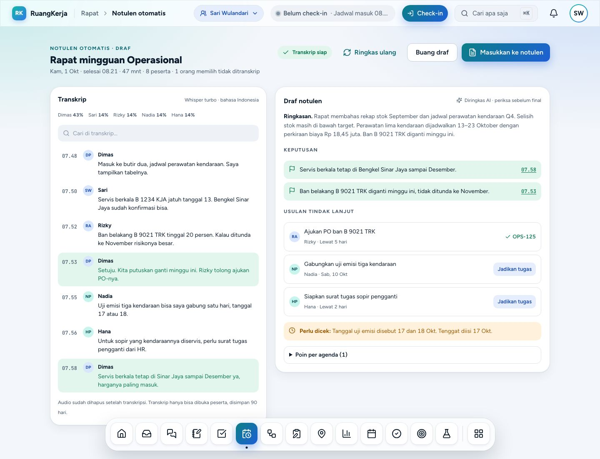

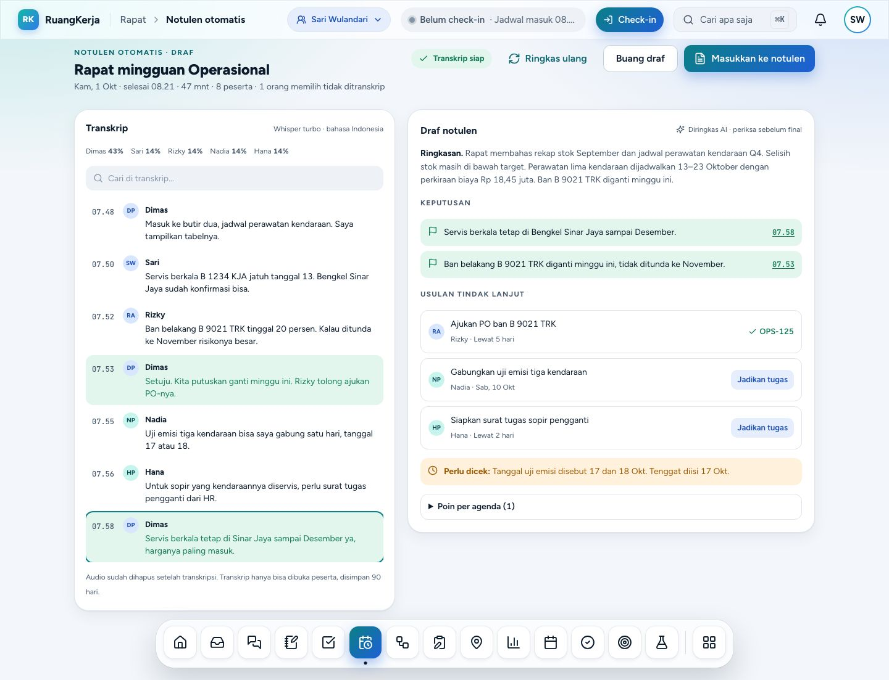

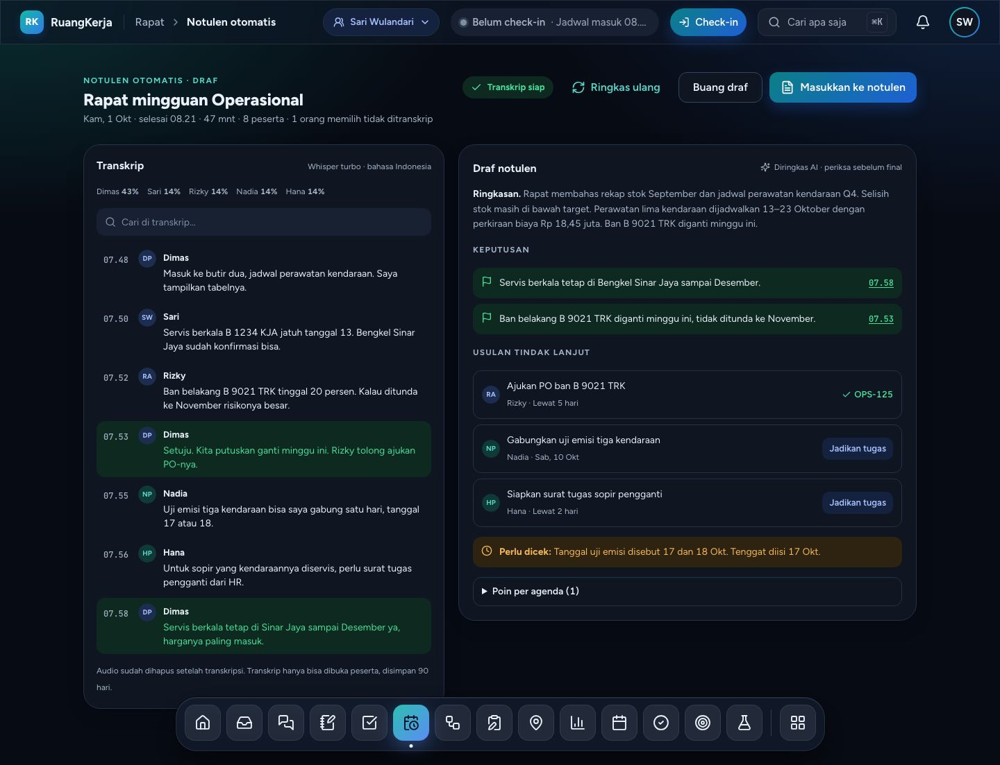

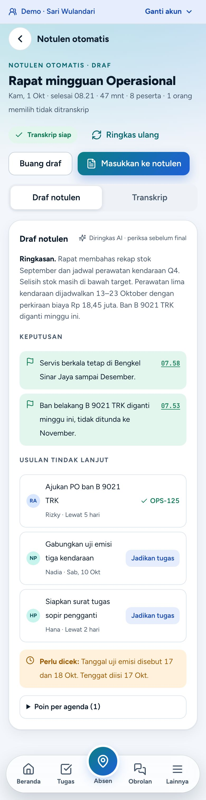

## 4. Untuk penyelenggara

### 4.1 Jadwalkan rapat video

**Rapat › Jadwalkan rapat** → judul, tanggal, jam, durasi → Tempat rapat **Video RuangKerja** (bawaan bila server rapat diatur; tanpa tautan) → peserta, agenda, notulis, ulangi, workspace (untuk "Jadikan tugas"), pengingat → sakelar **Notulen otomatis** (§4.2) → **Periksa & kirim undangan**. Agenda menjadi bagian notulen, navigator **Bagian**, dan acuan AI. Detail: `docs/fitur/rapat-kalender.md` §3.

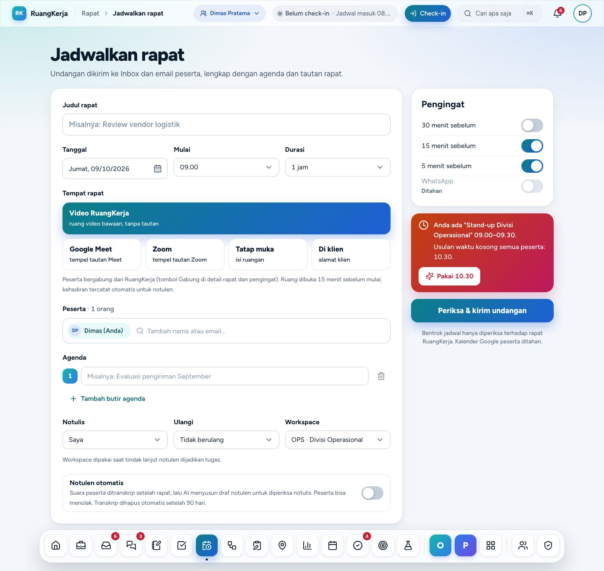

### 4.2 Nyalakan notulen otomatis

Sakelar **Notulen otomatis** ada di formulir jadwal/ubah dan di kartu **Notulen otomatis** detail rapat; hanya untuk rapat Video RuangKerja dan hanya bila admin sudah menyiapkan server notulen (selain itu: *"Belum disiapkan admin di server ini."*). Berlaku untuk **seluruh seri**, bisa dimatikan kapan saja, dicatat di log audit. Teks penjelas: *"Suara peserta ditranskrip setelah rapat, lalu AI menyusun draf notulen untuk diperiksa notulis. Peserta bisa menolak. Transkrip dihapus otomatis setelah 90 hari."* Perekaman mulai saat orang pertama masuk ruang.

Pertimbangkan sebelum menyalakan: rapat berisi data pribadi sensitif (kesehatan, gaji, sanksi, wawancara kandidat) **sebaiknya tanpa** notulen otomatis; draf AI dibuat penyedia di luar Indonesia ([privasi §6](rapat-video-privasi.md#6-pemrosesan-di-luar-indonesia-penyedia-ai)).

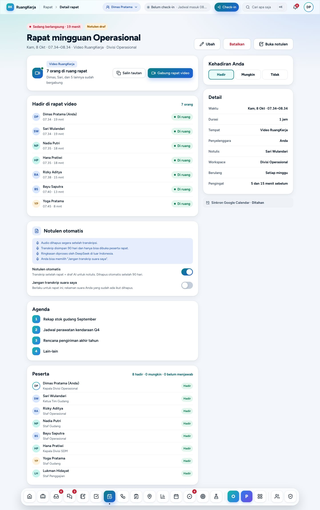

### 4.3 Kehadiran & panggil peserta

Tombol **Kehadiran** membuka panel *"otomatis dari ruang"*: tiap peserta dengan jam masuk dan lencana **Hadir** atau **Terlambat N mnt** (lebih dari 2 menit setelah mulai), lalu yang **belum masuk**. Notulis dan penyelenggara menekan **Panggil**: orang itu mendapat notifikasi **"Rapat sudah dimulai — Gabung"** (Inbox, toast, email sesuai pengaturannya) dengan tombol Gabung; sesudahnya tombol menjadi **Panggil lagi**. Satu orang paling sering dipanggil sekali per menit, hanya selama ruang terbuka; panggilan dicatat di log audit.

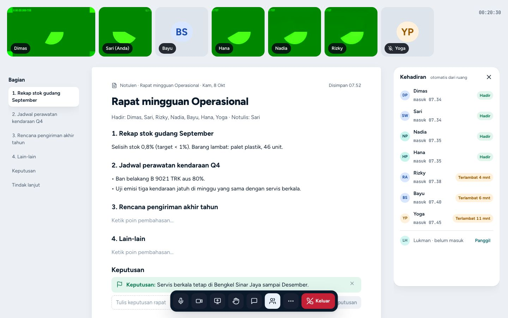

### 4.4 Bisukan, keluarkan, izinkan masuk lagi

Di panel Kehadiran (penyelenggara): **Bisukan {nama}** mematikan mikrofon peserta; **Keluarkan dari rapat** mengeluarkannya dan **melarangnya masuk lagi** di tanggal rapat itu (juga tidak bisa menyunting notulen). Daftar **Dikeluarkan** di panel yang sama punya tombol **Izinkan masuk lagi**. Semua dicatat di log audit. Orang yang dihapus dari daftar undangan atau akun yang dinonaktifkan otomatis keluar dari ruang.

## 5. Untuk HR & pimpinan

### 5.1 Kehadiran rapat

- Detail rapat › **Hadir di rapat video**: jam masuk, durasi, siapa yang masih di ruang. Putus-sambung tercatat sebagai sesi terpisah.
- Anda melihatnya bila Anda bisa membuka rapat itu: sebagai peserta, atau untuk **rapat pimpinan** sebagai Direksi/HR (baca saja). Pengamat rapat pimpinan yang tidak diundang **tidak** bisa masuk ruang, dan untuk notulen otomatis hanya melihat **status** (tanpa transkrip, nama pembicara, jumlah penolak, atau draf).
- Kehadiran rapat **bukan** absensi kerja dan tidak mengubah status hadir harian.

### 5.2 Privasi

- Rapat tidak direkam; yang tersimpan: kehadiran, waktu bicara (90 hari), notulen, dan (bila dinyalakan) transkrip + draf AI (90 hari).
- Waktu bicara dan transkrip tidak boleh dipakai menilai kinerja atau perilaku.
- Permintaan karyawan untuk melihat/menghapus data rapat ditangani kontak privasi (bawaan: tim HR): [rapat-video-privasi](rapat-video-privasi.md) §8.

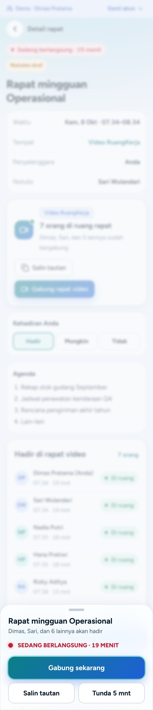

## 6. Pertanyaan umum

**Apakah rapat direkam?** Tidak. Video, suara, layar, dan obrolan tidak disimpan. Bila notulen otomatis aktif, hanya suara mikrofon yang direkam sementara untuk ditranskrip, lalu audionya dihapus.

**Siapa yang bisa membaca transkrip?** Penyelenggara, notulis, dan peserta yang diundang, selama 90 hari. Super Admin, HR, dan Direksi tidak otomatis melihatnya.

**Saya menolak transkrip. Apakah orang lain tahu?** Tidak. Pilihan Anda hanya diteruskan server ke mesin transkripsi; halaman draf hanya menyebut jumlah orang yang menolak.

**Bisakah saya menolak setelah rapat selesai?** Bisa, dari kartu Notulen otomatis di detail rapat. Ucapan Anda dihapus dari transkrip dan draf, kecuali yang sudah dimasukkan ke notulen (minta notulis memperbaikinya).

**Bisakah saya ikut mengetik notulen?** Di mode kolaboratif ya, semua yang diundang. Di mode satu penyunting hanya notulis dan penyelenggara.

**Bisakah bergabung dari ponsel?** Bisa, lewat browser ponsel. Pakai tab **Video | Notulen**.

**Kenapa tombol gabung belum aktif?** Ruang dibuka 15 menit sebelum rapat dan ditutup 2 jam setelah jam selesai.

**Bisakah tamu luar perusahaan ikut?** Belum.

**Transkrip salah dengar nama/angka.** Wajar untuk mesin. Perbaiki di notulen; transkrip bukan notulen resmi.

## 7. Mengatasi masalah

| Masalah | Penyebab umum | Yang dilakukan |
|---|---|---|
| *"Izin kamera atau mikrofon ditolak…"* | izin browser pernah ditolak | ikon gembok di bilah alamat → izinkan **Kamera** dan **Mikrofon** → muat ulang. macOS: Pengaturan Sistem › Privasi & Keamanan › Kamera/Mikrofon → izinkan browser. Tetap bisa bergabung tanpa keduanya |
| *"Kamera atau mikrofon sedang dipakai aplikasi lain…"* | Zoom/Teams/aplikasi kamera terbuka | tutup aplikasi itu, lalu coba lagi |
| *"Kamera atau mikrofon tidak terdeteksi…"* / *"…tidak bisa dinyalakan…"* (*"Kamera tidak tersedia"*) | perangkat tidak tersambung atau diblokir | colok ulang, pilih di setelan perangkat, periksa izin; tetap bisa bergabung untuk mendengarkan |
| Tidak terdengar suara apa pun | browser memblokir suara otomatis; speaker salah | tekan **Aktifkan suara rapat**; pilih speaker di ⋯ › Setelan perangkat (bila browser mendukung); periksa volume & tab tidak dibisukan |
| Orang lain tidak mendengar saya | mikrofon mati/dibisukan penyelenggara; mikrofon salah | nyalakan mikrofon; pilih mikrofon yang benar; lihat indikator level di pra-gabung |
| Gema/berdenging | dua perangkat bersuara di satu ruangan | pakai headset; satu ruangan satu perangkat bersuara |
| *"Tidak bisa tersambung ke server rapat. Periksa jaringan Anda (UDP atau port 443 mungkin diblokir)."* | jaringan memblokir UDP atau memeriksa lalu lintas TLS | coba lagi (jalur cadangan lewat 443 otomatis); bila tetap gagal pakai 4G dan laporkan ke admin dengan nama jaringannya (runbook R1) |
| *"Menyambungkan ulang…"* terus / gambar patah-patah | koneksi lemah | pindah jaringan, matikan kamera |
| *"Ruang rapat dibuka pukul HH.MM"* / *"Rapat sudah selesai. Ruang rapat sudah ditutup."* | di luar jendela gabung | tunggu, atau minta penyelenggara |
| *"Anda tidak diundang ke rapat ini."* | belum diundang | minta penyelenggara menambahkan Anda |
| *"Penyelenggara mengeluarkan Anda dari rapat ini."* | dikeluarkan | hubungi penyelenggara; masuk lagi setelah **Izinkan masuk lagi** |
| *"Video RuangKerja belum disiapkan"* | server rapat belum diatur | hubungi admin, atau pakai Google Meet/Zoom |
| *"Browser ini belum didukung"* | browser lama/tidak didukung | Chrome, Edge, Firefox, atau Safari terbaru |
| Tidak bisa membagikan layar | browser/ponsel tidak mendukung; izin perekaman layar macOS | Chrome/Edge desktop; macOS: Privasi & Keamanan › Perekaman Layar → izinkan browser |
| Status transkrip lama di **Mentranskrip** | masih antre/berjalan | tunggu; lebih dari ±1 jam → laporkan ke admin (runbook R2) |
| Status **Gagal** atau draf AI tidak ada | transkripsi/ringkasan gagal, atau layanan AI tidak aktif | notulis: **Ringkas ulang**; tetap gagal → admin (runbook R3). Transkrip tetap bisa dipakai |
| *"… baru saja dipanggil. Coba lagi dalam N detik."* | Panggil dibatasi sekali per menit per orang | tunggu sebentar |

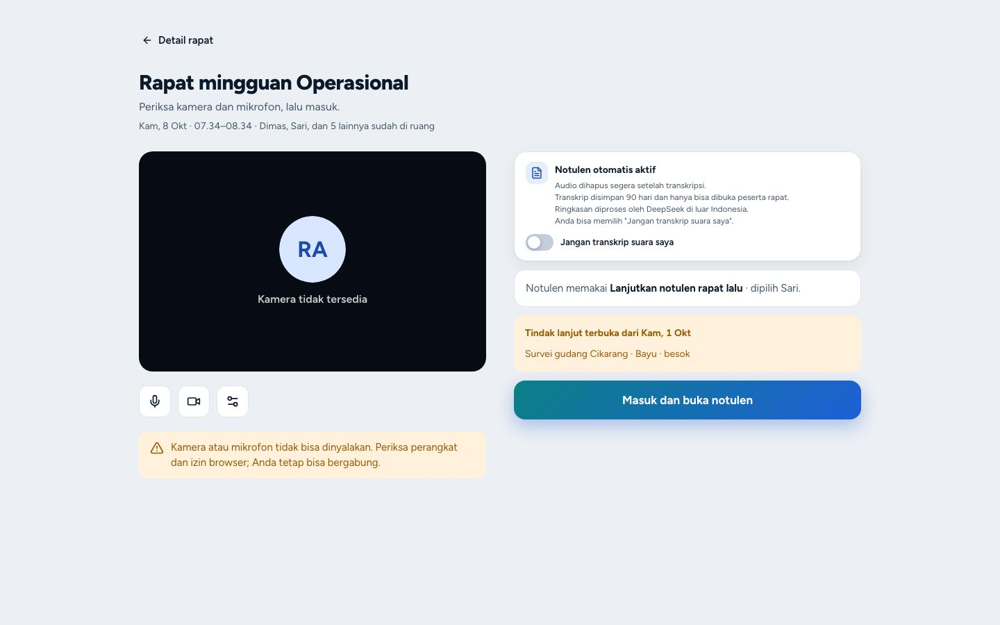

## 8. Status & keputusan pemilik yang masih terbuka

| Bagian | Status |
|---|---|
| Ruang arah C, pra-gabung, Kehadiran + Panggil, Waktu bicara, sumber notulen, notulen kolaboratif/satu penyunting, moderasi + izinkan masuk lagi | **Selesai** (kode); LiveKit sudah di server |
| Notulen otomatis (transkrip, persetujuan, draf AI, retensi) | **Selesai** (kode); worker belum dipasang di VPS rapat |
| Subtitle langsung | tampilan siap; menunggu server GPU tahap 2 |

Keputusan yang masih ditunggu dari pemilik (rincian di [rapat-video-privasi](rapat-video-privasi.md) §10):

1. **Opt-out atau opt-in** untuk transkrip: sekarang semua peserta ikut ditranskrip kecuali menolak (opt-out). Alternatif: hanya yang menyetujui.
2. **Naikkan `PRIVACY_POLICY_VERSION`** saat rilis (kebijakan privasi kini menyebut rapat video dan notulen otomatis); ini juga meminta persetujuan ulang lokasi & selfie absensi.
3. **Retensi kehadiran rapat video** (`meeting_attendances`), pilihan menolak, dan larangan masuk: belum ada penghapusan otomatis.
4. **Ekspor Data Saya** belum memuat data rapat.
5. Dasar transfer teks transkrip ke **DeepSeek di luar Indonesia** (UU PDP Pasal 56), atau ganti penyedia.
6. (Audit, di luar rapat) **HR mengatur sandi Direksi/HR** — sudah diputuskan 8 Okt 2026: hanya Super Admin. `docs/security/AUDIT-RAPAT-2026-10.md` R-06.

Audit keamanan lengkap fitur ini: `docs/security/AUDIT-RAPAT-2026-10.md`.
