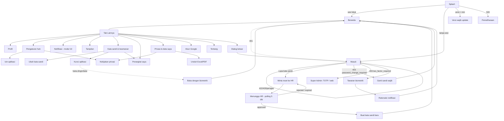

# Modul 01 — Akses, akun & pengaturan (Android)

> Mockup: `docs/mockups/android/screens/01-akses-akun/` (26 berkas HTML, 118 layar `.phone`, masing-masing dirender terang + malam; gaya lokal di `_akses.css`, prefiks `ak-`). Hari ini di data contoh: Selasa, 13 Okt 2026; persona Sari Wulandari (staf, `sari.wulandari@spkd.store`), Dimas Pratama (Kepala Divisi), Hana Puspitasari (HR), Rina Kusuma (Super Admin, hanya untuk varian 2FA).
> Sumber: `apps/mobile/app/masuk.tsx`, `app/_layout.tsx` (LayarBlokir), `app/(tabs)/lainnya.tsx`, `src/session/*`, `routes/api.php`, `docs/sesi/ponsel.md`, `docs/fitur/aplikasi-ponsel*.md`, halaman web `resources/js/pages/{auth,settings,privacy}/*`, `docs/PLATFORM.md` §3.
> Penanda API: **ADA** = sudah di `routes/api.php`; **BELUM ADA** = perlu endpoint baru (dipakai mockup sebagai usulan).

## 1. Inventaris layar

| Berkas | Layar (jumlah `.phone`) | Peran | Keadaan yang tercakup |
|---|---|---|---|
| `01-splash-buka-aplikasi` | splash sistem · skeleton Beranda saat sesi divalidasi · buka dingin offline (3) | semua | memuat, offline |
| `02-masuk` | Masuk: kosong · fokus email + keyboard · sandi terlihat + keyboard · terisi · memuat (5) | tamu | kosong, fokus, terisi, memuat |
| `03-masuk-galat` | validasi per kolom · 422 generik · 429 lockout + hitung mundur · jaringan · 5xx · 422 batas 5 perangkat (6) | tamu | galat |
| `04-blokir-akun` | 403 `password_change_required` (kini) · form ganti sandi wajib (usulan) · form dengan galat · 403 `two_factor_required` Super Admin · tantangan TOTP (usulan) (5) | semua / Super Admin | terkunci, galat |
| `05-lupa-sandi-minta` | form email · fokus + keyboard · mengirim · email salah · 429 limit (5) | tamu | kosong, memuat, galat, terkunci |
| `06-lupa-sandi-tunggu` | menunggu (polling 5 dtk) · offline/dijeda · disetujui (transisi) · ditolak (alasan) · kedaluwarsa · kartu "lanjutkan permintaan" di Masuk (6) | tamu | pending, offline, approved, rejected, expired |
| `07-lupa-sandi-baru` | form · terisi · galat (sandi bawaan, konfirmasi) · sisa waktu < 2 mnt · sukses (5) | tamu (token sekali pakai) | galat, hampir habis, sukses |
| `08-biometrik-aktifkan` | sheet tawaran · BiometricPrompt sistem · aktif (snackbar) · belum ada sidik jari · dialog matikan · tanpa sensor/kunci layar (6) | semua | enroll, galat perangkat, nonaktif |
| `09-biometrik-buka` | idle · memverifikasi (prompt) · tidak cocok · dikunci sementara · sidik jari berubah (kunci Keystore batal) · terbuka offline (6) | semua | lock/unlock, offline |
| `10-kunci-aplikasi` | pengaturan (batas waktu, buka dengan) · layar terkunci · recents tersembunyi (FLAG_SECURE) · belum ada kunci layar (4) | semua | on/off, terkunci |
| `11-sesi-versi-pemeliharaan` | sesi berakhir (401) · akun nonaktif · dialog sesi berakhir saat mengisi form · versi wajib update · update tersedia (fleksibel) · pemeliharaan 503 · galat server 5xx (7) | semua | sesi, versi, maintenance, galat |
| `12-lainnya` | Lainnya staf (panjang) · Lainnya HR/manajemen (panjang) · memuat · offline (4) | staf; HR/Kadiv/Direksi | memuat, offline, varian peran |
| `13-profil` | profil staf · Kadiv (peran bertumpuk) · memuat · offline (4) | semua | memuat, offline, baca-saja |
| `14-pengaturan` | hub pengaturan · dengan izin notifikasi ditolak · offline (3) | semua | offline |
| `15-tampilan` | Ikuti sistem · Gelap (dirender malam) · sheet pilihan dari Lainnya (3) | semua | — |
| `16-keamanan` | hub keamanan staf · Super Admin (2FA desktop) · snackbar "tautan dikirim" (3) | semua / Super Admin | baca-saja (desktop) |
| `17-ganti-kata-sandi` | kosong · fokus + keyboard · galat (salah, bawaan, tak cocok) · aturan Super Admin · menyimpan · sukses (6) | semua | galat, memuat, sukses |
| `18-perangkat-saya` | daftar · dialog cabut lain · dialog cabut perangkat ini · setelah dicabut · batas 5 penuh · memuat · galat/offline (7) | semua | memuat, galat, penuh |
| `19-izin-aplikasi` | rationale notifikasi · dialog izin Android 13 · banner ditolak · daftar Izin aplikasi + kanal · izin kamera/lokasi ditolak (5) | semua | izin ditolak |
| `20-privasi-data-saya` | Privasi & Data Saya (panjang) (1) | semua | — |
| `21-privasi-persetujuan` | belum disetujui · perlu ulang (v1.1) · dialog cabut · dialog setujui · snackbar dicabut (5) | semua | persetujuan |
| `21-privasi-unduh-keadaan` | memuat · absensi kosong · unduh berjalan · unduh sukses · unduh gagal (5) | semua | memuat, kosong, galat |
| `22-kebijakan-privasi` | pembaca (panjang) · publik tanpa sesi · daftar isi · memuat · salinan offline (5) | semua + tamu | memuat, offline |
| `23-keluar` | dialog keluar · ada perubahan belum terkirim · mengeluarkan · setelah keluar (4) | semua | destruktif, offline queue |
| `24-tentang` | Tentang · memeriksa pembaruan (2) | semua | — |
| `25-akun-google` | tersambung · belum · perlu hubungkan ulang (3) | semua | baca-saja (desktop) |

Peran: **staf** (hanya `anggota`) tidak melihat saldo cuti maupun Struktur organisasi (keputusan 6 Okt 2026); Kadiv/HR/Direksi melihat baris tambahan di Lainnya (Persetujuan, Karyawan, Hiring, Ringkasan manajemen, Struktur organisasi). Super Admin hanya muncul di layar blokir TOTP dan varian Keamanan.

## 2. Peta navigasi

Pintu masuk Pengaturan: ikon roda gigi di app bar Lainnya; kartu profil membuka Profil (seperti web `/menu`).

## 3. Layar → endpoint API

| Kebutuhan layar | Endpoint | Status |
|---|---|---|
| Masuk | `POST /auth/login` {email, password, device{platform, device_id_hash, name, os_version, app_version}} → `{token, user}`; 422 generik, 403 `password_change_required` / `two_factor_required`, 429 (per email+IP: "dalam N detik"; `api-login` 10/menit/IP: "dalam satu menit") | **ADA** |
| Validasi sesi saat buka, profil ringkas | `GET /auth/saya` → `{id, name, email, jabatan, divisi, work_mode}` | **ADA** (field tim, atasan, no. karyawan, tgl bergabung, peran, divisi dipimpin **BELUM ADA**) |
| Keluar | `POST /auth/logout` (cabut token ini) | **ADA** |
| Perangkat saya | `GET /perangkat`, `DELETE /perangkat/{device}`, `PUT /perangkat/{device}/push-token` | **ADA** |
| Sakelar buka biometrik per perangkat | `PUT /perangkat/{device}/biometrik` {enabled} (kolom `devices.biometric_login` & `DeviceRow.biometric_login` sudah ada) | **BELUM ADA** |
| Ganti kata sandi sendiri + wajib ganti (403) | `POST /auth/kata-sandi` {current_password, password, password_confirmation}; harus masuk daftar putih `EnsureApiAccountUsable::ALLOWED_ROUTES`; sukses: cabut token perangkat lain, token ini tetap; menghapus `password_change_required` | **BELUM ADA** (aksi web `ChangeOwnPassword` bisa dipakai ulang) |
| Aturan sandi tampil di hint | `PasswordPolicy::hint` (karyawan bebas, bukan sandi bawaan; Super Admin min. 8, bukan email) — sertakan di respons/ konfigurasi | **BELUM ADA** |
| Lupa kata sandi (HR menyetujui) | `POST /auth/lupa-sandi` {email}; `GET /auth/lupa-sandi/status` (header token permintaan; `{status}` saja, email tak dikenal = `pending`→`expired`); `POST /auth/lupa-sandi/sandi-baru` (setup token sekali pakai, 30 mnt) | **BELUM ADA** (web memakai sesi cookie; aksi `RequestPasswordReset`/`CompletePasswordReset` dipakai ulang, token permintaan dikirim sebagai Bearer sementara) |
| Tantangan TOTP Super Admin | `POST /auth/2fa` {kode \| kode_pemulihan} | **BELUM ADA** (kini Super Admin selalu 403) |
| Konfigurasi aplikasi (versi minimal/terbaru, pemeliharaan) | `GET /app/konfigurasi` → `{min_version, latest_version, store_url, maintenance{active,message,eta}}` + header `X-App-Version`; 426 `app_outdated`; 503 `maintenance` | **BELUM ADA** |
| Tema tersimpan di akun | `PUT /pengaturan/tampilan` {theme} (`users.theme`) | **BELUM ADA** (opsional; bisa lokal saja, lihat pertanyaan) |
| Privasi & Data Saya | `GET /privasi` (consent, attendance ringkas+hitung, requests, decisions, profile tersamar, policy{version,effective_date}) | **BELUM ADA** (web: `GET /privasi` Inertia, `MyData`) |
| Cabut / berikan persetujuan lokasi+selfie | `DELETE` / `POST /absensi/persetujuan` | **BELUM ADA** (web: `attendance/consent`) |
| Unduh data (Excel/PDF) | `GET /privasi/ekspor/{xlsx\|pdf}` dengan Bearer, respons berkas | **BELUM ADA** (web memakai cookie) |
| Kebijakan privasi | `GET /kebijakan-privasi` versi JSON `{version, effective_date, html}` tanpa auth | **BELUM ADA** (web: HTML di `/kebijakan-privasi`) |
| Kirim tautan desktop ke email saya | `POST /tautan-desktop` {path} (email berisi tautan masuk-lalu-buka) | **BELUM ADA** |
| Akun Google (status) | `GET /pengaturan/google` | **BELUM ADA** (hanya baca; hubungkan tetap desktop) |
| Lainnya: Inbox badge, Persetujuan badge | `GET /inbox` (**ADA**) · hitung persetujuan menunggu (**BELUM ADA** di API) | campur |
| Daftar workspace di Lainnya | `GET /workspace` | **ADA** |

## 4. Kemampuan khas Android yang dipakai

- **Splash sistem Android 12+** (`expo-splash-screen`, ikon adaptif di atas warna bg tema), `preventAutoHide` sampai sesi lokal dibaca.
- **BiometricPrompt** (`expo-local-authentication`, Class 3/strong dengan cadangan kunci layar), kunci **Android Keystore** terikat biometrik untuk token (`expo-secure-store` `requireAuthentication`): sidik jari baru didaftarkan → kunci batal (layar "Sidik jari berubah"). Lockout sistem: 5 gagal → 30 dtk.
- **Kunci aplikasi** + **FLAG_SECURE** (tangkapan layar & pratinjau recents kosong) — berlaku untuk seluruh aplikasi bila aktif; selfie/privasi selalu aman.
- **Izin runtime**: `POST_NOTIFICATIONS` (Android 13+; di bawahnya otomatis), kamera, lokasi presisi "hanya saat dipakai"; pra-izin (rationale) sebelum dialog sistem; setelah ditolak dua kali → `Linking.openSettings()`. **Kanal notifikasi** (Absensi, Tugas, Persetujuan, Rapat, Obrolan, Pengumuman & ringkasan) diatur lewat Setelan Android.
- **Tombol/gestur kembali sistem** (predictive back) ke layar sebelumnya; layar blokir dan wajib-ganti-sandi menutup kembali.
- **Play in-app updates**: fleksibel untuk versi baru, wajib (immediate) bila di bawah versi minimal.
- **Backup**: `allowBackup=false` untuk SecureStore agar token tidak ikut cadangan/terpulihkan di ponsel lain.
- **Custom Tabs** (`expo-web-browser`) untuk membuka web (Akun Google, 2FA, tautan "Buka di peramban").
- **Download** (Unduh data): `expo-file-system` + `expo-sharing`/DownloadManager; notifikasi unduhan sistem.

## 5. Matriks keadaan

| Layar | Memuat | Kosong | Galat | Offline | Terkunci | Baca-saja |
|---|---|---|---|---|---|---|
| Splash / buka | skeleton Beranda + bar 3px | — | 401 → Masuk | sesi lokal dipakai + banner | kunci aplikasi/biometrik | — |
| Masuk | tombol memuat, kolom nonaktif | — | validasi, 422, 429, jaringan, 5xx, batas perangkat | pesan jaringan | lockout 429 hitung mundur | — |
| Blokir akun | — | — | galat per kolom | tombol Periksa lagi menampilkan galat | tanpa tombol kembali | — |
| Lupa sandi | mengirim | — | email, 429 | polling dijeda | — | — |
| Lainnya / Profil / Pengaturan | skeleton | — | tombol "Coba lagi" | data tersimpan + banner, aksi server nonaktif | — | Profil baca-saja (HR yang mengubah) |
| Keamanan / Akun Google | — | — | — | — | — | 2FA & Google = "Tersedia di desktop" + "Kirim tautan ke email saya" |
| Perangkat saya | skeleton 3 baris | (selalu ≥ 1: perangkat ini) | "Daftar belum termuat" + coba lagi | sama | batas 5 penuh | — |
| Privasi & Data Saya | skeleton | "Belum ada data absensi", "Belum ada keputusan" | unduh gagal | unduhan gagal, data tersimpan | tanpa persetujuan → check-in GPS+selfie terkunci | — |
| Kebijakan privasi | skeleton teks | — | — | salinan tersimpan (v1.0) | — | — |

## 6. Catatan implementasi Expo (apa yang sudah ada di `apps/mobile`)

- **Sudah ada**: `app/masuk.tsx` (kolom + mata + galat), `SessionProvider` (SecureStore, `/auth/saya`, 401 → bersih, `blokir`), `LayarBlokir` di `_layout.tsx`, `lainnya.tsx` (profil, absensi bulan ini, pengajuan, perangkat + `Alert` cabut, keluar), `src/components/ui.tsx`, `src/lib/theme.tsx` (ikut sistem), `src/lib/device.ts`.
- **Perubahan terhadap kode sekarang**:
  1. Masuk: aurora malam tetap (selalu gelap, seperti web MLogin) — kode sekarang mengikuti tema; tambah tautan "Lupa kata sandi?" & "Kebijakan privasi", pesan per kolom, hitung mundur 429 (`Retry` dari detik di pesan), pesan 5xx.
  2. Ganti `Alert.alert` cabut perangkat & keluar dengan dialog Material (`Modal` kustom) agar konsisten dengan kit.
  3. `LayarBlokir`: tombol "Buka RuangKerja di peramban" (Custom Tabs); hilangkan "Periksa lagi" untuk `two_factor_required` (tidak pernah berhasil); ganti total dengan form native ganti sandi bila `POST /auth/kata-sandi` tersedia.
  4. Lainnya dipecah: hub ringkas (profil, Workspace, Pekerjaan, Lainnya) dan layar terpisah Profil / Pengaturan / Keamanan / Perangkat / Privasi (sekarang semuanya numpuk di satu layar; "Absensi bulan ini" dan "Pengajuan saya" pindah ke modul 03/04).
  5. Pustaka baru yang perlu (belum di repo): `expo-local-authentication`, `expo-web-browser`, `expo-notifications` (izin; FCM = modul 12), `expo-file-system` (sudah) + `expo-sharing`, `expo-application` (sudah), `react-native-reanimated` untuk transisi sheet bila belum.
- **Polling lupa sandi**: `setInterval` 5 dtk hanya saat `AppState === 'active'` dan layar fokus; hentikan di `rejected/expired/approved`; simpan `request_token` + `expires_at` di SecureStore (kartu "Lanjutkan permintaan" di Masuk).
- **Gerak (anotasi)**: transisi layar 180 ms `ease-brand` (slide dari kanan untuk dorong, dari bawah untuk sheet); cincin biometrik: skala 0,98 saat tekan, getaran `expo-haptics` ringan saat berhasil, ritme "tidak cocok" 2 getaran pendek; hitung mundur 429 tanpa animasi; `prefers-reduced-motion` (Setelan hapus animasi) → semua transisi menjadi fade 0 ms, spinner tetap.
- **Aksesibilitas**: target ≥ 48dp, `accessibilityRole="alert"` untuk banner galat, label tombol mata ("Lihat/Sembunyikan kata sandi"), hitung mundur tidak diumumkan tiap detik (hanya awal dan akhir), fokus otomatis ke kolom bergalat; ukuran huruf mengikuti skala sistem (uji 200%: kartu profil dan baris pengaturan harus membungkus, tidak terpotong).

## 7. Pertanyaan & keputusan untuk pemilik

1. **Fallback biometrik**: pratinjau web F3-1 menulis "Masuk dengan Google", tetapi login Google ditahan (keputusan 6 Okt). Mockup memakai **kata sandi** sebagai fallback. Setuju?
2. **Buka biometrik = Kunci aplikasi?** Token tetap di SecureStore sehingga "masuk biometrik" praktis sama dengan kunci aplikasi. Mockup menyatukannya: satu sakelar "Buka dengan sidik jari" + pengaturan "Kunci setelah" (segera/1/5/15 menit). Perlu satu sakelar atau dua? Dan apakah `devices.biometric_login` cukup sebagai penanda server?
3. **Ganti kata sandi wajib & lupa sandi di dalam aplikasi** (butuh 3 endpoint baru) atau tetap dilempar ke peramban? Mockup menampilkan keduanya: kondisi sekarang (file 04 layar 1) dan usulan native (layar 2–3, file 05–07).
4. **Super Admin di ponsel**: dukung TOTP native (file 04 layar 5) atau akun Super Admin web-saja? Jika web-saja, copy "untuk saat ini" perlu diganti ("Akun Super Admin hanya untuk web").
5. **Batas 5 perangkat**: pesan server meminta mencabut perangkat di "Perangkat saya", padahal pengguna belum bisa masuk. Perlu jalur: halaman web nyata untuk mencabut perangkat (halaman `/pengaturan/perangkat` sekarang hanya pratinjau berdata contoh) atau HR/Super Admin yang mencabut. Usulan: ubah pesan menjadi "…hubungi HR untuk mencabut perangkat lama".
6. **Tema**: simpan hanya di perangkat atau di akun (`users.theme`, sama di semua perangkat seperti web)? Menentukan perlu tidaknya `PUT /pengaturan/tampilan`.
7. **Versi wajib update**: siapa yang menetapkan `min_version` (env server atau tabel pengaturan Super Admin)? Dan tanggapan 426 vs pengecekan saat buka.
8. **Retensi perangkat tidak aktif**: perangkat tidak aktif > X hari dicabut otomatis? (daftar sekarang tak pernah bersih).
9. **Ekspor Data Saya di ponsel**: boleh mengunduh berkas berisi data pribadi ke folder Unduhan (tidak terenkripsi)? Alternatif: kirim ke email kantor.
10. **Teks kebijakan privasi masih draf** (menunggu `BRANDING_COMPANY_NAME`, kontak, persetujuan); salinan Android memakai teks yang sama + penyesuaian "Lainnya → Privasi & data saya".

## 8. Celah yang ditemukan (web sudah punya, ponsel belum / bermasalah)

- **Bug**: `LayarBlokir` untuk `two_factor_required` menyuruh mengaktifkan 2FA lalu "Periksa lagi", padahal API menolak Super Admin untuk selamanya (`EnsureApiAccountUsable`, `AuthController::store`). Tombol tidak pernah berhasil.
- Pesan 403 `password_change_required` ("Ganti kata sandi lewat web terlebih dahulu.") tidak memberi tautan; layar `masuk.tsx` hanya menambahkan kalimat statis.
- Tidak ada **lupa kata sandi**, **ganti kata sandi**, **tantangan TOTP**, **kebijakan privasi**, **Privasi & Data Saya**, **persetujuan lokasi/selfie**, **pengaturan tema**, **izin aplikasi**, **biometrik**, **kunci aplikasi**, **versi wajib/pemeliharaan** di aplikasi (semuanya hanya web, atau belum ada sama sekali).
- `GET /auth/saya` tidak membawa tim, atasan, no. karyawan, tgl bergabung, peran, divisi dipimpin: Profil tidak bisa menyamai web tanpa field tambahan.
- Tidak ada hitungan "Persetujuan menunggu" di API untuk lencana Lainnya (web: `approvals.pending`).
- Halaman web **Perangkat saya** (`/pengaturan/perangkat`) hanya pratinjau berdata contoh, jadi pengguna web tidak bisa mencabut perangkat ponsel; lihat pertanyaan 5.
- `RegisterDevice` hanya mengganti perangkat tertua yang **sudah keluar**; bila semua 5 masih masuk, masuk di ponsel baru gagal tanpa jalan keluar bagi staf.
- Akun nonaktif: 401 pesan khusus hanya setelah ada token; di layar Masuk akun nonaktif tetap berpesan generik (benar secara privasi, tetapi tidak membantu); HR yang menjelaskan.

## 9. Kebutuhan kit (untuk koordinator, `_kit/` tidak diubah)

Komponen ini ditulis lokal di `_akses.css` dan layak masuk kit bila modul lain membutuhkan: keyboard Android (`.ak-kbd`), kartu identitas gradien (`.ak-idcard`), tile ikon besar (`.ico-lg`, `.ico-xl`), layar status tengah (`.ak-center`), bilah aksi bawah di atas keyboard (`.ak-fixed-bar`), BiometricPrompt & dialog izin sistem (`.ak-bio`, `.ak-sysdlg`), kartu tema (`.ak-theme`), baris radio (`.ak-opt`), pasangan label–nilai (`.ak-kv`), latar aurora malam (`.ak-aurora`). Catatan: kelas `.sb` milik kit adalah status bar (absolute) — jangan dipakai ulang sebagai nama kelas lokal.
