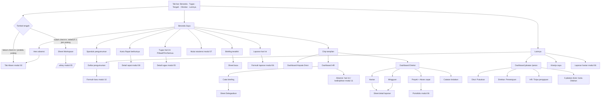

# Spesifikasi layar Android — Modul 02: Beranda & dashboard per peran

> Mockup: `docs/mockups/android/screens/02-beranda-dashboard/` (30 berkas HTML, **134 layar**, 268 PNG terang+malam di `docs/mockups/android/png/02-beranda-dashboard/`, tidak di-commit). Tema dipilih lewat `?tema=malam`. Hari contoh: **Selasa, 13 Okt 2026**; persona Sari Wulandari (staf), Dimas Pratama (Kepala Divisi Operasional), Hana Pertiwi (HR), Hendra Wijaya (Direktur Utama), Agus Salim (Direktur), Rina (Super Admin).
> Sumber: `apps/mobile/app/(tabs)/index.tsx`, `resources/js/features/{dashboard,briefings,announcements,monitoring,role-dashboards,reports,automation/performance}`, `docs/fitur/{dashboard-peran,dashboard-pimpinan,pengumuman,laporan-harian}.md`, `docs/PLATFORM.md` §2.1/§3, PRD M7/M9, keputusan pemilik 6–9 Okt 2026 (`docs/sesi/glm.md`, `docs/sesi/ponsel.md`).

## 1. Inventaris layar

Kolom "Peran" = siapa yang melihat. "Keadaan" = yang tercakup dalam berkas (satu `.phone` per keadaan, caption di HTML menjelaskan tiap satu).

| Berkas | Layar | Peran | Keadaan / isi yang tercakup |
|---|---|---|---|
| `01-beranda-staf` | Beranda staf, layar penuh bergulir | semua karyawan (acuan: staf) | spanduk pengumuman ×2 + "Lihat semua", hero absensi (sudah check-in), "Mulai notulensi", Rapat berikutnya, Tugas hari ini (Pribadi), Briefing terakhir, ringkasan (Disiplin hadir, Selesai), kartu Laporan hari ini; tombol tengah = Workspace |
| `02-beranda-hero-keadaan` | Kartu absensi Beranda | semua | 8: belum check-in · sudah (tepat waktu) · terlambat 24 mnt · selesai · tercatat dari pengajuan · hari libur · WFH/lapangan · jendela pulang (tengah kembali Absen) |
| `03-tugas-hari-ini-keadaan` | Kartu Tugas hari ini | semua | 10: Pribadi (badge "dari absen", dicoret bila selesai) · Tim (badge "penugasan atasan") · Semua (7) · kosong ×3 (per segmen) · memuat · galat · offline · menu cepat tahan-lama (usulan) |
| `04-beranda-keadaan-halaman` | Beranda: keadaan halaman | semua | memuat (kerangka) · galat penuh · sebagian gagal · offline · tarik-untuk-segarkan |
| `05-workspace-sheet-tombol-tengah` | Sheet Workspace dari tombol tengah | semua | 6: terisi (Pribadi·Tim·Proyek) · staf baru (grup kosong) · memuat · galat · tombol tengah = Absen (jendela pulang) · tab Workspace aktif |
| `06-briefing-pembaca` | Briefing terakhir (pembaca) | semua | 4: kartu · sheet baca penuh · tak ada briefing (204 → kartu tak tampil) · memuat |
| `07-briefing-pencatat` | Catat briefing | HR, Super Admin, ditunjuk | 8: kartu pagi + draf lokal · fokus · kosong (tombol nonaktif) · menyimpan · terkirim ("Simpan perubahan") · galat jendela/jaringan · ditunjuk oleh HR · di luar jendela |
| `08-briefing-delegasi` | Delegasikan briefing | HR, Super Admin | 5: sheet awal · hasil cari + pilihan + catatan delegasi lama · mencari · tidak ada hasil (1 periode) · sukses + snackbar |
| `09-pengumuman` | Spanduk + daftar | semua; "Saya buat" bagi penulis | 8: spanduk ×3 + "Lihat semua (5)" · spanduk ×1 · daftar Untuk saya (yang ditutup diredupkan) · Saya buat (+FAB) · dialog hapus · kosong · galat menutup (rollback) · sheet baca penuh (usulan) |
| `10-laporan-harian-kartu` | Kartu Laporan hari ini | semua (menonjol untuk staf) | 4: belum lapor (prominent) · draf · terkirim · terkunci (hari berikut) |
| `11-kinerja-saya` | Kinerja saya | semua; `/kinerja/{user}` bagi atasan/HR/Direksi | 4: penuh (KPI 2×2, terlambat, grafik 8 minggu, per workspace, privasi) · orang lain · kosong · memuat |
| `12-pemilih-tampilan-peran` | Pemilih tampilan dashboard | per peran | 6: staf (tanpa pemilih) · Kadiv · HR · Direksi · Direksi+memimpin divisi · berpindah (memuat) |
| `13-dashboard-kepala-divisi` | Dashboard Kepala Divisi, layar penuh | Kepala Divisi, Super Admin (+Direksi/HR bila berperan) | periode, KPI (hero kehadiran, penyelesaian, ketepatan, terlambat), antrean persetujuan, tren 8 minggu, kehadiran hari ini (LIVE), laporan tim hari ini, beban kerja, tugas terlambat, proyek berisiko |
| `14-kepala-divisi-keadaan` | Dashboard Kadiv: keadaan | idem | 6: memuat (deferred) · galat metrik · kosong · periode bulan · kehadiran diperluas · offline |
| `15-dashboard-hr` | Dashboard HR, layar penuh | HR, Super Admin | kartu Catat briefing, Menunggu HR, Absensi hari ini (KPI + tautan Perlu ditinjau / Lupa check-out / Kedisiplinan), Hiring |
| `16-hr-keadaan` | Dashboard HR: keadaan | HR | 4: antrean kosong · hiring tak tersedia · memuat · galat |
| `17-direksi-harian` | Dashboard Direksi › Harian | Direksi, Super Admin | 4: hari ini · tanggal lampau · libur (tak terjadwal) · memuat |
| `18-direksi-mingguan` | Direksi › Mingguan | idem | 2: minggu lalu (matriks lengkap) · minggu berjalan (hari depan bergaris putus) |
| `19-direksi-proyek` | Direksi › Proyek + Akses cepat workspace | idem | 3: proyek (kesehatan, progres vs rencana, milestone) · akses cepat (cari, chip, "Lihat saja") · kosong |
| `20-direksi-catatan` | Direksi › Catatan tindakan | Direksi, HR, Super Admin (pribadi) | 5: daftar · mengetik · ubah di tempat · kosong · galat simpan |
| `21-direksi-detail-laporan` | Sheet detail laporan harian | pembaca laporan | 4: terisi · hambatan + catatan · memuat · 404 tanpa akses |
| `22-beranda-super-admin` | Beranda Super Admin | Super Admin | 3: empat chip · pemilih divisi di tampilan Kadiv · sheet pilih divisi |
| `23-peran-dirut` | Dashboard jabatan Direktur Utama | Dirut, Direksi, Super Admin | hero Proyek aktif, strip KPI, aksi Putuskan/Monitoring, jadwal, daftar keputusan, portofolio vs rencana, perlu perhatian |
| `24-peran-dirut-putuskan` | Alur Putuskan (sheet) | Direksi | 6: default · menulis · memproses · kosong · hanya baca · galat |
| `25-peran-direktur` | Dashboard jabatan Direktur | Direktur, Direksi, Super Admin | hero Menunggu persetujuan, antrean (barang, dinas, koreksi), portofolio, keputusan Direksi |
| `26-peran-direktur-persetujuan` | Alur Persetujuan (sheet) | Direktur | 5: antrean · Tolak (alasan wajib) · Setujui + snackbar · kosong · galat |
| `27-peran-hr` | Dashboard jabatan HR | HR, Direksi, Super Admin | hero Menunggu keputusan Anda, KPI, aksi Tinjau/Kehadiran, daftar, antrean per jenis, cuti mendatang |
| `28-peran-hr-tinjau` | Alur Tinjau pengajuan (sheet) | HR | 6: cuti (detail lengkap + saldo) · catatan wajib salah · revisi · setelah putus/memuat · kosong · koreksi absensi |
| `29-peran-unit-divisi` | 5 dashboard jabatan divisi | pemegang jabatan, Direksi, SA | Corsec, Marketing, Programming, Implementer, Analis: data nyata + kartu "Ditahan · butuh modul baru" |
| `30-peran-keadaan` | Dashboard jabatan: akses & keadaan | per peran | 7: pemilih 8 jabatan + divisi · staf (data sendiri) · memuat · galat · 404 · Dirut tanpa keputusan · titik masuk di Lainnya |

### Dashboard jabatan SPKD (8) — cakupan

| Kunci | Jabatan | Layar yang ada | Alur | Catatan |
|---|---|---|---|---|
| `dirut` | Direktur Utama | `23`, `24`, `30` | **Putuskan** (nyata) | Tanpa metrik kerja/kehadiran (keputusan 6 Okt); "Monitoring kerja" menuju Dashboard Direksi |
| `direktur` | Direktur | `25`, `26` | **Persetujuan beruntun** (nyata) | Antrean Direktur memuat pengajuan barang (alur atasan → Direksi), dinas, koreksi |
| `hr` | HR | `27`, `28` | **Tinjau pengajuan** (nyata) | Tidak menduplikasi kehadiran; tautan ke Absensi |
| `corsec`, `marketing`, `programming`, `implementer`, `analis` | divisi | `29`, `30` | **Ditahan** | Data tugas/tenggat/kehadiran/beban kerja nyata; alur desain (disposisi surat, kalender konten, board sprint/bug, check-in di klien/tiket P1, UAT/review PR) **tidak dimock sebagai layar hidup** — hanya kartu "Ditahan" seperti web (`DashboardRole::heldModule()`). Layar P* desain yang ditahan: `PCorsecSurat/Notulis`, `PMarketingKalender/Review`, `PProgSprint/Bug`, `PImplTiket/Checkin`, `PAnalisUAT/Review`, `PDirekturKapasitas`, `PDirutPortofolio`, `PHRLive` |

## 2. Peta navigasi

## 3. Pemetaan layar → endpoint

Prefix `/api/v1`. **ADA** = sudah di `docs/sesi/ponsel.md` dan `apps/mobile/src/api/endpoints.ts`. **BELUM ADA** = harus dibuat sebagai presenter tipis di atas Action/Query/Policy web (aturan yang sama: Policy, `visibleTo`, flag fitur, 404 untuk tak berhak).

| Layar | Endpoint | Status |
|---|---|---|
| Hero absensi, jendela pulang, tombol tengah | `GET /absensi/hari-ini` → `today{action, schedule, day}`, `serverTime` | **ADA**. Untuk teks hero ("terlambat 24 menit", "32 m dari titik lokasi", `end` untuk jendela pulang) perlu memastikan `day.lateMinutes`, jarak, `schedule.end`; bila jarak tak ada, baris jarak disembunyikan |
| Tugas hari ini | `GET /tugas/hari-ini` | **ADA**. **Celah tipe:** server sudah mengirim `assigned_by_other` per item (`TugasHariIni`), tetapi `TodayTaskItem` di aplikasi belum memilikinya → badge "penugasan atasan" butuh field itu. Aplikasi juga memalsukan `priority: {value:3}` dan `due_date: today` di `TugasItem`; ganti dengan label asli |
| Menu cepat tugas (usulan) | `PATCH /tugas/{id}/status {done:true}` | **ADA** (tim → Review dulu, pribadi → Selesai) |
| Rapat berikutnya | `GET /rapat?rentang=hari-ini` + `akan-datang` | **ADA** (digabung klien) |
| Briefing terakhir | `GET /briefing/terakhir` (204 bila belum ada) | **ADA** |
| Catat briefing (kartu pencatat) | `GET /briefing/jendela` → payload `BriefingWindow::card` (`date`, `periods[{value,starts_at,ends_at,status}]`, `can_record`, `is_recorder`, `delegations`, `saved`, `latest`) | **BELUM ADA** |
| Simpan briefing | `POST /briefing {period, content}` (upsert idempoten, notifikasi hanya pertama) | **BELUM ADA** (web: `POST /briefing`) |
| Delegasi briefing | `POST /briefing/delegasi {user_id, period}` + cari orang `GET /cari/hasil?group=people&q=` | **BELUM ADA** (cari orang dimiliki modul 10) |
| Spanduk pengumuman | `GET /pengumuman/spanduk` → `{items[], total}` ; tutup `POST /pengumuman/{id}/tutup` | **BELUM ADA** |
| Daftar / hapus pengumuman | `GET /pengumuman` (Untuk saya / Saya buat), `DELETE /pengumuman/{id}`; buat `POST /pengumuman` (modul 10) | **BELUM ADA** |
| Kartu Laporan hari ini | `GET /laporan/status` → `{status: missing|draft|submitted, submitted_at, items_count}` (turunan `TodayReportStatus`) | **BELUM ADA** (formulir & riwayat: modul 06) |
| Kinerja saya | `GET /kinerja?periode=8-minggu|bulan|kuartal`, `GET /kinerja/{user}` | **BELUM ADA** (flag `features.automation`) |
| Workspace sheet | `GET /workspace` (grup `pribadi`/`divisi`/`proyek`/`lainnya`) | **ADA**. Sheet menampilkan 3 grup; baris Tim = grup `divisi`; `lainnya` tetap di Lainnya |
| Pemilih tampilan | `GET /dashboard/tampilan` → `[{key: saya|divisi|hr|direksi, label, active}]` (atau dari `/auth/saya` bagian `abilities`) | **BELUM ADA** |
| Dashboard Kadiv | `GET /dashboard/divisi?periode=minggu|bulan&divisi=` → `{scope, filters, attendance, approvals, reports}` + `metrics` terpisah (deferred) | **BELUM ADA**; pecah dua panggilan agar kerangka metrik bisa tampil |
| Dashboard HR | `GET /dashboard/hr` → `{pending, attendance, hiring, briefing}` | **BELUM ADA** |
| Dashboard Direksi | `GET /dashboard/direksi?tanggal=&minggu=` → `{scope, daily, weekly, projects, workspaces, notes}` | **BELUM ADA** (bisa `?bagian=harian|mingguan|proyek|catatan` agar muat per tab) |
| Detail laporan | `GET /monitoring/laporan/{id}` | **BELUM ADA** (JSON web sudah ada, tinggal dibungkus Sanctum) |
| Catatan tindakan | `POST /catatan-tindakan`, `PATCH /catatan-tindakan/{id}`, `DELETE …`, `PUT /catatan-tindakan/urutan` | **BELUM ADA** |
| Dashboard jabatan | `GET /peran` (alih ke jabatan sendiri), `GET /peran/{role}?divisi=` → `{role, roles[], divisions[], division, dashboard}` | **BELUM ADA** (flag `role_dashboards`) |
| Alur Dirut | `POST /peran/{role}/keputusan/{update}` `{decision}`, `POST …/minta-update` `{note}` | **BELUM ADA** |
| Alur Direktur/HR | `POST /peran/{role}/persetujuan/{id}/setujui|tolak|revisi` `{note}` + data alur (`flow`) dimuat bersama `GET /peran/{role}` | **BELUM ADA**. Catatan: `GET /persetujuan` modul 04 mungkin sudah menyediakan keputusan yang sama; sebaiknya satu kontrak |
| Lonceng / lencana | `GET /inbox` (`unread`) | **ADA** |

Semua jawaban galat memakai format v1: 422 `{message, errors}` Indonesia, 403/404 untuk tak berhak (tidak membocorkan keberadaan), 429 pesan Indonesia (`api-v1` 60/menit).

## 4. Kemampuan khas Android yang dipakai

| Kemampuan | Dipakai di | Catatan |
|---|---|---|
| Tarik untuk menyegarkan (`RefreshControl`) | Beranda & semua dashboard | muat ulang diam-diam, tanpa kerangka |
| Gestur kembali sistem | semua layar turunan, sheet menutup lebih dulu | `BackHandler`; sheet dan dialog menutup sebelum pindah layar |
| Bottom sheet & dialog Material | Workspace, baca briefing, delegasi, alur jabatan (sheet 90%), hapus, tolak | ketuk scrim = tutup; sheet alur tidak menutup saat ada ketikan belum dikirim tanpa konfirmasi |
| Snackbar | hasil aksi ringan, rollback optimistis, galat | 4 detik, aksi "Coba lagi" bila bisa diulang |
| Papan ketik / `visualViewport` | Catat briefing, alasan tolak, keputusan, catatan tindakan | tab bar disembunyikan; tombol Simpan ikut naik |
| Notifikasi (FCM, modul 12) | `briefing.posted` (informatif → buka sheet baca), `system.announcement` (→ daftar pengumuman), `report.reminder` 16.30 (→ formulir laporan), "Perlu tindakan" keputusan/persetujuan (→ alur jabatan) | deep link `ruangkerja://beranda`, `/pengumuman`, `/laporan/hari-ini`, `/peran/{role}` |
| Widget layar utama (modul 12) | Tugas hari ini, check-in | memakai `GET /tugas/hari-ini` dan `/absensi/hari-ini` |
| Getar halus | hasil Setujui/Putuskan (haptic konfirmasi), tidak untuk galat berulang | `expo-haptics` |
| Mode gelap sistem | semua layar | token Arus malam |

Izin runtime: tidak ada yang baru di modul ini (kamera/lokasi dimiliki modul 03; notifikasi dimiliki modul 12).

Gerak (anotasi): durasi 120 ms (tekan/hover), 180 ms (sheet, pil tab) dengan `ease-brand` `cubic-bezier(.2,.8,.2,1)`; pil tab bar bergeser dengan `transform` saja; ikon tombol tengah berganti (Absen ↔ Workspace) dengan cross-fade 120 ms; `prefers-reduced-motion` (`AccessibilityInfo.isReduceMotionEnabled`) → tanpa geser/skala, tarik-segarkan tetap tampil; kerangka berdenyut berhenti.

## 5. Matriks keadaan

| Bagian | Memuat | Kosong | Galat | Offline | Terkunci / tanpa akses | Baca-saja |
|---|---|---|---|---|---|---|
| Beranda (halaman) | kerangka hero/tugas | — (hero selalu ada) | kartu galat; sebagian gagal → kartu info | pita "Tidak ada koneksi", check-in nonaktif | — | — |
| Hero absensi | kerangka | n/a | digabung galat halaman | tombol nonaktif | tercatat dari pengajuan (tak perlu absen) | — |
| Tugas hari ini | 3 baris kerangka | per segmen (3 teks) | kartu galat + Coba lagi | data terakhir + pita (usulan cache) | — | — |
| Briefing pembaca | tanpa kerangka sendiri | **kartu disembunyikan** (204) | disembunyikan diam-diam | idem | — | selalu baca-saja |
| Catat briefing | — | tombol nonaktif | snackbar; draf lokal dipertahankan | draf lokal tetap | hanya tampil bagi pencatat dalam jendela | — |
| Pengumuman | — (muncul belakangan) | "Belum ada pengumuman" | rollback + snackbar | — | tab "Saya buat" hanya penulis | staf: tanpa hapus/buat |
| Laporan hari ini | — | n/a | n/a | — | terkunci setelah 23.59 | — |
| Kinerja saya | kerangka KPI 2×2 | "Belum ada data kinerja" | kartu galat | pita | `/kinerja/{user}` 404 bila bukan pembaca sah | orang lain: baca-saja |
| Dashboard Kadiv | kerangka metrik (deferred) | KPI "—", panel EmptyState | kartu galat metrik, sisanya tetap | pita + "Terakhir …" | 404 tanpa hak | — |
| Dashboard HR | kerangka 3 panel | "Tidak ada pengajuan yang menunggu HR." | kartu "Dashboard gagal dimuat" | pita | kartu Hiring hanya bila modul tersedia | — |
| Direksi (4 tab) | kerangka per panel | EmptyState per panel/tanggal libur | kartu galat dalam panel | pita | 404 detail laporan tanpa hak | workspace non-anggota = "Lihat saja" |
| Dashboard jabatan | kerangka bentuk layout | daftar kosong + kalimat | "Dashboard gagal dimuat" | pita | 404 (Gate `viewRoleDashboard`) / flag mati; **Ditahan** untuk 5 jabatan divisi | Super Admin/HR pada alur Dirut: `can_resolve=false` |
| Alur jabatan (sheet) | kerangka kartu detail | "Tidak ada yang menunggu" | snackbar + rollback | tombol nonaktif | tombol nonaktif + "Hanya Direksi yang bisa memutuskan." | — |

## 6. Catatan implementasi Expo

**Komponen yang sudah ada di `apps/mobile`:** `Screen` (+`RefreshControl`), `Card`, `CardTitle`, `Badge`, `Button`, `Segmented`, `EmptyState`, `ErrorState`, `Loading`, `Meta`, `TugasItem`, tema Arus (`useTheme`, `radius`). **Perlu dibuat:** `ChipScroller` (pemilih tampilan/jabatan, 42 px, aktif gradien), `BottomSheet` (gorhom/bottom-sheet atau `Modal` sendiri; jenis `sheet` dan `fullSheet` 90%), `Dialog` Material, `Snackbar` (satu antrean global), `StatTile`/`KpiCard` (+`highlight` gradien), `ProgressBar` (dengan penanda rencana), `WeekCell` (kotak hari berteks), `SegBar` (bilah segmen kehadiran), `BannerPengumuman`, `StepperTanggal`/`StepperMinggu`.

- **Struktur rute (expo-router):** `app/(tabs)/index.tsx` memilih tampilan dari pemilih (state + parameter `?tampilan=`); `app/dashboard/[view].tsx` untuk deep link; `app/peran/[role].tsx`; `app/pengumuman/index.tsx`; `app/kinerja/[[user]].tsx`. Sheet alur jabatan = rute modal (`presentation: 'transparentModal'`) agar tombol kembali sistem menutupnya.
- **Pemuatan:** `Promise.allSettled` per kartu seperti sekarang; dashboard besar dimuat dua tahap (shell → metrik) meniru Inertia deferred; tab Direksi dimuat sesuai tab aktif (`?bagian=`) supaya payload kecil; pilihan tanggal/minggu hanya memuat ulang panel itu.
- **Tombol tengah:** logika persis `centerAction`/`msUntilCenterFlip` (web `tab-bar-center.ts`) — `check_in` → Absen; `check_out` dengan `end` ≤ 1 jam lagi atau `end` null → Absen; selain itu → Workspace; status tak dikenal → Absen. Pewaktu satu `setTimeout` pada `end − 60 mnt` (batasi 24,8 hari). Ikon: sidik jari ↔ `layout-grid`; label aksesibilitas "Absen"/"Workspace"; tab Lainnya memakai ikon `menu` supaya tidak sama dengan Workspace.
- **Draf briefing lokal:** `expo-secure-store` tidak cocok untuk teks besar; pakai `@react-native-async-storage/async-storage` (belum ada di app — **paket baru, perlu persetujuan**) atau `expo-file-system`. Kunci `rk.briefing-draft.v1.{userId}.{tanggal}.{periode}`, debounce 500 ms, dibungkus try/catch.
- **Optimistis:** Setujui/Tolak/Putuskan/tutup spanduk/centang catatan menyembunyikan item seketika, rollback + snackbar bila gagal (pola web `withoutHidden`).
- **Tanggal & angka:** `src/lib/format` (id-ID, Asia/Jakarta); isian tanggal Direksi pakai `DateTimePickerAndroid` (`@react-native-community/datetimepicker`, paket baru) menampilkan "Sen, 12/10/2026"; pecahan memakai koma ("2,5 hari").
- **Warna:** hanya token tema; penanda status selalu ikon/titik + teks (kotak hari mingguan: angka/`D`/`!`/`–`).
- **Aksesibilitas:** semua target ≥ 44 px (tombol tutup spanduk 44, chip 42–44, tombol panah catatan 40×34 → naikkan ke 44 pada implementasi); `accessibilityRole="tab"`/`radio`/`progressbar`; `accessibilityLiveRegion="polite"` untuk teks status (briefing, pencarian); font 200% menumpuk KPI jadi satu kolom (hero tetap).
- **Tes:** pure function (`centerAction`, `withoutHidden`, `contentError`, `delegatablePeriods`, `filterWorkspaces`, tone progres) dipindah ke `apps/mobile/src/lib/*` dengan vitest bila harness dibuat; sisanya diuji lewat Pest `tests/Feature/Api/`.

## 7. Pertanyaan / keputusan untuk pemilik

1. **Kartu Laporan hari ini di Beranda Android.** Web mencabutnya dari Beranda pada 9 Okt (digantikan Tugas hari ini) walau PRD/`laporan-harian.md` masih menyebut; laporan kini lewat Lainnya/pengingat 16.30. Mockup `01` & `10` menampilkannya sebagai usulan (tampil hanya mulai ~15.30 atau bila belum lapor). **Tampilkan, atau ikuti web (tanpa kartu)?**
2. **Super Admin tidak bisa masuk ke aplikasi** (API menolak 403 `two_factor_required`; TOTP belum didukung). Layar `22` hanya spesifikasi untuk saat TOTP tersedia. **Apakah 2FA ditambahkan ke API v1, atau Super Admin tetap web-only?**
3. **Tampilan awal per peran multi-tampilan.** Web memakai tampilan "landing" (Direksi → Direksi, HR → HR) atau yang terakhir dibuka? Usulan Android: ingat tampilan terakhir per perangkat. **Setuju?**
4. **Cache baca-saja (offline).** Tugas hari ini, briefing terakhir, dan dashboard tampil dari data terakhir saat offline (mockup `03`/`04`/`14`). Memerlukan penyimpanan lokal (paket baru). **Ya/tidak untuk v1?** (PLATFORM §2.1 #5: antrean tulis offline hanya Fase 3.)
5. **Menu cepat tahan-lama pada baris tugas** ("Kirim ke Review"/"Tulis komentar") bukan keputusan web. **Boleh ditambahkan atau hanya buka detail?**
6. **Briefing: pengingat jendela.** Notifikasi 08.00 dan 16.00 ke pencatat (HR/Super Admin/ditunjuk) agar jendela tidak terlewat — belum ada di web. **Usulan; setuju?**
7. **Dashboard divisi untuk jabatan 5 divisi — "Ditahan".** Dipertahankan jujur seperti web. Bila ingin tampak "hidup" di Android, modulnya (surat masuk, tiket, UAT, bug) harus dibuat dulu. **Konfirmasi tidak membuat layar P\* ditahan.**
8. **Ekspor Excel/PDF** dashboard (Kadiv/Direksi, Kedisiplinan) tetap desktop (PLATFORM §3). Mockup tidak punya tombol ekspor; **cukup banner "Tersedia di desktop" + "Kirim tautan ke email saya" di menu ⋯?**
9. **Ikon Lainnya vs Workspace:** foundation memakai `layout-grid` untuk Lainnya dan web memakai `LayoutGrid` untuk Workspace — identik saat sebelahan. Mockup modul ini memakai `menu` untuk Lainnya (seperti kode `menu-outline`). **Setuju diseragamkan?**
10. **Pengumuman: baca penuh.** Spanduk memotong 2 baris; web tidak punya detail. Usulan sheet baca penuh (mockup `09`-8). **Setuju (satu ketukan)?**

## 8. Celah (fitur web tanpa wujud ponsel)

- **Seluruh dashboard non-staf** (Kadiv, HR, Direksi, jabatan) dan pemilihnya belum ada di `apps/mobile` maupun API v1; Beranda aplikasi hari ini hanya versi staf (hero kartu terpisah, tanpa spanduk, tanpa pemilih, tanpa laporan hari ini, tanpa KPI).
- **Briefing:** hanya pembaca; pencatat & delegasi (HR/Super Admin) dan pengiriman notifikasi belum ada; tidak ada deep link dari notifikasi `briefing.posted`.
- **Pengumuman** (spanduk, daftar, hapus, tutup) dan **Kinerja saya** tidak ada sama sekali; **Laporan hari ini** tidak ada kartunya.
- **Tombol tengah** masih tetap "Absen" di aplikasi; belum ada sheet Workspace dan logika flip; tab Lainnya memuat daftar panjang (profil, riwayat, pengajuan, perangkat) yang akan dipecah modul 01/04/05.
- **`TugasItem`** belum menampilkan badge "dari absen"/"penugasan atasan" dan label prioritas asli (lihat §3).
- **Catatan tindakan Direksi, akses cepat workspace "Lihat saja", detail laporan harian** — belum ada; mode lihat-saja untuk Direksi/HR/SA di workspace non-anggota dijaga Policy server.
- Ekspor (Excel/PDF) tetap desktop-saja; roadmap/kalender proyek desktop-saja (modul 06).

### Kebutuhan kit (tidak mengubah `_kit/`)

Pola yang berulang di modul ini dan layak masuk kit: `.b-tag` (tag 24 px berteks 13 px dengan ikon), `.b-fsheet` (bottom sheet hampir layar penuh dengan header/aksi lengket), `.b-ann` (spanduk informasi), `.b-cell` (kotak hari berteks), `.b-bar` (progres dengan penanda rencana), `.b-hs` (strip KPI menggulir horizontal). Kelas ini didefinisikan lokal di tiap berkas (prefiks `b-`).
