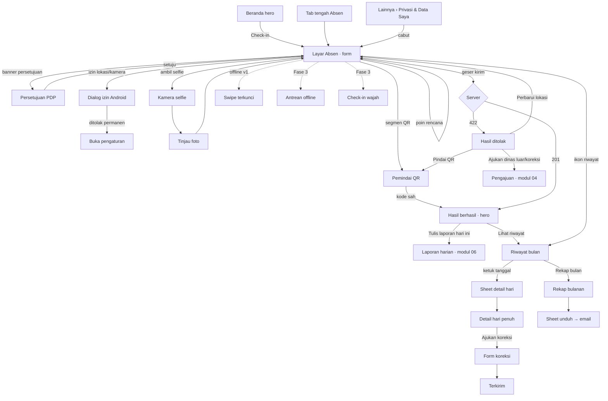

# Spesifikasi mockup Android — Modul 03 · Absensi

> Mockup: `docs/mockups/android/screens/03-absensi/` (19 berkas HTML, 102 layar `.phone`; render terang + malam = 204 PNG di `docs/mockups/android/png/03-absensi/`, tidak di-commit). Gaya lokal bersama: `_abs.css` (prefiks `.abs-`, hanya variabel token kit). Hari ini di mockup: **Selasa, 13 Okt 2026**; persona **Sari Wulandari** (staf, hybrid, Shift Reguler 08.00–17.00, toleransi terlambat 10 menit → batas 08.10, Kantor Pusat radius 100 m). Sumber: `docs/PRD.md` M2, `docs/PLATFORM.md` §2.1/§3/§4, `docs/fitur/absensi-whatsapp.md`, `docs/fitur/aplikasi-ponsel*.md`, `docs/sesi/ponsel.md`, `apps/mobile/app/(tabs)/absen.tsx`, `KameraSelfie.tsx`, `lib/lokasi.ts`, web `resources/js/features/attendance/**`.

## 1. Keputusan desain (diusulkan, perlu konfirmasi bila bertanda ❓)

| # | Keputusan | Alasan |
|---|---|---|
| D1 | **Geser untuk check-in/out** (bukan sekali ketuk), knob 56 px, ambang kirim ≥ 85% lebar, kembali berpegas bila dilepas lebih awal; tombol terkunci (ikon gembok) sampai prasyarat siap. Geser = **aksi kirim final** (bukan pembuka kamera). | `PLATFORM.md` §2.1 #4: cegah absen tanpa sengaja. Selfie sudah punya tahap tinjau sendiri, jadi kirim tidak ganda. |
| D2 | Semua masukan check-in ada **satu layar Absen** (status, peta, metode, rencana kerja, selfie, catatan, prasyarat) dan tombol geser **menempel di atas tab bar** (bilah kaca). Selfie memakai layar kamera penuh lalu kembali ke layar Absen dengan miniatur. | Sama dengan `absen.tsx` yang ada, tetapi dengan geser menggantikan tombol "Kirim". Kontras dengan web yang berurutan selfie → tinjau → kirim. |
| D3 | Metode = segmented **GPS + selfie · QR · WFH** (MAbsen). WFH **tidak** memilih mode terpisah ke server: sama dengan web, jalur remote otomatis bila `schedule.allowsRemote` dan di luar radius; segmen WFH hanya mengaktifkan catatan wajib + membuka batas radius di UI. Bila jadwal tidak mengizinkan remote, segmen terkunci (ikon gembok) + arahan "Ajukan dinas luar / koreksi". | Server menurunkan `wfh` dari jadwal (`allowsRemote`); tidak ada parameter metode. |
| D4 | **Rencana kerja 1–8 poin bernomor wajib** sebelum check-in GPS+selfie (maks. 300 karakter/poin, `+ Tambah poin`, hapus per baris, kunci baris stabil agar fokus/IME tidak berpindah saat menghapus). Teks bantu menyebut dua efek: terkirim ke grup WhatsApp manajemen dan tiap poin menjadi **tugas pribadi hari ini**. Untuk **QR** rencana **opsional** (pesan grup menulis "tidak diisi — absen lewat QR/kiosk"). ❓ | Web: QR tidak lewat form rencana. Aplikasi menawarkannya agar manajemen tetap tahu rencana; opsional agar paritas web terjaga. |
| D5 | **Tombol tengah tab bar kontekstual** (keputusan pemilik 9 Okt): Absen sebelum check-in; **Workspace** setelah check-in; Absen kembali mulai `jam pulang − 60 menit` (berlencana "!") sampai check-out; Workspace setelah check-out/tidak tersedia. Selama tombol = Workspace, Absen tetap terjangkau dari kartu hero Beranda ("Check-out lebih awal"), Lainnya › Absensi, dan notifikasi pengingat pulang. | `PLATFORM.md` §2.1 #1, `tab-bar-center.ts`. |
| D6 | **Persetujuan UU PDP** sebagai layar penuh "Langkah 1 dari 2" (Langkah 2 = izin sistem Android lokasi + kamera), muncul dari banner di Absen (bukan di tengah alur). Cabut persetujuan lewat Lainnya › Privasi & Data Saya (dialog + snackbar Urungkan). Setelah dicabut: banner di Absen, QR dan koreksi tetap tersedia. | Web `ConsentContent`/`ConsentCard`. |
| D7 | **Izin Android runtime** diminta tepat saat dibutuhkan, didahului penjelasan in-app (rationale) pada izin lokasi; hanya izin *foreground* (tanpa lokasi latar). Pilihan "Tepat" dianjurkan; "Perkiraan" ditolak dengan arahan ke pengaturan. Ditolak permanen → kartu "Buka pengaturan" + langkah 1-2-3. | `lokasi.ts` (`canAskAgain`), `KameraSelfie.tsx` (`izinDitolak`). |
| D8 | **Penanda, bukan pemblokiran**: akurasi > 100 m (`low_accuracy`), jam perangkat (`clock_skew`), selfie gelap (`dark_selfie`), lokasi palsu (`mock_location`, baru), perangkat baru. Peringatan dini ditampilkan sebelum kirim; absensi tetap tercatat dan ditandai untuk tinjauan HR. Di luar radius (GPS) **ditolak server** dengan layar "Pilih cara lain". | PRD M2 "hanya ditandai"; `LogFlag`. |
| D9 | Layar hasil **hero gradien layar penuh** (MSukses): hijau-biru untuk tepat waktu/WFH/QR, **kuning-oranye** untuk terlambat/pulang cepat/ditandai, **hangat** untuk check-out. Terlambat selalu menjelaskan "dihitung dari batas toleransi". Check-out berhasil mengajak **Tulis laporan hari ini** (modul 06). ❓ | `check-success.tsx`; kartu laporan harian di Beranda. |
| D10 | Riwayat = kalender bulan + 4 angka + kartu hari terpilih + "Catatan bulan ini" (daftar). Status **bukan warna saja**: tiap sel non-normal punya ikon kecil (jam = terlambat, rumah = WFH, dokumen = izin/cuti/sakit, pensil = koreksi, silang = alpha) dan legenda berlabel. **Tanpa saldo cuti** untuk staf dan tanpa skor gabungan. | PRD M7/M9; web `month-notes.tsx`. |
| D11 | **Selfie milik sendiri tidak ditampilkan** di detail hari/riwayat (hanya HR dan atasan langsung; setiap akses diaudit); layar menyatakannya. | `docs/PRD.md` §8 Privasi. |
| D12 | Pesan grup WhatsApp ditampilkan sebagai **pratinjau baca-saja** (sheet "Lihat pesan yang akan dikirim") dengan format 9 Okt (🟢 ABSEN MASUK / 🔴 ABSEN PULANG, Nama/Tanggal/Jam/Lokasi, poin bernomor, `Durasi kerja`). Pratinjau disusun di klien dari data yang sama; tidak ada endpoint. | `SendAttendanceWhatsApp::message`. |
| D13 | **Offline**: v1 menolak check-in tanpa koneksi (swipe terkunci, form dipertahankan) — sama seperti PWA. **Fase 3** menambah antrean lokal idempoten (`client_id` ULID + `client_time`) dengan status Menunggu/Mengirim/Gagal + alasan. | `PLATFORM.md` §2.1 #5, `aplikasi-ponsel.md`. |
| D14 | **Peta**: sketsa SVG geofence tanpa ubin (ringan di 4G, CSP web tidak mengizinkan ubin pihak ketiga). Bila memakai peta sungguhan nanti, butuh kunci API → keputusan pemilik. ❓ | Mini-map kartu Absensi web berupa sketsa. |

## 2. Inventaris layar

Semua layar = peran apa pun yang punya akun karyawan aktif (absensi pribadi; HR/atasan memantau orang lain di modul 11). "Terang/Malam" otomatis lewat `?tema=malam`.

| Berkas | Layar (jumlah) | Keadaan yang tercakup |
|---|---|---|
| `01-absen-masuk.html` | Form check-in (5) | awal (swipe terkunci + prasyarat), siap kirim, sedang digeser (50%), mengirim (form dikunci), mengetik poin dengan papan ketik (tab bar disembunyikan, dock naik, multi-baris) |
| `02-absen-metode.html` | QR, WFH, WFH terkunci (3) | QR (tanpa selfie, rencana opsional), WFH (catatan wajib, di luar radius, lokasi deskriptif), WFH tidak diizinkan jadwal → ajakan dinas luar/koreksi |
| `03-absen-keadaan.html` | Keadaan hari (6) | memuat skeleton, galat memuat, terlalu pagi (`too_early`), bukan hari kerja, hari dari pengajuan (`day_has_request`), tanpa lokasi kantor (`no_office_location`) |
| `04-absen-pulang.html` | Check-out (4) | sedang bekerja (tab tengah Workspace), check-out siap kirim (rencana pagi baca-saja + ajakan laporan), dialog pulang cepat, ringkasan "selesai" |
| `05-izin-persetujuan-pdp.html` | Persetujuan UU PDP (6) | awal (checkbox + tombol nonaktif), persetujuan ulang v1.1, banner di Absen (belum/dicabut), kartu di Privasi, dialog cabut, snackbar setelah dicabut |
| `06-izin-android.html` | Izin runtime (8) | penjelasan lokasi, dialog sistem lokasi (Tepat / Perkiraan), lokasi perkiraan ditolak UI, dialog kamera, lokasi ditolak permanen, kamera ditolak permanen, layanan lokasi mati |
| `07-lokasi-gps.html` | Keadaan GPS (8) | membaca lokasi, akurasi ±85 m (peringatan), >100 m (ditandai), timeout 15 dtk, fix basi dibaca ulang, **mock location**, jam perangkat tidak sesuai, di luar radius (peringatan dini) |
| `08-kamera-selfie.html` | Kamera selfie (5) | siap jepret, tinjau (terang cukup), tinjau gelap (`dark_selfie`), memproses/mengompres, galat ambil foto |
| `09-qr-scan.html` | Pindai QR (3) | mencari kode, bukan kode kiosk, kode dikenali → mengirim |
| `10-hasil-sukses.html` | Hasil berhasil (7) | masuk tepat waktu, terlambat 12 m, WFH, QR, ditandai (`is_suspicious`), pulang (+ajakan laporan), pulang cepat |
| `11-hasil-gagal.html` | Hasil ditolak (8) | luar radius (peta + "Pilih cara lain"), sudah check-in, persetujuan diperlukan, hari dari pengajuan, jaringan terputus, rate limit (52 dtk), QR kedaluwarsa, catatan WFH diperlukan |
| `12-pesan-whatsapp.html` | Pesan grup (3) | sheet pratinjau di aplikasi, grup WhatsApp (🟢 kantor, 🟢 WFH, 🔴 pulang), varian QR & luar kantor |
| `13-riwayat-bulan.html` | Riwayat (6) | Oktober berjalan (hari ini terpilih), September + catatan bulan, bulan depan kosong, memuat, galat, offline dari cache |
| `14-detail-hari.html` | Detail hari (7) | sheet dari kalender, layar penuh terlambat (log, rencana, catatan privasi), perlu koreksi, sudah dikoreksi, dari pengajuan, alpha di luar jendela koreksi, WFH |
| `15-rekap-bulanan.html` | Rekap (2) | rekap pribadi September (tingkat kehadiran + 10 angka), sheet unduh (web-only → kirim tautan ke email) |
| `16-koreksi-absensi.html` | Koreksi (4) | form terisi, galat validasi (maks. 7 hari, alasan ≥ 10), terkirim (timeline), pilihan bantuan dari detail hari |
| `17-offline.html` | Offline (4) | v1: swipe terkunci; **Fase 3**: masuk antrean, sinkron berjalan, konflik/ditolak + alasan |
| `18-wajah-fase3.html` | Wajah (8, **Fase 3 ditahan**) | persetujuan biometrik v1.0, posisi, kedip, toleh, terdaftar, cocok 98%, tidak cocok 62% (3 percobaan → GPS + selfie), hapus data wajah |
| `19-tab-kontekstual.html` | Tab tengah (5) | sebelum check-in (Absen), setelah check-in (Workspace), jam pulang − 60 mnt (Absen berlencana), setelah check-out (Workspace), sheet workspace |

## 3. Peta navigasi

## 4. Pemetaan layar → endpoint API (`docs/sesi/ponsel.md`)

| Layar | Endpoint | Status |
|---|---|---|
| Beranda Absen, keadaan hari, tab tengah kontekstual | `GET /api/v1/absensi/hari-ini` → `today{action, schedule{workDate,isWorkday,isHoliday,holidayName,shiftName,hours,start,end,checkInOpensAt,lateThreshold,workModeLabel,allowsRemote}, day, locations[]}`, `serverTime` | **ADA** |
| Kirim check-in (GPS+selfie/WFH) | `POST /absensi/check-in` multipart: `latitude, longitude, accuracy, selfie, note, work_plan[] (≤8×300), device_id (diabaikan; diambil dari token), client_time` | **ADA** (aplikasi belum mengirim `client_time`; wajib ditambah agar `clock_skew` terdeteksi) |
| Kirim check-out | `POST /absensi/check-out` (tanpa `work_plan`) | **ADA** |
| Penolakan (luar radius dst.) | 422 `{message, reason, context{distance_m,radius_m,accuracy_m,location{…},opens_at,at}}` — alasan: `consent_required, already_checked_in, already_checked_out, not_checked_in, too_early, outside_geofence, no_office_location, note_required, day_has_request, qr_*` | **ADA** (body identik web) |
| Rate limit / jaringan | 429 / galat jaringan klien | **ADA** |
| Check-in/out via **QR** | web: `POST /absensi/check-in/qr` & `/check-out/qr` (`QrCheckController`, limiter `check-in`) | **BELUM ADA di API v1** — perlu `POST /api/v1/absensi/check-in/qr` & `/check-out/qr` `{code, latitude?, longitude?, accuracy?, client_time}` |
| Status & ubah **persetujuan** lokasi/selfie | web: `POST/DELETE /absensi/persetujuan`, props `consent{granted,version,needs_renewal,retention_months,history}` | **BELUM ADA di API v1** — perlu `GET /api/v1/absensi/persetujuan`, `POST`, `DELETE` (+ audit, notifikasi HR yang sudah ada di Action web). Sementara hanya terdeteksi lewat 422 `consent_required`. |
| Flag **mock location** | `attendance_logs.flags` tidak punya `mock_location`; `expo-location` memberi `coords.mocked` (Android) | **BELUM ADA** — tambah parameter `mock_location` + `LogFlag::MockLocation` (Tahap 4.3) |
| Pratinjau pesan WhatsApp | disusun klien dari data form (format `SendAttendanceWhatsApp::message`) | tanpa endpoint |
| Riwayat bulan, detail hari, rekap | `GET /absensi/riwayat?bulan=YYYY-MM` → `period{month,label,start,end,countedUntil,isRunning,previous,next}`, `recap{workDays,presentDays,lateCount,lateMinutes,earlyLeaveCount,absentDays,leaveDays,permitDays,sickDays,businessTripDays,wfhDays,offDays,attendanceRate,days[{date,kind,isWorkday,holidayName,statusLabel,lateMinutes,earlyLeaveMinutes,workMinutes,overtimeMinutes,isSuspicious,shiftName,checkIn,checkOut}]}` | **ADA** |
| Rencana kerja & daftar flag **per hari** di Detail hari | tidak ada di `RecapDayCell` (hanya `isSuspicious`) | **BELUM ADA** — perlu `workPlan` + `flags[]` (label) di sel hari, atau `GET /absensi/hari/{tanggal}` |
| Tautan ke pengajuan dari hari (izin/cuti/koreksi) | `request_id` tidak ada di `RecapDayCell` | **BELUM ADA** — perlu `request{number,status}` di sel hari |
| Unduh rekap PDF/Excel | web-only (halaman Absensi Saya) | **BELUM ADA** — sementara "Kirim tautan ke email saya" (endpoint kirim tautan juga belum ada; modul 10 punya pola yang sama) |
| Koreksi absensi | `GET /pengajuan/jenis` (kategori koreksi) + `POST /pengajuan` `{type: KOR, tanggal, jam…}` | **ADA** (form lengkap di modul 04; jendela `max_backdate_days` 7 divalidasi server) |
| Tugas dari rencana ("Tugas hari ini") | `GET /tugas/hari-ini` (segmen Pribadi memuat sumber `attendance`) | **ADA** |
| Daftar workspace untuk sheet tab tengah | `GET /workspace` | **ADA** |
| Laporan harian dari ajakan check-out | web `/laporan/hari-ini` | **BELUM ADA di API v1** (modul 06) |
| Perangkat saya / hapus data wajah | `GET/DELETE /perangkat`; wajah belum ada | perangkat **ADA**; **wajah BELUM ADA** (`face_templates`, `method=face`, skor/liveness di `flags`) |
| Antrean offline | idempoten `client_id` ULID + 409 + alasan | **BELUM ADA** (Fase 3) |

## 5. Kemampuan khas Android yang dipakai

- **Izin runtime** (`ACCESS_FINE_LOCATION`/`COARSE`, `CAMERA`): dialog sistem Android 12+ dengan pilihan Tepat/Perkiraan dan "Saat aplikasi sedang digunakan / Hanya kali ini / Jangan izinkan". Setelah ditolak dua kali sistem tidak bertanya lagi → `Linking.openSettings()`. Layanan lokasi mati → `Location.enableNetworkProviderAsync()` (dialog "Aktifkan lokasi"). **Tanpa** izin lokasi latar.
- **Tombol kembali sistem**: menutup kamera/pemindai/sheet lebih dulu (`BackHandler`), baru layar; pada layar hasil kembali ke Absen.
- **Haptik** (`expo-haptics`): ringan saat knob melewati 50%, sukses saat 201, error saat 422/jaringan. Mengikuti pengaturan sistem; tidak ada suara.
- **Papan ketik**: `softwareKeyboardLayoutMode: resize`; saat input fokus tab bar disembunyikan dan dock geser naik di atas papan ketik (mockup 01-5). Tombol Enter di poin → poin baru (maks. 8).
- **Kamera**: `expo-camera` `CameraView` depan (selfie) / belakang (QR, `onBarcodeScanned` hanya `qr`, senter `enableTorch`). Selfie dikompres ≤ 200 KB (`ambilDanKompresi`), dicerminkan hanya di pratinjau.
- **Status bar/gesture bar**: layar kamera dan hero memakai ikon status putih; konten tidak masuk ke area gestur (edge-to-edge dengan inset).
- **Notifikasi (modul 10/12)**: pengingat check-in 15 menit setelah jam masuk, pengingat check-out pada jam pulang − 60 menit (kanal "Pengingat absensi"), ketukan membuka layar Absen; hasil check-in tidak memakai notifikasi.
- **Widget/pintasan** (modul 12): aksi "Check-in" membuka layar Absen; widget tidak mengirim tanpa konfirmasi di layar Absen (geser).
- **Dinas luar/kiosk**: halaman kiosk QR desktop-only (tablet/TV), tidak ada di ponsel.

## 6. Matriks keadaan

| Keadaan | Absen (form) | Kamera/QR | Hasil | Riwayat | Detail hari | Rekap |
|---|---|---|---|---|---|---|
| Memuat | skeleton (03-1) | spinner "Membuka kamera…" | tombol geser "Mengirim… n%" (01-4) | skeleton (13-4) | — | — |
| Kosong | — | — | — | bulan depan "Belum ada riwayat" (13-3) | — | tanpa data → angka 0 |
| Galat | ErrorState + Coba lagi (03-2) | galat ambil foto (08-5) | 422 per alasan (11) | "Riwayat tidak dapat dimuat" (13-5) | — | — |
| Offline | banner, swipe terkunci (17-1) | kamera tetap bisa dibuka; kirim terkunci | antrean Fase 3 (17-2..4) | data cache + banner (13-6) | dari cache | dari cache |
| Terkunci / tanpa akses | persetujuan belum/dicabut (05-3), WFH terkunci (02-3), lokasi tidak diatur (03-6), hari dari pengajuan/libur (03-4/5), terlalu pagi (03-3) | izin ditolak permanen (06-6/7) | — | — | — | — |
| Baca-saja | hari "selesai" (04-4) | — | — | seluruh riwayat | seluruh detail (koreksi lewat pengajuan) | seluruh rekap |
| Ditandai (bukan blokir) | banner low accuracy / mock / jam (07) | selfie gelap (08-3) | hasil "ditandai" (10-5) | ikon `isSuspicious` | "Ditinjau" | — |

## 7. Catatan implementasi Expo

- **Pakai ulang**: `app/(tabs)/absen.tsx` (state `memuat/galat/data`, `useFocusEffect`, kunci kirim sinkron `kunciKirim`, `lokasiSegar` 2 menit, `deviceIdHash`), `KameraSelfie.tsx` (izin, bingkai oval, kompresi), `lib/lokasi.ts` (race 15 dtk), `lib/format.ts` (`jam`, `durasiMenit`, `jarakMeter`), `ui.tsx` (`Badge`, `Card`, `Banner`).
- **Pecah `absen.tsx`** menjadi: `AbsenForm` (ubahan), `RencanaKerja` (pakai `id` baris stabil, bukan indeks), `SwipeToConfirm`, `KartuLokasi` (sketsa SVG), `LayarHasil` (varian hero), `Riwayat` + `KalenderBulan`, `DetailHari`, `Koreksi` (masuk modul 04).
- **Pustaka baru yang diusulkan** (jelaskan di ringkasan PR, belum ada di `apps/mobile`): `react-native-gesture-handler` + `react-native-reanimated` (geser, berpegas ~180 ms `ease-brand`, `prefers-reduced-motion` → knob langsung meloncat tanpa spring), `expo-haptics`, `react-native-svg` (sketsa peta + ikon kalender), `@react-native-community/netinfo` (banner offline), `expo-notifications` (pengingat; modul 10).
- **Aksesibilitas**: komponen geser wajib punya `accessibilityActions: [{name:'activate'}]` + label "Check-in. Aktifkan dua kali untuk mengirim" (TalkBack tidak bisa menggeser tanpa gestur khusus); target ≥ 44–56 px; status memakai ikon+teks; kontras AA terang/malam.
- **Gerak (anotasi)**: knob mengikuti jari (transform), isian gradien lebar = `x + 62`, haptik pada 50%/100%; transisi hero 180 ms; skeleton berdenyut (diam bila reduced motion); frame kamera tanpa animasi lain.
- **Kunci kirim ganda**: pertahankan `kunciKirim` (ref) + limiter server 6/menit; geser dimatikan selama `mengirim`.
- **Pengiriman**: kirim `client_time` (ISO) dan `accuracy`; di Fase 3 tambah `client_id` ULID. Jangan simpan koordinat/selfie di log aplikasi.
- **Tab tengah**: turunkan dari respons `absensi/hari-ini` (`action`, `schedule.end`) dengan timer ke `end − 60 menit` (`msUntilCenterFlip`), tanpa polling.
- **Zona waktu**: tampil `Asia/Jakarta`; tanggal "hari ini" dari `serverTime`/`schedule.workDate`, bukan jam perangkat.

## 8. Pertanyaan & keputusan untuk pemilik

1. ❓ **Geser sebagai aksi final di layar Absen** (D1/D2) atau geser setelah tinjau selfie seperti web? Usulan: final di layar Absen.
2. ❓ **Rencana kerja untuk QR**: opsional (usulan) atau wajib seperti GPS+selfie? Wajib berarti QR lewat form yang sama.
3. ❓ **Check-out menawarkan laporan harian** (D9) dan menampilkan rencana pagi baca-saja untuk dilaporkan — setuju? Atau tanpa ajakan.
4. ❓ **Peta**: sketsa SVG (usulan, nol biaya) atau peta sungguhan (butuh kunci Google Maps/Mapbox)?
5. ❓ **Konfirmasi biometrik sebelum kirim** (sidik jari saat geser selesai) sebagai opsi di Pengaturan — dibutuhkan? Saat ini tidak ada; hanya widget (modul 12) yang membahasnya.
6. ❓ **Mock location**: menandai saja (usulan, konsisten PRD) atau memblokir check-in di aplikasi native Fase 3? Perlu `mock_location` di API + keputusan.
7. ❓ **Unduh rekap**: cukup "kirim tautan ke email" atau diinginkan PDF langsung di ponsel (butuh endpoint unduh Sanctum + berbagi berkas)?
8. ❓ **Pengingat check-in/check-out** (notifikasi lokal) default menyala? Jam pulang − 60 menit sudah dipakai tab tengah; selaraskan.
9. ❓ **Check-in "terlalu pagi"**: jendela 120 menit sebelum masuk — apakah rencana kerja boleh disiapkan lebih dulu (usulan, 03-3) atau form disembunyikan?

## 9. Celah yang ditemukan (web punya, ponsel belum)

| Celah | Rujukan web | Usulan |
|---|---|---|
| Persetujuan UU PDP tidak ada di aplikasi/API (`consent_required` hanya muncul saat kirim) | `ConsentContent`, `AttendanceConsentController` | endpoint `persetujuan` + layar 05 |
| Check-in QR tidak ada | `QrScan`, `QrCheckController` | endpoint QR + layar 09 |
| Segmen WFH dan catatan wajib tidak ada di `absen.tsx` (catatan hanya opsional) | `SelfieReview` (`isRemote`) | layar 02-2 |
| Layar gagal rinci (peta luar radius, "Pilih cara lain") tidak ada; sekarang hanya teks galat | `CheckFailure` | layar 11 |
| Kalender riwayat, detail hari, rekap bulanan tidak ada di aplikasi (hanya endpoint) | `recap/*`, `history.tsx`, `MRiwayatAbsensi` | layar 13–15 |
| Rencana kerja & flag per hari tidak ada di kontrak riwayat; selfie sendiri disembunyikan | `AttendancePresenter::day` | perluas `RecapDayCell` |
| Koreksi absensi dari hari bermasalah tidak ada tautan | `correction-dialog` (HR) / `/pengajuan/baru?kategori=koreksi` | layar 16 + modul 04 |
| `client_time` belum dikirim aplikasi (deteksi `clock_skew`) | `use-check-flow.ts` | tambahkan |
| Mock location / integritas perangkat belum ada | `aplikasi-ponsel-rencana.md` Tahap 4.3 | layar 07-6 |
| Antrean offline, check-in wajah (Fase 3) | `docs/fitur/aplikasi-ponsel.md` | layar 17-2..4, 18 (ditandai Fase 3) |
| Unduh rekap | halaman Absensi Saya | sheet 15-2 |
| Tidak ada saldo cuti di Absen (aturan staf) | PRD M2 | mockup lama `Absensi.png` menampilkan "Saldo cuti tahunan" — **tidak dipakai** |

## 10. Kebutuhan kit

Tidak mengubah `_kit/`. Kebutuhan umum yang sebaiknya masuk kit bila modul lain juga memakainya: komponen **geser-untuk-konfirmasi** (`.abs-swipe`), **bilah dock di atas tab bar** (`.abs-dock`), **dialog izin runtime Android** (`.abs-perm`), **hero hasil gradien** (`.abs-hero`), **papan ketik placeholder** (`.abs-kbd`), **kalender bulan** (`.abs-cal`). Semuanya ada di `screens/03-absensi/_abs.css`.
