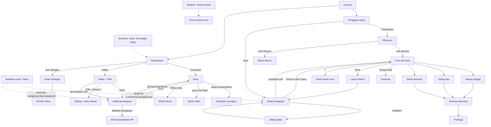

# Spesifikasi mockup Android — Modul 04 · Pengajuan & persetujuan

> Mockup: `docs/mockups/android/screens/04-pengajuan-persetujuan/` (29 berkas HTML, 109 layar `.phone`; render terang + malam = 218 PNG di `docs/mockups/android/png/04-pengajuan-persetujuan/`, tidak di-commit). Jam status bar dipakai **14.10, Selasa 13 Okt 2026** agar konsisten dengan data ("menunggu sejak 2 jam", dll.). Satu berkas multi-`.phone` dirender menjadi `nama-1-…`, `nama-2-…` dst. sesuai urutan di tabel §2. Terang/Malam lewat `?tema=malam`. Gaya lokal berprefiks `.pj-` di tiap berkas (tidak mengubah `_kit/`).
>
> Sumber: `apps/mobile/app/pengajuan/baru.tsx`, `resources/js/features/{requests,approvals}/**`, `docs/PRD.md` M2, `docs/DATABASE.md` §3, `docs/sprints/FITUR-PENGAJUAN.md`, `docs/fitur/staf-pengajuan-workspace.md`, `docs/PLATFORM.md` §2.1 butir 3 dan §3, mockup lama `docs/mockups/png/mobile/{MFormPengajuan,MPengajuanSaya,MPersetujuan,MPersetujuanDetail}.png`.

## 1. Keputusan desain (diusulkan, perlu konfirmasi bila bertanda ❓)

| # | Keputusan | Alasan |
|---|---|---|
| D1 | **Pilih jenis = layar ubin** ("Apa yang ingin Anda ajukan?") dengan 5 ubin terbuka (Izin, Sakit, Koreksi absensi, Dinas luar, Pengajuan barang) dan blok **Dikunci** berisi ubin bergembok Cuti & Lembur beserta alasan "Dikunci sampai SOP cuti/lembur ditetapkan." Ubin terkunci tidak bisa dibuka; ketukan menampilkan sheet penjelasan. Di form, jenis dapat diganti lewat tautan "Ganti jenis" (kembali ke layar ubin). | Web ponsel memakai chip kategori + daftar bergembok di bawahnya (`request-form.mobile.tsx`); ubin lebih jelas untuk empat kategori sekaligus dan memberi tempat bagi alasan penguncian (aturan produk 6 Okt). Aplikasi Expo v1 memakai chip kategori + daftar jenis tanpa jenis terkunci sama sekali. |
| D2 | Form memakai **bilah atas "×" + judul + status draf** ("Draf tersimpan 09.14") dan **bilah aksi bawah** (Simpan draf · Kirim pengajuan) di atas gesture bar; tab bar disembunyikan di form dan detail yang punya bilah aksi (pola `docs/PLATFORM.md` §4). Teks kecil "Disetujui oleh Dimas Pratama, lalu HR" di atas tombol (alur dari pratinjau server). | Zona jempol; sama dengan MSFormPengajuan. |
| D3 | **Isian tanggal "Hari, dd/mm/yyyy"** (mis. `Selasa, 13/10/2026`) sebagai kolom satu-ketuk yang membuka **dialog tanggal Material 3**; jam `14.00` membuka **dialog jam Material (dial 24 jam)**. Tanggal mulai/selesai **ditumpuk vertikal** (bukan dua kolom) karena "Selasa, 13/10/2026" tidak muat dalam setengah lebar 412 dp pada 17 px; jam mulai/selesai tetap dua kolom. Ketik langsung (ikon pensil di header dialog) tersedia untuk Android. Tanggal di luar batas (mis. > 7 hari lalu untuk koreksi) tampil redup di kalender. | `docs/DESIGN.md` §8 (format tanggal) dan `DateInput` web; v1 Expo memakai teks `YYYY-MM-DD` yang tidak ramah (diganti). |
| D4 | **Lampiran lewat 3 jalur**: Ambil foto (kamera belakang, bingkai dokumen), Pilih dari galeri, Pilih file (PDF/JPG/PNG; Storage Access Framework, tanpa izin penyimpanan). Maks. 5 berkas × 5 MB; foto dikompres di klien (target ≤ 800 KB). Pratinjau "Pakai foto / Ulangi" sebelum melampirkan. Wajib untuk Sakit > 1 hari (galat inline bila kosong). | `config/requests.php` (`max_kilobytes` 5120, `max_files` 5, `mimes` pdf/jpg/jpeg/png); web mobile punya tombol "Ambil foto" + "Pilih file". |
| D5 | **Pengajuan barang**: jumlah × harga satuan = **Perkiraan total** langsung di kartu terpisah, harga diformat `350.000` saat diketik (nilai terkirim = bilangan bulat), kebutuhan Biasa/Mendesak sebagai segmented. Alur ringkasan otomatis "atasan langsung → Direksi". Tanggal = tanggal kirim (dijelaskan di ringkasan). | `procurement-fields.tsx`, PRD M2 (pengajuan barang), `DATABASE.md` §3. |
| D6 | **Form cuti & lembur terkunci**: hanya dicapai lewat draf lama, tautan notifikasi, atau jenis yang dikunci HR saat form sedang terbuka. Semua isian abu-abu baca-saja, banner "Dikunci sampai SOP cuti/lembur ditetapkan.", tombol Kirim nonaktif; draf lama jenis terkunci **hanya bisa dibatalkan** (dialog konfirmasi). | Keputusan pemilik 6 Okt 2026 (server menolak buat/draf/kirim; pengajuan terkirim tidak berubah). |
| D7 | **Staf tidak pernah melihat saldo cuti tahunan**: tidak di Pengajuan saya, form, ringkasan, atau detail. Non-staf (mis. Dimas) melihat kartu saldo di Pengajuan saya dan baris "Saldo cuti 12 → 9 hari" di detail persetujuan. Kartu saldo non-staf tetap menampilkan baris "Pengajuan cuti dikunci". | `docs/fitur/staf-pengajuan-workspace.md`. Server tidak mengirim saldo ke staf, jadi klien tidak perlu menyaring. |
| D8 | **Pengajuan saya**: daftar kartu (nomor mono, status berikon-titik + teks, tag kategori, periode, durasi, jalur langkah `1/2 · menunggu Dimas sejak 2 jam`, kutipan penolakan/revisi) dengan chip filter Semua · Menunggu · Disetujui · Ditolak dan **FAB "Ajukan"**. Draf dan "Perlu revisi" tampil di Semua; banner info di atas mengangkat "1 pengajuan perlu revisi" (tambahan kecil di atas web). | `my-requests.mobile.tsx`, `my-requests-filters.ts`. |
| D9 | **Persetujuan = tumpukan kartu** (default di ponsel): satu kartu besar + dua bayangan di bawahnya, **geser kanan = setujui**, **geser kiri = tolak** (ambang 40% lebar, stempel SETUJUI/TOLAK muncul progresif, kembali berpegas bila dilepas lebih awal), plus tombol **Tolak · Minta revisi · Setujui** di zona jempol (di atas tab bar) sebagai jalur non-gestur. Ketuk kartu atau "Lihat detail" → detail. Menyetujui lewat geser/tombol tanpa catatan; **snackbar "Disetujui · Urungkan"** (6 detik) memberi jalan kembali. Geser kiri (tolak) membuka sheet alasan wajib, bukan langsung menolak. Pengalih ikon (daftar/tumpukan) di bilah atas. | `docs/PLATFORM.md` §2.1 butir 3 (keputusan pemilik 6 Okt). Web mobile saat ini hanya geser-kiri-ungkap dua aksi; mockup ini mengikuti keputusan §2.1. |
| D10 | **Mode daftar** tetap ada (untuk melihat banyak sekaligus, mode "Pilih" setujui massal, tab Sudah diputus/Disetujui): kartu antrean dengan avatar, periode, tag, "Diajukan 8 hari lalu · langkah 1 dari 2", peringatan rekan ("Nadia Putri juga cuti 20 Okt"). Setujui massal tanpa catatan, dengan dialog konfirmasi dan sheet hasil (sebagian gagal bila sudah diputus orang lain). | `approvals.mobile.tsx`, `use-approval-selection.ts`. |
| D11 | **Tolak** dan **Minta revisi** = bottom sheet dengan catatan wajib (hingga 1000 karakter), galat inline "Alasan penolakan wajib diisi." Teks bantu "Terlihat oleh {pemohon} dan HR." Catatan tidak dikirim ke email/WA (hanya di aplikasi). | `decision-controls.tsx`, `FITUR-PENGAJUAN.md` §4. |
| D12 | **Detail persetujuan** = layar penuh dengan penyetuju melihat: avatar besar, "Menunggu Anda", baris Tanggal/Hari kerja/**Saldo cuti**/Alasan/Pengganti/Lampiran, peringatan rekan, **timeline alur per langkah** (Diajukan ✓ → Langkah n ● menunggu → Langkah n+1 ○), kolom catatan, dan bilah bawah **Minta revisi · Tolak · Setujui**. Untuk pengajuan **Sakit**, penyetuju pengganti (delegasi) melihat "Detail kesehatan disembunyikan untuk penyetuju pengganti" pada Alasan & Lampiran; penyetuju asli melihat alasan + lampiran surat dokter. | `approval-detail.tsx`, `request-parts.tsx`, `FITUR-PENGAJUAN.md` §5. |
| D13 | **Pembatalan pengajuan yang sudah disetujui hanya HR/Super Admin** (`requests.cancel_approved`): tombol di detail → bottom sheet daftar akibat (saldo dikembalikan, catatan absensi dihapus, peringatan "sudah lewat → Alpha"), kolom **alasan wajib min. 10 karakter** (hitung 0/500), tombol merah. Kasus blocker (absensi sudah berubah setelah koreksi) menonaktifkan tombol dengan penjelasan. Pemohon yang membatalkan (belum diputus) memakai dialog sederhana. | `cancel-approved-action.tsx`, `cancel-approved.ts`, PRD M2. |
| D14 | **Delegasi** dikelola dari ikon "orang-gir" di bilah atas Persetujuan: sheet daftar delegasi (hentikan dengan ×) + form (Delegasikan ke → pemilih rekan bercari, Mulai, Selesai, Keterangan). Saat aktif, banner "Delegasi aktif … sampai …" dengan Ubah/Hentikan. Penerima delegasi melihat banner "Anda mewakili …" dan lencana "Mewakili Dimas" pada kartu titipan. | `delegation-dialog.tsx`, `requests:route-delegations`. |
| D15 | **Offline**: baca daftar terakhir (tembolok) dengan banner; **semua aksi tulis dimatikan** (kirim, simpan ke server, setuju, tolak, geser kartu, batalkan). Draf isian disimpan lokal di perangkat (AsyncStorage) sehingga bisa dilanjutkan. Tidak ada antrean offline (keputusan approval harus daring — `aplikasi-ponsel-rencana.md`). | PLATFORM §5 butir 6; rencana aplikasi ponsel. |
| D16 | **Tablet (834 dp)**: Rail 96 dp + daftar persetujuan kiri + detail kanan (master-detail), tanpa mode tumpukan. | `docs/PLATFORM.md` §1 (tablet = shell desktop dengan Rail). |

## 2. Inventaris layar

Peran: **Staf** = hanya `anggota`; **Atasan** = Kepala Divisi/penyetuju langkah; **HR** = HR/Super Admin; **Direksi**. Pengajuan saya + form berlaku untuk semua karyawan aktif.

| Berkas | Layar (urutan phone) | Peran | Keadaan yang tercakup |
|---|---|---|---|
| `01-pengajuan-saya.html` | 1 staf Semua (semua status), 2 non-staf dengan kartu saldo + filter Menunggu, 3 filter Ditolak | Staf / non-staf | Draf, Menunggu (jalur 1/2 & 2/2), Perlu revisi (kutipan), Disetujui, Ditolak (kutipan), Dibatalkan; banner revisi; tanpa saldo (staf) vs saldo + "cuti dikunci" (non-staf); FAB; tab bar Lainnya |
| `02-pilih-jenis.html` | 1 ubin jenis, 2 sheet "Cuti dikunci", 3 memuat (skeleton), 4 galat muat | Semua | 5 ubin terbuka, 2 ubin terkunci bergembok + alasan, penjelasan penguncian, memuat, galat jaringan |
| `03-form-terkunci.html` | 1 Cuti terkunci, 2 Lembur terkunci, 3 draf lama jenis terkunci, 4 dialog batalkan draf | Semua | isian abu-abu baca-saja, Kirim nonaktif, hanya bisa dibatalkan |
| `04-form-izin.html` | 1 izin Per jam (fokus pada Alasan), 2 izin Per hari, 3 galat validasi | Semua | sakelar Per jam/Per hari, peringatan rekan ("Bayu Saputra juga izin …"), ringkasan + alur, galat "Jam selesai harus setelah jam mulai", "Alasan wajib diisi" |
| `05-pemilih-tanggal-jam.html` | 1 dialog tanggal (min hari ini), 2 dialog jam (jam), 3 dialog jam (menit), 4 dialog tanggal koreksi (jendela 7 hari) | Semua | Material 3: hari redup di luar batas, hari ini bercincin, pilihan terisi |
| `06-form-sakit.html` | 1 sakit 1 hari (lampiran opsional), 2 sakit 3 hari tanpa lampiran (galat), 3 lampiran terisi | Semua | aturan "wajib surat bila > 1 hari", galat inline, daftar berkas (foto + PDF) |
| `07-lampiran.html` | 1 sheet Ambil foto/Galeri/File, 2 dialog izin kamera Android, 3 kamera dokumen, 4 pratinjau Pakai/Ulangi, 5 galat berkas > 5 MB | Semua | izin runtime, bingkai dokumen, kompres, batas ukuran/format |
| `08-form-koreksi.html` | 1 koreksi jam pulang, 2 galat (tanggal terlalu lama, jam kosong, alasan kosong), 3 dibuka dari Absensi "Perlu koreksi" | Semua | hint 7 hari, shift malam, banner asal Absensi |
| `09-form-dinas.html` | 1 dinas luar lengkap + lampiran surat tugas opsional, 2 galat tujuan/alasan, 3 tanggal bertabrakan | Semua | tujuan wajib, benturan dengan DNS lain, banner galat |
| `10-form-barang.html` | 1 barang lengkap (total otomatis), 2 galat (nama, jumlah 0, URL, alasan), 3 kebutuhan Mendesak (Rp 2.150.000) | Semua | qty × harga = total, ringkasan "Dikirim Sel, 13 Okt", alur atasan → Direksi |
| `11-terkirim-dan-keluar.html` | 1 sukses izin, 2 sukses barang, 3 sheet "Keluar dari form?", 4 snackbar "Draf tersimpan" | Semua | nomor pengajuan, jalur menunggu, notifikasi; simpan/buang/lanjut |
| `12-form-keadaan.html` | 1 draf dipulihkan dari perangkat, 2 ditolak server karena jenis baru dikunci, 3 offline, 4 mengirim, 5 galat 422 (bertabrakan) | Semua | banner per keadaan, tombol nonaktif, spinner |
| `13-detail-pengajuan.html` | 1 Menunggu, 2 Disetujui (Sakit), 3 Ditolak, 4 Perlu revisi | Pemilik | timeline per langkah, catatan penyetuju, Batalkan, Revisi & kirim ulang |
| `14-detail-pengajuan-varian.html` | 1 Draf, 2 Dibatalkan oleh Anda, 3 Dibatalkan oleh HR setelah disetujui (alasan), 4 Pengajuan barang menunggu Direksi | Pemilik | Lanjutkan draf, notice pembatalan HR, baris barang & total |
| `15-batal-dan-revisi.html` | 1 dialog Batalkan pengajuan?, 2 setelah batal + snackbar, 3 form revisi (banner penyetuju), 4 terkirim ulang (putaran 2) | Pemilik | konfirmasi destruktif, status Dibatalkan, putaran |
| `16-titik-masuk.html` | 1 Lainnya staf, 2 Lainnya Kepala Divisi (banner 5 menunggu), 3 Lainnya HR (banner desktop "Alur persetujuan & jenis") | Staf / Atasan / HR | entri menu & lencana; staf tanpa Persetujuan |
| `17-persetujuan-tumpukan.html` | 1 tumpukan, 2 geser kanan (SETUJUI), 3 geser kiri (TOLAK), 4 setelah setuju + snackbar Urungkan | Atasan / Direksi | kartu + bayangan, stempel, tombol zona jempol, "1 dari 5 · terlama menunggu 8 hari" |
| `18-persetujuan-daftar.html` | 1 daftar Menunggu, 2 mode Pilih (2 terpilih), 3 tab Sudah diputus, 4 HR tiga tab (Disetujui) | Atasan / HR | peringatan rekan, setujui massal, lencana keputusan saya |
| `19-detail-persetujuan.html` | 1 cuti Maya (saldo 12 → 9), 2 koreksi Rizky | Atasan | baris detail, peringatan rekan, timeline, catatan, bilah Minta revisi/Tolak/Setujui |
| `20-detail-persetujuan-varian.html` | 1 barang (langkah 2 Direksi), 2 sakit sebagai penyetuju pengganti, 3 sakit sebagai penyetuju asli (lampiran) | Direksi / penyetuju pengganti / atasan | detail kesehatan disembunyikan, lencana "Mewakili Dimas" |
| `21-detail-persetujuan-keadaan.html` | 1 sudah Anda setujui (baca-saja), 2 konflik "Sudah diputuskan", 3 offline + snackbar, 4 memuat, 5 tidak ditemukan/403 | Atasan | status read-only, 409, offline, skeleton, 404 |
| `22-sheet-keputusan.html` | 1 sheet Tolak (galat alasan kosong), 2 sheet Tolak terisi, 3 sheet Minta revisi, 4 dialog Setujui 2 pengajuan, 5 hasil massal 2 sukses 1 gagal | Atasan | catatan wajib, konfirmasi massal, galat per baris |
| `23-delegasi.html` | 1 daftar tanpa delegasi, 2 sheet Delegasi (kosong), 3 pemilih rekan, 4 sheet dengan delegasi aktif + galat tanggal | Atasan | form, pemilih bercari, validasi |
| `24-delegasi-lanjutan.html` | 1 dialog Hentikan delegasi, 2 daftar saat didelegasikan (banner), 3 tampilan penerima delegasi, 4 snackbar tersimpan | Atasan / penerima | banner aktif, "Mewakili Dimas" |
| `25-pembatalan-hr.html` | 1 detail disetujui (HR) dengan tombol Batalkan, 2 sheet akibat + alasan kosong, 3 alasan < 10 karakter (galat), 4 alasan terisi | HR | akibat saldo/absensi, peringatan Alpha, hitung karakter |
| `26-pembatalan-hr-lanjutan.html` | 1 blocker (absensi berubah), 2 koreksi dikembalikan, 3 hasil dibatalkan + snackbar, 4 non-HR melihat pengajuan disetujui | HR / Atasan | tombol nonaktif, banner "hanya HR" |
| `27-pengajuan-saya-keadaan.html` | 1 memuat, 2 kosong, 3 galat server, 4 offline (tembolok) | Semua | skeleton, empty state dengan aksi, coba lagi, FAB nonaktif |
| `28-persetujuan-keadaan.html` | 1 Semua beres, 2 Belum ada keputusan, 3 memuat, 4 galat, 5 staf membuka tautan persetujuan (tidak tersedia), 6 offline | Atasan / Staf | empty, skeleton, galat, tanpa akses, offline |
| `29-persetujuan-tablet.html` | 1 master-detail 834×1112 dengan Rail | Atasan | daftar kiri + detail kanan |

## 3. Peta navigasi

## 4. Pemetaan layar → endpoint API (`docs/sesi/ponsel.md`)

API v1 sekarang hanya menyediakan jalur pengajuan dasar. **Persetujuan, detail, batal, draf, lampiran, delegasi belum punya endpoint** — logika sudah ada di Action/Policy web (rute Inertia di `routes/requests.php`), tinggal dibuat presenter tipis `Api/*` seperti pola `Api/Requests/RequestController`.

| Layar / aksi | Endpoint | Status |
|---|---|---|
| Pilih jenis (ubin) | `GET /pengajuan/jenis` | **ADA**, tetapi **tanpa jenis terkunci/belum berhak** → perlu menambah `locked`, `locked_reason`, `eligible` (+ `category_locked`) agar ubin bergembok & alasan bisa ditampilkan (BELUM ADA field) |
| Pengajuan saya (daftar) | `GET /pengajuan?page=` | **ADA** (20/halaman, tanpa filter) |
| ↳ filter status + hitungan (Semua/Menunggu/…) | `GET /pengajuan?status=&…` | **BELUM ADA** (parameter `status`, `counts`) |
| ↳ kartu saldo non-staf | `GET /pengajuan` `balances` | **BELUM ADA** (server harus menyaring saldo untuk staf, `RequestPresenter`) |
| Kirim pengajuan (izin hari, sakit, koreksi, dinas, barang) | `POST /pengajuan` | **ADA** |
| ↳ izin **per jam** (`mode=hours`, `date`, `start_time`, `end_time`) | `POST /pengajuan` | **BELUM ADA** di v1 (dicatat "izin per jam lewat web") — validasi web sudah ada, perlu dibuka di `SubmitEmployeeRequestRequest` |
| ↳ lampiran (multipart `attachments[]`), pengganti `substitute_id` | `POST /pengajuan` | **BELUM ADA** (v1 menolak lampiran) |
| Simpan draf (`intent=draft`), ubah draf/revisi (`POST /pengajuan/{id}`) | — | **BELUM ADA** (`intent` dipatok `submit`) |
| Pratinjau ringkasan (durasi, alur, peringatan rekan, galat bisnis) | `GET /pengajuan/pratinjau` (web) | **BELUM ADA** di API v1 |
| Detail pengajuan (timeline, `can`, `cancel_preview`, `decision_note`) | `GET /pengajuan/{id}` | **BELUM ADA** |
| Batalkan (belum diputus) | `POST /pengajuan/{id}/batal` | **BELUM ADA** |
| Unduh lampiran | `GET /pengajuan/{id}/lampiran/{att}` | **BELUM ADA** (butuh unduh bertoken + pratinjau gambar) |
| Persetujuan (tab Menunggu / Sudah diputus / Disetujui, `counts`, delegasi, `can_cancel_approved`) | `GET /persetujuan?tab=` | **BELUM ADA** |
| Detail persetujuan | `GET /persetujuan/{id}` | **BELUM ADA** |
| Setujui / Tolak / Minta revisi (catatan) | `POST /persetujuan/{id}/setujui|tolak|revisi` | **BELUM ADA** |
| Setujui massal | `POST /persetujuan/massal` | **BELUM ADA** |
| Urungkan keputusan (snackbar) | — | **BELUM ADA, dan belum ada di web** (lihat §9 celah G4) |
| Delegasi simpan / hentikan | `POST /persetujuan/delegasi`, `DELETE /persetujuan/delegasi/{id}` | **BELUM ADA** |
| Daftar rekan untuk delegasi | di `GET /persetujuan` (`delegations.colleagues`) | **BELUM ADA** |
| Batalkan pengajuan disetujui (HR) | `POST /persetujuan/{id}/batalkan` (`reason` ≥ 10) | **BELUM ADA** |
| Push "pengajuan baru / diputus" | FCM (`PUT /perangkat/{device}/push-token`) | **BELUM ADA** (Tahap 2) |

## 5. Kemampuan khas Android yang dipakai

- **Izin runtime**: kamera (lampiran dokter) diminta saat mengetuk "Ambil foto"; dialog sistem tiga pilihan (Saat aplikasi digunakan / Hanya kali ini / Tidak izinkan). Bila ditolak permanen → banner "Buka Pengaturan" (pola modul 03). Galeri/file memakai **Photo Picker / Storage Access Framework** — tanpa izin penyimpanan.
- **Dialog tanggal & jam Material** (`@react-native-community/datetimepicker` mode kalender/dial, 24 jam).
- **Gestur kembali sistem**: dari form dengan isian belum disimpan membuka sheet "Keluar dari form?" (`beforeRemove` Expo Router).
- **Gestur geser kartu** (Gesture Handler + Reanimated, jalur UI thread), dengan jalur tombol sebagai alternatif aksesibilitas; haptik ringan (`expo-haptics`) saat melewati ambang dan saat keputusan terkirim.
- **Notifikasi**: pengajuan baru (ke penyetuju, aksi cepat "Setujui"/"Tolak"/"Buka" — lihat modul 12; "Setujui" butuh biometrik), "Pengajuan Anda disetujui/ditolak/perlu revisi" (tanpa isi catatan di layar kunci), "Pengajuan menunggu Anda 8 hari" (pengingat). Deep link `ruangkerja://pengajuan/{id}` dan `ruangkerja://persetujuan/{id}`.
- **Berbagi/Unggah**: berkas dari aplikasi lain lewat share sheet Android dapat menjadi lampiran draf baru (modul 12, butuh keputusan).
- **Papan ketik**: isian jumlah dan harga memakai `number-pad`; saat papan ketik muncul bilah aksi bawah ikut naik dan tab bar disembunyikan.
- **Aksesibilitas**: tiap kartu gestur punya `accessibilityActions` (Setujui/Tolak/Buka); status = ikon titik + teks; target sentuh ≥ 44 dp; teks hingga 200% (kartu tumpukan dapat digulir di dalam).
- **Gerak (anotasi)**: stempel geser berubah linear dengan jarak (opacity 0→1 di 15–40% lebar); kartu kembali berpegas 180 ms `ease-brand`; kartu berikut naik ke depan 180 ms; sheet 180 ms; hormati `prefers-reduced-motion` (tanpa rotasi/pegas, kartu langsung berganti dengan fade).

## 6. Matriks keadaan

| Layar | Memuat | Kosong | Galat | Offline | Terkunci/tanpa akses | Baca-saja |
|---|---|---|---|---|---|---|
| Pengajuan saya | `27` p1 (skeleton kartu) | `27` p2 (empty + aksi Ajukan) | `27` p3 (Coba lagi) | `27` p4 (tembolok + FAB nonaktif) | — (semua karyawan) | — |
| Pilih jenis | `02` p3 | — | `02` p4 | gunakan tembolok jenis terakhir (belum digambar, lihat Q6) | `02` p1–2 (cuti & lembur terkunci) | — |
| Form (semua jenis) | skeleton jenis (`02` p3) | — | `04`/`06`/`08`/`09`/`10` (galat inline), `12` p5 (422 server) | `12` p3 | `03` (cuti/lembur), `12` p2 (dikunci saat mengisi) | `03` (draf lama jenis terkunci) |
| Detail pengajuan | — (skeleton mirip `21` p4) | — | 404 sebagai `21` p5 | tembolok (tanpa aksi) | — | Disetujui/Ditolak/Dibatalkan/Draf terkunci tanpa tombol ubah |
| Persetujuan | `28` p3 | `28` p1 (Semua beres), p2 | `28` p4 | `28` p6 | `28` p5 (staf) | tab Sudah diputus/Disetujui baca-saja |
| Detail persetujuan | `21` p4 | — | `21` p5 (tidak ditemukan/403), `21` p2 (409 sudah diputus) | `21` p3 | detail kesehatan disembunyikan (`20` p2) | `21` p1 (sudah Anda putuskan) |
| Delegasi | — | `23` p1 | `23` p4 (galat tanggal) | tombol simpan nonaktif (belum digambar) | — | — |
| Pembatalan HR | — | — | `25` p3 (alasan), `26` p1 (blocker) | tombol nonaktif | `26` p4 (bukan HR) | — |

## 7. Catatan implementasi Expo (`apps/mobile`)

- **Rute baru** (expo-router): `pengajuan/index` (Pengajuan saya; saat ini daftar ringkas ada di tab Lainnya), `pengajuan/baru` (pilih jenis), `pengajuan/baru/[kategori]` (form), `pengajuan/[id]` (detail), `persetujuan/index` (tumpukan/daftar), `persetujuan/[id]`. `pengajuan/baru.tsx` yang ada (satu layar chip + daftar jenis) dipecah: logika validasi (`periksa`, regex tanggal/jam) dipertahankan, **diganti** input teks `YYYY-MM-DD`/`HH:MM` dengan pemilih tanggal/jam.
- **Komponen baru** di `src/components`: `FieldTanggal` / `FieldJam` (format `Hari, dd/mm/yyyy`), `LampiranField` (kamera `expo-camera`/`expo-image-picker`, `expo-document-picker`, kompres `expo-image-manipulator`; pola `KameraSelfie.tsx` sudah ada), `Timeline` (langkah persetujuan), `KartuPengajuan`, `KartuAntrean`, `TumpukanKartu` (Reanimated + Gesture Handler yang sudah terpasang), `SheetKeputusan` (bottom sheet), `LencanaStatus` (ikon titik + teks).
- **Draf lokal**: `AsyncStorage`/MMKV kunci `rk.request-draft.v1.<user>.<kategori>`, debounce 500 ms, hanya nilai biasa (tanpa berkas); dihapus setelah kirim/draf server/buang; spanduk "Draf dipulihkan dari perangkat ini" sama dengan `draft-storage.ts` web.
- **Perhitungan & aturan di server**: durasi, hari kerja, benturan, alur, peringatan rekan, dan saldo semuanya dari server; klien hanya menampilkan ringkasan dari `GET /pengajuan/pratinjau` (debounce 400 ms) dan memvalidasi cepat seperti pesan server (pola yang sudah ada).
- **Rupiah**: ketik angka → format `id-ID` saat tampil; kirim bilangan bulat (`unit_price`, `quantity`).
- **Tab bar**: tombol tengah kontekstual (Absen ↔ Workspace, `docs/sesi/glm.md`) tidak berubah; layar Pengajuan/Persetujuan berada di bawah **Lainnya** sehingga tab Lainnya aktif.
- **Zona waktu & format**: `src/lib/format` (id-ID, Asia/Jakarta); "menunggu sejak …" dari `waiting.since` (sudah dikirim API).
- **Lencana Lainnya** (jumlah persetujuan menunggu + pengajuan saya): dari `GET /persetujuan` counts / `unread` global (`src/session`).
- **Uji**: replika `lib/requests.ts` (ringkas) diuji vitest seperti web; validasi klien jangan menyimpang dari FormRequest.

## 8. Pertanyaan & keputusan untuk pemilik

1. ❓ **Geser kartu**: setuju geser kanan = setujui langsung (dengan Urungkan 6 detik) tanpa konfirmasi? Alternatif: geser kanan hanya menandai, keputusan lewat tombol. Risiko: salah geser pada keputusan yang meneruskan ke HR/Direksi. Usulan: Urungkan hanya bisa **selama pengajuan belum diteruskan ke langkah berikutnya diproses** — butuh aturan baru di server (G4).
2. ❓ **Urungkan keputusan** belum ada di web. Perlu Action baru (`UndoStepDecision`, jendela 6–10 detik, hanya bila langkah berikutnya belum diputus)? Atau cukup tampilkan "Dikirim" tanpa Urungkan dan andalkan tombol (tidak ada risiko salah geser)?
3. ❓ **Tampilan default Persetujuan**: Tumpukan (mockup) atau Daftar (web saat ini)? Usulan: Tumpukan bila ≤ 10 menunggu, Daftar bila lebih; ikon pengalih mengingat pilihan terakhir.
4. ❓ **Cuti & lembur terkunci di API**: biarkan `/pengajuan/jenis` menyembunyikan jenis terkunci (perilaku sekarang) dan tampilkan ubin bergembok statis di klien, atau kirim jenis terkunci dengan `locked_reason` agar pesan HR berubah otomatis (disarankan, mockup mengasumsikan ini)?
5. ❓ **Penyetuju pengganti (delegasi)**: apakah keputusan tercatat "atas nama Rizky, mewakili Dimas" (tampilan mockup) — apakah audit sudah menyimpan `delegated_from_id`? Dan apakah pengajuan yang **sudah** menunggu Dimas dialihkan ke penerima saat delegasi dibuat (pekerjaan `requests:route-delegations`) atau hanya yang baru?
6. ❓ **Offline untuk pengajuan**: cukup draf lokal + banner (mockup), atau antrean offline kirim pengajuan di Fase 3 (idempoten via `client_id`)? Tembolok detail/jenis untuk dibaca offline belum digambar.
7. ❓ **Lampiran dari share sheet** (WhatsApp/Galeri → "Lampirkan ke RuangKerja"): masuk Tahap 2 (modul 12)? Perlu memilih pengajuan/draf tujuan.
8. ❓ **Pengajuan lembur/cuti baru setelah SOP**: kunci dibuka HR di web; apakah ponsel perlu menampilkan form cuti dengan saldo dan pemilihan pengganti (tidak digambar karena terkunci, tetapi akan dibutuhkan)? Disarankan membuat setelah SOP terbit agar mockup tidak usang.
9. ❓ **Dikirim ulang setelah ditolak**: web tidak punya "Ajukan ulang dari pengajuan ditolak". Tambahkan tombol "Buat pengajuan serupa" (salin isian ke form baru)? Tidak digambar.
10. ❓ **Setujui massal**: pertahankan di ponsel (dibatasi hanya mode Pilih di daftar) atau hanya desktop (`docs/PLATFORM.md` §3: "Aksi massal hanya desktop")? Mockup menyertakan karena web mobile sudah memilikinya.

## 9. Celah yang ditemukan (web punya, ponsel belum / belum ada di web)

| # | Celah | Catatan |
|---|---|---|
| G1 | Seluruh jalur **persetujuan, detail, batal, draf, ubah/revisi, lampiran, delegasi, pembatalan HR** belum punya endpoint API v1 (§4). Aplikasi v1 hanya bisa membuat dan melihat daftar. | Prasyarat Tahap 2 modul ini; Action/Policy sudah ada. |
| G2 | **Izin per jam**, **pengganti cuti**, **lampiran** ditolak/tidak ada di `POST /pengajuan` (v1). | Mockup mengasumsikan terbuka. |
| G3 | `GET /pengajuan/jenis` menyembunyikan jenis terkunci → ubin bergembok & alasan tidak mungkin tanpa perubahan. | D1/Q4. |
| G4 | **Urungkan keputusan** (snackbar) tidak ada di web maupun server. | D9/Q2. |
| G5 | Mode **tumpukan kartu** (keputusan §2.1 butir 3) belum dibangun di web mobile (web hanya geser-kiri-ungkap). | Spesifikasi gestur di §5; mockup menjadi acuan. |
| G6 | **Pratinjau ringkasan** (`/pengajuan/pratinjau`: durasi, alur, peringatan rekan, galat bisnis) belum ada di API. Tanpa itu, kartu ringkasan & jalur "Disetujui oleh … lalu …" tidak bisa tampil. | Disarankan endpoint `GET /pengajuan/pratinjau`. |
| G7 | **Deep link & aksi cepat dari notifikasi** (Setujui dari bayangan notifikasi) menunggu FCM dan modul 12. | Persetujuan dari layar kunci wajib biometrik (`aplikasi-ponsel.md`). |
| G8 | **Tampilan HR di ponsel**: tab "Disetujui" + pembatalan sudah ada di web mobile; desktop-only (alur persetujuan, jenis cuti, saldo cuti, impor saldo) tampil sebagai banner di Lainnya HR (modul 11). | `16` p3. |
| G9 | Tablet/lipat: master-detail hanya digambar untuk Persetujuan; Pengajuan saya tablet (daftar + detail) belum. | Ikuti pola `29`. |
| G10 | **Pengajuan barang** tidak punya lampiran penawaran/foto barang di web (hanya tautan). Tidak digambar lampiran di form barang. | Bila diminta, ikuti `LampiranField`. |

## 10. Kebutuhan kit

- Komponen kecil yang dipakai di banyak modul dan sebaiknya masuk `kit.css` suatu saat: **kartu stempel geser**, **timeline langkah** (`.pj-tl`), **dialog tanggal/jam Material** (`.pj-dp`, `.pj-clk`), dan **lencana status + kartu jalur** (`.pj-track`). Semua saat ini lokal di berkas modul ini.
- `.btn.danger` pada mode malam memakai `--bad` terang dengan teks putih (kontras rendah). Modul ini menimpa lokal (`color:var(--primary-fg)`); perbaikan permanen sebaiknya di `kit.css` (`.btn.danger` + `.btn.danger.off`).
- Grid dua kolom `.grid2` perlu `min-width:0` pada anak agar isian dengan `.trunc` tidak melebarkan kolom (ditimpa lokal).
