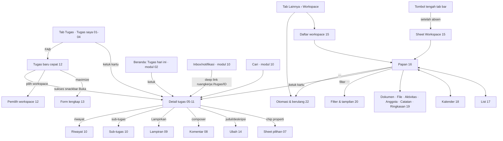

# Spesifikasi modul 05 — Tugas & workspace (Android)

> Mockup: `docs/mockups/android/screens/05-tugas-workspace/` (22 berkas HTML, 128 layar `.phone`, 256 PNG terang+malam). Gaya bersama: `_tugas.css` (prefiks `.tg-`, hanya token kit). Tanggal contoh: **Selasa, 13 Okt 2026**; persona Sari (staf), Dimas (Kepala Divisi, admin PLQ), Rizky, Maya, Putri (PIC), Hendra (Direksi, bukan anggota), workspace `PRG` (pribadi Sari), `GDG`, `PLQ`, `KEU`, `OPS`, `MIG`.
>
> Sumber: `apps/mobile/app/(tabs)/tugas.tsx`, `app/tugas/{[id],baru}.tsx`, `app/workspace/{index,[id]}.tsx`, `app/kalender.tsx`, `src/components/{TugasItem,KartuPapan}.tsx`; web `resources/js/features/{tasks,workspaces,automation}/**`, `pages/{tasks,workspaces,automation}`; PRD M3/M4/M5; DATABASE §4 (`task_plans`, `saved_views`, `task_comment_reads`, checklist, automation); `docs/PLATFORM.md` §2.1/§3; `docs/sesi/ponsel.md`; mockup lama `MTugasSaya`, `MBoard`, `MTugasBaru`, `MTaskDetail`, `MKalender`, `MFile`; Arus `MTugas`, `MSDetailTugas`, `MTodo`, `MProyek`, `MSProyekSaya`.

## 1. Inventaris layar

Kolom "Peran" = siapa yang melihat varian itu. Semua layar punya terang/malam (`?tema=malam`).

### A. Tugas saya (tab Tugas)

| Berkas | Layar (urutan `.phone`) | Peran | Keadaan tercakup |
|---|---|---|---|
| `01-tugas-saya.html` | Tugas saya, kelompok Tenggat, chip Ditugaskan/Saya amati/Saya buat, chip workspace, baris tergeser (Tunda · Selesai) | semua | normal, terlambat, dari absen, titipan |
| `02-tugas-saya-varian.html` | (1) tab Saya buat + kelompok Workspace (2) kelompok Prioritas + tugas selesai ditampilkan (3) mode **Rencana saya** Hari ini/Minggu ini/Nanti, "terbawa dari kemarin", "tugas baru" (4) menu konteks tahan-lama | semua | varian kelompok, rencana pribadi |
| `03-tugas-saya-keadaan.html` | memuat (skeleton), kosong, filter tak cocok, galat jaringan, offline, "Muat lagi" (paginasi) | semua | memuat · kosong · galat · offline |
| `04-tugas-saya-sheet.html` | filter sheet, kelompokkan, tampilan tersimpan, rencanakan, tunda (+snackbar Urungkan), dialog "kirim ke Review" | semua | sheet/dialog |

### B. Detail tugas

| Berkas | Layar | Peran | Keadaan |
|---|---|---|---|
| `05-detail-tugas.html` | Detail penuh layar panjang: bar (key, workspace, bagikan, ⋯), judul, chip "Maya sedang melihat", status track, chip properti, deskripsi kaya (mention, rujukan), checklist, sub-tugas, lampiran Drive (Kamera/Galeri/Drive), aktivitas (filter Semua/Komentar), komentar + reaksi + "Dibaca oleh", komposer menempel | pembuat/admin/atasan (`can.edit`) | normal |
| `06-detail-tugas-peran.html` | (1) **tugas titipan** (penerima Sari): banner penjelasan, chip terkunci, Pindahkan + Rencanakan, checklist & komentar aktif (2) **mode lihat saja** Direksi/HR/SA non-anggota (3) tugas sendiri hasil absen (label "dari absen") | penerima titipan · manajemen · pemilik | `can.edit` ≠ `can.work` |
| `07-detail-pilihan.html` | sheet Pindahkan, Prioritas, Penanggung jawab (multi), Tenggat (cepat), dialog Material pilih tanggal, Label, Semua properti, menu ⋯ (Amati, Salin tautan, Rencanakan, Duplikat, Hapus), dialog Hapus | admin/pembuat | pilihan |
| `08-detail-komentar.html` | picker `@` mention, picker `#` rujukan, kirim (Mengirim…), gagal terkirim/offline, aksi komentar + reaksi emoji, sheet "Dibaca oleh", sunting komentar + komentar dihapus | komentator | komentar |
| `09-detail-lampiran.html` | sheet Lampirkan (Kamera · Galeri · File · Drive · Docs/Sheets/Slides baru), dialog izin kamera Android, Photo Picker sistem, progres/gagal unggah, pilih dari Drive, aksi lampiran, dialog Lepas, komposer dengan lampiran tertunda | pemegang `can.work` | lampiran |
| `10-detail-sub-checklist-riwayat.html` | detail **sub-tugas** (crumb induk), tambah sub-tugas (IME), tambah butir checklist (IME), geser butir (Ubah/Hapus), **riwayat aktivitas** penuh (filter jenis) | pengerja | sub/checklist/riwayat |
| `11-detail-keadaan.html` | memuat, 404 tidak ditemukan, galat jaringan, offline (diantre), 403 saat sunting (snackbar), konflik edit orang lain, workspace diarsipkan (baca saja), tugas dihapus orang lain | semua | memuat · galat · offline · terkunci · baca-saja |

### C. Buat & ubah

| Berkas | Layar | Peran | Keadaan |
|---|---|---|---|
| `12-tugas-baru-cepat.html` | sheet cepat (judul fokus, chip status/prioritas/penanggung/tanggal/label, tenggat cepat, deskripsi, workspace), dengan keyboard, galat judul kosong, galat workspace hanya-lihat (403), pemilih workspace (yang tak boleh = terkunci), sukses (snackbar Buka), offline | anggota yang boleh menyunting | fokus · galat · terkirim · offline |
| `13-tugas-baru-lengkap.html` | form lengkap layar penuh: workspace, judul, deskripsi (toolbar), status, prioritas, penanggung (multi), mulai, tenggat, estimasi, label, induk, checklist awal, lampiran | idem | form |
| `14-tugas-ubah.html` | ubah judul inline, editor deskripsi layar penuh, dialog estimasi & mulai, "Buang perubahan?", titipan (ditolak, snackbar), galat validasi 255 karakter/tanggal | `can.edit` | fokus · galat · terkunci |

### D. Workspace

| Berkas | Layar | Peran | Keadaan |
|---|---|---|---|
| `15-workspace-daftar.html` | daftar terkelompok Pribadi · Divisi & tim · Proyek yang diikuti (+ chip filter), Direksi (+ **Lainnya (lihat saja)**), staf, memuat, filter kosong, galat, offline, sheet Workspace baru, **sheet tombol-tengah** (Pribadi · Tim · Proyek) | Kadiv · Direksi/HR/SA · staf | semua keadaan |
| `16-workspace-papan.html` | Board satu kolom (chip kolom, "Pindahkan"), mode lihat saja, sheet Pindahkan, kolom kosong, filter aktif + kehadiran, diarsipkan, menu ⋯ workspace, kolom Selesai (tersembunyi >30 hari) | anggota · manajemen | normal · baca-saja · arsip · kosong |
| `17-workspace-list.html` | list per status, pencarian, kelompok Prioritas + geser (Selesai/Pindah) | idem | varian |
| `18-workspace-kalender.html` | strip minggu + agenda (+ banner terlambat), **bulan** + agenda hari terpilih, sheet Tanpa tenggat, minggu kosong | idem | varian · kosong |
| `19-workspace-tab-lain.html` | Dokumen, File, sheet Tambah (Docs/Sheets/Slides baru, unggah, kamera, Drive), Aktivitas, Anggota (status Akses Drive), sheet peran anggota, Catatan (→ modul 07), Ringkasan proyek (→ modul 06), Pengaturan baca-saja + banner desktop | anggota · admin | tab |
| `20-workspace-filter-tampilan.html` | sheet filter, **tampilan tersimpan** (pribadi/dibagikan), dialog Simpan tampilan, dialog Hapus, tampilan aktif | anggota | filter |
| `21-workspace-keadaan.html` | memuat, galat, offline, 404/privat, workspace kosong, lihat saja (Divisi Keuangan) | semua | semua |

### E. Otomasi & berulang

| Berkas | Layar | Peran | Keadaan |
|---|---|---|---|
| `22-otomasi-berulang.html` | hub "Otomasi & berulang", aturan otomasi (KPI, kartu Jika/Maka, sakelar jeda, FAB), detail aturan + riwayat eksekusi, pembuat aturan (sheet layar penuh), daftar baca-saja (non-admin) + banner desktop, dialog jeda, tugas berulang (list), form tugas berulang, template (Tugas/Workspace), pakai template, kosong, offline | admin/owner workspace · anggota (baca) | semua |

## 2. Peta navigasi

Tab bawah: Beranda · Tugas · tombol tengah · Obrolan · Lainnya. Pada layar workspace/tugas tombol tengah **Workspace** (ikon `layout-grid`, sesudah absen masuk) membuka sheet "Pribadi · Tim · Proyek"; sebelum absen/menjelang pulang tombol itu **Absen** (modul 03). Layar turunan (detail, form, papan) memakai bar-sub tanpa tab bar di detail/form; papan & daftar workspace mempertahankan tab bar.

## 3. Pemetaan layar → endpoint API v1

Dasar kontrak `docs/sesi/ponsel.md`; klien `apps/mobile/src/api/endpoints.ts`. **ADA** = rute sudah hidup di `routes/api.php`; **BELUM ADA** = harus dibuat (presenter/Action/Policy web dipakai ulang bila ada).

| Layar / aksi | Endpoint | Status |
|---|---|---|
| Tugas saya: daftar, paginasi 20 | `GET /tugas?saya=1&page=` | **ADA** |
| Tab Saya amati / Saya buat | `GET /tugas?tab=watching\|created` (web `tab=` pada `MyTasks`) | **BELUM ADA** (API hanya `saya`) |
| Filter (penanggung, prioritas, label, tenggat, `q`), kelompokkan, tugas selesai minggu ini | `GET /tugas?filter…` + metadata `status.color`, `labels`, `done_status_id` | **BELUM ADA** (filter dikerjakan klien dari halaman terunduh = tak lengkap) |
| Ringkasan "9 aktif · 1 terlambat · 2 hari ini" | dihitung klien dari daftar penuh / `summarize()` server | **BELUM ADA** (butuh `counts`) |
| Swipe **Selesai** | `PATCH /tugas/{id}/status {done:true}` | **ADA** (workspace tim → Review dulu) |
| **Tunda** | `PATCH /tugas/{id} {due_date}` | **ADA** (tapi 403 untuk penerima titipan: `TaskPolicy::update`; lihat pertanyaan 2) |
| Pindahkan status | `PATCH /tugas/{id}/status {status_id}` | **ADA**; daftar status/kolom dari `GET /workspace/{id}/papan` (`columns`) |
| Rencanakan (Hari ini/Minggu ini/Nanti), rencana saya, "tugas baru" | `PUT /tugas/{id}/rencana`, `GET /rencana` (`task_plans`, `PersonalPlanner`) | **BELUM ADA** (hanya `GET /tugas/hari-ini` 3 segmen) |
| Tampilan tersimpan | `GET/POST/DELETE /workspace/{ws}/tampilan` (`saved_views`; lintas workspace = `workspace_id` null) | **BELUM ADA** |
| Detail tugas ringkas | `GET /tugas/{id}` (id, key, status, prioritas, due, start, assignees[nama], checklist{done,total}, `can{edit,work,delete,comment}`) | **ADA** — `types.ts` belum memuat `can.work` |
| Detail lengkap: checklist butir, sub-tugas, label, estimasi, pengamat, `watching`, creator, parent, `comment_reads`, `references` | `GET /tugas/{id}` diperluas (bentuk `TaskDetail` web) | **BELUM ADA** |
| Properti: penanggung (multi), label, mulai, estimasi | `PATCH /tugas/{id} {assignee_ids, label_ids, start_date, estimate_hours}` | **ADA sebagian** (`assignee_ids` didukung server; `TaskUpdateBody` app belum; label/start/estimasi **BELUM ADA**) |
| Daftar anggota untuk pemilih | `GET /workspace/{id}/anggota` | **ADA** |
| Buat tugas cepat/lengkap | `POST /tugas {workspace_id, title, description, assignee_ids, due_date, priority}` | **ADA**; `status_id`, `label_ids`, `parent_id`, `start_date`, `estimate_hours`, checklist awal, template **BELUM ADA** |
| Hapus | `DELETE /tugas/{id}` | **ADA** |
| Duplikat | `POST /tugas/{id}/duplikat` | **BELUM ADA** (opsional) |
| Amati/berhenti amati | `PUT/DELETE /tugas/{id}/pengamat` | **BELUM ADA** |
| Komentar daftar/kirim | `GET/POST /tugas/{id}/komentar` (teks polos) | **ADA** |
| Komentar kaya: mention/`#`rujukan, sunting, hapus, reaksi | body = dokumen Tiptap/ID mention; `PATCH/DELETE /komentar/{id}`, `PUT /komentar/{id}/reaksi` | **BELUM ADA** (kontrak komentar sekarang teks polos) |
| Tanda baca "Dibaca oleh" | `POST /tugas/{id}/komentar/dibaca` (`MarkCommentsRead`) + `comment_reads` di detail | **BELUM ADA** |
| Picker `@`/`#` | `GET /workspace/{id}/anggota` (ADA) + `GET /tugas?q=` untuk rujukan | rujukan **BELUM ADA** |
| Checklist toggle/tambah/ubah/hapus | `POST/PATCH/DELETE /tugas/{id}/checklist[/ {item}]` | **BELUM ADA** |
| Sub-tugas daftar/buat | `GET /tugas/{id}/subtugas`, `POST /tugas {parent_id}` | **BELUM ADA** |
| Lampiran: daftar/lepas, unggah (kamera/galeri/file), Drive picker, dokumen baru | `GET/POST/DELETE /lampiran/task/{id}`, Drive (token OAuth `drive.file`) | **BELUM ADA** (web memakai `/lampiran` + Picker JS) |
| Aktivitas/riwayat tugas | `GET /tugas/{id}/aktivitas` (`activities` subject = tugas) | **BELUM ADA** |
| Kehadiran "sedang melihat" | presence Reverb | **BELUM ADA** (app v1 tanpa WebSocket; opsi polling `GET /tugas/{id}/penonton`) |
| Daftar workspace terkelompok | `GET /workspace` (`groups[]` pribadi/divisi/proyek/lainnya, `arsip`) | **ADA**; favorit (`favorited_at`), `is_member`, jumlah tugas/anggota **BELUM ADA** |
| Workspace baru | `POST /workspace` (`CreateWorkspace`) | **BELUM ADA** |
| Papan: kolom + kartu | `GET /workspace/{id}/papan` | **ADA**; flag `can`/`view_only`/`archived`/anggota/jumlah **BELUM ADA** |
| Papan: filter (penanggung, prioritas, label, tenggat) | query pada `/papan` atau klien | sebagian klien; **BELUM ADA** server |
| Kalender workspace (strip & bulan) | `GET /workspace/{id}/kalender?bulan=` atau `GET /kalender?bulan=` (+`workspace`) | `GET /kalender` **ADA** (lapisan tugas milik pemilik saja; per-workspace **BELUM ADA**) |
| Tanpa tenggat | `GET /workspace/{id}/papan` (klien) | **ADA** (turunan klien) |
| Dokumen, File (Drive), tambah Docs/Sheets/Slides, unggah | `GET /workspace/{id}/{dokumen,file}`, `POST …/dokumen`, upload | **BELUM ADA** |
| Aktivitas workspace | `GET /workspace/{id}/aktivitas` | **BELUM ADA** |
| Anggota + Akses Drive; ubah peran/keluarkan | `GET /workspace/{id}/anggota` (nama, avatar, role) | **ADA**; `drive_access/error`, `PATCH/DELETE …/anggota/{u}`, sinkron Drive **BELUM ADA** |
| Catatan (tab) | `GET /workspace/{id}/catatan` | **ADA** (modul 07) |
| Ringkasan proyek | endpoint portofolio/proyek | **BELUM ADA** (modul 06) |
| Pengaturan workspace (baca) | `GET /workspace/{id}/pengaturan` | **BELUM ADA** (baca saja; ubah = desktop) |
| Aturan otomasi: daftar, jeda, riwayat, buat | `GET/POST/PATCH/DELETE /otomasi/aturan`, `GET …/{id}/log` | **BELUM ADA** (web Inertia only) |
| Tugas berulang: list, aktif/jeda, buat, "Buat sekarang" | `/tugas-berulang` CRUD | **BELUM ADA** |
| Template tugas/workspace: list, pakai | `/template/tugas`, `/template/workspace`, `POST …/pakai` | **BELUM ADA** |

Kontrak yang disarankan: satu respons `GET /tugas/{id}` setara `TaskDetail` web (checklist, sub, label, anggota, pembaca, `can`, `references`, `watching`) dengan aksi tulis per bagian di atas; filter dan hitungan Tugas saya lewat satu query (`MyTasks`) agar angka header = hasil.

## 4. Aturan akses yang terlihat di UI

| Konteks | Yang boleh | UI |
|---|---|---|
| Pembuat tugas / admin-owner workspace / atasan langsung penerima (`can.edit`) | judul, deskripsi, tenggat, prioritas, penanggung, label, status, sub-tugas, hapus | chip properti aktif, status track |
| **Penerima tugas titipan** (`can.edit=false`, `can.work=true`) | pindah status, **rencanakan**, komentar, centang checklist, lampiran | banner biru bergembok, chip properti abu bergembok, tombol **Pindahkan** + **Rencanakan**, checklist/komposer aktif; tap judul → snackbar "Hanya Dimas Pratama atau atasan Anda yang bisa mengubah…" |
| Tugas sendiri / hasil absen | semua (kecuali ubah penugasan orang lain) | normal; tag "dari absen" |
| Direksi/HR/Super Admin **bukan anggota** (mode lihat saja) | baca; tanpa komentar, reaksi, amati, lampiran, checklist; bacaan tidak dicatat | banner "Mode lihat saja", chip abu, komposer terkunci, tanpa FAB/Pindahkan, tanpa "Dibaca oleh" milik mereka |
| Workspace diarsipkan | baca | banner abu, komposer "Workspace diarsipkan · hanya baca" |
| Peran `viewer` di workspace | baca; komentar/centang mengikuti `can.comment`/`can.work` dari server (jangan ditebak di klien) | komposer & kontrol hanya muncul bila `can.*` benar |
| Staf | tanpa saldo cuti/struktur org (tidak relevan di modul ini); tidak melihat "Lainnya (lihat saja)" | daftar workspace tanpa kelompok Lainnya |

`can.work` ada di respons API (`TaskController::can`) tetapi belum di `apps/mobile/src/api/types.ts` (`can?: {edit, delete, comment}`) — tambahkan. Tombol Pindahkan untuk titipan harus mengandalkan `TaskPolicy::move` (server), bukan `can.edit`.

## 5. Kemampuan khas Android yang dipakai

- **Izin runtime**: kamera (lampiran, dialog "Saat aplikasi sedang digunakan / Hanya kali ini / Jangan izinkan", mockup 09-2). Galeri lewat **Photo Picker sistem** (tanpa izin penyimpanan), file lewat **Storage Access Framework**; keduanya tanpa izin tambahan. Notifikasi `POST_NOTIFICATIONS` diatur modul 12.
- **Gestur**: geser kartu (Tunda/Selesai) dengan haptik saat melewati ambang; geser horizontal antar kolom board (`PagerView`) dan swipe butir checklist; tahan lama pada kartu → menu konteks (Buka, Pindahkan, Rencanakan, Tunda, Salin tautan, Amati); tarik untuk menyegarkan; gestur/predictive back menutup sheet dulu, lalu layar.
- **IME**: aksi tombol Enter = "Kirim"/"Tambah"/"Selesai" (`returnKeyType`), field komentar naik di atas keyboard (`KeyboardAvoidingView` + `behavior="padding"` seperti kode sekarang), keyboard menyembunyikan tab bar.
- **Deep link/Share**: `ruangkerja://tugas/{id}` dan tautan web `…/w/{KEY}/tasks/{n}`; "Bagikan" memakai share sheet Android (teks "PLQ-21 · Landing page produk baru" + URL); "Terima berbagi" untuk membuat tugas dari teks/gambar → modul 12.
- **Edge-to-edge**, bar status transparan; `safeAreaInsets` untuk gesture bar 24dp.
- **Notifikasi** (modul 12): `task.assigned`, `mention`, `task.commented`, `task.due_soon/overdue` dengan aksi cepat Selesai/Balas; mockup ini hanya merujuk.
- **Unggah latar belakang**: unggah lampiran berlanjut saat aplikasi di latar (WorkManager via `expo-task-manager`/`expo-file-system` upload) dengan notifikasi progres.

## 6. Matriks keadaan

| Layar | Memuat | Kosong | Galat | Offline | Terkunci/tanpa akses | Baca-saja |
|---|---|---|---|---|---|---|
| Tugas saya | 03-1 skeleton kartu | 03-2, 03-3 (filter) | 03-4 | 03-5 (cache + antrean) | – | – |
| Detail tugas | 11-1 | komentar/lampiran kosong (teks kecil) | 11-2 (404), 11-3, 11-6 (konflik), 11-8 (dihapus) | 11-4 | 11-5 (403), 06-1 (titipan) | 06-2, 11-7 |
| Komentar | – | "Belum ada komentar. Mulai diskusi di bawah." | 08-4 gagal terkirim | 08-4 | – | 06-2 komposer terkunci |
| Lampiran | 09-4 progres | – | 09-4 gagal (>100 MB, terputus) | antre unggah | – | 06-2 |
| Buat tugas | – | – | 12-3 validasi, 12-4 403 hanya-lihat | 12-7 simpan di perangkat | 12-5 workspace terkunci | – |
| Daftar workspace | 15-4 | 15-5 | 15-6 | 15-7 | – | 15-2 (Lainnya, mata) |
| Papan | 21-1 | 16-4, 21-5 | 21-2 | 21-3 | 21-4 (404 privat) | 16-2, 16-6, 21-6 |
| List/Kalender | skeleton sama papan | 18-4, "Tidak ada tenggat" | sama | sama | – | sama |
| Otomasi/berulang | – | 22-11 | – | 22-12 | 22-5 (non-admin) | 22-5 |

Aturan umum: memuat = skeleton setinggi konten asli (bukan spinner penuh layar); galat = ikon `cloud-alert` + pesan server + "Coba lagi"; offline = pita kuning di atas daftar, data cache dengan cap waktu; aksi tulis diantre (lihat pertanyaan 4).

## 7. Catatan implementasi Expo

- **Komponen sudah ada**: `Screen`, `Card`, `Segmented`, `Badge`, `Row`, `Field`, `Input`, `Button`, `Loading`, `EmptyState`, `ErrorState`, `TugasItem`, `KartuPapan` (`src/components/ui.tsx`). Perlu ditambah: `BottomSheet` (gorhom atau `Modal`), `Dialog` Material, `SwipeableRow` (`react-native-gesture-handler` + Reanimated), `StatusIcon` (cincin: todo kosong, in_progress setengah, review tiga perempat, done centang, backlog putus-putus, canceled coret), `PriorityIcon` (3 batang; urgent kotak "!"), `ChipScroller`, `PagerView` untuk board satu kolom, `DateDialog` (Material date picker via `@react-native-community/datetimepicker`), `MentionPicker`, `ImagePicker`/`DocumentPicker` (`expo-image-picker`, `expo-document-picker`; pustaka belum ada — butuh persetujuan dependensi), `Camera` (`expo-camera` sudah dipakai `KameraSelfie`).
- **State & data**: ganti paginasi manual dengan satu hook `useTugasSaya(filters)`; cache baca-saja (MMKV/SQLite) per layar untuk offline; optimistic update untuk Selesai/Pindahkan/centang dengan rollback + snackbar; polling 30 detik pada detail/papan (tanpa WebSocket di v1) dengan indikator kecil seperti web.
- **Tiga bentuk modal**: *sheet* (pilihan, menu, aksi), *dialog* (konfirmasi destruktif, pilih tanggal), *layar penuh* (form lengkap, editor deskripsi, pembuat aturan). Konfirmasi Hapus/Lepas/Buang/Jeda memakai dialog Material (tombol teks kanan-bawah).
- **Teks**: deskripsi dan komentar ditampilkan kaya (mention `.mn`, rujukan `.tg-ref`, tautan) dari `body_html`/Tiptap (WebView ringan atau renderer node-ke-`Text`); sunting = editor ringan (bold, daftar, centang, `@`, `#`) — lihat modul 07 untuk konsistensi.
- **Aksesibilitas**: status/prioritas = ikon **dan** label (`accessibilityLabel`), target ≥ 44dp, kartu geser punya aksi alternatif lewat menu konteks (TalkBack "Tindakan khusus"), skala font 200% menumpuk meta ke baris baru (sudah `flex-wrap`).
- **Gerak (anotasi)**: sheet naik 180 ms `ease-brand` (`cubic-bezier(.2,.8,.2,1)`), pil status track bergeser 180 ms, centang checklist 120 ms, kartu selesai memudar/mencoret 120 ms lalu pindah kelompok; progres unggah linear; `prefers-reduced-motion`/"Hapus animasi" → tanpa transisi, hanya ganti keadaan. Tidak ada gerak dekoratif di daftar.

## 8. Kebutuhan kit (tidak mengubah `_kit/`)

1. Komponen **ikon status tugas** (cincin 6 keadaan) dan **ikon prioritas** — ditulis lokal di `_tugas.css` (`.tg-st`, `.tg-pr`); pantas masuk kit modul 13.
2. **Keyboard/IME** tiruan (`.tg-kb`) dan **dialog tanggal Material** (`.tg-cal`) — dibuat lokal; bisa dipakai modul 03/04.
3. **Tab tengah aktif** (Workspace) belum punya gaya "aktif"; pada layar workspace tab bawah ditampilkan tanpa tab berpil.
4. `.sb`, `.sheet`, `.slide` pada kit bertabrakan dengan nama kelas umum (`sb`, `sheet`) — hindari menamai kelas lokal persis itu (kasus ditemui: `tg-ft sheet`).

## 9. Pertanyaan / keputusan untuk pemilik

1. **Penerima titipan dan Tunda**: web mengizinkan penerima memindah, merencanakan, berkomentar, mencentang, melampirkan — tetapi mengubah tenggat (Tunda) ditolak `update`. Apakah **Tunda** untuk tugas titipan disembunyikan, atau diubah jadi "Rencanakan" (hanya rencana pribadi)? Mockup menyembunyikannya dan menawarkan Rencanakan.
2. **Tombol Pindahkan di detail titipan**: detail mobile web menyembunyikan status track bila `can.edit=false`. Mockup menampilkan tombol **Pindahkan** (sesuai aturan 9 Okt "penerima tetap boleh move"). Setuju?
3. **Mention/rujukan/reaksi/sunting komentar**: kontrak komentar API sekarang teks polos. Apakah v1 Android memakai komentar kaya penuh (butuh perluasan kontrak) atau menunda (hanya teks + reaksi)? Mockup menggambarkan penuh.
4. **Offline**: PLATFORM §2.1 #5 menyatakan antrean offline untuk aplikasi native (Fase 3). Untuk tugas: antre hanya komentar/centang/pindah/selesai (dengan penanda "Menunggu kirim") atau baca-saja total?
5. **Kehadiran "sedang melihat" dan "Dibaca oleh"**: tanpa WebSocket di v1 — pakai polling 30 detik, atau tunda ke Reverb di aplikasi?
6. **Tampilan tersimpan lintas workspace** untuk Tugas saya: DATABASE memungkinkan (`workspace_id` null) tetapi web belum punya UI. Dibangun sekarang atau ditunda?
7. **Aturan otomasi di ponsel**: PLATFORM menyebut kartu + FAB + bottom sheet; mockup memberi pembuat aturan sheet layar penuh dan banner desktop untuk kondisi majemuk. Cukup baca + jeda di v1 dan pembuat di desktop?
8. **Pembuatan workspace (proyek) dari ponsel** dan **pengaturan workspace** (kolom status, label, anggota): hanya desktop (mockup: baca-saja + "Kirim tautan ke email saya")? Siapa yang boleh membuat proyek (staf)?
9. **Duplikat tugas** dan **template tugas saat buat**: ada di web desktop; masuk v1 ponsel atau tidak?
10. **Sheet tombol tengah vs daftar `/workspace`**: dua jalan masuk ke workspace (sheet cepat, daftar penuh). Pertahankan keduanya (sheet = pintasan, baris "Semua workspace" = daftar)?
11. Batas unggah ponsel (web 100 MB/file): sama? Kompres foto kamera otomatis (mis. ≤ 2 MB seperti selfie ≤ 200 KB)?
12. Deskripsi/komentar mengandung dokumen Tiptap: renderer WebView atau konversi node → komponen native (konsisten dengan modul Catatan 07)?

## 10. Celah paritas (fitur web tanpa wujud ponsel saat ini)

| Fitur web | Keadaan di `apps/mobile` | Mockup |
|---|---|---|
| Tab Saya amati / Saya buat; kelompokkan; filter; tampilan tersimpan | hanya "Saya/Semua" tanpa filter | 01–04 |
| Rencana pribadi (`task_plans`), "tugas baru" | tidak ada | 02-3, 04-4 |
| Status track, chip properti, penanggung ganda, label, estimasi, mulai | hanya judul/deskripsi/tenggat/prioritas | 05, 07, 13, 14 |
| Checklist (toggle/tambah/ubah), sub-tugas | checklist baca-saja, sub-tugas tak ada | 05, 10 |
| Lampiran Drive + kamera/galeri/file, dokumen baru | tidak ada | 05, 09, 19 |
| Komentar kaya, mention, rujukan, reaksi, sunting/hapus, tanda baca | teks polos, kirim saja | 05, 08 |
| Riwayat aktivitas, pengamat, presence | tidak ada | 05, 10 |
| Papan: filter, tampilan, kartu hidup, pindah via menu, kolom tersembunyi >30 hari | papan satu kolom tanpa pindah/filter | 16, 17, 20 |
| List & kalender (strip minggu + bulan) per workspace | `app/kalender.tsx` agenda bulanan lintas fitur saja | 17, 18 |
| Tab Dokumen/File/Aktivitas/Anggota/Ringkasan | hanya Papan · Catatan · Tugas | 19 |
| Kelompok "Lainnya (lihat saja)", favorit, workspace baru | grup ada di API, tanpa favorit/pembuatan | 15 |
| Mode lihat saja, arsip | tidak dibedakan | 06-2, 16-2, 16-6, 21-6 |
| Otomasi, tugas berulang, template | tidak ada | 22 |

## 11. Catatan desain

- Kartu Tugas saya mengikuti `MTugas`: cincin status 26dp, judul 17sp maksimal dua baris, key mono + workspace + tenggat berwarna (merah terlambat/amber hari ini), prioritas ikon di kanan; kartu terlambat berbingkai merah; tombol geser 88dp.
- Detail memakai urutan `MSDetailTugas`/web mobile: key+workspace di bar, judul 26sp, **status track** (hanya `can.edit`), chip properti, deskripsi, checklist, sub-tugas, lampiran (Kamera · Galeri · Drive), aktivitas, komposer menempel (bukan di atas tab bar karena tab bar disembunyikan di detail).
- Board: **satu kolom per layar**, tab kolom bergambar status + jumlah, tombol **Pindahkan** 44dp di tiap kartu (tanpa drag), indikator titik halaman + "Geser untuk kolom lain". Selesai di workspace tim lewat Review dulu (dialog menjelaskan).
- Hierarki warna: tenggat = teks berwarna **dan** ikon (jam peringatan pada terlambat), status = ikon + nama, bukan warna saja; kontras AA terang/malam dari token.
- Tidak ada skor produktivitas; hitungan ("9 aktif · 1 terlambat") adalah angka mentah.
