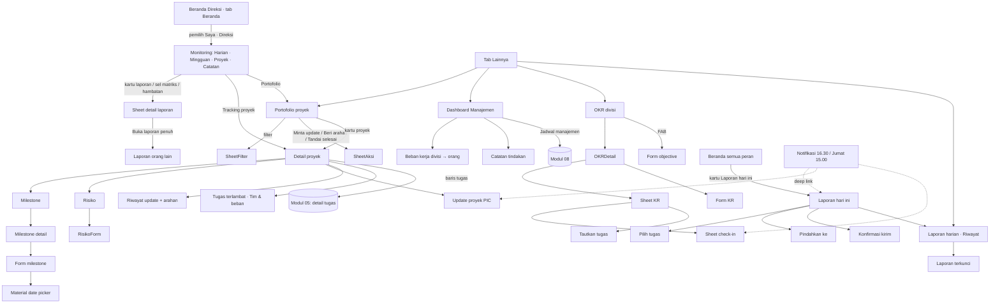

# Spesifikasi Android — Modul 06: Proyek, portofolio, OKR & monitoring

> Modul 06 dari `docs/mockups/android/BRIEF.md`. Layar: `docs/mockups/android/screens/06-proyek-okr-monitoring/` (40 berkas HTML, 166 layar `.phone`, 332 PNG terang + malam; gaya lokal `_p06.css`, prefiks `p6-`). Tema malam lewat `?tema=malam`. Hari ini di semua layar: **Selasa, 13 Okt 2026**. Pemeran: Hendra Wijaya (Direktur Utama, penonton Direksi), Putri Ramadhani (PIC proyek PLQ), Dimas Pratama (Kepala Divisi Operasional), Sari Wulandari (staf, penulis laporan), Maya Lestari (anggota Pemasaran), Hana Anggraini (HR, PIC RKR).
>
> Sumber: `docs/PRD.md` M7/M10, `docs/DATABASE.md` §4 (`project_*`, `milestones`, `daily_reports`, `management_notes`) dan §8 (OKR), `docs/fitur/{okr,laporan-harian,dashboard-pimpinan}.md`, `resources/js/features/{portfolio,projects,management,monitoring,reports,okr}/**`, `routes/{projects,management,reports,okr}.php`, `app/Domain/{Projects,Analytics,Monitoring,Reports,Okr}/**`, `docs/mockups/png/mobile/{MDashboardDireksi,MProyekDetail,MDashboardKadiv}.png`, `docs/ruangkerja-design/screens/{MgP*,MProyek,PDirut*}.dc.html`, `docs/sesi/ponsel.md`, `apps/mobile/app/**`.
>
> Catatan data: angka dipilih konsisten dengan rumus PRD (hari ke-42 dari 56 hari proyek PLQ → rencana 75%; aktual 18/31 = 58%; selisih −17 poin; kuartal Q4: hari ke-13 dari 92 → 14% berlalu). Semua hex hanya pada placeholder; warna lain dari token kit.

## 1. Inventaris layar

| Berkas | Nama | Peran yang melihat | Keadaan yang tercakup |
|---|---|---|---|
| `01-portofolio-direksi.html` | Portofolio proyek | Direksi, Super Admin (`portfolio.view`) | chip status Semua/Bermasalah/Berisiko/Sesuai jalur, widget kehadiran, KPI (butuh keputusan, milestone 2 minggu, terlewat, tugas terlambat), panel "Butuh keputusan Anda" (2 keputusan + 1 perhatian), 6 kartu proyek (cincin progres aktual vs rencana, penanda sistem, milestone berikutnya menggantikan roadmap), "Update terbaru dari PIC" |
| `02-portofolio-keadaan.html` | Portofolio · keadaan | Direksi; peran lain | memuat (skeleton), kosong filter, kosong (belum ada proyek, banner buat-proyek-di-desktop), galat, offline, **terkunci** (tanpa `portfolio.view`) |
| `03-portofolio-sheet.html` | Portofolio · filter & aksi Direksi | Direksi | sheet filter (periode kuartal/bulan/semua, divisi, arsip), pilih divisi, Minta update (RKR), Beri arahan (PLQ, mengutip update), dialog "Tandai keputusan selesai?", snackbar terkirim + Urungkan |
| `04-proyek-divisi-kadiv.html` | Proyek divisi (usulan) | Kepala Divisi | daftar baca saja proyek yang melibatkan divisinya, tanpa Minta update/Beri arahan. **Usulan** (lihat §9) |
| `05-proyek-detail-direksi.html` | Detail proyek · Direksi | Direksi, Super Admin, HR (baca + aksi pengarah Direksi) | header, Sponsor/PIC/Target/Mulai, tab (Ringkasan · Tugas · Milestone · Update · File), KPI progres aktual vs rencana + delta, bilah status tugas, "Dari mana angka ini?", milestone berikutnya, update terbaru + keputusan dibutuhkan + "Tandai keputusan selesai", milestone, burn-up, risiko terbuka, tugas terlambat, tim & beban, **bilah aksi bawah Minta update · Beri arahan** |
| `06-proyek-detail-pic.html` | Detail proyek · PIC | PIC, admin workspace | sama + "Tulis update", "Tambah" milestone/risiko, ⋯ per baris, kotak "Arahan Direksi" (balasan Hendra), bilah bawah **Update proyek** |
| `07-proyek-detail-anggota-selesai.html` | Detail proyek · anggota, selesai, baru | anggota, Kepala Divisi; semua | (1) anggota/Kadiv baca saja tanpa bilah aksi, (2) proyek **selesai/diarsipkan** baca saja, (3) PIC proyek baru: empty state per panel |
| `08-proyek-update-form.html` | Update proyek (PIC) · form | PIC | status kesehatan 3 pilihan (Sesuai jalur/Berisiko/Bermasalah), Ringkasan*, Hambatan, Keputusan dari Direksi, kartu "disimpan bersama" (progres, rencana, penanda sistem); fokus + papan ketik, galat 422, mengirim, offline, dialog "Buang update?" |
| `09-proyek-update-riwayat.html` | Riwayat update | semua yang melihat proyek | 4 update (Sab, 10 Okt … 19 Sep) dengan progres/rencana saat itu, keputusan selesai, **arahan Direksi** sebagai balasan, chip Semua/Butuh keputusan/Ada arahan |
| `10-proyek-direksi-aksi.html` | Aksi Direksi pada detail proyek | Direksi | sheet Minta update, Beri arahan (mengutip hambatan), snackbar, dialog keputusan selesai, sheet **penjelasan rumus** (aktual, rencana, penanda sistem), menu ⋯ proyek |
| `11-milestone-daftar.html` | Milestone | PIC/admin (tulis); lainnya baca | daftar 6 status (selesai, selesai terlambat, **terlewat** disorot, berjalan, akan datang, target proyek), FAB "Milestone baru", sheet aksi (Ubah · Tandai selesai · Hapus), dialog hapus, snackbar + Urungkan, baca saja (banner), kosong |
| `12-milestone-detail-form.html` | Milestone · detail & form | PIC (form); lainnya detail | detail (target, progres tugas terkait, tugas terkait, deskripsi), form baru/ubah (nama, target, deskripsi, tugas terkait), fokus, galat, **pemilih tanggal Material**, pemilih tugas multi |
| `13-proyek-risiko.html` | Risiko proyek | PIC/admin (tulis) | daftar terbuka (Tinggi/Sedang/Rendah, pemilik, tugas terkait), aksi (Ubah · Tandai teratasi · Hapus), tab Teratasi (baca saja), form risiko (judul, level, pemilik, tugas terkait), galat, pilih pemilik |
| `14-proyek-tugas-tim.html` | Tugas terlambat & tim | semua yang melihat proyek | tab Tugas terlambat (4), Tim & beban per orang (tugas terbuka + estimasi jam), kosong "tidak ada terlambat" |
| `15-proyek-keadaan.html` | Detail proyek · keadaan | semua | memuat, galat, offline (aksi tulis nonaktif), 404/tanpa akses, **mode lihat saja** (Direksi/HR non-anggota) |
| `16-manajemen-dashboard.html` | Dashboard Manajemen (mingguan) | Direksi, HR, Super Admin | tab Harian/Mingguan/Bulanan, "Mulai notulensi", hero (kehadiran rata-rata + tugas selesai/rencana + progres), tile Tepat waktu & Proyek perlu perhatian, grafik kerja harian, tracking per proyek (3), milestone bulan ini, **beban kerja** per divisi, **catatan tindakan**, jadwal terdekat |
| `17-manajemen-periode.html` | Manajemen · periode | sama | Harian (tanpa kehadiran/tepat waktu, grafik per divisi), Bulanan (4 minggu kerja) |
| `18-manajemen-beban-kerja.html` | Beban kerja | sama | per divisi (terpadat dulu), divisi dibuka → bilah per orang, kosong, memuat |
| `19-catatan-tindakan.html` | Catatan tindakan (pribadi) | Direksi, HR, Super Admin (`dashboard.view_company`), hanya pemilik | daftar terbuka + selesai (dilipat), tenggat (merah bila lewat), tambah di bilah bawah + tenggat, menulis dengan papan ketik, aksi (ubah, selesai, naikkan/turunkan, hapus), ubah inline, hapus + Urungkan, kosong, galat simpan |
| `20-manajemen-keadaan.html` | Manajemen · keadaan | sama; lainnya | memuat (blok deferred), galat sebagian, offline, **terkunci**, data kosong |
| `21-okr-daftar.html` | OKR divisi | semua karyawan (isi sesuai akses) | tab kuartal Q3/Q4/Q1, chip divisi, hari ke-13 dari 92, KPI (progres rata-rata 16% vs diharapkan 14%, Sesuai jalur 3, Berisiko 1, Tertinggal 1), kartu objective bercincin per divisi, FAB "Objective baru" |
| `22-okr-daftar-keadaan.html` | OKR · keadaan daftar | semua | kosong (berhak membuat), kosong (anggota), memuat, galat, offline, kuartal lalu (**Ditutup**), **Draf**, sheet pilih divisi |
| `23-okr-detail.html` | Detail objective | sesuai akses | header (divisi, kuartal, status, PIC), cincin besar + "Diharapkan 14%", 3 KPI, kartu KR (progres vs diharapkan, bobot, pemilik, **Check-in**, Detail), "Tambah" |
| `24-okr-kr-checkin.html` | Key result · detail & check-in | pemilik KR, pemilik objective, Kepala Divisi | sheet detail KR (grafik rencana vs aktual, riwayat check-in), sheet check-in (nilai, **keyakinan 1–10**, catatan), fokus numerik, galat, menyimpan (optimistis), snackbar |
| `25-okr-tautkan-tugas.html` | Tautkan tugas ke KR | pemilik KR/objective, Kepala Divisi | daftar tugas divisi yang terlihat, hasil cari, kosong, memuat, dialog lepas tautan, galat muat |
| `26-okr-form.html` | OKR · form | Kepala Divisi (divisinya), Direksi (semua) | objective baru (Kadiv: divisi terkunci), galat, ubah, tambah KR, KR "makin kecil makin baik", galat target = awal, dialog **Tutup objective**, menu ⋯ |
| `27-okr-peran.html` | OKR · varian peran | anggota, Direksi, HR/Super Admin | anggota (check-in hanya KR miliknya), Direksi (semua divisi, FAB, tanpa check-in), HR (baca saja), objective ditutup (+ Buka kembali), fitur mati, 404 |
| `28-laporan-hari-ini.html` | Laporan hari ini | semua karyawan (pemilik) | status Draf, "Terbuka sampai 23.59", autosave, pekerjaan (item dibuka/diringkas: catatan wajib, persen, jam, Pindahkan ke), saran dari tugas Anda, Dari tugas / Di luar tugas, ringkasan, hambatan, notulensi, bilah **Kirim laporan** |
| `29-laporan-pilih-tugas.html` | Laporan · pilih tugas & pindah | pemilik | sheet pilih tugas (saran Hari ini, ditugaskan, cari), kosong, memuat, "Pindahkan ke" (kolom workspace), Pindahkan dikunci (mode lihat saja) |
| `30-laporan-keadaan.html` | Laporan · keadaan | pemilik | kosong, galat validasi (catatan wajib), menyimpan, draf belum tersimpan (offline), galat 403 (lewat 23.59), memuat, tanpa saran, hari libur |
| `31-laporan-kirim-terkunci.html` | Laporan · kirim & terkunci | pemilik | konfirmasi kirim, terkirim (+ pindah status), hasil pindah per tugas, sebagian gagal, **terkunci** baca saja |
| `32-laporan-riwayat.html` | Riwayat laporan | pemilik | kartu hari ini + daftar per tanggal (Terkirim/Draf, hambatan, jam), kosong, memuat, offline |
| `33-laporan-kartu-beranda.html` | Kartu "Laporan hari ini" | semua karyawan | Belum lapor · Draf · Terkirim (potongan Beranda, milik modul 02, ditampilkan di sini agar teks & CTA konsisten) |
| `34-laporan-pembaca.html` | Laporan · sisi pembaca | atasan langsung, Kepala Divisi, Direksi, HR, Super Admin | Laporan tim hari ini (hitung + daftar status), detail laporan orang lain, judul tugas tersembunyi (hanya kode), riwayat satu orang, 404, offline |
| `35-monitoring-harian.html` | Monitoring Direksi · Harian | Direksi, Super Admin | pemilih tampilan Saya · Direksi, tab Harian/Mingguan/Proyek/Catatan, navigasi tanggal, hitung (terjadwal, sudah lapor, draf, belum lapor), per divisi, belum lapor, laporan terbaru (tugas + persen, hambatan) |
| `36-monitoring-mingguan.html` | Monitoring · Mingguan | sama | pemilih minggu (Sen–Min), **matriks orang × hari sebagai kartu per divisi** (angka, D, !, –), tugas paling banyak dikerjakan, hambatan minggu ini |
| `37-monitoring-proyek-workspace.html` | Monitoring · Proyek & akses cepat | sama | tracking per proyek (status PIC, laporan & orang minggu ini), akses cepat workspace (cari, chip jenis, "Lihat saja") |
| `38-monitoring-detail-laporan.html` | Monitoring · detail & pemilih | sama | bottom sheet detail laporan, 404, pemilih tampilan, dialog tanggal |
| `39-monitoring-keadaan.html` | Monitoring · keadaan | sama; lainnya | memuat, kosong (pagi), akhir pekan/libur, galat, offline, mingguan kosong, proyek kosong, **terkunci** |
| `40-fitur-desktop-saja.html` | Fitur desktop saja | semua pembuka | banner "Tersedia di desktop" + "Kirim tautan ke email saya": roadmap portofolio, ubah atribut proyek (baca saja di ponsel), ekspor Excel, buat proyek, hapus objective; dialog + snackbar |

## 2. Peta navigasi

Penempatan (keputusan usulan, lihat §9): Portofolio, Manajemen, OKR, dan Riwayat laporan masuk daftar **Lainnya** (hanya muncul sesuai akses); **Monitoring Direksi** adalah tampilan Beranda Direksi (tab bawah tetap Beranda aktif) lewat pemilih "Saya · Direksi" yang sudah ada di web; kartu Laporan hari ini hidup di Beranda semua peran. Layar bertumpuk (Portofolio, Proyek, OKR, Laporan) menyembunyikan tab bawah dan memakai `.bar-sub` + bilah aksi bawah; root tab (Monitoring) mempertahankan tab bar kapsul.

## 3. Pemetaan layar → endpoint API

Seluruh modul ini **belum punya endpoint `/api/v1`** (`routes/api.php` hanya memuat auth, perangkat, absensi, tugas, workspace, catatan, obrolan, rapat, kalender, inbox, pengajuan, briefing). Halaman web (Inertia) sudah ada dan memakai Action/Policy/Query yang dapat dipakai ulang; tabel berikut mengusulkan presenter tipis (pola sama dengan API Tahap 2): satu rute JSON per Action/Query, otorisasi lewat Policy/Gate yang sama, galat 404 untuk yang tidak terlihat.

| Layar | Endpoint v1 (usulan) | Dasar di web | Status API |
|---|---|---|---|
| 01–03 portofolio | `GET /portofolio?periode=&divisi=&status=&arsip=` → `PortfolioDashboard` (kpis, projects, decisions, attention, feed, attendance; **tanpa roadmap**) | `GET /portofolio`, `Projects/Queries/PortfolioDashboard` | **BELUM ADA** |
| 03, 10 Minta update | `POST /proyek/{workspace}/minta-update` {pesan?} → `RequestProjectUpdate` | `projects.request-update` | **BELUM ADA** |
| 03, 10 Beri arahan | `POST /proyek/{workspace}/arahan` {update_id?, body} → `GiveProjectDirection` | `projects.directions.store` | **BELUM ADA** |
| 03, 05 keputusan selesai | `POST /proyek/{workspace}/update/{update}/keputusan` → `ResolveProjectDecision` | `projects.updates.resolve-decision` | **BELUM ADA** |
| 05–07, 14, 15 detail | `GET /proyek/{workspace}` → `ProjectSummary` (project, metrics, milestones, latest update, risks, overdue, team, directions, `project_can`) | `GET /w/{ws}/ringkasan` | **BELUM ADA** (daftar workspace `GET /workspace` **ADA**; tab Tugas memakai `GET /workspace/{ws}/papan` **ADA**) |
| 08 form update | `POST /proyek/{workspace}/update` {health, summary, blockers?, decision_needed?} → `PostProjectUpdate` (snapshot progres/rencana diisi server) | `projects.updates.store` | **BELUM ADA** |
| 09 riwayat | `GET /proyek/{workspace}/update?cursor=` (+ arahan per update) | panel Update PIC + `project_directions` | **BELUM ADA** (belum ada halaman web riwayat terpisah) |
| 11–12 milestone | `POST/PATCH/DELETE /proyek/{workspace}/milestone[/{id}]`, `PATCH …/selesai` → `SaveMilestone`, `SetMilestoneCompletion`, `DeleteMilestone`; detail milestone dari ringkasan | `projects.milestones.*` | **BELUM ADA** |
| 13 risiko | `POST/PATCH/DELETE /proyek/{workspace}/risiko[/{id}]` → `SaveProjectRisk`, `DeleteProjectRisk` (+ `?status=resolved` untuk tab Teratasi) | `projects.risks.*` | **BELUM ADA** (tab Teratasi: perlu kolom filter di presenter) |
| 15 atribut (baca) | termasuk di `GET /proyek/{workspace}`; ubah = `PATCH /w/{ws}/proyek` hanya desktop | `projects.attributes.update` | **BELUM ADA** |
| 16–18, 20 manajemen | `GET /manajemen/ringkasan?periode=harian\|mingguan\|bulanan`, `GET /manajemen/portofolio`, `GET /manajemen/beban-kerja` → `ManagementDashboard::{summary,portfolio,workload}` (tiga blok terpisah agar skeleton per blok, seperti `Inertia::defer`) | `GET /manajemen` (Gate `viewManagementDashboard`) | **BELUM ADA** |
| 16, 19 catatan tindakan | `GET/POST /catatan-tindakan`, `PATCH/DELETE /catatan-tindakan/{id}`, `PUT /catatan-tindakan/urutan` → `Create/Update/Delete/ReorderManagementNotes` | rute JSON `management-notes` | **BELUM ADA** |
| 16 jadwal terdekat | `GET /manajemen/jadwal-terdekat` (rapat `leadership`) | web mengirim `agenda: []` (kosong) | **BELUM ADA** + celah web (§9) |
| 21–22, 27 daftar OKR | `GET /okr?kuartal=2026-Q4&divisi=` → `OkrIndex` | `okr.index` (flag `FEATURE_OKR`, 404 saat mati) | **BELUM ADA** |
| 23, 26, 27 detail/form/tutup | `GET /okr/{objective}`; `POST /okr`, `PATCH /okr/{id}`, `POST /okr/{id}/tutup` | `okr.show/store/update/close` | **BELUM ADA** |
| 24, 26 KR & check-in | `POST /okr/{objective}/kr`, `PATCH/DELETE /okr/kr/{kr}`, `POST /okr/kr/{kr}/check-in` {value, confidence?, note?} → `RecordKeyResultCheckin` | `okr.key-results.*` | **BELUM ADA** |
| 25 tautkan tugas | `GET /okr/kr/{kr}/tugas?q=` (throttle `search`), `POST /okr/kr/{kr}/tugas`, `DELETE /okr/kr/{kr}/tugas/{task}` | `okr.key-results.tasks.*` | **BELUM ADA** |
| 28–31 laporan saya | `GET /laporan/hari-ini` (draf + `editable`, `locks_at`, statuses workspace), `PUT /laporan/hari-ini` (autosave), `POST /laporan/hari-ini/kirim` (hasil pindah per tugas), `GET /laporan/tugas?q=` (saran + cari) → `SaveDailyReport`, `SubmitDailyReport`, `ReportTaskOptions` | `reports.today/save/submit/tasks` (throttle 60/30 per menit) | **BELUM ADA** |
| 32 riwayat | `GET /laporan?bulan=` → `MyDailyReports` | `reports.index` | **BELUM ADA** |
| 33 kartu Beranda | `GET /laporan/hari-ini/status` (`TodayReportStatus`) atau bagian `GET /beranda` modul 02 | `MyDailyReports::status` | **BELUM ADA** |
| 34 pembaca | `GET /laporan/tim?tanggal=` → `DailyReportFeed::forDate`; `GET /laporan/{user}`; `GET /laporan/{user}/{tanggal}` | `reports.person/show`, `ReportReaders` (404 bila bukan pembaca) | **BELUM ADA** |
| 35–39 monitoring | `GET /monitoring/harian?tanggal=`, `/monitoring/mingguan?minggu=`, `/monitoring/proyek`, `/monitoring/workspace?q=&jenis=`, `GET /monitoring/laporan/{id}` | `Monitoring/Queries/{DailyWorkMonitor,WeeklyWorkMonitor,ProjectWorkMonitor,WorkspaceDirectory}`, Gate `monitorDailyReport` | **BELUM ADA** |
| 40 kirim tautan | `POST /tautan-desktop` {rute} → email (pola sama dengan banner modul lain) | belum ada | **BELUM ADA** (kebutuhan lintas modul) |

Aturan kontrak yang perlu dibawa ke presenter: waktu UTC di JSON + `tanggal kantor` string `Y-m-d` untuk laporan; `project_can {steer, manage, write_update}` mengikuti `WorkspacePolicy::isViewOnly`; galat validasi 422 Indonesia (pola `SaveEmployeeRequestRequest`); throttle laporan identik web; presenter laporan mengikuti `ReportPresenter` (judul tugas hanya bila `TaskPolicy::view`, selain itu `task_key` saja).

## 4. Kemampuan khas Android yang dipakai

| Kemampuan | Dipakai di | Catatan |
|---|---|---|
| Tombol/gestur kembali sistem | semua layar bertumpuk, sheet, dialog | form dengan isian → dialog "Buang update?" / draf laporan otomatis tersimpan; sheet menutup dengan kembali |
| Papan ketik (IME) | form update, check-in (numerik, koma desimal `inputMode="decimal"`), laporan, catatan tindakan | bilah aksi bawah naik di atas papan ketik (`KeyboardAvoidingView`, `adjustResize`); aksi IME "Lanjut" antar field |
| Pemilih tanggal Material | target milestone, tenggat catatan, tanggal monitoring | tampil dialog Material (`DateTimePickerAndroid`); format tampil "Rabu, 21/10/2026"; masa depan dinonaktifkan di monitoring harian |
| Izin notifikasi (`POST_NOTIFICATIONS`, Android 13+) | pengingat laporan 16.30, update proyek Jumat 15.00, check-in OKR Jumat 15.00, keputusan/arahan | izin diminta di modul 01/10; modul ini hanya menyebut deep link: `ruangkerja://laporan/hari-ini`, `ruangkerja://proyek/{key}/update`, `ruangkerja://okr/kr/{id}/check-in` |
| Tarik-untuk-segarkan | portofolio, monitoring, manajemen, OKR, riwayat laporan | `RefreshControl`; mengikuti pola `app/(tabs)/index.tsx` |
| Geser baris | tidak dipakai (aksi lewat ⋯ + sheet, lebih mudah ditemukan) | catatan tindakan: urut lewat Naikkan/Turunkan; seret untuk urut = usulan (§9) |
| Haptik ringan | sukses simpan/kirim, centang catatan | `expo-haptics` (belum terpasang) |
| Penyimpanan lokal draf | autosave laporan saat offline | sebelum 23.59 draf aman di perangkat dan disinkron saat tersambung; **belum ada pustaka penyimpanan** di `apps/mobile` (§7) |
| Tanpa kamera/lokasi/mikrofon | modul ini | tidak ada izin runtime selain notifikasi |

Gerak (anotasi): segmented/tab 180 ms `ease-brand` hanya `transform`/`opacity`; bottom sheet naik 180 ms dengan fling-ke-tutup; progres bar dan cincin OKR/portofolio mengisi 180 ms pada pemuatan pertama saja; check-in OKR memutakhirkan nilai optimistis tanpa animasi tambahan; `prefers-reduced-motion` (animator scale 0) → semua transisi menjadi instan. Skeleton berkedip dihentikan saat reduced motion.

## 5. Matriks keadaan

| Layar | Memuat | Kosong | Galat | Offline | Terkunci / tanpa akses | Baca saja |
|---|---|---|---|---|---|---|
| Portofolio | skeleton (02-1) | filter & perusahaan (02-2, 02-3) | 02-4 | 02-5 (aksi tulis nonaktif) | 02-6 (bukan Direksi/Super Admin) | Kadiv (04) |
| Detail proyek | 15-1 | per panel (07-3), tidak ada tugas terlambat (14-3) | 15-2 | 15-3 (bilah "butuh koneksi") | 15-4 (404) | anggota, selesai/diarsipkan (07-1, 07-2), manajemen non-anggota (15-5) |
| Update PIC (form) | – | – | galat 422 (08-2) | 08-4 | – | Direksi tak memiliki form |
| Milestone / risiko | – | 11-6 | – | ikut 15-3 | – | 11-5, 13-3 |
| Manajemen | 20-1 | 20-5 (+ beban 18-3, catatan 19-6) | 20-2 (sebagian per blok), catatan 19-7 | 20-3 | 20-4 | – |
| OKR | 22-3 | 22-1, 22-2 | 22-4 | 22-5 | 27-5 (fitur mati), 27-6 (404) | HR/Super Admin 27-3; ditutup 22-6, 27-4 |
| Laporan saya | 30-6, 29-4 | 30-1, 30-7, 32-2 | 30-2, 30-5 | 30-4 (draf lokal), 32-4 | 34-5 (404) | terkunci 31-5 |
| Pembaca laporan | – | – | – | 34-6 | 34-5 | semua baca saja |
| Monitoring | 39-1 | 39-2, 39-3, 39-6, 39-7 | 39-4 | 39-5 | 39-8 | semua baca saja |

## 6. Aturan akses yang tercermin (jangan dilanggar)

- **Portofolio / Monitoring Direksi**: `portfolio.view` (Direksi, Super Admin) / tampilan Direksi; HR tidak melihat portofolio (tautan "Semua proyek" disembunyikan di Manajemen).
- **Direksi, HR, Super Admin di workspace non-anggota = mode lihat saja** (banner kuning, tanpa ubah tugas/komentar/lampiran); aksi pengarah proyek Direksi (**Minta update**, **Beri arahan**, **Tandai keputusan selesai**) tetap ada.
- **Hanya PIC dan admin workspace** menulis update, milestone, risiko; status kesehatan = penilaian PIC, **bukan dihitung** — penanda sistem tampil di sampingnya.
- **Tidak ada skor produktivitas gabungan**: laporan, matriks, dan beban kerja berdampingan tanpa peringkat; "Tepat waktu" dan "Penyelesaian" dibaca terpisah.
- **Staf** (peran `anggota` saja): tidak melihat saldo cuti/struktur organisasi (tidak muncul di modul ini); laporan harian paling menonjol di Beranda staf.
- **Laporan**: draf tidak pernah terlihat pembaca; judul tugas hanya bila pembaca berhak, selain itu kode saja; pemilik menulis hanya pada tanggal kantor hari itu (terkunci 23.59).
- **Catatan tindakan**: pribadi, hanya pemilik (orang lain, termasuk Super Admin, mendapat 404).
- **OKR**: pemilik KR melakukan check-in; Direksi membuat/menutup objective tetapi tidak check-in; HR/Super Admin baca saja; objective ditutup = baca saja (Kepala Divisi/Direksi bisa buka kembali).
- Fitur desktop-saja (roadmap, atribut proyek, ekspor, buat proyek) tampil sebagai banner + "Kirim tautan ke email saya" (40).

## 7. Catatan implementasi Expo (`apps/mobile`)

Yang sudah ada: Expo Router (`app/**`), `src/components/ui.tsx` (Button, Badge, Loading, EmptyState, …), tema (`src/lib/theme.tsx`), klien API (`src/api`), sesi. Rute baru yang disarankan (di luar `(tabs)` agar tab bar tersembunyi): `app/portofolio/index.tsx`, `app/proyek/[id]/{index,update,milestone,risiko,tim}.tsx`, `app/manajemen/{index,beban,catatan}.tsx`, `app/okr/{index,[id]}.tsx`, `app/laporan/{hari-ini,index,[user]/[tanggal],tim}.tsx`, `app/monitoring.tsx` (atau tab Beranda Direksi).

Komponen & pustaka:

| Kebutuhan | Rencana | Status di `apps/mobile` |
|---|---|---|
| Grafik burn-up, kolom, rencana-vs-aktual | `react-native-svg` (polyline/rect, tanpa pustaka grafik) + tabel aksesibilitas tersembunyi | **belum terpasang** — perlu ditambahkan |
| Cincin progres OKR | `react-native-svg` `Circle` stroke-dasharray | idem |
| Bottom sheet (filter, aksi, check-in, detail laporan, pilih tugas) | `@gorhom/bottom-sheet` atau `Modal` kustom; sheet detail laporan setinggi 85% dengan pegangan | belum ada (perlu keputusan §9) |
| Gestur / animasi | `react-native-gesture-handler` + `react-native-reanimated` untuk sheet dan seret-urut | belum terpasang (`animate-expo`) |
| Pemilih tanggal | `@react-native-community/datetimepicker` (dialog Material Android) | belum terpasang |
| Slider keyakinan 1–10 | `@react-native-community/slider` atau komponen kustom 10 titik (aksesibel: `accessibilityValue`) | belum terpasang |
| Autosave draf laporan | state lokal + debounce 1,2 dtk ke `PUT /laporan/hari-ini`; cadangan lokal di `@react-native-async-storage/async-storage` atau `expo-sqlite` | belum terpasang |
| Bilah aksi bawah | `View` absolut di atas `SafeArea` + `KeyboardAvoidingView` | pola baru, tambahkan ke `ui.tsx` |
| Daftar panjang | `FlatList`/`SectionList` (kartu proyek, riwayat laporan, monitoring) | tersedia |

Catatan perilaku: simpan hasil "pindahkan ke" bersama laporan lalu tampilkan hasil per tugas (sebagian bisa gagal karena `TaskPolicy::move`); kunci kolom saat mode lihat saja; semua angka diformat id-ID (`1.250`, koma desimal pada input); tanggal tampil "Hari, dd/mm/yyyy" pada isian dan "Sen, 5 Okt 2026" pada daftar; progres mentah KR dibatasi 0–100% untuk tampilan tetapi status memakai nilai terbatas −100…100 (KR yang mundur → Tertinggal); keputusan proyek memakai salinan `progress_snapshot` bukan hitung ulang.

Kebutuhan kit (tidak mengubah `_kit`): untuk implementasi perlu komponen `StatusRing` (cincin), `ProgressWithPlan` (penanda rencana), `MatrixCell` (kotak orang×hari), `BottomActionBar`, `HealthSegmented` (3 pilihan) — gaya lokal `_p06.css` dapat dijadikan acuan, usulan dipromosikan ke kit/katalog modul 13.

## 8. Keputusan yang diambil

1. **Roadmap tidak ada di ponsel**: diganti baris "Berikutnya: milestone · tanggal" pada kartu proyek + banner "Tersedia di desktop" (40-1), sesuai `docs/PLATFORM.md` §3.
2. **Bilah aksi bawah**: Direksi mendapat *Minta update · Beri arahan*, PIC *Update proyek*, lainnya tanpa bilah (mengikuti `summary.mobile.tsx`).
3. **Matriks mingguan orang × hari** dipecah menjadi satu kartu per divisi yang bisa dibuka; tujuh kotak 32 px per baris muat di 412 px; sel menampilkan jumlah tugas atau **D** (draf) / **!** (belum lapor) / **–** (libur) — status selalu simbol + warna, bukan warna saja.
4. **Update proyek sebagai layar penuh** (bukan dialog) karena empat isian + papan ketik; kirim di bilah bawah yang naik di atas keyboard; dialog konfirmasi buang saat kembali dengan isian.
5. **Penjelasan rumus** ("Dari mana angka ini?") sebagai sheet agar penanda sistem (selisih ≤ −15 poin, milestone terlewat, update > 7 hari) dapat dijelaskan tanpa mengubah aturan PRD.
6. **Check-in KR**: nilai + keyakinan (slider 10 titik) + catatan; pembaruan optimistis dengan rollback; objective ditutup menolak semua aksi tulis.
7. **Laporan harian**: item pertama terbuka, sisanya diringkas (akordeon) untuk menghemat gulir; persen sebagai 5 chip (0–100%), jam stepper ±0,5; "Pindahkan ke" via sheet kolom workspace; kirim memakai **konfirmasi ringkas** dan menampilkan hasil pindah per tugas.
8. **Catatan tindakan**: input di bilah bawah (zona jempol) dengan chip tenggat; urutan lewat Naikkan/Turunkan (setara web) — seret-urut tidak dimasukkan.
9. **Monitoring Direksi** tetap berupa empat tab (Harian · Mingguan · Proyek · Catatan) di Beranda Direksi, persis web; ekspor tidak ada di ponsel.
10. Tema malam: status memakai pasangan token `--ok/--warn/--bad/--info` + `-soft`; cincin dan bilah memakai `--fill-*` (bukan teks).

## 9. Pertanyaan / keputusan untuk pemilik

1. **Penempatan menu**: Portofolio, Manajemen, OKR, Riwayat laporan di tab *Lainnya* dan Monitoring sebagai tampilan Beranda Direksi — setuju? Alternatif: tab khusus "Pimpinan" untuk Direksi.
2. **Label "Tandai selesai"** pada keputusan Direksi (di web hanya menandai selesai, tidak menyetujui). Mockup desain lama bertuliskan "Setujui"; dipakai "Tandai selesai" + "Diskusikan" agar tidak menyiratkan persetujuan formal. Setuju?
3. **Layar "Proyek divisi" untuk Kepala Divisi (04)** tidak punya padanan web (web hanya grup "Proyek yang diikuti" di `/workspace` dan panel risiko di dashboard Kadiv). Dibangun sebagai usulan atau cukup memakai daftar workspace modul 05?
4. **Riwayat update proyek (09) dan tab Risiko teratasi (13-3)** adalah tampilan baru (web hanya menampilkan update terbaru + 4 riwayat dalam panel dan risiko terbuka). Lanjutkan sebagai tambahan presenter?
5. **Konfirmasi kirim laporan harian**: web mengirim langsung; ponsel diberi konfirmasi ringkas karena kirim memindahkan status tugas. Pertahankan atau samakan dengan web?
6. **Draf laporan offline**: `docs/PLATFORM.md` §2.1 butir 5 menunda antrean offline ke Fase 3. Android native adalah Fase 3 — izinkan draf laporan (bukan kirim) tersimpan lokal dan disinkron? Kirim tetap butuh koneksi.
7. **Seret-untuk-urut catatan tindakan** (butuh gesture-handler/reanimated) atau cukup Naikkan/Turunkan?
8. **Pustaka**: setuju menambah `react-native-svg`, bottom sheet (`@gorhom/bottom-sheet`), `datetimepicker`, `slider`, dan penyimpanan lokal? (AGENTS.md: paket baru butuh alasan di ringkasan.)
9. **Jadwal terdekat** pada Dashboard Manajemen: web mengirim `agenda: []` karena modul rapat dulu belum ada; sekarang modul Rapat ada — isi dari rapat `leadership` (mockup 16 menampilkannya) atau pertahankan kosong sampai web diperbarui?
10. **Pengingat**: notifikasi 16.30 (laporan), Jumat 15.00 (update proyek, check-in OKR) — jenis saluran Android dan jam tenang dipegang modul 10/12; cukup deep link seperti §4?
11. **Akses HR ke portofolio**: HR melihat Dashboard Manajemen tetapi tidak portofolio (web). Pertahankan?

## 10. Celah yang ditemukan (web belum punya wujud ponsel / API)

- Seluruh endpoint modul ini belum ada di API v1 (§3); halaman web hanya Inertia.
- Roadmap lintas proyek, ekspor Excel, atribut proyek, buat proyek, hapus objective: desktop saja / belum ada (40).
- Jadwal terdekat/notulensi terbaru pada Manajemen kosong di web (`agenda: []`, `minutes: []`).
- Tidak ada ekspor laporan harian dan lampiran pada laporan (web menahan); mockup tidak menambahkannya.
- KR belum dihitung otomatis dari tugas tertaut (nilai lewat check-in) — mockup mengikuti.
- Tidak ada layar Detail milestone di web (hanya panel); mockup 12-1 menyusunnya dari data panel (tugas terkait + progres) — perlu presenter.
- `aksi bawah Minta update/Beri arahan` di portofolio dan detail memakai Action yang sama; tidak ada pembatalan arahan (tidak digambar).
- Pengingat 16.30 dan Jumat 15.00 hanya in-app/email di web; push FCM milik modul 12.

## 11. Verifikasi

`node docs/mockups/android/_kit/render.mjs 06-proyek-okr-monitoring` → 332 PNG dari 40 berkas, tanpa baris `MASALAH` (tanpa ikon hilang, tanpa luapan horizontal). Layar panjang memakai tinggi otomatis (`data-fit`, skrip lokal kecil) agar PNG utuh.
