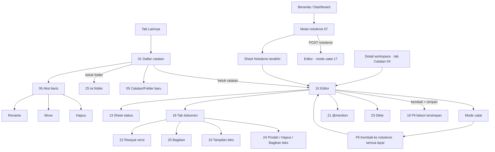

# Spesifikasi mockup Android — 07 Catatan & notulensi

> Modul: catatan bersama (F2-2) + Notulensi cepat + mode catat + dikte (rencana). Sumber: `docs/fitur/catatan.md`, `docs/fitur/catatan-stt.md`, `docs/DATABASE.md` §7 (notes, note_versions, note_shares, preset `minutes`), PRD §M9, `resources/js/features/notes/**`, `apps/mobile/app/catatan/[id].tsx`, kontrak API `docs/sesi/ponsel.md`.
> Hari ini di mockup: **Selasa, 13 Okt 2026**. Pengguna contoh: Sari Wulandari (staf, anggota `GDG`), Maya Lestari (Kepala Tim Gudang), Rizky Pratama, Dimas Pratama (Kadiv Operasional), Hendra Wijaya (Direktur Utama, tampilan baca-saja).
> Render: `node docs/mockups/android/_kit/render.mjs 07-catatan-notulensi` → 25 berkas HTML, 147 bingkai ponsel/tablet, 294 PNG (terang + malam), nol baris "MASALAH".

## 0. Keadaan aplikasi Expo saat ini vs. yang dirancang

Aplikasi saat ini (`apps/mobile/app/catatan/[id].tsx`, tab Catatan di `app/workspace/[id].tsx`) hanya punya:

- daftar **datar** catatan per workspace + buat catatan (judul saja);
- editor **teks polos** (`TextInput` multibaris, `body_text`), autosave 1,5 dtk lewat `PATCH /catatan/{id}`, konflik 409 → `Alert` "Catatan berubah" + "Muat ulang", tombol kembali (termasuk tombol fisik Android) menyiram simpanan, `mobile_editable=false` → "Catatan ini berformat lengkap. Sunting di web." (judul tetap bisa diganti).

Mockup ini adalah **target paritas** dengan `resources/js/features/notes/note.mobile.tsx` (editor minimalis 9 Okt 2026) dan `docs/PLATFORM.md` §3 (Catatan & notulensi: ✓ di ponsel). Jarak antara keadaan sekarang dan target ditandai di §5 (API) dan §9 (celah).

Penanda di spesifikasi ini: **ADA** = endpoint API v1 sudah ada; **BELUM ADA** = rute web ada tetapi belum diekspos di `routes/api.php`; **USULAN** = belum ada di web maupun API.

## 1. Inventaris layar

Semua berkas di `docs/mockups/android/screens/07-catatan-notulensi/`. "Peran" = siapa yang melihat variannya; `staf` = hanya peran `anggota`.

| Berkas | Nama | Bingkai | Peran | Keadaan yang tercakup |
|---|---|---|---|---|
| `01-daftar-catatan.html` | Daftar catatan (pohon per workspace) | 1 | semua karyawan | folder terbuka/tertutup, sub-halaman (tingkat 2), ikon notulensi (preset `minutes`), gembok "Hanya diundang", FAB, kolom cari, chip workspace berhitung, tab bar (Lainnya aktif) |
| `02-daftar-keadaan.html` | Keadaan daftar | 7 | semua | memuat (skeleton), kosong total, pencarian tanpa hasil, galat server, offline, offline dengan cache (USULAN), fitur `notes` mati (404) |
| `03-pencarian-filter.html` | Pencarian & filter | 3 | semua; Direksi/HR (baca-saja) | pencarian dengan hasil (sorotan judul + cuplikan isi, keyboard terbuka), filter chip `GDG`, daftar baca-saja (tanpa FAB/menu, lencana "Hanya baca", spanduk lihat-saja) |
| `04-tab-catatan-workspace.html` | Tab Catatan di detail workspace | 4 | anggota; Direksi/HR/SA bukan anggota | normal (Catatan baru/Folder baru), mode lihat saja, workspace kosong, workspace diarsipkan |
| `05-buat-catatan.html` | Buat catatan & folder | 7 | yang `can_create` | sheet kosong, terisi + keyboard, galat "Judul wajib diisi.", Folder baru, pemilih Letak, membuat…, galat jaringan |
| `06-aksi-baris.html` | Aksi baris pohon | 8 | yang `can_create` | menu aksi catatan, menu aksi folder, Ganti nama (keyboard), Pindahkan (+ catatan folder), dialog Hapus catatan, dialog Hapus folder, snackbar "dipindahkan" + Urungkan |
| `07-mulai-notulensi.html` | Pintasan "Mulai notulensi" | 8 | semua; Kadiv; Direksi | tombol 52px di Beranda staf, sheet "Notulensi terakhir" (3 terbaru), memuat, kosong, membuat…, galat, header Dashboard Kadiv, header Dashboard Direksi |
| `10-editor-catatan.html` | Editor minimalis | 4 | penyunting | top bar judul + 3 ikon, toolbar muncul (ikon aktif), toolbar tersembunyi (idle), menyimpan, catatan baru kosong ("Tanpa judul") |
| `11-editor-keyboard.html` | Editor dengan keyboard Android | 4 | penyunting | toolbar tepat di atas keyboard (tab bar disembunyikan), toolbar auto-hide (±1,8 dtk), seleksi teks (gagang + bilah konteks sistem + toolbar tertahan), geser toolbar |
| `12-toolbar-format.html` | Bilah format & warna | 4 | penyunting | awal toolbar, ujung toolbar (geser), menu Warna teks (10), menu Stabilo (8), indikator warna aktif |
| `13-status-simpan.html` | Status simpan | 10 | penyunting | matriks 5 ikon app bar (menyimpan, tersimpan, gagal/tanpa koneksi, konflik, mode catat aktif) + sheet status: menyimpan, tersimpan 08.12, belum tersimpan (tanpa koneksi), konflik (+Muat ulang), gagal menyimpan (+Salin teks) |
| `14-konflik-409.html` | Konflik versi | 5 | penyunting | spanduk konflik, dialog "Catatan berubah", dialog keluar saat konflik, dialog keluar saat gagal simpan, snackbar sesudah muat ulang |
| `15-baca-saja.html` | Baca-saja & berformat lengkap | 6 | pembaca; penyunting catatan kaya | `can_edit=false`, `mobile_editable=false` (judul bisa diganti, isi tampil terformat), ganti judul dengan keyboard, Direksi bukan anggota, workspace diarsipkan, "Kirim tautan ke email saya" terkirim |
| `16-pil-belum-tersimpan.html` | Pil "Catatan belum tersimpan" | 6 | penyunting | belum tersimpan (Simpan), periksa koneksi (Coba lagi), diubah orang lain (Muat ulang), Tersimpan ✓, sedang menyimpan, "+N catatan lain" |
| `17-mode-catat.html` | Mode catat (notulensi berjalan) | 10 | penyunting | editor mode catat (tab bar hilang, ikon tonal), dengan keyboard, sheet "Selesai mencatat?", menyimpan…, pil "Notulensi berjalan · Kembali" di Beranda dan di Tugas (di samping FAB), snackbar mulai, catatan lain saat mode berjalan (ikon mode nonaktif + pil), mode berakhir otomatis (catatan hilang/akses dicabut), gagal menutup (simpan gagal) |
| `18-tab-dokumen.html` | Tab dokumen (tab & sub-tab) | 7 | penyunting; pembaca | daftar tab + sub-tab, dokumen induk aktif (tanpa tombol Sub-tab), menu baris tab, Ganti nama, Hapus tab (dialog), pembaca (tanpa footer & menu), gagal membuat tab; baris aksi catatan di bawah daftar |
| `19-tampilan-teks.html` | Tampilan teks A−/A+ | 4 | semua | 100%, 130%, 160% (A+ nonaktif), 90% (A− nonaktif) |
| `20-berbagi-akses.html` | Bagikan & peran | 8 | penulis / admin / owner (`can_share`) | akses Workspace, Hanya diundang, menu peran (Menyunting/Membaca/Hapus akses), picker Undang orang, menyimpan…, sukses, galat, Salin tautan |
| `21-mention.html` | @mention | 4 | penyunting | daftar hasil `@ma`, mencari…, tidak ada hasil, mention tersisip + toast notifikasi |
| `22-riwayat-versi.html` | Riwayat versi & pulihkan | 8 | penyunting; pembaca (hanya lihat) | daftar versi (+label "Dipulihkan dari…"), memuat, kosong, pratinjau (Daftar/Pulihkan), dialog Pulihkan, pembaca (tanpa Pulihkan), sukses, memulihkan + galat |
| `23-dikte-stt.html` | Dikte suara — **RENCANA** | 8 | penyunting | mic di toolbar, consent pertama kali, dialog izin mikrofon runtime Android, mendengarkan (teks interim abu-abu), segmen final masuk, izin ditolak (Buka Pengaturan), koneksi putus, dikte di mode catat |
| `24-pindah-hapus-ekspor.html` | Pindah, hapus & bagikan sebagai teks | 8 | penyunting | Pindahkan dari editor, pemilih tujuan, dialog Hapus, menghapus…, snackbar + daftar sesudah hapus, snackbar dipindahkan, galat izin, share sheet Android (USULAN "Ekspor") |
| `25-keadaan-editor.html` | Keadaan editor | 8 | semua | memuat, galat, offline, 404 (dihapus/akses dicabut), folder dibuka (isi folder), fitur mati, spanduk "belum tersimpan", galat validasi judul |
| `26-presence.html` | Presence "X sedang melihat" — **USULAN** | 3 | penyunting | strip penonton, sheet status dengan penyunting lain, spanduk "diubah orang lain" berbasis polling |
| `27-tablet.html` | Tablet 834×1112 | 2 | semua | editor dengan panel Tab dokumen + Rail 96px, daftar catatan dua kolom |

## 2. Peta navigasi

Gestur sistem: kembali (panah/gestur/tombol fisik) selalu menyiram simpanan dulu (`kembali()` di `[id].tsx`); bila gagal → dialog "Perubahan belum tersimpan" (14).

## 3. Pemetaan layar → endpoint

| Layar | Endpoint | Status |
|---|---|---|
| 01 daftar per workspace | `GET /workspace` (grup), `GET /workspace/{ws}/catatan` → baris datar `id/parent_id/kind/preset/title/access/updated_at/penulis/penyunting`; pohon dibangun klien dari `parent_id` | **ADA** |
| 01/03 pencarian server `?q=` lintas workspace, hitung per workspace | `GET /catatan?q=` (web: `NoteController@index`, full-text `simple`) | **BELUM ADA** |
| 05 buat catatan | `POST /workspace/{ws}/catatan {title}` | **ADA** (hanya judul) |
| 05 buat **folder**, `kind`, `parent_id` (letak) | `POST /catatan` (web `NoteController@store`, `CreateNote`) | **BELUM ADA** di API (`kind`/`parent_id` belum diterima) |
| 06 ganti nama | `PATCH /catatan/{id} {title}` | **ADA** |
| 06/24 pindahkan | `PATCH /catatan/{id}` varian `parent_id` (web `MoveNote`) — butuh rute | **BELUM ADA** |
| 06/24 hapus (folder: isi naik satu tingkat) | `DELETE /catatan/{id}` (web `destroy`, `DeleteNote`) | **BELUM ADA** |
| 07 mulai notulensi | `POST /catatan/notulensi` (`StartQuickMinutes`, judul `Notulensi · {hari}, dd/mm/yyyy HH.mm` waktu kantor, templat, workspace Pribadi) | **BELUM ADA** |
| 07 notulensi terakhir | `GET /catatan/notulensi` → `{minutes:[{id,title,workspace_name,updated_at}]}` | **BELUM ADA** |
| 10 buka catatan | `GET /catatan/{id}` → `body_html`, `body_text`, `can_edit/can_share/can_delete`, `updated_at`, `mobile_editable` | **ADA** |
| 10 simpan isi | `PATCH /catatan/{id} {body_html, updated_at}`; 409 `updated_at` usang; 409 `code:'rich_note'` | **ADA** (lihat §9: konversi `NoteHtml` terbatas) |
| 10 simpan judul | `PATCH /catatan/{id} {title}` (satu maksud per permintaan) | **ADA** |
| 11/12 format (heading, tebal, miring, daftar, checklist, kutipan, kode, warna, stabilo) | disimpan sebagai `body_html` (mark `textColor`/`highlight` lewat `data-color`/`data-highlight`) | **ADA** sebagai transport; **editor kaya di aplikasi BELUM ADA** (kini teks polos) |
| 13/14/16 status & konflik | status lokal + 409 dari PATCH | **ADA** |
| 17 mode catat | state lokal per pengguna (setara `rk.notes.session.v1`) → simpan di penyimpanan lokal aplikasi; tidak ada endpoint | lokal |
| 18 tab/sub-tab (catatan anak, maks. 2 tingkat) | tab baru = `POST` dengan `parent_id`; ganti nama = PATCH title; hapus tab = `DELETE ?kembali=induk` | **BELUM ADA** (butuh `parent_id` di POST + DELETE) |
| 19 tampilan teks | lokal (setara `rk.notes.scale.v1`, 90–160%, per perangkat) | lokal |
| 20 bagikan | `PUT /catatan/{id}/akses {access, people:[{user_id,role}]}` (web `UpdateNoteShare`, audit `note.share_updated`); data awal `share` + `people` | **BELUM ADA** |
| 20 salin tautan | tautan web `/catatan/{id}`; di Android lebih baik deep link (modul 12) | lokal |
| 21 mention | `GET /w/{key}/rujukan?type=people&q=` (web `ReferenceController`, hanya yang punya akses) | **BELUM ADA** di API |
| 22 riwayat | daftar versi (web `GET /catatan/{id}` prop `versions`) + `POST /catatan/{id}/versi/{version}/pulihkan` | **BELUM ADA** |
| 23 dikte | Android `SpeechRecognizer`/`expo-speech-recognition` di klien; tanpa endpoint (opsi self-host: token HMAC + WhisperLive, `catatan-stt.md` §6 langkah 8) | **RENCANA** (keputusan privasi pemilik tertunda) |
| 24 bagikan sebagai teks | `body_text` lokal → share sheet Android | **USULAN**, tanpa endpoint |
| 26 presence | butuh endpoint presence/polling (web memakai awareness Yjs, tidak ada di API) | **USULAN** |

## 4. Kemampuan khas Android yang dipakai

- **Tombol kembali sistem + gestur kembali**: menyiram simpanan; bila gagal menampilkan dialog 14.
- **Keyboard (IME)**: `windowSoftInputMode=adjustResize`; toolbar format ditempel tepat di atas keyboard (setara `useKeyboardInset`), tab bar disembunyikan selama keyboard terbuka; sheet dengan input ikut naik di atas keyboard (`kbsheet` di 05/06/18). Saran koreksi/prediksi keyboard tidak dikendalikan aplikasi.
- **Seleksi teks**: gagang dan bilah konteks (Potong · Salin · Tempel · Pilih semua) milik sistem; toolbar format tertahan tampil selama seleksi tidak kosong.
- **Izin runtime**: `RECORD_AUDIO` hanya saat mic dikte pertama kali diketuk (23); kamera/lokasi tidak dipakai modul ini. Penolakan permanen → snackbar "Buka Pengaturan".
- **Share sheet sistem** untuk "Bagikan sebagai teks" (24, USULAN).
- **Notifikasi**: mention dan undangan akses memakai jalur notifikasi yang sudah ada (modul 10/12); mode catat tidak membuat notifikasi tetap — pil dalam-aplikasi saja (di Android 14+ tidak ada foreground service untuk mode catat).
- **Aksesibilitas**: ikon app bar punya label ("Status: tersimpan", "Tab dokumen", "Mode catat aktif, selesai mencatat"), `aria-pressed` ↔ `accessibilityState.selected` pada mode catat dan tombol toolbar aktif; target sentuh 44px (toolbar) dan 52px (aksi utama).
- **Gerak (anotasi)**: toolbar muncul/hilang 180 ms `ease-brand` (transform + opacity); pil masuk/keluar 180 ms; ikon awan menyimpan berputar (berhenti di frame diam dengan reduced motion); tombol tekan skala .98 selama 120 ms.

## 5. Spesifikasi perilaku utama (rujukan implementasi)

**Editor minimalis** (top bar = tombol kembali + judul + 3 ikon 44px):
1. **Status simpan/online gabungan** — ketuk membuka sheet status (13). Pemetaan fase (web `savePhase`) untuk aplikasi tanpa Yjs: `menyimpan` = awan-cog berputar; `tersimpan` = awan hijau + centang; `belum tersimpan/tanpa koneksi` = awan dicoret + titik kuning (di web fase `offline` berarti "tanpa kolaborasi"; di aplikasi REST itu keadaan normal, jadi ikon dicoret dipakai untuk gagal kirim); `konflik` = segitiga peringatan.
2. **Tab dokumen** (ikon daftar) → sheet 18; di bawah daftar: Riwayat versi, Bagikan (bila `can_share`), Ukuran huruf, Pindahkan (bila `can_edit`), Bagikan sebagai teks (USULAN), Hapus catatan (bila `can_delete`).
3. **Mode catat** (ikon pena-buku, `aria-pressed`); nonaktif bila bukan penyunting atau notulensi lain sedang berjalan; saat aktif mengetuk membuka sheet "Selesai mencatat?" (17).

**Toolbar format** (auto-hide): muncul saat editor fokus/ada seleksi; bersembunyi ±1,8 dtk (`TOOLBAR_IDLE_MS = 1800`) setelah aktivitas terakhir atau saat blur (keyboard ditutup); seleksi tak kosong atau fokus di dalam toolbar/menunya menahannya. Urutan: Urungkan · Ulangi │ H2 · H3 · Tebal · Miring · Daftar poin · Daftar nomor · Checklist · Kutipan · Blok kode │ Warna teks · Stabilo │ [Mic — rencana] · Aa (membuka 19). Dapat digeser horizontal; ujung kanan memudar sebagai petunjuk. Tanpa keyboard: menempel di atas tab bar (136px dari bawah pada mockup); mode catat (tab bar hilang): 28px dari bawah; keyboard terbuka: tepat di atas keyboard. Pengganjal setinggi toolbar menjaga caret tidak tertutup.

**Warna** (nama palet, bukan hex): Warna teks 10 (merah, oranye, kuning, hijau, teal, biru, ungu, merah muda, batu, abu-abu) + "Warna bawaan" + "Hapus warna"; Stabilo 8 (kuning, hijau, teal, biru, ungu, merah muda, merah, oranye) + "Tanpa stabilo" + "Hapus warna". Ikon toolbar bergaris warna aktif di bawahnya.

**Mode catat**: dimulai dari "Mulai notulensi" (parameter mode) atau ikon; selama berjalan tab bar bergeser keluar layar dokumen itu, ikon tonal; di layar lain pil "Notulensi berjalan · {judul} · Kembali" (kiri 16px, sisakan 96px kanan untuk FAB; 12px di atas tab bar), tanpa tombol tutup. Satu-satunya jalan keluar: "Selesai mencatat" (simpan paksa judul/isi dulu; gagal → snackbar "Sebagian isi belum tersimpan. Periksa koneksi, lalu coba lagi."). Membuka menu Catatan saat mode berjalan langsung kembali ke notulensi. Catatan aktif dihapus/aksesnya hilang (404/403) → mode berakhir otomatis dengan pesan (17).

**Pil belum tersimpan**: muncul di layar mana pun setelah meninggalkan editor dengan perubahan belum terkirim; simpanan jalan di latar; "Simpan" menyiram sekarang, badan pil kembali ke catatan setelah simpanan selesai; gagal → label/aksi berganti (Coba lagi/Muat ulang); "Tersimpan ✓" hilang sendiri setelah 2 dtk; satu pil menampilkan catatan terbaru + "+N catatan lain". Salinan lokal untuk simpanan gagal bila aplikasi ditutup (setara `unsent-stash`, kedaluwarsa 7 hari).

**Konflik 409**: `PATCH` dengan `updated_at` usang → status `konflik`, spanduk + dialog "Catatan berubah"; "Muat ulang" mengganti isi dengan versi server (suntingan lokal yang belum tersimpan hilang — dialog menyebut ini). `409 rich_note` bukan konflik: layar beralih ke baca-saja berformat lengkap.

**Berformat lengkap / baca-saja**: spanduk "Catatan ini berformat lengkap. Sunting di web." + tombol "Kirim tautan ke email saya" (`docs/PLATFORM.md` §3); isi dirender terformat (tabel/format tetap terlihat), judul tetap bisa diganti. Pembaca (`can_edit=false`): lencana "Hanya baca", tanpa toolbar/mode catat. Direksi/HR/Super Admin bukan anggota: spanduk "Mode lihat saja", tanpa mode catat.

## 6. Matriks keadaan

| Layar | Memuat | Kosong | Galat | Offline | Terkunci / tanpa akses | Baca-saja |
|---|---|---|---|---|---|---|
| Daftar | skeleton 2 panel (02) | "Belum ada catatan" + Catatan baru (02); pencarian kosong | ErrorState + Coba lagi (02) | ErrorState "Tidak ada koneksi"; cache = USULAN (02) | fitur mati: "Catatan belum diaktifkan" (02); catatan "Hanya diundang" = ikon gembok | tanpa FAB/menu, spanduk lihat-saja (03/04) |
| Editor | skeleton judul+baris (25) | catatan baru "Tanpa judul" + placeholder (10) | ErrorState (25); galat simpan → status gagal/sheet (13) | spanduk "Belum tersimpan — periksa koneksi" (25); pil (16) | 404 "tidak ditemukan atau akses dicabut" (25) | spanduk baca-saja / berformat lengkap / lihat-saja / arsip (15) |
| Tab dokumen | — | dokumen tanpa tab (hanya induk) | "Tab gagal dibuat" (18) | tombol dinonaktifkan | — | tanpa footer & menu (18) |
| Bagikan | — | "Belum ada orang…" | snackbar galat (20) | tombol Simpan akses → galat | hanya `can_share`; catatan di workspace Pribadi tidak punya Bagikan | — |
| Riwayat | skeleton (22) | "Belum ada versi tersimpan…" (22) | "Versi gagal dipulihkan" (22) | idem galat | — | tanpa tombol Pulihkan (22) |
| Dikte | consent/izin (23) | — | koneksi putus, izin ditolak (23) | tidak tersedia | belum didukung → mic disembunyikan | mic hanya untuk penyunting |

## 7. Catatan implementasi Expo

- **Editor kaya** adalah komponen terbesar yang belum ada. Aplikasi kini hanya punya `TextInput`; tanpa `react-native-webview`, `react-native-reanimated`, `react-native-gesture-handler`, atau penyimpanan lokal (`AsyncStorage`/`expo-sqlite`) di `package.json`. Opsi: (a) WebView dengan bundle Tiptap kecil yang berbagi skema `RichText` web (HTML ↔ `NoteHtml`), toolbar tetap native RN; (b) pustaka editor RN berbasis WebView (mis. `@10play/tentap-editor`) lalu memetakan node ke whitelist `RichText`. Keduanya mengirim `body_html` lewat PATCH yang ada; **tanpa Yjs** (kolaborasi realtime hanya di web — di API v1 sengaja tidak ada).
- Komponen yang sudah ada dan dipakai ulang: `Badge`, `Body`, `Button`, `Card`, `ErrorState`, `Field`, `Input`, `Label`, `Loading`, `Meta`, `Screen` (`@/components/ui`), `ApiError` (409 `code`), `jam()`; perlu dibuat: `BottomSheet` (setara web), `Dialog` Material (RN `Alert` cukup untuk konfirmasi pendek), `Snackbar`, `ChipScroller`, `Fab`, pohon `NoteTree`, `SaveStatusIcon`, `EditorToolbar`, `ColorMenu`.
- **Simpan**: pertahankan satu antrean simpan untuk judul + isi (`simpan()` di `[id].tsx`: snapshot isi, `updated_at` dasar diperbarui dari tiap respons, satu maksud per PATCH) — itu sudah memecahkan 409 palsu.
- **Keyboard**: `KeyboardAvoidingView`/`useKeyboardInset` (Android: `adjustResize`); toolbar `position:absolute; bottom: keyboardHeight`; sembunyikan tab bar saat keyboard terbuka dan saat mode catat (analog kelas `minutes-mode` web).
- **Mode catat/pil**: state global (context + penyimpanan lokal per pengguna), pil dipasang sekali di layout akar, `visible` bila rute bukan dokumen sesi.
- **Dikte**: `expo-speech-recognition` (pembungkus `SpeechRecognizer` Android) bahasa `id-ID`, hasil interim sebagai dekorasi abu-abu, hanya segmen final disisipkan ke dokumen; mulai ulang otomatis saat mesin berhenti; berhenti saat aplikasi ke latar. Isi dikte tidak boleh masuk log.
- **Gerak**: Reanimated bila ditambahkan; sebelum itu `Animated` (transform/opacity, 180 ms, `Easing.bezier(.2,.8,.2,1)`), hormati `AccessibilityInfo.isReduceMotionEnabled`.
- **Deep link** `ruangkerja://catatan/{id}` untuk "Salin tautan" dan tombol "Kembali ke notulensi" dari notifikasi (modul 12).

### Kebutuhan kit (tidak mengubah `_kit/`)
- Token palet label `--tag-*` (teks warna/stabilo) belum ada di `kit.css`; mockup ini mendefinisikan `--p-*` dan kelas `hl-*`/`tc-*` lokal (nilai mendekati `resources/css/palette.css`).
- Placeholder keyboard Android, gagang seleksi, share sheet sistem, dan dialog izin runtime ditulis lokal — kandidat komponen kit bersama untuk modul 03/12.
- Kelas `.sb` milik kit (status bar) bentrok dengan nama umum; hindari memakainya sebagai kelas lokal.

## 8. Pertanyaan / keputusan untuk pemilik

1. **Dikte (STT)** — Google (Android `SpeechRecognizer`/Web Speech; audio lewat server Google, kualitas id-ID terbaik, tanpa biaya server) **atau** self-host saja (WhisperLive; suara tetap di server perusahaan, latensi/kualitas lebih rendah). Teks consent di 23 ("Audio diproses oleh Google…") hanya berlaku bila pilihan **a**; keputusan tertunda di `docs/fitur/catatan-stt.md` §2.
2. **Editor kaya di aplikasi (Fase paritas)** — buat editor berformat lengkap (WebView, REST autosave tanpa kolaborasi, sebagian konten dibatasi ke whitelist) **atau** pertahankan teks polos + "Sunting di web" untuk catatan berformat. Mockup menggambarkan opsi pertama; opsi kedua berarti layar 11/12/21 hanya berlaku di web.
3. **Kolaborasi realtime di ponsel** — Yjs tidak ada di API v1. Terima polling + 409 + presence berbasis polling (26, USULAN) atau tambahkan klien Yjs/Hocuspocus di aplikasi?
4. **Cache offline daftar catatan** (02, USULAN) dan antrean simpan offline di aplikasi (dikaitkan keputusan antrean offline `docs/PLATFORM.md` §2.1 butir 5: "hanya native Fase 3").
5. **"Bagikan sebagai teks"/ekspor** (24, USULAN) — web belum punya ekspor catatan; cukup share teks polos lewat share sheet atau perlu PDF/Docs?
6. **Hapus catatan** — mockup memakai dialog Material (sesuai brief); web memakai bottom sheet. Tetap dialog di Android?
7. **Pil mode catat di Android** — tetap pil dalam-aplikasi saja, atau tambah notifikasi sementara (ongoing) agar mudah kembali dari luar aplikasi?
8. **Batas panjang catatan/tab** — web membatasi tab 2 tingkat; tidak ada batas jumlah catatan di UI. Perlu batas di ponsel (daftar panjang)?

## 9. Celah yang ditemukan (web punya, ponsel belum)

| Celah | Dampak | Keterangan |
|---|---|---|
| Editor berformat (heading, daftar, checklist, kutipan, kode, warna, stabilo, mention, rujukan tugas) | tinggi | aplikasi hanya `TextInput`; catatan berformat jadi baca-saja ("Sunting di web") |
| Pohon folder/sub-halaman, buat folder, pindah, hapus | tinggi | API hanya daftar datar + buat catatan judul saja |
| Tab dokumen (tab & sub-tab) | tinggi | `parent_id` belum diterima API; inti Notulensi |
| Notulensi cepat (`POST/GET /catatan/notulensi`) + mode catat + pil | tinggi | belum ada di API/aplikasi; keputusan pemilik 6 Okt |
| Berbagi & peran, riwayat versi + pulihkan | sedang | rute web ada, belum diekspos |
| Pencarian lintas workspace (`?q=`) | sedang | hanya per workspace |
| Tampilan teks A−/A+ | rendah | lokal, mudah |
| Pil "Catatan belum tersimpan" + `unsent-stash` | sedang | tombol kembali kini menyiram, tetapi tidak ada penyimpanan lokal bila aplikasi dimatikan |
| Dikte, presence, "Bagikan sebagai teks" | rendah | rencana/usulan |
| Kolom presence di daftar ("Sedang disunting") | — | di web pun ditahan |

Dokumen yang perlu disesuaikan bila mockup disetujui: `docs/sesi/ponsel.md` (daftar endpoint catatan Tahap 3: folder/pindah/hapus/notulensi/akses/versi/rujukan), `docs/PLATFORM.md` §3 (baris Catatan & notulensi sudah ✓ — tanpa perubahan).
