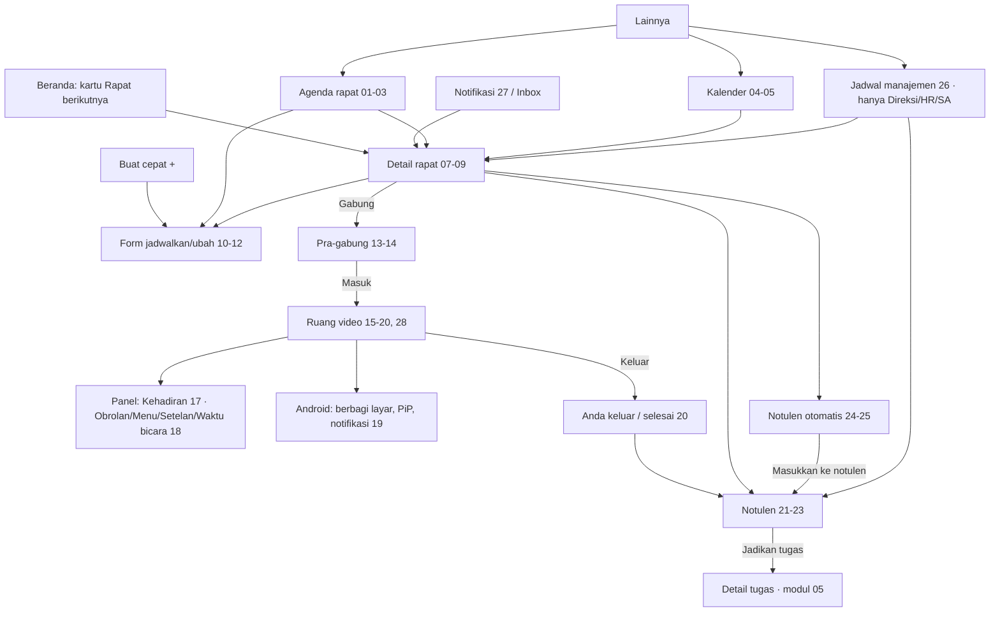

# Spesifikasi — Modul 08 · Rapat, kalender & video (Android)

> Mockup: `docs/mockups/android/screens/08-rapat-kalender-video/` (28 berkas HTML, 138 layar/`.phone`, terang + malam lewat `?tema=malam`; render → `png/08-rapat-kalender-video/`). Gaya tambahan bersama: `_rapat.css` (prefiks `.rp-`, token ruang video dari `docs/DESIGN.md` "Ruang rapat video"). Hari ini = **Selasa, 13 Okt 2026**; viewer utama Sari Wulandari (staf, notulis rapat contoh), Dimas Pratama (Kepala Divisi, penyelenggara), Hana (HR), Hendra (Direktur Utama, pengamat rapat pimpinan).
>
> Sumber: `apps/mobile/app/rapat/**`, `app/kalender.tsx`, `src/lib/rapat.ts`, `docs/sesi/ponsel.md` (kontrak API v1), `resources/js/features/meetings/**` (+ `video/**`, `notulen/**`), `docs/fitur/rapat-kalender.md` (§6a), `rapat-video.md`, `rapat-video-kontrak.md`, `notulen-otomatis-kontrak.md`, `docs/DATABASE.md` §7, paket desain `MRapat`, `MRapatDetail`, `MNotulen`, `MgPJadwal`, `MgPNotulen`, `MNotifRapat`.
>
> **Status aplikasi sekarang** (`apps/mobile`): agenda 3 rentang, detail + RSVP, notulen **baca-saja**, kalender list per bulan, video = buka browser. Selebihnya di mockup ini adalah **target** (tandai BELUM ADA di §3). Rapat adalah layar `Stack` di luar tab (dibuka dari Lainnya › Rapat/Kalender atau kartu "Rapat berikutnya" di Beranda), jadi **tanpa tab bar**; kembali = panah di `.bar-sub` / gestur sistem.

## 1. Inventaris layar

Peran: **S** staf/anggota · **K** Kepala Divisi/penyelenggara · **N** notulis · **P** peserta diundang · **D** Direksi/HR/Super Admin (pengamat rapat pimpinan, `dashboard.view_company`).

| Berkas | Layar (jumlah `.phone`) | Peran | Keadaan yang tercakup |
|---|---|---|---|
| `01-agenda-rapat.html` | Agenda rapat: segmented Hari ini/Minggu ini/Akan datang, strip hari, kartu "Rapat berikutnya" (hitung mundur, Gabung, Notulen), baris rapat (lencana platform, RSVP, notulen, seri), panel "Tindak lanjut untuk Anda", FAB Jadwalkan (1) | semua | normal, notulis |
| `02-agenda-keadaan.html` | Memuat (skeleton), kosong Hari ini, galat + Coba lagi, offline (data tersimpan), fitur mati (404), rapat sedang berlangsung (banner hangat) (6) | semua | memuat · kosong · galat · offline · tak tersedia · berlangsung |
| `03-agenda-akan-datang-filter.html` | Akan datang 30 hari per tanggal (seri, dibatalkan, rapat pimpinan), lembar filter, filter aktif + hasil kosong (3) | semua | filter · seri · dibatalkan |
| `04-kalender-minggu.html` | Kalender strip minggu + agenda hari (rapat, tenggat, terlambat, cuti disetujui), lapisan, banner Google Calendar ditahan; hari tanpa agenda + libur (2) | semua | kosong · libur |
| `05-kalender-bulan.html` | Grid bulan + titik per lapisan + agenda hari terpilih, lembar lapisan, memuat bulan lain, offline + galat, fitur mati (5) | semua | memuat · galat · offline · 404 |
| `06-titik-masuk-rapat.html` | Kartu "Rapat berikutnya" di Beranda, baris Rapat/Kalender di Lainnya, Buat cepat › Jadwalkan rapat, deep link ke rapat tak ditemukan (4) | semua | masuk · 404 |
| `07-detail-rapat-video.html` | Detail rapat video sebelum jendela gabung: status hitung mundur, kartu video, RSVP, agenda, peserta, kartu Notulen otomatis + opt-out, kartu Notulen (1, layar panjang) | N/P | belum dibuka |
| `08-detail-rapat-varian.html` | Penyelenggara berlangsung + "Hadir di rapat video"; Google Meet (tempel tautan); tatap muka; dibatalkan; pengamat rapat pimpinan (baca saja); selesai tanpa notulen (6) | K · P · N · D | varian platform/peran |
| `09-detail-rapat-aksi.html` | Lembar semua peserta + hitungan RSVP, menu aksi (ubah, salin, tambah ke kalender perangkat, bagikan, kemunculan seri, batalkan), dialog batalkan seri, pilih kemunculan, RSVP gagal (rollback), RSVP berhasil + Urungkan (6) | K · P | galat · konfirmasi destruktif |
| `10-form-jadwalkan-rapat.html` | Form Jadwalkan rapat lengkap: judul, tanggal, jam, durasi, tempat (5 pilihan), peserta + tamu email, agenda, notulis, ulangi, workspace, pengingat, notulen otomatis (1, layar panjang) | semua | form terisi |
| `11-form-keadaan.html` | Validasi (fokus galat pertama), bentrok + "Pakai 15.30" + tanpa slot, mode Ubah seri, Meet + tautan salah + video belum diatur, Rapat pimpinan (Direksi/HR), gagal kirim offline + buang perubahan (6) | semua · D | galat · offline · terkunci |
| `12-form-pemilih-sheet.html` | Pilih peserta (cari, centang, tamu email), Material DatePicker, Material TimePicker, Ulangi, pilih workspace, ringkasan sebelum kirim, terkirim + snackbar (7) | semua | sheet/dialog |
| `13-pra-gabung.html` | Pra-gabung: normal, notulis memilih sumber notulen, peserta biasa, ruang belum dibuka, sudah ditutup, tidak diundang/pengamat, 503 belum disiapkan, versi aplikasi lama (8) | N · P · D | belum dibuka · tutup · tanpa akses · terkunci |
| `14-pra-gabung-izin-perangkat.html` | Dialog izin runtime kamera, mikrofon, Bluetooth; izin ditolak (gabung mendengarkan / Buka Pengaturan); kamera dipakai aplikasi lain; lembar mikrofon & kamera + hemat data (6) | semua | izin · galat |
| `15-ruang-video-portrait.html` | Ruang potret: tab Video (sorotan + petak kecil + subtitle), tampilan Petak, tab Notulen hidup (kolaboratif, kursor rekan), presentasi layar (4) | semua | sorotan · petak · presentasi |
| `16-ruang-video-lanskap.html` | Lanskap imersif: sorotan + panel Notulen, presentasi + panel Peserta, petak 4×2 tanpa panel, panel Obrolan (4) | semua | lanskap |
| `17-ruang-kehadiran-moderasi.html` | Panel Kehadiran (penyelenggara / notulis / peserta), menu aksi peserta (Bisukan, Sematkan, Keluarkan), konfirmasi keluarkan, daftar Dikeluarkan + Izinkan masuk lagi + batas Panggil 429 (6) | K · N · P | hak per peran |
| `18-ruang-panel-obrolan-menu.html` | Obrolan, menu ⋯, Setelan perangkat & transkrip (opt-out), Waktu bicara, angkat tangan + toast, navigator Bagian notulen (6) | semua | panel |
| `19-ruang-sistem-android.html` | Izin MediaProjection (berbagi layar), banner "Anda membagikan layar", notifikasi layanan latar depan (Bisukan/Kembali/Keluar), Picture-in-Picture, telepon masuk (mikrofon dijeda), baterai rendah (6) | semua | fitur sistem |
| `20-ruang-keadaan.html` | Menyambung (memuat), menyambungkan ulang, jaringan lemah, offline, server rapat tak terjangkau (UDP/443), dikeluarkan, rapat dibatalkan, konfirmasi keluar, "Anda keluar", rapat selesai (10) | semua | semua keadaan jaringan/akses |
| `21-notulen-draf.html` | Notulen draf (notulis): kehadiran, catatan per agenda, keputusan, tindak lanjut, Finalkan & bagikan (1, layar panjang) | N · K | tulis |
| `22-notulen-keadaan.html` | Final (terkunci, centang PIC, Ingatkan PIC, Buka kembali), baca-saja peserta, belum dimulai, riwayat versi, daftar masalah + konfirmasi finalkan, offline/belum tersimpan, sheet kehadiran (7) | N · K · P | final · baca-saja · galat · offline |
| `23-notulen-tindak-lanjut.html` | Tambah tindak lanjut, Jadikan tugas (pilih workspace), hasil Jadikan semua tugas, tanpa hak ubah tugas, PIC mencentang miliknya + Ingatkan PIC (5) | N · P | sheet · galat |
| `24-notulen-otomatis.html` | Review draf AI (Draf/Transkrip), Mentranskrip, Gagal/AI tidak aktif, konfirmasi Masukkan ke notulen, Buang draf, sudah dimasukkan, status saja untuk non-notulis (8) | N · K · P · D | proses · gagal · terkunci |
| `25-kartu-notulen-otomatis.html` | Kartu Notulen otomatis di detail: belum disiapkan, nyalakan (penyelenggara), Merekam + opt-out, Siap, tolak sesudah rapat (dampak), Gagal (6) | K · N · P | per status |
| `26-jadwal-manajemen.html` | `/manajemen/jadwal`: Agenda, Notulen (filter), Tindak lanjut (Terlambat/Berjalan/Selesai), 403, kosong, memuat+offline (6) | D | baca-saja · 403 · kosong |
| `27-notifikasi-rapat.html` | Sheet "Mulai 5 menit lagi", heads-up Android, bayangan notifikasi berkelompok, jadwal berubah/dibatalkan, kanal sistem "Rapat", pengaturan notifikasi Rapat (6) | semua | notifikasi |
| `28-ruang-video-tablet.html` | Ruang tablet 834 px: video + notulen berdampingan (1) | semua | tablet |

## 2. Peta navigasi

Aturan akses yang tampil: rapat tak terlihat → 404 ("Rapat tidak ditemukan"); pengamat rapat pimpinan hanya baca (tanpa RSVP, tanpa gabung video, notulen otomatis hanya status); `/manajemen/jadwal` untuk non-Direksi/HR/SA → 403; staf tidak punya sakelar Rapat pimpinan.

## 3. Pemetaan layar → endpoint API

Kontrak `docs/sesi/ponsel.md`; rute web `routes/meetings.php`. **ADA** = sudah di `routes/api.php` v1; **BELUM ADA** = ada di web, belum diekspos ke API v1 (perlu presenter tipis di atas Action/Policy yang sama).

| Layar | Endpoint | Status |
|---|---|---|
| Agenda 01-03 | `GET /rapat?rentang=hari-ini\|minggu-ini\|akan-datang` | **ADA** (filter peran/platform/belum dijawab dilakukan di klien dari baris yang ada) |
| Kalender 04-05 | `GET /kalender?bulan=YYYY-MM` | **ADA** (entri flat per `layer`; lapisan disaring klien) |
| Detail 07-09 | `GET /rapat/{id}?tanggal=` | **ADA** (`video` hanya `join_href`, tanpa `attendance`/`in_room`/`opens_at` hitung orang; **BELUM ADA** `video.attendance`, `in_room`, `not_joined`, `notulen` ringkasan notulen otomatis) |
| RSVP | `POST /rapat/{id}/kehadiran` `{rsvp}` | **ADA** |
| Notulen baca | `GET /rapat/{id}/notulen?tanggal=` | **ADA** |
| Buat/ubah/batalkan 10-12 | `POST /rapat`, `PATCH /rapat/{id}`, `DELETE /rapat/{id}` | **BELUM ADA** |
| Bentrok jadwal 11 | `GET /rapat/bentrok` | **BELUM ADA** |
| Pemilih peserta, workspace, notulis 12 | daftar orang/workspace terlihat (people picker) | **BELUM ADA** (`GET /workspace` ada, tanpa filter "bisa ubah tugas") |
| Notulen tulis/final 21-23 | `PUT /rapat/{id}/notulen`, `POST …/notulen/final`, `POST …/notulen/buka`, `GET …/notulen/data`, `POST …/notulen/menyunting` | **BELUM ADA** |
| Tindak lanjut | `POST/PATCH/DELETE /rapat/{id}/tindak-lanjut`, `POST …/notulen/tugas`, `POST …/notulen/ingatkan` | **BELUM ADA** |
| Notulen kolaboratif (Yjs) | `GET …/notulen/kolaborasi` + server Hocuspocus | **BELUM ADA** (lihat §7 keputusan 3) |
| Pra-gabung / token | `POST /rapat/{id}/video/token` (JWT LiveKit 10 menit), `POST …/video/sumber-notulen` | **BELUM ADA** |
| Ruang video | LiveKit (WebRTC) + `POST …/video/tangan`, `…/video/atribut`, `GET/POST …/video/bicara`, `GET …/video/kehadiran`, `POST …/video/panggil/{user}`, `POST …/video/peserta/{u}/bisukan`, `DELETE …/video/peserta/{u}` (+ `/larangan` = Izinkan masuk lagi) | **BELUM ADA** semua |
| Realtime | kanal privat `meeting.{id}` (Reverb: `speaking.updated`, `participant.called`, `minutes.updated`, `attendance.updated`, `participant.readmitted`, `minutes.editing`) | **BELUM ADA** untuk klien ponsel (polling 15–30 detik bila tanpa realtime sesuai kontrak) |
| Notulen otomatis 24-25 | `GET …/notulen-otomatis/status`, `…/transkrip`, `PUT …/pengaturan`, `PUT …/persetujuan`, `POST …/masukkan`, `DELETE …/draf`, `POST …/ringkas-ulang`, `POST …/tindak-lanjut/{id}/tugas` | **BELUM ADA** |
| Jadwal manajemen 26 | `GET /manajemen/jadwal` | **BELUM ADA** |
| Notifikasi 27 | `meeting.invited`, `meeting.starting`, `meeting.called`, `minutes.finalized`, `action_item.due` lewat Inbox API (modul 10) + push FCM `PUT /perangkat/{device}/push-token` | Inbox **ADA**; push **BELUM ADA** (belum ada kanal push) |

## 4. Kemampuan khas Android yang dipakai

| Kemampuan | Dipakai di | Catatan |
|---|---|---|
| Izin runtime kamera, mikrofon (`CAMERA`, `RECORD_AUDIO`), Bluetooth Android 12+ (`BLUETOOTH_CONNECT`) | 14 | Diminta saat pertama masuk pra-gabung, bukan saat aplikasi dibuka. "Hanya kali ini"/ditolak dua kali → banner + **Buka Pengaturan aplikasi** (`Linking.openSettings`), tetap bisa gabung mendengarkan |
| Berbagi layar (`MediaProjection`) | 19 | Perlu layanan latar depan bertipe `mediaProjection`; dialog sistem bawaan Android; banner merah "Anda membagikan layar" + Berhenti |
| Layanan latar depan rapat + notifikasi tetap | 19 | Kanal "Rapat" (penting); aksi Bisukan, Kembali ke rapat, Keluar; menjaga audio saat aplikasi di latar |
| Picture-in-Picture | 19 | Masuk otomatis saat Home ditekan di ruang video; kontrol Mic, Keluar |
| Heads-up / bayangan notifikasi berkelompok, kanal notifikasi | 27 | `meeting.starting` (aksi Gabung/Lihat detail), "Rapat sudah dimulai — Gabung", undangan, jadwal berubah, notulen final, tindak lanjut jatuh tempo; izin `POST_NOTIFICATIONS` (Android 13+, modul 12) |
| Intent kalender (`CalendarContract`) | 09 | "Tambahkan ke kalender perangkat" lewat intent tanpa izin baca-tulis kalender |
| Gestur kembali sistem, layar tetap menyala (keep-awake), rotasi hanya di ruang video | 15-20 | Lanskap hanya di ruang video (imersif, bilah sistem disembunyikan); layar lain terkunci potret |
| Pemilih tanggal/jam Material (DatePickerDialog/TimePicker) | 12 | Pengganti `DateInput` web; format tampil "Rab, 14/10/2026", simpan `YYYY-MM-DD` |
| Rute audio (speaker/earpiece/Bluetooth), telepon masuk menjeda mikrofon | 14, 19 | `AudioManager`/`InCallManager`; mikrofon dijeda otomatis saat panggilan GSM |
| Hemat data seluler | 14, 18 | Video diterima 360p; adaptiveStream tetap aktif |
| Salin tautan (clipboard), berbagi | 09, 25 | `expo-clipboard`, `Share` |

Gerak (anotasi): sheet naik 180 ms `ease-brand`; tab Video↔Notulen geser 180 ms; ubin pembicara aktif memakai cincin teal (tanpa animasi pada reduced motion); loop "menyambung" berhenti di frame diam bila reduced motion; toast angkat tangan/panggil 120 ms masuk, 4 detik tampil.

## 5. Matriks keadaan

| Keadaan | Wujud |
|---|---|
| Memuat | skeleton agenda/kalender/jadwal (02, 05, 26), "Menyambung ke ruang rapat…" (20), status Mentranskrip dengan progres (24) |
| Kosong | agenda hari kosong (02), hari tanpa agenda (04), notulen belum dimulai (22), tidak ada rapat pimpinan (26), hasil filter kosong (03) |
| Galat | agenda/kalender gagal + Coba lagi (02, 05), RSVP gagal rollback (09), validasi form per isian (11), kirim gagal (11), server rapat tak terjangkau UDP/443 (20), transkripsi gagal + Ringkas ulang (24, 25) |
| Offline | banner "Tanpa koneksi" + data tersimpan (02, 05, 26); form menahan isian; notulen mengantre ke perangkat (22); gabung video butuh jaringan (20); aksi tulis dinonaktifkan |
| Terkunci / tanpa akses | rapat 404, 403 jadwal manajemen, pengamat rapat pimpinan baca saja, dikeluarkan penyelenggara, ruang belum dibuka/ditutup, tanpa hak ubah tugas (08, 13, 20, 23, 26) |
| Baca-saja | notulen final, draf untuk peserta, pengamat pimpinan, jadwal manajemen (08, 22, 26) |
| Fitur dimatikan (`features.meetings` 404) | "Rapat/Kalender belum diaktifkan" (02, 05) |
| Platform tak didukung | "Perbarui aplikasi untuk rapat video" + buka browser (13) |

Aturan produk yang ditegakkan: staf tanpa saldo cuti (cuti di kalender hanya yang disetujui, bukan saldo); tanpa struktur organisasi; tidak ada skor produktivitas (Waktu bicara berlabel "bukan penilaian kinerja"); tamu eksternal belum melihat apa pun; Google Meet/Calendar otomatis & WhatsApp ditahan (label "Ditahan"); jenis pengajuan terkunci tidak relevan di modul ini.

## 6. Catatan implementasi Expo

- **Sudah ada di `apps/mobile`**: `Screen`, `Card`, `Badge`, `Segmented`, `EmptyState`, `ErrorState`, `Loading`, `Meta`, `Button` (`src/components/ui.tsx`); `agendaRapat`/`detailRapat`/`rsvpRapat`/`notulenRapat`/`kalenderBulan` (`src/api/endpoints.ts`); `LABEL_RSVP`/`TONE_*`/`labelPengulangan` (`src/lib/rapat.ts`); `KameraSelfie` (pola `expo-camera` untuk pratinjau). Perlu ditambah: strip hari + kisi bulan (`CalendarGrid`), `BottomSheet` bersama (modul 13), picker tanggal/jam (`@react-native-community/datetimepicker`), `PeoplePicker`.
- **Pustaka baru untuk video native** (butuh *development build*/EAS, bukan Expo Go): `@livekit/react-native` + `react-native-webrtc` + `@livekit/react-native-expo-plugin`, `expo-keep-awake`, `expo-notifications` (FCM), `react-native-pip-android` atau modul PiP kecil, `expo-av`/`InCallManager` untuk rute audio. Peringatan ukuran APK (+±25 MB) dan `minSdk 24`.
- **Alur token**: `POST …/video/token` → `{url, token, room, identity}`; klien tersambung langsung ke LiveKit (`wss://livekit.spkd.store`), menyambung ulang minta token baru; nama/avatar peserta dari `room.people` menurut `identity` (jangan percaya nama peserta LiveKit). Atribut sendiri hanya lewat `POST …/video/tangan`/`atribut` (token tanpa `canUpdateOwnMetadata`).
- **Waktu bicara**: akumulasi lokal `isSpeaking` peserta lokal, laporkan tiap 15 detik (juga 0) dan saat keluar dengan `fetch(..., {keepalive:true})`; mulai dari `mine_ms` server.
- **Subtitle**: terima text stream `lk.transcription` hanya dari `rk-notulen`; tampil bila `features.subtitles` atau datang; tombol hanya bila ada.
- **Notulen hidup**: ponsel tidak menjalankan Tiptap+Yjs asli. Usulan: mode *autosave* per bagian (`TextInput`, simpan 1 detik setelah berhenti, petunjuk "X sedang menyunting" dari `POST …/notulen/menyunting`) dan mode kolaboratif lewat `WebView` editor Catatan bersama (modul 07) bila `features.collab_minutes`. Notulen bagian ruang = `minutes.doc.sections` + `decisions` (kontrak §1.4).
- **Realtime**: Pusher/Reverb client RN untuk kanal `meeting.{id}` (setelah modul 09 memutuskan klien Echo); tanpa itu polling sesuai kontrak (§5 kontrak).
- **Rotasi**: `expo-screen-orientation` membuka potret+lanskap hanya di rute `rapat/[id]/ruang`; `StatusBar` & navigasi sistem disembunyikan (`expo-navigation-bar`) di lanskap.
- **Bagikan layar**: modul MediaProjection + layanan latar depan `FOREGROUND_SERVICE_MEDIA_PROJECTION`; izinkan hanya satu sharer; banner merah wajib.
- **Hak per peran di ruang** (`room.can`): `moderate` (penyelenggara) = Bisukan/Keluarkan/Izinkan masuk lagi; `call_participants` (notulis/penyelenggara) = Panggil (1× per menit per orang, tampilkan `retry_after`); `edit_minutes` per mode.

## 7. Pertanyaan / keputusan untuk pemilik

1. **Video native atau tetap browser?** Mockup mengasumsikan ruang video **native** (LiveKit RN) karena ponsel adalah perangkat rapat utama. Alternatif bertahap: tahap A tetap membuka `/rapat/{id}/gabung` di browser (sekarang); tahap B native. Native membutuhkan development build, token endpoint API v1, dan foreground service.
2. **Bagikan layar dari ponsel** perlu foreground service + banner permanen. Apakah dibuka untuk semua peserta atau hanya penyelenggara/notulis?
3. **Notulen hidup di ponsel**: cukup mode autosave satu penyunting (sederhana), atau wajib kolaboratif (Yjs lewat WebView)? Rekomendasi: autosave dulu.
4. **Jadwalkan/ubah rapat dari ponsel** (form 10-12): masuk rilis berikutnya atau tetap web-only sambil ponsel baca + RSVP? Saat ini ponsel hanya baca + RSVP.
5. **Push notifikasi (FCM)** untuk `meeting.starting` dan "Rapat sudah dimulai — Gabung" — perlu FCM + `PUT /perangkat/{device}/push-token`. Tanpa push, pengingat hanya muncul saat aplikasi terbuka.
6. **Notulen otomatis**: opt-out (sekarang) atau opt-in; di ponsel kartu persetujuan wajib terlihat sebelum masuk (dipertahankan). Dasar hukum penyedia AI di luar Indonesia (privasi §10) masih terbuka.
7. **Orientasi**: izinkan lanskap hanya di ruang video (usulan) atau juga di layar lain (modul 12, tablet/lipat)?
8. **Layar menyala & baterai**: keep-awake otomatis selama di ruang; apakah perlu peringatan baterai ≤ 15 % (mockup 19) atau cukup sistem?
9. **Pembatalan satu kemunculan seri** dan **pemulihan versi notulen** belum ada di web; mockup hanya menandai "belum tersedia".
10. **Tamu eksternal** (email) belum melihat apa pun; tidak ada layar tamu di ponsel.
11. **Tab bar di layar rapat**: mockup mengikuti kode (Stack tanpa tab bar). Tetap seperti itu, atau tampilkan tab bar di agenda/kalender (seperti web PLATFORM)?

## 8. Celah yang ditemukan (web → ponsel)

| Fitur web | Wujud ponsel di mockup | Catatan |
|---|---|---|
| Tampilan minggu grid jam + baris Sehari, grid bulan padat dengan "+N lainnya" | strip minggu 7 hari + agenda; bulan dengan titik per lapisan | sesuai `docs/PLATFORM.md` §2 "Kalender" |
| Jadwal manajemen grid jam 08–17 | daftar agenda per hari (26) | grid hanya desktop |
| Form jadwal: kartu bentrok `GET /rapat/bentrok` | kartu bentrok + "Pakai 15.30" (11) | API belum ada |
| Pintasan keyboard ruang rapat | tidak berlaku | diganti kontrol sentuh |
| Chat/obrolan ruang rapat tidak disimpan | lembar Obrolan (18) | LiveKit data channel |
| "Panggil" peserta | tersedia notulis/penyelenggara (17) | perlu push agar efektif |
| Izin kamera di browser | dialog izin runtime Android (14) | baru di ponsel |
| Picture-in-Picture, layanan latar depan, rute audio Bluetooth | 19, 14 | khas Android |
| Mode kolaborasi Yjs | autosave per bagian + opsi WebView | lihat §7(3) |
| Pembatalan satu kemunculan, lampiran Drive di rapat, "kabari terlambat" | tidak ada | belum ada di web |
| Ekspor notulen ke Google Docs, Google Calendar/Meet otomatis, WhatsApp | label "Ditahan" | keputusan pemilik |

**Kebutuhan kit** (untuk modul 13, tanpa mengubah `_kit/`): komponen `Dialog izin runtime Android` (diimplementasikan lokal `.rp-os`), token ruang video (`--room-*`, `--caption*`) diperlukan di katalog, `.btn.danger` mode malam berkontras rendah (putih di atas `--bad` pastel; ditimpa lokal ke #C42137), varian `.fab` tanpa tab bar (`bottom:44px`), opsi `.phone` lanskap (`--w:915px;--h:412px`, tanpa status bar/gesture bar) dan `.sb` disembunyikan (dipakai berkas 16), `A(…)` avatar `sm`.
