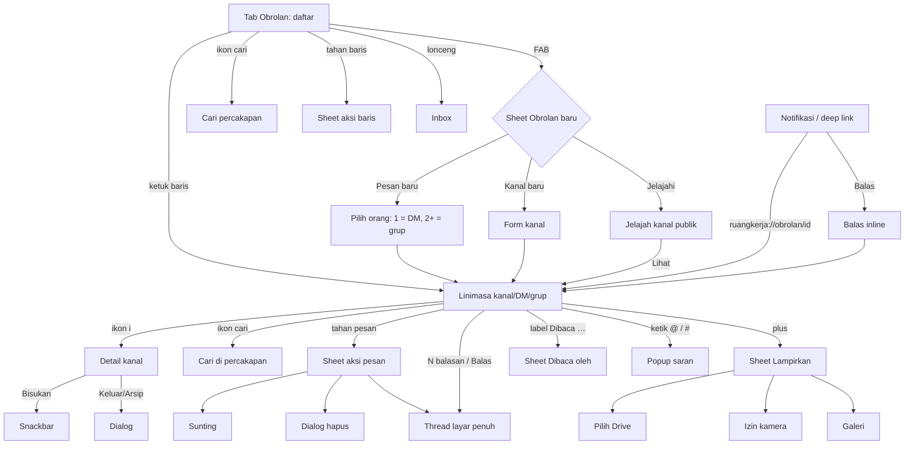

# Spesifikasi mockup Android — Modul 09 · Obrolan

> Sumber: `apps/mobile/app/(tabs)/obrolan.tsx`, `apps/mobile/app/obrolan/[id].tsx`, `resources/js/features/chat/**`, `docs/fitur/obrolan.md`, `docs/DATABASE.md` §7, `docs/PLATFORM.md` §2.1/§3/§6, kontrak API v1 di `docs/sesi/ponsel.md`, `routes/chat.php`, `routes/api.php`, `ChannelPolicy`/`MessagePolicy`, `ChatInbox`.
> Berkas layar: `docs/mockups/android/screens/09-obrolan/` (24 berkas HTML, 81 layar; render `png/09-obrolan/` terang & malam = 162 PNG, tidak di-commit). Hari ini = Sel, 13 Okt 2026; pengguna = Sari Wulandari (staf, anggota PLQ/GDG/PRG).

## 1. Inventaris layar

| Berkas | Layar (urutan `.phone`) | Peran yang melihat | Keadaan tercakup |
|---|---|---|---|
| `01-daftar-obrolan` | 1 daftar Semua (seksi Workspace · Kanal publik · Kanal privat, badge belum dibaca, ikon bisu, "Belum bergabung", FAB "Obrolan baru", lonceng Inbox) · 2 filter Belum dibaca · 3 sheet aksi baris (tahan lama: tandai dibaca, bisukan, detail) | semua karyawan | normal, terfilter, aksi baris |
| `02-daftar-gulir-penuh` | daftar penuh 5 seksi (Workspace, Kanal publik, Kanal privat, Pesan langsung, Grup) | semua | layar panjang |
| `03-cari-percakapan` | 1 hasil (Percakapan + Pesan lintas kanal, disorot) · 2 tanpa hasil · 3 kolom cari + keyboard + "Terakhir dicari" | semua | cari, kosong, keyboard |
| `04-daftar-keadaan` | memuat (skeleton) · kosong · galat muat · offline (daftar cache + banner, FAB nonaktif) · flag `FEATURE_CHAT` mati ("Obrolan belum diaktifkan") | semua | memuat/kosong/galat/offline/terkunci |
| `05-obrolan-baru` | 1 sheet "Obrolan baru" (Pesan baru · Kanal baru · Jelajahi kanal) · 2 pilih orang, 1 dipilih = DM · 3 tiga dipilih = grup (nama otomatis) · 4 melebihi 9 orang · 5 form Kanal baru (fokus, pratinjau `#slug`, privat, undang) · 6 form galat (nama pendek, gagal jaringan) | semua | fokus, galat, validasi |
| `06-jelajah-kanal-publik` | 1 daftar kanal publik (belum/sudah bergabung) · 2 pratinjau kanal belum bergabung (banner "Gabung kanal") · 3 sesudah gabung (snackbar) · 4 kosong | semua | gabung, kosong |
| `07-linimasa-kanal-workspace` | linimasa PLQ: nama penulis + peran, pemisah hari, mention, rujukan tugas, kartu lampiran Drive, reaksi, ringkasan thread, disunting, "Pesan ini dihapus" | anggota workspace | utama |
| `08-linimasa-dm` | linimasa DM: tanpa nama penulis, centang terkirim/dibaca/menunggu, "sedang mengetik…" | 2 peserta | DM |
| `09-linimasa-varian` | 1 pemisah "belum dibaca" + pil "2 pesan baru ↓" · 2 tombol lompat ke terbaru (jauh dari bawah) · 3 "Muat sebelumnya" + skeleton · 4 indikator mengetik (header + baris) · 5 baca-saja (Direksi bukan anggota) | anggota / Direksi-HR-Super Admin | tanda baru, paging, baca-saja |
| `10-linimasa-diarsipkan` | kanal diarsipkan (banner + komposer terkunci) | semua yang melihat | terkunci |
| `11-composer-keyboard` | 1 keyboard terbuka (layout: bilah tulis di atas IME, tab bar tidak ada) · 2 pemilih @mention · 3 pemilih #rujukan tugas · 4 pesan multibaris + penghitung 214/20.000 | anggota | keyboard, saran |
| `12-lampiran` | 1 sheet Lampirkan (Drive · Kamera · Galeri) · 2 pilih file Drive (maks. 10) · 3 dialog izin kamera Android · 4 chip lampiran terpilih · 5 galat lampiran (terlalu besar, maks. 10) + progres unggah | anggota | izin runtime, galat, progres |
| `13-kirim-gagal` | 1 limiter 429 · 2 gagal terkirim offline (Coba lagi/Hapus) · 3 mengirim · 4 pesan > 20.000 karakter · 5 dialog bukan anggota lagi | anggota | 429, offline, validasi, 403 |
| `14-aksi-pesan` | 1 sheet pesan orang lain (8 reaksi, Balas di thread, Salin) · 2 sheet pesan sendiri (+ Sunting, Hapus) · 3 dialog Hapus pesan? · 4 mode sunting (bilah konteks, tombol centang) · 5 hapus sebagai admin kanal | anggota / admin kanal | aksi, destruktif, sunting |
| `15-thread` | 1 thread layar penuh (akar + 3 balasan) · 2 tanpa balasan · 3 akar dihapus, balasan tetap · 4 mengetik + keyboard | anggota | thread |
| `16-cari-di-percakapan` | 1 hasil disorot 2/2 + panah · 2 tanpa hasil + "Cari di pesan lebih lama" · 3 mengetik + keyboard | anggota | cari |
| `17-detail-kanal-workspace` | detail kanal workspace: topik, Cari pesan, Buka workspace, bisukan, anggota (online/peran), file Drive dibagikan | anggota | detail (layar panjang) |
| `18-detail-kanal-varian` | 1 detail DM · 2 detail grup (anggota; ubah nama/tambah anggota nonaktif) · 3 kanal privat sebagai admin (tambah anggota, arsipkan, keluar) · 4 dialog Keluar dari kanal? | peserta / admin | varian jenis kanal |
| `19-status-baca` | 1 grup + label "Dibaca Maya, Rizky +1" · 2 sheet "Dibaca oleh" · 3 DM + pemisah "Maya membaca sampai sini" | peserta | status baca |
| `20-keadaan-percakapan` | memuat · kosong ("Belum ada pesan") · galat muat · offline (komposer terkunci) · 404 "Obrolan tidak ditemukan" | anggota / bukan anggota | memuat/kosong/galat/offline/404 |
| `21-koneksi-dan-sinkron` | 1 tarik untuk menyegarkan · 2 "Menyambung kembali…" · 3 "Tersambung kembali" + pil pesan baru · 4 daftar saat server tidak tersedia (banner coba ulang) | semua | polling/reconnect |
| `22-notifikasi-obrolan` | 1 heads-up DM (Balas · Tandai dibaca) · 2 bayangan notifikasi berkelompok per percakapan · 3 balas dari notifikasi (RemoteInput + keyboard) · 4 hasil balas / balasan gagal · 5 mention (juga di kanal dibisukan) | penerima | notifikasi |
| `23-pengaturan-notifikasi-obrolan` | 1 pengaturan (DM/grup, mention terkunci, kanal dibisukan) · 2 snackbar dibisukan + Urungkan | semua | preferensi |
| `24-tablet-dua-panel` | tablet 834 px: Rail + daftar 316 px + percakapan | semua | tablet/lipat |

## 2. Peta navigasi

Gestur kembali sistem: menutup sheet/keyboard/pencarian dulu, baru layar. Tab bar disembunyikan di linimasa (layar tumpukan di luar `(tabs)`, sama seperti `app/obrolan/[id].tsx`).

## 3. Pemetaan layar → endpoint API

Kontrak v1 saat ini (`routes/api.php`, `docs/sesi/ponsel.md`): empat endpoint obrolan. Rute web (`routes/chat.php`) lebih lengkap tetapi memakai sesi + Inertia, belum tersedia untuk token.

| Kebutuhan layar | Endpoint | Status |
|---|---|---|
| Daftar kanal (nama, jenis, belum dibaca, pratinjau, `can_post`, `can_manage`, `members.last_read_message_id`, `muted`) | `GET /api/v1/obrolan/kanal` | **ADA** |
| Linimasa (30/halaman, `?sebelum=`, balasan thread ikut, `penulis.nama`, `reactions`, `tasks`, `has_more`) | `GET /api/v1/obrolan/kanal/{id}/pesan` | **ADA** |
| Kirim pesan teks polos | `POST /api/v1/obrolan/kanal/{id}/pesan` `{body}` (limiter `messages` 60/mnt; 429 → pesan Indonesia) | **ADA** (tanpa `parent_id`, lampiran, id mention) |
| Tandai kanal dibaca | `POST /api/v1/obrolan/kanal/{id}/dibaca` | **ADA** (sudah ada di rute; dipakai `tandaiKanalDibaca`) |
| Status baca per orang ("Dibaca oleh") | turunan klien dari `members[].last_read_message_id` + daftar nama | **ADA** untuk pointer; **BELUM ADA** daftar nama anggota |
| Thread (lihat) | turunan klien dari balasan (`parent_id`) di linimasa yang sama | **ADA** |
| Balas di thread | `POST …/pesan` + `parent_id` | **BELUM ADA** |
| Sunting / hapus pesan | web `PATCH/DELETE /obrolan/pesan/{id}` | **BELUM ADA** di API |
| Reaksi (8 emoji tetap) | web `POST /obrolan/pesan/{id}/reaksi` | **BELUM ADA** di API |
| Mention @ (saran orang + id agar notifikasi mention terkirim) | web memakai `people` dari `ChatInbox::people` + dokumen Tiptap | **BELUM ADA** (API menerima string; `@Nama` tidak jadi mention) |
| Rujukan #tugas (saran) | web `GET /obrolan/rujukan/tugas` | **BELUM ADA** di API |
| Lampiran Drive | web `POST …/pesan` `attachments[]` + `GET /obrolan/{id}/file-drive` | **BELUM ADA** di API |
| Lampiran kamera/galeri (unggah file) | — | **BELUM ADA** (web pun belum; `docs/fitur/obrolan.md` §7) |
| Buat DM/grup | web `POST /obrolan/langsung` `{user_ids}` (maks. 9 orang, DM dipakai ulang lewat `direct_key`) | **BELUM ADA** di API |
| Buat kanal | web `POST /obrolan` `{name, topic, private, member_ids}` | **BELUM ADA** di API |
| Jelajah kanal publik | daftar kanal sudah memuat semua kanal publik (`ChatInbox::listed`); pembeda "belum bergabung" = tidak ada baris `members` milik pengguna | **ADA** (turunan klien) |
| Gabung kanal publik | implisit: pesan pertama menggabungkan (`PostMessage`); tombol "Gabung" eksplisit | implisit **ADA**; eksplisit **BELUM ADA** (usulan `POST …/gabung`) |
| Bisukan kanal | web `PUT /obrolan/{id}/bisu` | **BELUM ADA** di API |
| Cari pesan di dalam kanal | klien saja (pesan yang sudah dimuat); server **BELUM ADA** | sebagian |
| Cari pesan lintas kanal | — | **BELUM ADA** (web juga belum di ⌘K) |
| Keluar / arsipkan kanal, ubah nama grup, tambah anggota | — | **BELUM ADA** (web juga belum; "backlog ubah/arsip channel") |
| Mengetik & online (presence) | Reverb `chat.{id}` whisper + presence `chat-online.{company}` | **BELUM ADA** untuk aplikasi (v1 polling, tanpa WebSocket) |
| Push notifikasi (FCM) & balas inline | notifikasi `chat.message`/mention sudah dikirim in-app + email; kanal FCM | **BELUM ADA** (FCM/Play Console masih di roadmap) |
| Deep link `ruangkerja://obrolan/{kanal}` | skema sudah dipakai modul lain; rute `obrolan/[id]` ada | **ADA** (perlu parameter `pesan` untuk lompat) |
| Nama tampilan DM/grup | `members` hanya `user_id`; butuh daftar orang | **BELUM ADA** (aplikasi kini menampilkan "Pesan langsung · n orang") |

Perilaku server yang sudah dipakai mockup: kanal privat/DM/grup non-anggota = 404 (`ChannelPolicy::view`); Direksi/HR/Super Admin pada kanal workspace non-anggota = baca saja (`post` → 403 "Hanya anggota workspace yang dapat mengirim pesan di sini."); kanal diarsipkan = 403 "Obrolan ini sudah diarsipkan dan hanya bisa dibaca."; `FEATURE_CHAT` mati = 404 di semua rute; tak ada Policy yang membuka DM/privat bagi Super Admin/HR/Direksi (banner privasi di detail DM).

## 4. Kemampuan khas Android yang dipakai

- **IME & layout keyboard**: `softwareKeyboardLayoutMode: "resize"` (app.json) + `KeyboardAvoidingView` (Android: `behavior="height"`) atau `react-native-keyboard-controller`; komposer menempel di atas IME, tab bar tak ada di linimasa (PLATFORM §4: tab bawah disembunyikan saat keyboard). Edge-to-edge: padding bawah = inset navigasi gestur.
- **Gestur**: tahan pesan = bottom sheet aksi (haptic ringan); *usulan*: geser pesan ke kanan = balas di thread; tahan baris daftar = sheet aksi baris; tarik-untuk-menyegarkan di daftar dan linimasa; gestur kembali sistem menutup sheet → keyboard → pencarian → layar.
- **Izin runtime**: kamera (lampiran foto; dialog sistem dimockup di `12-lampiran` #3) — hanya diminta saat pengguna memilih "Kamera"; galeri memakai pemilih foto sistem (tanpa izin). Notifikasi: `POST_NOTIFICATIONS` (Android 13+) diminta setelah login pertama (modul 01/12).
- **Notifikasi**: kanal notifikasi Android `obrolan_dm` (penting, heads-up), `obrolan_mention` (penting, bunyi walau kanal dibisukan), `obrolan_kanal` (default, tanpa heads-up). Gaya `MessagingStyle`, dikelompokkan per percakapan + ringkasan grup "Obrolan · RuangKerja"; aksi **Balas** (RemoteInput) dan **Tandai dibaca**; ketuk = deep link ke kanal. Notifikasi dihapus saat percakapan dibuka (sejalan dengan "selesai saat dibaca" di server). Pratinjau isi pesan di layar kunci mengikuti pengaturan sistem (keputusan pemilik, §8).
- **Berbagi/clipboard**: "Salin teks" ke clipboard sistem + snackbar "Teks disalin".
- **Tautan**: `ruangkerja://obrolan/{kanal}` (+ `?pesan={id}` untuk lompat ke pesan/mention); tautan Drive dibuka di aplikasi Google/Chrome Custom Tab.
- **Gerak (anotasi)**: sheet 180 ms `ease-brand`; pil "pesan baru ↓" fade+naik 120 ms; titik "mengetik" berdenyut dan berhenti di frame diam bila `reduce motion`; gelembung baru masuk tanpa animasi geser bila reduced motion.

## 5. Matriks keadaan

| Keadaan | Daftar | Linimasa | Thread | Detail kanal | Cari |
|---|---|---|---|---|---|
| Memuat | skeleton 7 baris (`04` #1) | skeleton gelembung (`20` #1) | skeleton akar+balasan | skeleton avatar + baris | indikator di kolom |
| Kosong | "Belum ada obrolan" + "Pesan baru" (`04` #2) | "Belum ada pesan" (`20` #2) | "Belum ada balasan" (`15` #2) | "File yang dibagikan: belum ada" | "Tidak ada hasil" (`03` #2, `16` #2) |
| Galat | "Obrolan gagal dimuat" + Coba lagi (`04` #3) | "Pesan gagal dimuat" + Coba lagi (`20` #3) | sama | snackbar + coba lagi | — |
| Offline | banner + cache + FAB nonaktif (`04` #4) | banner + komposer terkunci (`20` #4); pesan gagal bisa dicoba lagi (`13` #2) | idem | baca dari cache | cari di cache |
| Terkunci | `FEATURE_CHAT` mati (`04` #5) | arsip (`10`); baca-saja (`09` #5); bukan anggota lagi (`13` #5); 404 (`20` #5) | idem | tombol anggota nonaktif | — |
| Baca-saja | — | Direksi/HR/Super Admin bukan anggota workspace: komposer diganti pesan penjelasan; reaksi/lampiran/sunting tidak ada | idem | tanpa bisukan peran admin | boleh |
| 429 | — | pita "Terlalu banyak pesan terkirim" + hitung mundur (`13` #1); teks dipertahankan | idem | — | — |
| Realtime/koneksi | pita "Menyegarkan…" saat tarik | "Menyambung kembali…" → "Tersambung kembali" + pil (`21`) | idem | — | — |

## 6. Catatan implementasi Expo

- **Sudah ada di `apps/mobile`**: `Screen`, `Card`, `Segmented`, `Badge`, `Button`, `Input`, `EmptyState`, `ErrorState`, `Loading`, `Meta` (`src/components/ui.tsx`); `ApiError` (429/404 sudah ditangani di `[id].tsx`); polling 15 dtk hanya saat fokus (`useFocusEffect`); `urutkanTimeline`/`gabungTimeline` (dedup, balasan di bawah akar); `ymdJakarta`, `tanggalDariYMD`, `waktuRelatif`, `jam` (`src/lib/format.ts`); palet workspace (`src/lib/palette.ts`).
- **Perubahan untuk mockup ini**: (1) daftar dikelompokkan per jenis (Workspace · Kanal publik · Kanal privat · Pesan langsung · Grup), urut pesan terbaru dalam seksi; (2) ubin kanal (huruf workspace bergradien, `#`, gembok, grup, avatar+presence DM) menggantikan ikon Ionicons; (3) header linimasa dengan ubin, subjudul anggota/mengetik, ikon cari & info; (4) gelembung dengan avatar di baris terakhir kelompok, nama + peran di pertama; pesan sendiri bergradien aksi; (5) pil "pesan baru ↓" + pemisah "belum dibaca" memakai `last_read_message_id` milik sendiri; (6) timeline memakai `FlatList inverted` (atau FlashList) agar posisi tetap saat pesan masuk dan keyboard muncul — menggantikan `ScrollView` + `scrollToEnd`.
- **Pustaka yang perlu ditambah (belum di `package.json`)**: `expo-notifications` (kanal, RemoteInput/aksi, deep link), `expo-clipboard`, `expo-image-picker` + `expo-document-picker` (lampiran kamera/galeri; tunggu endpoint unggah), `expo-haptics`, `react-native-gesture-handler` + `react-native-reanimated` (geser-untuk-balas, sheet), `@gorhom/bottom-sheet` atau komponen sheet sendiri. `expo-camera` & `expo-image-manipulator` sudah ada (kompres foto ≤ 300 KB seperti selfie). Alasan harus ditulis di ringkasan sprint (AGENTS.md).
- **Teks → dokumen**: API v1 menerima string; mention/rujukan butuh kontrak baru (kirim `body` Tiptap atau `mentions[]` + `task_refs[]`). Render isi pesan: gunakan `body_text` untuk pratinjau dan `body` Tiptap (mention, `PLQ-18`, tautan) bila endpoint sudah memberi `body_html`/dokumen tersanitasi (pola `body_html` di Tugas).
- **Target sentuh**: chip reaksi 32 px tampak → perluas `hitSlop` ke ≥ 44 px (bug terbuka web #3); baris daftar ≥ 72 px; tombol bilah komposer 48 px; ikon bilah header 44×48.
- **Aksesibilitas**: label baris daftar "Peluncuran Produk Q4, 3 belum dibaca"; gelembung dibaca sebagai "Rizky, 07.38, <isi>, 2 reaksi"; aksi pesan juga tersedia via `accessibilityActions` (TalkBack) selain tahan-lama; indikator mengetik `accessibilityLiveRegion="polite"`; status = ikon + teks.
- **Kinerja**: daftar paling banyak puluhan kanal (tanpa virtualisasi khusus), linimasa 30 pesan/halaman; polling 15 dtk dihentikan saat blur/latar belakang; gabungkan hanya halaman terbaru (sudah ada).

## 7. Kebutuhan kit

Tidak ada perubahan kit yang dipakai paksa. Gaya lokal berprefiks `ob-` (daftar baris, gelembung, komposer, keyboard tiruan, popup saran, notifikasi) ada di tiap berkas. Usul bagi kit bersama: komponen **keyboard Android tiruan** (`.ob-kb`), **gelembung pesan**, dan **kartu notifikasi Android** (`.ntf`) karena modul 07/08/10/12 kemungkinan membutuhkannya.

## 8. Pertanyaan & keputusan untuk pemilik

1. **Gabung kanal publik**: pertahankan perilaku web (pesan pertama = gabung otomatis) atau tambah tombol "Gabung" eksplisit (mockup `06` memakainya)? Eksplisit butuh endpoint baru.
2. **Nama grup**: skema mengunci `name` null untuk DM/grup (CHECK), sehingga grup dinamai otomatis "Maya, Rizky +1". Apakah grup boleh diberi nama? (butuh ubah skema + `docs/DATABASE.md`).
3. **Bisukan**: cukup hidup/mati seperti web, atau durasi (1 jam, sampai besok, selamanya)? Mockup memakai hidup/mati.
4. **Keluar/arsip kanal & tambah anggota** setelah dibuat: belum ada di web; masuk cakupan ponsel atau tunggu web?
5. **Pencarian pesan lintas kanal** (mockup `03` #1 menampilkannya sebagai usulan): perlu endpoint pencarian server (`search_vector` sudah ada). Dibangun sekarang atau ditunda?
6. **Isi pesan di notifikasi & layar kunci**: tampilkan isi (kenyamanan) atau "Pesan baru dari Maya" (privasi, lebih aman bagi data kantor)? Mockup menampilkan isi dengan catatan "ikuti pengaturan sistem".
7. **Antrean offline untuk pesan**: PLATFORM §2.1 butir 5 menunda antrean offline ke Fase 3; mockup `13` #2 hanya "Gagal terkirim · Coba lagi". Setuju?
8. **Lampiran dari kamera/galeri**: dikerjakan bersama endpoint unggah ke folder Drive workspace (belum ada di web) atau hanya Drive dulu?
9. **Waktu baca per orang** ("Dibaca pukul 08.01") tidak ada di data (hanya pointer pesan terakhir); cukup nama pembaca seperti di web?
10. **Badge tab Obrolan**: jumlah *kanal* belum dibaca (web `chatUnread`) — dipertahankan, bukan jumlah pesan?

## 9. Celah yang ditemukan (web ada, ponsel belum punya wujud/kontrak)

- Balasan thread, reaksi, sunting, hapus, bisukan, DM/grup/kanal baru, lampiran Drive, #rujukan, mention beridentitas, dan "sedang mengetik/online" ada di web tetapi **tidak ada di API v1** (tiga yang pertama paling mendesak karena sudah tampil di linimasa; saat ini aplikasi hanya membaca reaksi dan kirim teks).
- Nama tampilan DM/grup di daftar & header butuh daftar orang (kontrak hanya `user_id`).
- Titik "belum dibaca" kini bisa dibersihkan dari ponsel (`dibaca` sudah ada) — catatan lama di `docs/sesi/ponsel.md` ("tak pernah bersih") sudah usang; perlu diverifikasi di aplikasi.
- Tidak ada FCM; tanpa itu notifikasi obrolan hanya tampil in-app/email (modul 12).
- Web belum punya: arsip/ubah kanal, tambah anggota, pencarian server, unggah file langsung, pin pesan.
