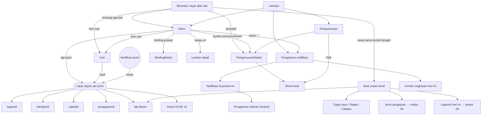

# Spesifikasi Android — Modul 10: Inbox, notifikasi & cari

> Modul 10 dari `docs/mockups/android/BRIEF.md`. Layar: `docs/mockups/android/screens/10-inbox-notifikasi-cari/` (21 berkas HTML, 87 layar `.phone`, 174 PNG terang + malam; gaya lokal `_inbox.css`). Tema malam lewat `?tema=malam`. Hari ini di semua layar: **Selasa, 13 Okt 2026**. Pemeran utama Inbox: Dimas Pratama (Kepala Divisi Operasional); varian staf: Sari Wulandari; pembuat pengumuman: Hana Nuraini (HR).
>
> Sumber: `apps/mobile/app/inbox.tsx`, `resources/js/features/{notifications,search,announcements}`, `resources/js/pages/{inbox,search,announcements}`, `app/Domain/Notifications/**` (`NotificationType`, `NotificationEvent`, `QuietHours`, `config/notifications.php`), `app/Domain/Search/**`, `routes/{notifications,announcements,api}.php`, PRD M6 & M9, `docs/DATABASE.md` §6, `docs/fitur/pengumuman.md`, `docs/sesi/ponsel.md`, `docs/mockups/png/mobile/{MInbox,MCari,MPengaturanNotifikasi}.png`, `docs/ruangkerja-design/screens/{MInbox,MQuickAdd,MSPengaturan}.dc.html`.

## 1. Inventaris layar

| Berkas | Nama | Peran yang melihat | Keadaan yang tercakup |
|---|---|---|---|
| `01-inbox-semua.html` | Inbox · Semua | semua karyawan (isi sesuai peran) | tab Semua/Perlu tindakan/Diarsipkan, chip jenis + Belum dibaca, grup hari ("HARI INI · 6 BARU"), titik belum dibaca, lencana "Perlu tindakan", footer retensi 30 hari |
| `02-inbox-staf.html` | Inbox · staf | staf (hanya `anggota`) | isi staf (penugasan, tenggat, laporan, revisi pengajuan, tanpa persetujuan/hiring/proyek); tab Perlu tindakan versi staf |
| `03-inbox-perlu-tindakan.html` | Inbox · Perlu tindakan | penyetuju, Kepala Divisi, HR, Direksi | 5 item aksi (persetujuan, barang, tenggat, keputusan Direksi, tindak lanjut rapat) |
| `04-inbox-swipe-pilih.html` | Gestur & aksi massal | semua | (1) geser kiri: Dibaca + Arsipkan, (2) mode pilih (CAB "3 dipilih" + bilah aksi), (3) snackbar "diarsipkan · URUNGKAN", (4) dialog "Tandai semua dibaca?" |
| `05-inbox-arsip-kosong.html` | Arsip & keadaan kosong | semua | Diarsipkan berisi (geser Kembalikan), Arsip kosong, Perlu tindakan kosong, **Semua beres**, Belum dibaca kosong |
| `06-inbox-memuat-galat.html` | Memuat, galat, offline | semua | skeleton, galat muat + Coba lagi, offline (salinan terakhir + snackbar), tarik-untuk-muat + muat halaman berikut, akhir daftar ("Itu saja untuk sekarang"), galat arsip (snackbar ULANGI) |
| `07-inbox-detail.html` | Detail & tujuan | semua | briefing.posted layar penuh (teks lengkap, "Informatif"), lembar detail notifikasi tanpa url, tujuan tidak tersedia (404/terkunci), banner "Tersedia di desktop" + Kirim tautan ke email |
| `08-inbox-katalog-jenis.html` | Katalog jenis (3 layar panjang) | semua | **semua 36 jenis** `NotificationType` dengan ikon, nada, konteks, lencana aksi, dan kunci tipe (mono, hanya di katalog) |
| `09-pengumuman-daftar.html` | Pengumuman · daftar | semua; pembuat melihat tab "Saya buat" + FAB | staf (tanpa tab/FAB, sorotan `?pilih=`, berakhir, ditutup), HR (Saya buat + hapus + FAB), kosong staf, kosong "Saya buat", memuat, galat |
| `10-pengumuman-detail.html` | Pengumuman · detail | penerima / pembuat | detail penerima (Tutup dari beranda), detail pembuat (Hapus), dialog hapus, pengumuman berakhir + snackbar tutup |
| `11-pengumuman-buat.html` | Pengumuman · buat (bottom sheet) | Direksi, HR, Super Admin, Kepala Divisi, Ketua Tim | awal (Semua karyawan, tombol nonaktif), Divisi + daftar centang, keyboard terbuka, galat validasi, pemilih "Tampil sampai" (dialog tanggal Material), varian Kepala Divisi, varian Ketua Tim, terbit sukses |
| `12-pengumuman-spanduk.html` | Spanduk di beranda | semua penerima | 1 spanduk, 3 spanduk ringkas + "Lihat semua (5)", snackbar setelah × |
| `13-cari-awal.html` | Cari · awal | semua | keyboard terbuka + riwayat + aksi cepat, tanpa keyboard (chips menempel di atas kolom cari), tanpa riwayat |
| `14-cari-hasil.html` | Cari · hasil | semua | hasil bergrup + sorotan kata, chip Tugas (20/halaman), Orang & Workspace, Catatan · Pengajuan · **Rapat** (celah, lihat §9) |
| `15-cari-keadaan.html` | Cari · keadaan | semua | memuat (skeleton), tidak ada hasil, kurang dari 2 huruf, galat, offline (riwayat + aksi saja), hasil dibatasi izin |
| `16-quick-add.html` | Buat cepat (sheet) | semua | grid 6 aksi + "Mulai notulensi cepat"; sudah check-in (→ Check-out, laporan terkirim); tanpa jadwal (Check-in nonaktif); offline |
| `17-quick-add-form.html` | Buat cepat · formulir mini | semua | Tugas baru (keyboard), Ajukan apa? (jenis cuti & lembur **terkunci**), Check-in (lanjut ke Absen), Rapat baru (celah API), snackbar sukses tugas, snackbar notulensi cepat, galat validasi |
| `18-notifikasi-pengaturan.html` | Pengaturan notifikasi (2 layar panjang) | semua | accordion event × kanal per grup (Tugas · Pengajuan · Absensi · Sistem · Informatif), kartu Ringkasan harian, Jam tenang, jeda saat cuti, tombol uji, indikator "Tersimpan otomatis" |
| `19-notifikasi-pengaturan-varian.html` | Pengaturan · keadaan | semua | baris terkunci (Selalu aktif), gagal simpan + rollback, dialog jam kirim, izin notifikasi Android belum diberikan + dialog izin runtime, memuat, galat muat, offline baca-saja, uji terkirim |
| `20-notifikasi-ponsel-ini.html` | Notifikasi di ponsel ini | semua | status izin + 9 saluran Android (kepentingan, status), izin ditolak, ikon launcher bertitik + pintasan, ikon berlencana angka |
| `21-ringkasan-harian-pratinjau.html` | Contoh ringkasan hari ini | semua | pratinjau berisi, pratinjau kosong ("tidak dikirim bila kosong") |

## 2. Peta navigasi

Pintu masuk Inbox mengikuti keputusan mobile-first (`docs/PLATFORM.md` §2.1 butir 1): lonceng berlencana di app bar setiap layar akar tab, plus baris "Inbox" di Lainnya (aplikasi saat ini hanya punya baris di Lainnya; lonceng di app bar adalah penambahan). Layar Inbox, Pengumuman, Cari, dan Pengaturan notifikasi adalah layar turunan (bar `arrow-left` + judul, **tanpa tab bar**, gestur/prediktif kembali Android).

## 3. Pemetaan layar → endpoint API v1 (`docs/sesi/ponsel.md`, prefiks `/api/v1`)

| Layar / aksi | Endpoint | Status |
|---|---|---|
| Daftar Inbox (Semua), filter belum dibaca | `GET /inbox?belum-dibaca=1&page=` → `{items, unread, meta}` (20/halaman) | **ADA** |
| Tab Perlu tindakan, tab Diarsipkan, chip jenis, hitung `{all, unread, action}` | `GET /inbox?tab=action&arsip=1&jenis=` + `counts` | **BELUM ADA** (web memakai `InboxFilters`/`InboxQuery`; API hanya `belum-dibaca` dan `unread`) |
| Tandai dibaca | `POST /inbox/{id}/baca` → `{unread}` | **ADA** |
| Tandai belum dibaca | `DELETE /inbox/{id}/baca` (web: `inbox.unread`) | **BELUM ADA** |
| Arsip / Kembalikan | `POST /inbox/{id}/arsip`, `DELETE /inbox/{id}/arsip` (web: `inbox.archive`) | **BELUM ADA** |
| Tandai semua dibaca | `POST /inbox/baca-semua` (web: `inbox.read-all`) | **BELUM ADA** |
| Aksi massal (pilih beberapa) | `POST /inbox/aksi-massal {ids, aksi}` atau pengulangan per id | **BELUM ADA** (usulan; 20 id/permintaan) |
| Muat ulang ringan / penghitung lencana | `GET /inbox/feed` (web `NotificationFeedController`, `{unread, notifications, server_time}`) | **BELUM ADA** di API v1; sementara polling `GET /inbox?belum-dibaca=1` |
| Briefing penuh | isi `body` notifikasi `briefing.posted` (tidak dipotong) dan `GET /briefing/terakhir` | **ADA** |
| Cari global | `GET /cari?q=&grup=` → `{groups:[{key,label,items[]}]}` (web: `GET /cari/hasil`, `RunSearch`) | **BELUM ADA** di API v1 |
| Riwayat pencarian | penyimpanan lokal perangkat (web: `localStorage rk:recent-searches`, maks. 5) | n/a (klien) |
| Buat cepat · Tugas baru | `POST /tugas` | **ADA** |
| Buat cepat · Check-in/Check-out | `GET /absensi/hari-ini`, `POST /absensi/check-in`, `/check-out` | **ADA** (alur penuh modul 03) |
| Buat cepat · Ajukan | `GET /pengajuan/jenis`, `POST /pengajuan` | **ADA** (jenis terkunci tidak ikut daftar; mockup menampilkannya bergembok dari data web, butuh `locked_reason` di `/pengajuan/jenis`: **BELUM ADA**) |
| Buat cepat · Laporan hari ini | `GET/PUT /laporan/hari-ini` | **BELUM ADA** (modul 06) |
| Buat cepat · Catatan cepat / Notulensi cepat | `POST /workspace/{ws}/catatan {title}` (ada); templat `preset=minutes` (`StartQuickMinutes`) | catatan **ADA**; templat notulensi **BELUM ADA** |
| Buat cepat · Rapat | `POST /rapat` | **BELUM ADA** (API rapat hanya baca + RSVP) |
| Pengumuman: daftar untuk saya / saya buat | `GET /pengumuman` → `{received, mine, can_create, options}` | **BELUM ADA** (web Inertia `/pengumuman`) |
| Pengumuman: spanduk beranda | `GET /pengumuman/spanduk` → `{items, total}` | **BELUM ADA** |
| Pengumuman: terbit / tutup spanduk / hapus | `POST /pengumuman`, `POST /pengumuman/{id}/tutup`, `DELETE /pengumuman/{id}` | **BELUM ADA** |
| Pengaturan notifikasi: baca + simpan | `GET /pengaturan/notifikasi`, `PATCH /pengaturan/notifikasi/preferensi {event,channel,enabled}`, `PATCH /pengaturan/notifikasi {digest_enabled,digest_time,quiet_hours,pause_while_on_leave}` | **BELUM ADA** (hanya web) |
| Contoh ringkasan hari ini | `GET /pengaturan/notifikasi/pratinjau-ringkasan` (web: halaman HTML/email) | **BELUM ADA** (butuh JSON `DigestPreview`) |
| Kirim notifikasi uji | `POST /pengaturan/notifikasi/uji` | **BELUM ADA** |
| Daftar token push ponsel | `PUT /perangkat/{device}/push-token` | **ADA** |
| Pengiriman push (FCM) per jenis | kanal `fcm` di `NotificationChannel` + payload `{type, subject, channel_id}` (B7 rencana ponsel) | **BELUM ADA** |

## 4. Aturan data yang diikuti layar

- **Item Inbox** = `InboxItem` (`id, type, category, icon, tone, type_label, title, body, url, actor, subject{type,id,code,title}, meta{context, context_tone, open_label, quote, plan_url, plan_label}, action_required, read_at, archived_at, created_at`). Judul menebalkan nama pelaku dan kode subjek; baris kedua = `jam · kode · konteks (bernada) · “kutipan”`; titik gradien = belum dibaca; judul tebal selagi belum dibaca; lencana "Perlu tindakan" selama `action_required` dan belum diselesaikan modul.
- **Grup hari**: "Hari ini · n baru", "Kemarin", lalu `Sab, 3 Okt 2026` (zona kantor). Retensi 30 hari (`notifications:prune`), kecuali yang masih perlu tindakan.
- **Tab**: Semua (tidak diarsipkan) · Perlu tindakan (`action_required` belum selesai, badge jumlah) · Diarsipkan (`archived_at`). "Belum dibaca" dan jenis (Disebut · Tugas · Pengajuan · Absensi · Sistem · Informatif) adalah chip saring yang bisa digabung dengan tab. Peta kategori: Tugas = tugas, mention, obrolan, otomasi, proyek, OKR, rapat, laporan; Pengajuan = pengajuan + hiring; Absensi = pengingat check-in/out; Sistem = keamanan akun + pengumuman + uji; Informatif = briefing.
- **Perlu tindakan hilang sendiri** saat modul menyelesaikannya (`ResolveNotificationsForSubject`); aplikasi memuat ulang saat layar kembali fokus.
- **Pengumuman**: penerima semua/divisi (+ sub-divisi)/tim; penulis Direksi/HR/Super Admin (mana saja), Kepala Divisi (divisinya), Ketua Tim (timnya), lainnya tidak punya tab "Saya buat" maupun FAB; "Tampil sampai" = akhir hari kantor itu; spanduk maks. 3 + "Lihat semua (n)"; × hanya menutup di beranda orang itu (notifikasi Inbox tetap); hapus oleh pembuat menghilangkannya dari semua beranda. Tanpa jadwal terbit di masa depan dan tanpa ubah setelah terbit.
- **Cari**: server menyaring per penonton (provider: Aksi, Tugas, Orang, Workspace, Dokumen, Catatan bila `FEATURE_NOTES`, Pengajuan); 5 hasil per grup di Semua, 20 saat satu chip; debounce 150 ms; minimal 2 huruf untuk sebagian provider. Pengajuan orang lain hanya muncul bagi penyetuju; workspace pribadi dan catatan terbatas tidak pernah bocor.
- **Pengaturan notifikasi**: matriks event × kanal dari `NotificationEvent::matrix()` (19 baris), kanal In-app / Email / WhatsApp ("Segera hadir", mati). Terkunci (tampil "Selalu aktif", saklar redup): `request.pending` In-app, `system` In-app, `account.security` In-app + Email. Bawaan dari `config/notifications.php` (mis. `task.assigned` In-app+Email, `task.commented` In-app saja). Jam tenang: email/WhatsApp di luar **07.00–17.30** dan akhir pekan/libur ditahan (jendela diatur server, bukan pengguna; in-app selalu tercatat); "Saat saya cuti, tahan semua notifikasi" (`pause_while_on_leave`); ringkasan harian email jam bawaan 07.30 WIB (`digest_time`), tidak dikirim bila semua seksi kosong.

## 5. Peta tujuan (deep link) per jenis notifikasi

Aplikasi memetakan `subject.type` + `subject.id` (cadangan: pola `url` web) ke rute aplikasi. Mengetuk baris menandai dibaca lalu membuka tujuan; tanpa tujuan → lembar detail (`07-inbox-detail` layar 2); tujuan 404/terkunci → layar "tidak tersedia" + snackbar; tujuan yang belum punya wujud ponsel → banner "Tersedia di desktop" + "Kirim tautan ke email saya" (`07-inbox-detail` layar 4).

| Jenis (kunci tipe) | Layar tujuan | Rute aplikasi / modul |
|---|---|---|
| `task.assigned`, `task.commented`, `task.due_soon`, `task.overdue`, `automation.notify` | Detail tugas (komentar: gulir ke `#komentar-{id}`) | `tugas/[id]` (ada; modul 05) |
| `task.assigned` aksi kedua "Rencanakan di Ruang saya" (`meta.plan_url`) | Pilih bucket Hari ini/Minggu ini/Nanti | modul 05/02 |
| `mention` (tugas/komentar) · `mention` (obrolan) · `mention` (catatan) | detail tugas · kanal + pesan · catatan | `tugas/[id]` · `obrolan/[id]` · `catatan/[id]` |
| `chat.message` | Kanal DM/grup (`#pesan-{id}`) | `obrolan/[id]` (ada; modul 09) |
| `request.submitted`, `request.canceled` (penyetuju) | Detail persetujuan | rute persetujuan (belum ada di `apps/mobile`; modul 04) |
| `request.approved`, `.rejected`, `.revision_requested`, `.voided` (pemohon) | Detail pengajuan (revisi: "Revisi pengajuan") | detail pengajuan (modul 04) |
| `attendance.check_in_reminder`, `.check_out_reminder` | Tab Absen | `(tabs)/absen` (modul 03) |
| `attendance.consent_revoked` (HR) | Karyawan/privasi baca-saja | modul 11 |
| `report.reminder` | Tulis laporan hari ini | modul 06 |
| `project.update_reminder`, `.update_requested` | Tulis update proyek (desktop-only?) | modul 06 |
| `project.direction`, `.decision_needed`, `.decision_resolved` | Ringkasan proyek (`#arahan`/`#keputusan`) | modul 06 |
| `okr.checkin_reminder`, `okr.objective_at_risk` | Detail objective | modul 06 (`/okr/{id}`) |
| `meeting.invited`, `meeting.starting`, `minutes.finalized`, `action_item.due` | Detail rapat (`?tanggal=`); `starting` + video → pra-gabung; notulen/tindak lanjut | `rapat/[id]` (ada; modul 08) |
| `hiring.candidate_received`, `.decision_needed`, `.candidate_decided` | Profil kandidat | modul 11 |
| `account.password_reset_requested` (HR) | Permintaan reset sandi | modul 11 |
| `account.password_set_by_hr` | Pengaturan › Keamanan (wajib ganti) | modul 01 |
| `system.announcement` | Detail pengumuman (`?pilih=`) | modul ini (`10-pengumuman-detail`) |
| `briefing.posted` | Layar briefing penuh (teks lengkap) | modul ini (`07-inbox-detail` 1) |
| `system.test` | Lembar detail (tanpa url) | modul ini |

## 6. Saluran notifikasi Android (push) — pemetaan

Aplikasi membuat saluran saat pertama dibuka (`Notifications.setNotificationChannelAsync`), dikelompokkan dalam satu *channel group* "RuangKerja". Push mengikuti pilihan **In-app** di matriks web (satu sumber kebenaran); saluran Android hanya mengatur *cara* (suara/getar/pop-up) dan boleh dimatikan sistem. Server mengirim `channel_id` di payload FCM berdasarkan jenis.

| Channel ID | Nama di Android | Kepentingan | Jenis notifikasi (kunci tipe) | Layar kunci |
|---|---|---|---|---|
| `rk_mendesak` | Perlu tindakan | HIGH (pop-up, suara, getar) | `request.submitted`, `request.revision_requested`, `task.overdue`, `project.update_requested`, `project.decision_needed`, `action_item.due`, `hiring.decision_needed` | privat (isi netral bila sensitif) |
| `rk_tugas` | Tugas & sebutan | HIGH | `task.assigned`, `mention`, `task.commented`, `task.due_soon`, `automation.notify` | publik |
| `rk_obrolan` | Obrolan | HIGH | `chat.message` | privat (isi pesan disembunyikan) |
| `rk_rapat` | Rapat | HIGH | `meeting.invited`, `meeting.starting`, `minutes.finalized` | publik |
| `rk_pengajuan` | Pengajuan | DEFAULT (suara, tanpa pop-up) | `request.approved`, `.rejected`, `.canceled`, `.voided` | **privat**: judul netral (pengajuan sakit tidak dibuka di layar kunci) |
| `rk_pengingat` | Pengingat harian | DEFAULT | `attendance.check_in_reminder`, `.check_out_reminder`, `report.reminder` | publik |
| `rk_proyek` | Proyek, OKR & hiring | DEFAULT | `project.update_reminder`, `project.direction`, `project.decision_resolved`, `okr.checkin_reminder`, `okr.objective_at_risk`, `hiring.candidate_received`, `hiring.candidate_decided` | privat (data pelamar tanpa nama) |
| `rk_info` | Pengumuman & briefing | LOW (tanpa suara, tanpa pop-up) | `system.announcement`, `briefing.posted`, `system.test` | publik |
| `rk_keamanan` | Keamanan akun | HIGH, tidak boleh dibisukan dari dalam aplikasi | `account.password_reset_requested`, `account.password_set_by_hr`, `attendance.consent_revoked` | privat (tanpa isi sandi — memang tak pernah dikirim) |
| `rk_sinkron` | Sinkron latar (teknis, tidak tampil di daftar) | MIN | status unggah antrean offline (modul 12) | publik |

Layar "Notifikasi di ponsel ini" (`20-notifikasi-ponsel-ini`) membaca status tiap saluran (`getNotificationChannelAsync`) dan membuka pengaturan sistem lewat `Linking.sendIntent('android.settings.CHANNEL_NOTIFICATION_SETTINGS', …)` / `Linking.openSettings()`. Android 13+ meminta izin runtime `POST_NOTIFICATIONS`: diminta **di konteks** (setelah login berhasil dan lagi saat membuka layar ini bila belum diberikan), bukan saat peluncuran pertama. Bila ditolak, banner di Pengaturan notifikasi dan Inbox tetap berfungsi (pull dari API).

**Lencana ikon aplikasi**: Android memakai *notification dot*; angka hanya di launcher yang mendukung (Samsung, Xiaomi, dll.). Aplikasi menyetel `setBadgeCountAsync(unread)` dari `UnreadProvider` (jumlah belum dibaca global, bukan Perlu tindakan) dan mengosongkannya saat 0. Aksi cepat notifikasi (Setujui/Tolak, Check-in dari bayangan notifikasi) dan pintasan ikon dirancang di modul 12.

## 7. Kemampuan khas Android yang dipakai

| Kemampuan | Dipakai di | Catatan |
|---|---|---|
| Gestur geser baris (kiri = Dibaca + Arsipkan; lepas > 50% menjalankan Arsipkan) | Inbox | butuh `react-native-gesture-handler` + `react-native-reanimated` (belum ada di `apps/mobile`); aksesibilitas: aksi sama tersedia lewat tekan-lama → mode pilih dan menu ⋮ (TalkBack tidak bisa menggeser) |
| Tekan lama → mode pilih ganda (CAB) + bilah aksi bawah | Inbox | haptik ringan (`expo-haptics`, belum terpasang) |
| Tarik untuk muat ulang, gulir tanpa akhir | Inbox, Pengumuman | `RefreshControl` bawaan RN; `FlatList` `onEndReached` |
| Bar pencarian di bawah, naik bersama IME | Cari | `windowSoftInputMode=adjustResize` + `KeyboardAvoidingView`; tombol IME = `search` (`returnKeyType="search"`) |
| Dialog tanggal/jam gaya Material | Tampil sampai, jam kirim ringkasan | `@react-native-community/datetimepicker` (belum ada) |
| Dialog izin runtime `POST_NOTIFICATIONS` | Pengaturan notifikasi | `expo-notifications` (belum ada) |
| Saluran notifikasi, lencana ikon, FCM | §6 | `expo-notifications`, token ke `PUT /perangkat/{device}/push-token` |
| Kembali sistem (tombol/gestur prediktif) | semua layar turunan | dari mode pilih: kembali = keluar mode pilih, bukan keluar layar |
| Tautan dalam: skema `ruangkerja://` (sudah ada di `app.json`) | ketuk push, spanduk, hasil cari | rute: `ruangkerja://tugas/{id}`, `://pengumuman/{id}`, dst. |
| Snackbar dengan aksi (URUNGKAN/ULANGI) | Inbox, Pengumuman, Quick add | komponen bersama modul 13 |

Gerak (anotasi): geser baris mengikuti jari lalu per spring `ease-brand`; lembar bawah naik 180 ms; dialog masuk 120 ms; skeleton berdenyut; semua dihormati `prefers-reduced-motion` (animasi geser diganti perpindahan instan, skeleton diam).

## 8. Matriks keadaan

| Layar | Memuat | Kosong | Galat | Offline | Terkunci / tanpa akses | Baca-saja |
|---|---|---|---|---|---|---|
| Inbox | skeleton 6 baris (`06` 1) | per tab: "Semua beres", "Tidak ada yang perlu tindakan", "Arsip kosong", "Semua sudah dibaca" (`05`) | kartu galat + Coba lagi; snackbar galat aksi (`06` 2, 6) | banner + salinan terakhir; aksi menunggu koneksi (`06` 3) | tujuan tidak tersedia (`07` 3) | n/a |
| Detail notifikasi | – | – | – | membaca dari salinan | tujuan 404 (`07` 3) | briefing baca-saja (`07` 1) |
| Pengumuman daftar | skeleton kartu (`09` 5) | staf dan "Saya buat" (`09` 3–4) | kartu galat (`09` 6) | salinan terakhir; FAB nonaktif | tanpa tab/FAB bagi non-penulis (`09` 1) | berakhir/ditutup ditandai |
| Buat pengumuman | tombol memuat | – | galat per bidang (`11` 4) | tombol Terbitkan nonaktif + banner | audiens dibatasi peran (`11` 6–7) | – |
| Cari | skeleton (`15` 1) | tidak ada hasil, < 2 huruf (`15` 2–3) | "Pencarian gagal" (`15` 4) | hanya riwayat + aksi (`15` 5) | hasil disaring server (`15` 6) | – |
| Buat cepat | – | – | galat bidang (`17` 7) | Check-in/Ajukan/Rapat nonaktif "Butuh koneksi" (`16` 4) | Cuti/Lembur bergembok (`17` 2); Check-in nonaktif tanpa jadwal (`16` 3) | – |
| Pengaturan notifikasi | skeleton (`19` 5) | – | galat muat; gagal simpan + rollback + snackbar ULANGI (`19` 2, 6) | baca-saja + banner (`19` 7) | baris terkunci "Selalu aktif" (`19` 1) | offline = baca-saja |
| Notifikasi di ponsel ini | – | – | – | – | izin ditolak: banner merah + "Buka pengaturan Android" (`20` 2) | – |

## 9. Catatan implementasi Expo

- **Yang sudah ada** (`apps/mobile`): `app/inbox.tsx` (daftar sederhana: Segmented Semua/Belum dibaca, "Muat lagi", tandai dibaca saat ditekan), `UnreadProvider` (lencana global, dipakai di Lainnya), `src/api/endpoints.ts` (`inbox()`, `tandaiBaca()`), `ui.tsx` (`Segmented`, `Card`, `Badge`, `EmptyState`, `ErrorState`, `Loading`), `waktuRelatif`. Paritas yang kurang: grup hari, ikon/nada per jenis, lencana aksi, tab Perlu tindakan/Diarsipkan, geser/pilih, deep link, Cari, Pengumuman, Pengaturan notifikasi, Buat cepat, push.
- **Ikon**: mockup memakai Lucide; aplikasi saat ini memakai `Ionicons` (`@expo/vector-icons`). Pemetaan `icon` server (`plus, at-sign, message, calendar-clock, alert, check-check, x, rotate, alarm, megaphone, bell, shield, target, workflow, video, notebook, key, clipboard, user-plus, user-check`) ke ikon aplikasi dipusatkan di satu berkas (`src/lib/notification-icons.ts`). Keputusan ikon final di modul 13.
- **Komponen baru**: `InboxRow` (ubin 44 radius 14 bernada + judul tebal-bagian + baris sekunder + titik), `SwipeableRow`, `SelectionBar` (CAB + bilah bawah), `DayGroupHeader`, `SearchDock` (chips + input menempel di atas keyboard), `SearchResultRow` + sorotan (`HighlightedText`), `QuickAddSheet` (grid 3 kolom, tile 104 px), `AnnouncementCard/Banner/Composer`, `NotificationMatrixAccordion`, `ChannelStatusRow`.
- **Pustaka yang perlu ditambah** (alasan wajib di ringkasan sprint): `expo-notifications` (push, saluran, lencana, izin), `react-native-gesture-handler` + `react-native-reanimated` (geser baris; juga dibutuhkan modul lain), `expo-haptics`, `@react-native-community/datetimepicker`. `@gorhom/bottom-sheet` opsional untuk sheet; `Modal` bawaan cukup.
- **Data**: daftar Inbox memakai `useInfiniteQuery`-setara (halaman 20) dengan pembaruan optimistis untuk dibaca/arsip dan rollback + snackbar bila gagal; penghitung `{all, unread, action}` dari respons; pencarian di-debounce 150 ms dan dibatalkan dengan `AbortController`; riwayat pencarian maks. 5 di `expo-secure-store`/AsyncStorage per perangkat.
- **Keamanan/privasi**: isi notifikasi sensitif (pengajuan sakit, hiring) memakai versi netral di push/layar kunci (`RequestNotification::neutralTitle`); aplikasi tidak mencatat isi notifikasi ke log; token push dihapus saat keluar/cabut perangkat.

## 10. Pertanyaan / keputusan untuk pemilik

1. **Pintu Quick add**: tombol tengah tab bar sudah dipakai Absen↔Workspace, jadi mockup memakai **tekan lama tombol tengah**. Kurang mudah ditemukan; alternatif: FAB "+" di Beranda/Tugas atau ikon "+" di app bar. Mana?
2. **Rapat di Buat cepat**: perlu `POST /rapat` yang belum ada. Masukkan sekarang (dengan endpoint baru) atau tampil sebagai pintasan ke web sampai modul 08 memutuskan? Mockup menampilkan banner celah.
3. **Notulensi cepat & dikte**: "Mulai notulensi cepat" mengikuti web; tile "Rekam catatan suara" dari desain lama tidak dimasukkan karena keputusan STT (Web Speech vs WhisperLive) belum diambil.
4. **Susunan hasil cari**: urutan baca atas→bawah dengan kolom cari di bawah (dipakai di mockup) vs urutan terbalik (paling relevan paling dekat jempol). Pilih satu.
5. **Tab "Belum dibaca"**: di web ia tab; di brief tab = Semua · Perlu tindakan · Diarsipkan, jadi "Belum dibaca" menjadi chip. Setuju? Sekalian: apakah tab Perlu tindakan menampilkan badge jumlah (dipakai) dan lencana ikon aplikasi memakai jumlah belum dibaca (dipakai) atau Perlu tindakan?
6. **Push sebagai kanal baru di matriks?** Mockup membuat push mengikuti kolom In-app (tanpa kolom keempat). Alternatif: kolom "Ponsel (push)" per event. Pilih satu sebelum B7 (`NotificationChannel` fcm).
7. **Jendela jam tenang** 07.00–17.30 tetap dikonfigurasi server (tidak ada kontrol per pengguna di web). Biarkan, atau beri pengaturan jam per pengguna?
8. **Detail pengumuman** tidak ada di web (hanya daftar + `?pilih=`). Mockup menambah layar detail (tutup dari beranda, hapus). Setuju atau cukup daftar?
9. **Swipe kanan**: web hanya menyediakan geser kiri (Dibaca + Arsipkan). Android sering memakai dua arah; tambah geser kanan = Dibaca?
10. **Jumlah saluran Android** (9 saluran + 1 teknis) cukup atau terlalu banyak? Menggabungkan "Pengingat harian" dan "Proyek, OKR & hiring" menjadi satu mengurangi pilihan di pengaturan sistem.
11. **Tandai semua dibaca** menandai semua notifikasi (bukan hanya yang tampil karena filter) dan tidak menyelesaikan "Perlu tindakan". Dialog konfirmasi ditambahkan; perlu?

## 11. Celah (fitur web yang belum punya wujud ponsel / data yang kurang)

- **API v1 hampir kosong untuk modul ini**: tidak ada arsip/kembalikan/belum dibaca/baca-semua/aksi massal, tab Perlu tindakan & Diarsipkan, hitung per tab, cari global, seluruh Pengumuman, seluruh Pengaturan notifikasi (matriks, ringkasan, jam tenang, uji), pratinjau ringkasan JSON, push FCM per jenis (lihat §3).
- **Cari Rapat tidak ada di web**: `config/search.php` tidak punya provider rapat/notulen/obrolan; grup "Rapat" di mockup (`14` 4) membutuhkan `MeetingSearchProvider` baru (dengan `Meeting::visibleTo`), juga bila ingin mencari pesan obrolan (modul 09 punya pencarian sendiri).
- **Target tautan**: sebagian notifikasi hanya membawa `url` (obrolan, rapat, hiring) tanpa `subject.type/id` yang cukup; perlu menambah `meta.target {type,id,anchor}` agar aplikasi tidak mem-parsing URL web.
- **Layar tujuan lintas modul belum ada di aplikasi**: persetujuan, detail pengajuan, laporan hari ini, proyek, OKR, hiring, admin karyawan/permintaan reset, Pengaturan › Keamanan (modul 01/04/06/11).
- **Jenis cuti/lembur terkunci** harus ikut di `GET /pengajuan/jenis` (dengan `locked_reason`) agar sheet "Ajukan apa?" bisa menampilkan ubin bergembok.
- **Briefing**: notifikasi membawa teks penuh, tetapi tidak ada tombol "Bagikan"/"Buka briefing di Beranda" di web; mockup hanya memberi Arsipkan/Belum dibaca.
- **Retensi 30 hari** juga berlaku untuk Diarsipkan (dipangkas `notifications:prune`); layar Arsip perlu teks yang jujur soal ini.
- **Kebutuhan kit**: komponen bersama untuk modul 13 — `SwipeableRow`, CAB (action bar kontekstual), `SearchDock`, dialog tanggal/jam Material, keyboard IME palsu, `Dialog izin runtime Android`. Gaya sementara dipasang lokal di `_inbox.css` (prefiks `in-`, `sr-`, `an-`, `qa-`, `st-`).
