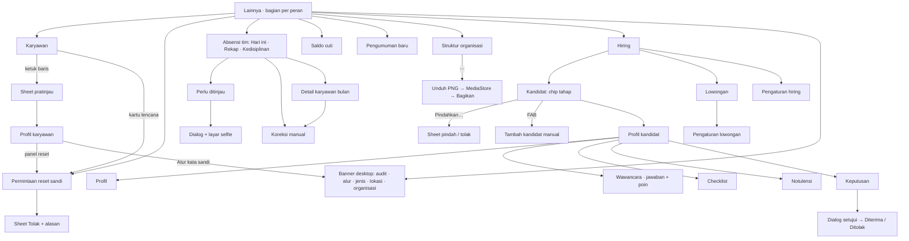

# Spesifikasi mockup Android — Modul 11 · HR, admin & hiring (ponsel)

> Mockup: `docs/mockups/android/screens/11-hr-admin-hiring/` (27 berkas HTML, 163 layar `.phone`; render terang + malam = 326 PNG di `docs/mockups/android/png/11-hr-admin-hiring/`, tidak di-commit). Sumber: `docs/PLATFORM.md` §3 (matriks fitur), `docs/PRD.md` M1/M8/M11, `docs/DATABASE.md` §1 dan §4b, `docs/fitur/hiring.md`, `docs/fitur/ekspor-struktur-organisasi.md`, halaman web `resources/js/pages/{admin,hiring,organization,attendance}/**` dan `features/{employees,hiring,organization,attendance}/**`, serta `docs/mockups/png/mobile/MKaryawan.png`. Hari ini di semua layar = Selasa, 13 Okt 2026; persona: Hana Kusuma (HR, pemakai utama), Faris Alamsyah dan Dio Prakoso (Direksi, penyetuju akhir), Dimas Pratama (Kepala Divisi Operasional, pewawancara), Arif Nugroho (programmer, pewawancara), Sari Wulandari dan Bayu Saputra (staf).

**Keadaan aplikasi saat ini:** `apps/mobile` belum punya satu pun layar atau endpoint untuk modul ini (hanya Lainnya → profil, riwayat, pengajuan, perangkat). Semua layar di bawah adalah **baru**; seluruh endpoint di §4 berstatus **BELUM ADA** (API v1 saat ini baru mencakup auth, perangkat, absensi pribadi, tugas, workspace, catatan, obrolan, rapat, kalender, inbox, pengajuan, briefing).

## 1. Keputusan desain (diusulkan, perlu konfirmasi bila bertanda ❓)

| # | Keputusan | Alasan |
|---|---|---|
| D1 | **Pintu masuk = Lainnya**, bagian per peran (SDM & absensi · Rekrutmen · Admin tersedia di desktop). Staf tidak melihat bagian apa pun; Kadiv melihat Absensi divisi, Pengumuman, Struktur organisasi; Direksi melihat Karyawan (lihat saja), Absensi, Pengumuman, Struktur, dan Hiring bila penyetuju; pewawancara hanya melihat satu baris Hiring. | `docs/PRD.md` §3.2 + `docs/PLATFORM.md` §3 (baris Hiring: hanya yang ditugaskan; Struktur: bukan staf). |
| D2 | **Tab bar tetap tampil pada layar tingkat-daftar** (Karyawan, Hiring, Absensi, Struktur), **disembunyikan pada layar detail/form** yang memakai bilah aksi bawah (profil kandidat, detail lowongan, koreksi, tulis notulensi) agar tombol Simpan/Kirim di zona jempol; sheet menutup tab bar. | `docs/PLATFORM.md` §4 (bilah aksi menempel di bawah; tab disembunyikan saat input fokus). |
| D3 | **Fitur desktop-saja = kartu "Fitur ini tersedia di desktop." + tombol "Kirim tautan ke email saya"** (bukan tata letak desktop terpotong) di: tambah/ubah/impor karyawan, ubah peran, **Atur kata sandi**, aktifkan kembali akun, audit log, alur persetujuan, jenis pengajuan, lokasi/shift/hari libur/kiosk/penugasan jadwal, organisasi (divisi, tim, jabatan), ekspor rekap/kedisiplinan, ubah saldo cuti/impor, pasang skrip Google Form. Web memakai "Salin tautan"; ponsel memakai kirim-email sesuai `docs/PLATFORM.md` §3. | `docs/PLATFORM.md` §3 baris "—" dan paragraf penutup. |
| D4 | **Permintaan reset sandi bisa diputus di ponsel** (✓ di matriks): layar khusus dengan kartu per permintaan, Setujui satu ketukan (tanpa dialog, sama dengan web; hasil lewat snackbar "Disetujui. Sari punya 30 menit…") dan **Tolak lewat bottom sheet dengan alasan wajib** (maks. 500). Pintu masuk: kartu berlencana di atas daftar Karyawan, baris Lainnya, dan panel di profil karyawan. Setujui/Tolak **dinonaktifkan offline** (karyawan menunggu di layarnya). | `docs/PRD.md` M1; `docs/PLATFORM.md` §3; `PasswordResetRequests` web. |
| D5 | **Atur kata sandi tidak ada di ponsel** (keputusan 8 Okt 2026 audit R-06: akun Direksi/HR/Super Admin hanya diatur Super Admin; HR tetap boleh *menyetujui/menolak permintaan* dari akun-akun itu). Profil akun Direksi/HR menampilkan pesan aturan; profil staf menampilkan banner desktop. Nilai sandi bawaan **tidak pernah** ditampilkan di ponsel. | `UserPolicy::setPassword`, `PasswordResetRequestPolicy::decide`, `docs/ARCHITECTURE.md` §5. |
| D6 | **Profil karyawan baca-saja satu layar** (bukan sheet seperti MKaryawan lama) untuk HR; **bottom sheet pratinjau** dari daftar tetap ada (Hubungi via email · Lihat profil). NIK **selalu tersamar** (`•••• •••• •••• 4821`), tidak ada tombol "tampilkan"; NIK, status kata sandi, dan Riwayat perubahan hanya HR/Super Admin (Direksi melihat profil tanpa ketiganya). Aksi cepat Email/Telepon memakai intent `mailto:`/`tel:`. | `employees.manage`; `EmployeeController::show` (`nik_masked`, `audit`). |
| D7 | **Daftar Karyawan**: cari + chip divisi (sudah di web ponsel) **ditambah** sheet Filter (status Aktif/Nonaktif/Mengundurkan diri, peran, urutan) karena API web sudah mendukung `status`/`role`/`sort`. Paginasi "Muat lagi (n tersisa)" (web) dipertahankan; bisa jadi gulir tak hingga di Expo. ❓ | Web ponsel hanya cari + divisi; filter status penting bagi HR (akun nonaktif). |
| D8 | **Struktur organisasi** = daftar bertingkat (Direksi → divisi → tim → orang) dengan penanda warna divisi, badge kode, "Ketua/Kepala". Menu ⋯ memuat **Unduh PNG bagan**, Buka/Ciutkan semua. PNG **dirender di server** (lihat §8-Q1) lalu disimpan lewat MediaStore (tanpa izin penyimpanan di Android 10+) + snackbar "Bagikan" (share sheet sistem). Bagan lengkap mengikuti kata pencarian; selalu terang. **Staf: menu disembunyikan dan rute 404** (halaman "Halaman tidak ditemukan"). | `docs/fitur/ekspor-struktur-organisasi.md`; `docs/PRD.md` M1 (keputusan 6 Okt). |
| D9 | **Hiring di ponsel mengikuti `docs/fitur/hiring.md` §3**: tab bergaris bawah Kandidat · Lowongan · Pengaturan (Pengaturan hanya HR/SA; pewawancara/penyetuju hanya Kandidat + Lowongan), **chip tahap berangka** + daftar kartu, **tanpa seret**: pindah tahap lewat tombol "Pindahkan…" → bottom sheet (Diterima tidak ditawarkan; "Ditolak…" wajib alasan), FAB "Tambah kandidat manual" hanya HR. Kartu menampilkan "Menunggu keputusan Anda" untuk penyetuju. | `docs/fitur/hiring.md` §3–4. |
| D10 | **Profil kandidat**: tab Profil · Wawancara · Checklist n/m · Notulensi · Keputusan (sama dengan web; bilah tab menggulir horizontal dan menggulir otomatis ke tab aktif). Permintaan "Jawaban / Poin" di brief dipenuhi di tab **Wawancara** dengan dua bagian per pertanyaan (Jawaban kandidat — diisi HR, simpan otomatis; Poin — pilih 1..maks lalu catatan) + sakelar **Per pertanyaan · Ringkasan poin** (total, rata-rata per pertanyaan, per pewawancara; hanya HR/penyetuju). Bagian Ringkasan di tab Profil (cincin checklist, total poin, status keputusan). | Web: Wawancara berisi jawaban dan poin; mockup memisah supaya tidak membuat 6 tab di 412 dp. ❓ |
| D11 | **Tombol poin 48 × 48 dp** (1..maks pertanyaan, default 5), catatan opsional muncul setelah memilih poin ("Pilih poin dulu untuk menulis catatan"). Pewawancara hanya melihat poin miliknya (spanduk "hanya poin Anda sendiri yang terlihat"). **Tidak ada skor gabungan otomatis untuk keputusan** — ringkasan hanya informasi. | `docs/fitur/hiring.md` §1; PRD "tanpa skor produktivitas gabungan". |
| D12 | **Checklist** dikelompokkan per pemeriksa (HR · tiap pewawancara · tiap penyetuju); pemeriksa hanya bisa mencentang butirnya sendiri (butir orang lain tampil pudar/terkunci), HR bisa menambah/menghapus butir; spanduk "Checklist wajib belum lengkap (n butir)" menjelaskan kenapa belum bisa masuk Keputusan akhir. | `CandidateChecklistItemPolicy`. |
| D13 | **Keputusan akhir**: Setujui/Tolak di bawah catatan ("wajib bila menolak"); sebelum itu penyetuju harus mencentang butir miliknya (tombol nonaktif + "Buka checklist"); **dialog konfirmasi** sebelum Setujui bila akan menyelesaikan keputusan ("Ratna langsung Diterima…"). Tampilan hasil: Diterima (hijau, tenggat pindah data ke profil karyawan sesuai retensi 30 hari) dan Ditolak (alasan penolak; hanya di aplikasi). Konflik: kandidat sudah dipindah keluar → banner "Keputusan Anda tidak disimpan" + Muat ulang. | `docs/fitur/hiring.md` §4 dan "Retensi". |
| D14 | **Pengaturan lowongan di ponsel dapat diedit** (judul, divisi, status, tim penilai, pemetaan field, pertanyaan) dengan bilah **Simpan perubahan** menempel di bawah; hanya **pemasangan skrip Google Form** diarahkan ke desktop ("Kirim tautan ke email saya") karena menempel skrip di Apps Script tidak praktis di ponsel; URL webhook + Salin tetap ada. **Secret hanya tampil sekali** dan disamarkan (`••••`), diberikan lewat "Salin skrip"/"Kirim ke email"; layar disetel FLAG_SECURE. ❓ | `docs/PLATFORM.md` §3 baris Hiring (✓) + `hiring.md` §5. |
| D15 | **Absensi HR**: tiga tab bergaris bawah (Hari ini · Rekap · Kedisiplinan), tanpa tabel; KPI 2 × 2, hero "Hadir sekarang n/48", batang tumpuk per divisi (hadir/cuti-izin/belum + teks angka, bukan warna saja), panel "Perlu ditinjau" (maks. 3 + Lihat semua), "Lupa check-out kemarin", daftar per orang dengan chip status. Data tampil per `09.40` agar konsisten dengan mockup MgPAbsensi. Pembaruan: Reverb tidak dipakai di aplikasi v1 → **polling 60 detik** dengan pil "Langsung/Tertunda". | `docs/PLATFORM.md` §3 baris Absensi ◐; `AttendanceBoard` web; `MgPAbsensi`. |
| D16 | **Rekap bulanan di ponsel** = ringkasan KPI + **daftar per karyawan** + **detail karyawan per bulan** (kalender + hari terakhir) — melebihi web ponsel yang hanya menampilkan KPI + banner desktop. **Ekspor Excel/PDF tetap desktop** (banner + Kirim tautan). Detail memuat tombol Log check-in dan Koreksi (HR). ❓ | PLATFORM ◐ "Ringkasan saja"; perluasan diusulkan karena atasan/HR sering menjawab pertanyaan satu orang dari ponsel. |
| D17 | **Kedisiplinan**: KPI 2 × 2 (Kedisiplinan hadir · Rata-rata terlambat · Hari alpha · Hari terlambat), dua KPI sekunder (Tingkat penyelesaian · Lead time) **berdampingan, tanpa skor gabungan**, tren 8 minggu (batang + angka, tidak hanya warna), "Per orang" dengan chip Perlu perhatian/Alpha/Terlambat/Semua, sheet definisi metrik (ikon ⓘ). Segmented Minggu/Bulan di kanan judul periode. | `AttendanceDisciplineReport`; PRD M7 dan keputusan 6 Okt. |
| D18 | **Review absensi mencurigakan**: kartu abu per log (nama, jam, lokasi, **chip tanda** + penjelasan satu baris), aksi Lihat selfie / Tandai ditinjau. **Lihat selfie wajib dialog konfirmasi** ("dicatat di audit log, tautan 5 menit") dan layar selfie penuh memakai **FLAG_SECURE** (blokir tangkapan layar) + hitung mundur; selfie yang sudah dihapus retensi menampilkan dialog "Selfie tidak tersedia". Kadiv yang bukan atasan langsung tidak melihat tombol selfie; hanya atasan langsung orang itu, dan HR, yang melihat. | `AttendanceSelfieController`, `attendance.view_selfie`, `docs/PRD.md` §8 Privasi. |
| D19 | **Koreksi manual HR**: bottom sheet (tanggal kerja, jam masuk, jam pulang dengan pemilih waktu Material, **alasan wajib**) + dialog konfirmasi ringkas + snackbar "Koreksi disimpan. Rizky diberi tahu." Tidak ada antrean offline (data sensitif) — offline menonaktifkan Simpan. Kadiv: tanpa tombol Koreksi, banner menjelaskan jalur (HR / pengajuan "Koreksi absensi"). | `AttendanceCorrectionController`; `attendance.manage`. |
| D20 | **Saldo cuti HR = baca saja** (daftar per karyawan: jatah, bawaan, terpakai, menunggu, sisa; penanda Prorata/Belum berhak; sheet detail + riwayat penyesuaian). Ubah jatah, penyesuaian, buat saldo, impor → banner desktop. **Staf tidak pernah melihat saldo cuti tahunan** (tidak ada di modul ini untuk mereka). | `docs/PRD.md` M2 keputusan 6 Okt; `LeaveBalanceController`. |
| D21 | **Pengumuman dari HR**: sheet tulis (judul, isi, penerima Semua/Divisi/Tim + pemilih bertanda, "Tampil sampai" opsional), **dialog konfirmasi jumlah penerima**, snackbar "Terkirim ke 48 orang"; Kadiv = penerima terkunci ke divisinya, Ketua Tim = timnya. Tanpa jadwal terbit dan tanpa sunting setelah terbit. Daftar/detail pengumuman = modul 10. | `docs/fitur/pengumuman.md`. |
| D22 | **Akses peran** ditegakkan dengan 404 generik ("Halaman tidak ditemukan") — tidak membocorkan keberadaan data — dan konflik keputusan (kandidat berpindah tahap) dengan banner Muat ulang. | Policy web; `docs/fitur/hiring.md` §2. |
| D23 | **Gerak** (anotasi): sheet naik 180 ms `ease-brand`; centang checklist/ikon saat berpindah status 120 ms; geser tab di bilah tab Hiring berhenti di tab aktif (spring, tanpa animasi bila *reduced motion*); batang kehadiran/tren tumbuh 180 ms dari 0 (diam bila *reduced motion*). | `docs/DESIGN.md` §7. |

## 2. Inventaris layar

"Terang/Malam" otomatis lewat `?tema=malam`. Peran: **HR** = peran `hr` · **SA** = Super Admin · **Dir** = Direksi · **Kadiv** = Kepala Divisi · **Pewawancara/Penyetuju** = karyawan yang ditugaskan pada lowongan · **Staf**.

| Berkas | Layar (jumlah) | Peran yang melihat | Keadaan yang tercakup |
|---|---|---|---|
| `01-menu-lainnya-per-peran.html` | Lainnya per peran (5) | HR, Dir (penyetuju), Kadiv, pewawancara, staf | bagian SDM/Rekrutmen/Admin-desktop, lencana (2 permintaan, 3 kandidat), staf tanpa bagian |
| `02-karyawan-daftar.html` | Karyawan (8) | HR, SA, Dir | daftar + kartu reset sandi + banner desktop, sheet filter, hasil cari, memuat, kosong, galat, offline, Direksi lihat saja |
| `03-karyawan-profil.html` | Profil karyawan (4) | HR/SA (penuh), Dir (tanpa NIK/riwayat) | sheet pratinjau, profil HR panjang (NIK tersamar, penempatan, bawahan, keamanan, riwayat), profil Direksi, nonaktif/mengundurkan diri |
| `04-reset-sandi.html` | Permintaan reset sandi (9) | HR, SA | daftar (2), sheet Tolak (alasan terisi), sheet Tolak galat (kosong), snackbar disetujui + kartu terkunci, kedaluwarsa + sudah diputus orang lain, kosong, akun Direksi (sandi hanya SA), panel di profil karyawan, offline (tombol nonaktif) |
| `05-atur-sandi-desktop.html` | Atur kata sandi (4) | HR, SA | banner desktop (staf biasa), pesan aturan R-06 untuk akun Direksi/HR/SA, tampilan SA (tetap desktop), sheet konfirmasi "Kirim tautan ke email saya" |
| `06-struktur-organisasi.html` | Struktur organisasi (10) | semua kecuali staf | daftar bertingkat, menu ⋯, "Menyiapkan PNG…", PNG tersimpan + Bagikan, hasil cari, tidak cocok, memuat, kosong, offline, 404 untuk staf |
| `07-kandidat-daftar-peran.html` | Hiring › Kandidat (4) | HR/SA; penyetuju; pewawancara | HR (3 tab + FAB + Pindahkan), penyetuju (menunggu keputusan Anda), pewawancara (tanpa Pengaturan), tahap Diterima + catatan retensi |
| `08-kandidat-aksi.html` | Aksi kandidat (8) | HR/SA | sheet Pindahkan, sheet Tolak (isi / galat), tambah manual (isi / galat), filter lowongan, snackbar sukses + Urungkan, galat server |
| `09-hiring-keadaan.html` | Keadaan Hiring (7) | semua yang punya akses | memuat, belum ada lowongan, tahap kosong, filter tanpa hasil, galat, offline, 404 (tanpa akses) |
| `10-lowongan-daftar.html` | Hiring › Lowongan (5) | HR/SA; pewawancara/penyetuju | daftar (Dibuka/Ditutup/Draf + hitungan), tampilan peran saya, sheet Lowongan baru, kosong, memuat |
| `11-lowongan-detail.html` | Pengaturan lowongan (6) | HR/SA | layar panjang (detail, tim penilai, pemetaan field, pertanyaan, sambungan Google Form, hapus), dialog tutup lowongan, pemilih pewawancara, secret baru (sekali tampil), dialog hapus, galat validasi |
| `12-pengaturan-hiring.html` | Hiring › Pengaturan (2) | HR/SA | penyetuju bawaan + templat checklist per peran, galat penyetuju nonaktif |
| `13-kandidat-profil-tab-profil.html` | Profil kandidat · Profil (4) | HR/SA, penyetuju, pewawancara | HR (Ringkasan, data, berkas, jawaban formulir), pewawancara baca-saja, kandidat manual, Diterima |
| `14-kandidat-tab-wawancara.html` | Wawancara (5) | HR, pewawancara, penyetuju | jawaban kandidat (tersimpan/menyimpan) + poin per pewawancara, pewawancara memilih poin 1–5 + catatan, ringkasan poin, tanpa pertanyaan, offline/galat simpan |
| `15-kandidat-tab-checklist.html` | Checklist (5) | HR, pewawancara, penyetuju | grup per pemeriksa + spanduk belum lengkap, giliran penyetuju, sheet tambah butir, dialog hapus, semua lengkap |
| `16-kandidat-tab-notulensi.html` | Notulensi (5) | HR, pewawancara, penyetuju | daftar (milik sendiri ada menu ⋯), tulis, menu ubah/hapus, dialog hapus, kosong |
| `17-kandidat-tab-keputusan.html` | Keputusan akhir (7) | penyetuju, HR | form Setujui/Tolak, galat catatan, butir wajib belum dicentang, dialog setujui, Diterima, Ditolak, belum di tahap keputusan |
| `18-kandidat-aksi-profil.html` | Menu ⋯ profil (4) | HR/SA | menu (Ubah data, Bagikan, Hapus), sheet Ubah data, dialog Hapus (retensi 30 hari), buka CV di Chrome |
| `19-absensi-hari-ini.html` | Absensi › Hari ini (8) | HR/SA/Dir (semua); Kadiv (divisi) | HR panjang, Kadiv, memuat, galat, hari libur, offline, sheet filter lokasi/divisi, sheet detail orang |
| `20-absensi-review-mencurigakan.html` | Perlu ditinjau (7) | HR; atasan langsung (selfie) | daftar 3 temuan, dialog lihat selfie, layar selfie (FLAG_SECURE), selfie terhapus retensi, snackbar ditinjau + Urungkan, tidak ada temuan, detail log (peta sketsa + perangkat) |
| `21-absensi-koreksi-manual.html` | Koreksi manual (7) | HR | sheet isi, galat (alasan kosong/jam pulang < masuk), dialog konfirmasi, snackbar, pemilih waktu Material, Kadiv tanpa koreksi, offline |
| `22-absensi-rekap-bulanan.html` | Absensi › Rekap (7) | HR/SA/Dir; Kadiv (divisi) | daftar + KPI + banner ekspor desktop, detail karyawan bulan (kalender, hari terakhir, aksi HR), sheet pilih bulan, sheet Kirim tautan, kosong, memuat, offline (bulan lalu tersimpan) |
| `23-absensi-kedisiplinan.html` | Absensi › Kedisiplinan (7) | HR/SA/Dir; Kadiv (divisi) | HR panjang (KPI 2×2 + tren + per orang), sheet definisi metrik, memuat, "Semua tepat waktu", Kadiv minggu ini, galat, banner ekspor desktop |
| `24-saldo-cuti-hr.html` | Saldo cuti (4) | HR/SA | daftar baca-saja + banner desktop, sheet detail + riwayat penyesuaian, memuat, saldo belum dibuat |
| `25-pengumuman-hr.html` | Pengumuman baru (7) | HR/SA/Dir (semua); Kadiv (divisi); Ketua Tim (tim) | sheet isi, galat validasi, pemilih divisi, dialog konfirmasi n penerima, snackbar terkirim, Kadiv (penerima terkunci), galat izin |
| `26-admin-desktop-only.html` | Banner desktop (9) | HR/SA (sesuai peran) | audit log (SA), alur persetujuan, jenis pengajuan (terkunci cuti/lembur), lokasi/shift/libur, impor karyawan, organisasi, tambah karyawan, snackbar tautan terkirim, galat jaringan |
| `27-akses-peran-dan-konflik.html` | Akses & konflik (5) | — | 404 lowongan lain, 404 Karyawan untuk Kadiv, konflik keputusan, permintaan reset milik SA, audit log hanya SA |

## 3. Peta navigasi

## 4. Pemetaan layar → endpoint API

Semua **BELUM ADA**. Usulan: `/api/v1`, presenter tipis di atas Action/Policy web, bahasa respons Indonesia, 404 untuk data yang tak boleh dilihat (sama dengan web).

| Layar | Endpoint usulan | Status | Dasar web |
|---|---|---|---|
| Lainnya per peran (lencana, bagian) | `GET /auth/saya` + bendera `features` (`hiring`, `can.manage_employees`, `can.view_org_chart`, dll.) atau `GET /menu` | **BELUM ADA** (profil ada, bendera belum) | prop bersama `features.hiring`; `isStaffOnly()` |
| Karyawan daftar/filter | `GET /admin/karyawan?q&divisi&status&peran&sort&page` → `{employees, meta, counts, divisions}` | **BELUM ADA** | `EmployeeController::index` |
| Profil karyawan | `GET /admin/karyawan/{id}` (NIK tersamar; `audit`/`has_password` hanya `employees.manage`) | **BELUM ADA** | `EmployeeController::show` |
| Permintaan reset sandi | `GET /admin/karyawan/permintaan-sandi`; `POST …/{id}/setujui`; `POST …/{id}/tolak {reason}` | **BELUM ADA** | `EmployeePasswordController::approve/reject` |
| Kirim tautan ke email saya | `POST /tautan-desktop {path}` (hanya path web internal ber-allowlist, tanpa token; limiter) | **BELUM ADA** | baru (web memakai Salin tautan) |
| Struktur organisasi | `GET /organisasi/struktur` (404 staf); PNG: `GET /organisasi/struktur/png?q=` | **BELUM ADA** | `OrganizationChartController`, `OrganizationTree` |
| Hiring ringkasan | `GET /hiring` → `{overview, positions, candidates}` (`?lowongan&q`) | **BELUM ADA** | `CandidateController::index` |
| Pindah tahap / tambah / ubah / hapus kandidat | `PUT /hiring/kandidat/{id}/tahap`; `POST /hiring/kandidat`; `PATCH`; `DELETE` | **BELUM ADA** | `CandidateController` |
| Profil kandidat | `GET /hiring/kandidat/{id}` → `{candidate, questions, checklist, notes, decisions, reviewers, can, blockers}` | **BELUM ADA** | `CandidateController::show` |
| Jawaban/poin | `PUT …/jawaban/{question}`; `PUT …/poin/{question}` | **BELUM ADA** | `InterviewController` |
| Checklist | `POST …/checklist`; `PATCH /hiring/checklist/{id}`; `DELETE` | **BELUM ADA** | `ChecklistController` |
| Notulensi | `POST …/notulensi`; `PATCH`/`DELETE /hiring/notulensi/{id}` | **BELUM ADA** | `NoteController` |
| Keputusan | `POST …/keputusan {decision, note}` | **BELUM ADA** | `DecisionController`, `DecideCandidate` |
| Lowongan | `GET/POST /hiring/lowongan`; `GET/PUT/DELETE …/{id}`; `POST …/{id}/webhook` (secret sekali tampil); pertanyaan `POST/PUT/DELETE` + urutan | **BELUM ADA** | `PositionController`, `QuestionController` |
| Pengaturan hiring | `GET/PUT /hiring/pengaturan` | **BELUM ADA** | `SettingsController` |
| Absensi Hari ini | `GET /absensi/papan?lokasi=` (polling 60 dtk) | **BELUM ADA** (hanya `/absensi/hari-ini` pribadi) | `AttendanceBoardController` |
| Perlu ditinjau / tandai / selfie | `GET /absensi/log/{id}/selfie-url` (5 mnt, diaudit); `POST /absensi/log/{id}/tinjau` | **BELUM ADA** | `AttendanceLogController` |
| Koreksi manual | `POST /absensi/koreksi {user_id, work_date, check_in, check_out, reason}` | **BELUM ADA** | `AttendanceCorrectionController` |
| Rekap bulanan + detail orang | `GET /absensi/rekap?bulan&divisi&q&karyawan=` | **BELUM ADA** (`/absensi/riwayat` hanya pribadi) | `AttendanceRecapController`, `RecapReport` |
| Kedisiplinan | `GET /absensi/kedisiplinan?periode&divisi&tim` | **BELUM ADA** | `AttendanceDisciplineController` |
| Saldo cuti | `GET /admin/saldo-cuti?tahun&jenis&q` + `GET …/{id}/riwayat` | **BELUM ADA** | `LeaveBalanceController::index` |
| Pengumuman baru | `POST /pengumuman {title, body, audience, target_ids, expires_on}`; `GET /pengumuman/penerima` (opsi sesuai peran) | **BELUM ADA** (modul 10) | `AnnouncementController` |
| Banner desktop | tanpa endpoint (kecuali tautan email) | — | — |

## 5. Kemampuan khas Android yang dipakai

- **Intent**: `mailto:` dan `tel:` (profil karyawan/kandidat), buka tautan CV/berkas di Chrome Custom Tab atau aplikasi Drive, **share sheet** sistem untuk PNG struktur organisasi.
- **MediaStore**: PNG struktur disimpan ke Unduhan/Pictures tanpa izin penyimpanan (API 29+); API ≤ 28 meminta `WRITE_EXTERNAL_STORAGE` saat unduh pertama. Notifikasi unduhan standar.
- **FLAG_SECURE** pada layar selfie (blokir tangkapan layar/rekaman), layar secret webhook, dan layar yang menampilkan NIK tersamar.
- **Notifikasi** (modul 12/10): "Perlu tindakan" untuk reset sandi (HR) dan `hiring.decision_needed` (penyetuju) dengan aksi cepat membuka layar terkait; `hiring.candidate_received`/`candidate_decided` ke HR. Isi notifikasi **tanpa nama pelamar** (sama dengan email).
- **Gestur**: gulir horizontal bilah tab dan chip; tarik-untuk-muat-ulang pada daftar; gestur kembali sistem; **tanpa seret kartu** di Hiring.
- **Pemilih Material** untuk tanggal dan waktu (koreksi, "Tampil sampai"). Format tampilan tetap "Sen, 12/10/2026".
- Papan ketik: input 17 sp, tab bar disembunyikan saat fokus (D2); `inputMode` numerik untuk poin; `keyboardType: email-address/phone-pad` untuk form kandidat.
- Biometrik/PIN aplikasi (modul 01) melindungi seluruh bagian modul ini; tidak ada izin runtime baru (lokasi/kamera tidak dipakai).

## 6. Matriks keadaan

| Layar | Memuat | Kosong | Galat | Offline | Terkunci/tanpa akses | Baca-saja |
|---|---|---|---|---|---|---|
| Karyawan daftar | skeleton baris | "Tidak ada karyawan yang cocok" + Hapus filter | kartu Coba lagi | banner + data tersimpan, Setujui/Tolak nonaktif | 404 untuk Kadiv/staf | Direksi (tanpa banner/kartu reset) |
| Profil karyawan | skeleton | — | kartu Coba lagi | data tersimpan | NIK/riwayat disembunyikan bagi Dir | nonaktif (banner) |
| Reset sandi | skeleton kartu | "Tidak ada permintaan menunggu" | banner kedaluwarsa / sudah diputus | tombol nonaktif | permintaan SA hanya SA lain | — |
| Struktur | skeleton | "Struktur organisasi belum diisi" | Coba lagi | data tersimpan, Unduh PNG nonaktif | 404 staf | — |
| Hiring kandidat/lowongan | skeleton | belum ada lowongan / tahap kosong / filter tanpa hasil | Coba lagi | daftar tersimpan, pindah/keputusan nonaktif | 404 non-ditugaskan | pewawancara/penyetuju (tanpa pindah/FAB) |
| Profil kandidat | skeleton | "Belum ada pertanyaan/notulensi/jawaban formulir" | konflik tahap (banner) | jawaban/poin disimpan lokal "Menunggu jaringan" lalu kirim | 404 | kandidat Diterima/Ditolak |
| Absensi (3 tab) | skeleton | hari libur / "Semua tepat waktu" / belum ada data | Coba lagi | data tersimpan, Koreksi nonaktif | Kadiv tanpa Koreksi, selfie hanya atasan langsung | semua (kecuali HR memutus/koreksi) |
| Saldo cuti | skeleton | "Saldo 2026 belum dibuat" | — | tersimpan | — | seluruhnya baca-saja |
| Pengumuman baru | — | — | validasi + galat izin | Kirim nonaktif | penerima terkunci per peran | — |

## 7. Catatan implementasi Expo

- Rute baru yang disarankan di `apps/mobile/app`: `karyawan/index.tsx`, `karyawan/[id].tsx`, `karyawan/permintaan-sandi.tsx`, `organisasi/struktur.tsx`, `hiring/(tabs)/{kandidat,lowongan,pengaturan}.tsx`, `hiring/kandidat/[id].tsx` (tab lokal), `hiring/lowongan/[id].tsx`, `absensi-tim/{hari-ini,rekap,kedisiplinan}.tsx` + `rekap/[userId].tsx`, `pengumuman/baru.tsx` (sheet). Izin menu dari bendera server, bukan tebakan peran di klien.
- Komponen: ulang pakai `Screen`, `Card`, `Badge`, `Row`, `Button`, `Loading` (`src/components/ui.tsx`); tambah **TabUnderline** (WAI-ARIA tabs), **ChipScroller**, **BottomSheet** (gorhom/`@gorhom/bottom-sheet` bila sudah ada; bila belum, `Modal` + `Animated`), **KalenderBulan** (grid statis 7 kolom), **BatangTumpuk**/**BatangTren** (View, tanpa pustaka grafik), **KartuDesktopOnly** (satu komponen untuk semua banner, prop `fitur`).
- Poin wawancara = `Pressable` 48 dp; catatan muncul setelah poin dipilih; simpan otomatis jawaban kandidat dengan debounce 600 ms dan indikator Tersimpan/Menyimpan/Menunggu jaringan; tulisan yang gagal dikirim disimpan lokal (SecureStore/AsyncStorage) dan dikirim ulang saat tersambung (idempoten: `PUT` per pertanyaan).
- PNG struktur: lihat Q1 — bila dirender di server, aplikasi hanya mengunduh `image/png` lalu `expo-media-library`/`expo-sharing`; bila dirender di perangkat butuh `react-native-view-shot` (pustaka baru, perlu alasan di ringkasan akhir).
- Caching baca-saja: daftar Karyawan/Struktur/Rekap bulan lalu disimpan (TanStack Query persist) hanya untuk offline; **data pelamar tidak di-cache di disk** (UU PDP + retensi 30 hari); tidak ada cache selfie.
- Aksesibilitas: setiap badge status = ikon/titik + teks; tombol poin `accessibilityLabel="Poin 4 dari 5"`; bilah tab Hiring `accessibilityRole="tablist"`; ukuran font 200% (modul 12) harus tetap membungkus teks kartu kandidat (tidak memotong nama).
- Keamanan: `FLAG_SECURE` lewat `expo-screen-capture` pada layar selfie/secret/NIK; jangan mencatat nilai NIK/telepon/alasan di log klien; tautan CV selalu `https` (tolak skema lain).

## 8. Pertanyaan & keputusan untuk pemilik

1. **Q1 — PNG struktur organisasi di ponsel**: web merender di peramban (`modern-screenshot`). Di Android pilih (a) render di **server** (butuh endpoint + Chromium/GD di VPS — sebelumnya ditolak di `docs/fitur/ekspor-struktur-organisasi.md`), (b) render di perangkat dengan `react-native-view-shot` (paket baru, bagan besar berat), atau (c) **tunda** ekspor di ponsel dan tampilkan banner "Unduh PNG tersedia di desktop"? Mockup menggambar (a)/(b) sama.
2. **Q2 — Perluasan rekap di ponsel (D16)**: PLATFORM menyebut Rekap ◐ "ringkasan saja". Apakah daftar per karyawan + detail kalender boleh ada di ponsel? (Data sudah tersedia; hanya ekspor tetap desktop.)
3. **Q3 — Pengaturan lowongan di ponsel (D14)** boleh diubah, atau cukup baca-saja + "Kirim tautan ke email saya" seperti `docs/PLATFORM.md` ("Satu kolom, tombol simpan menempel di bawah" ✓)? Mockup menggambar edit penuh kecuali pemasangan Apps Script.
4. **Q4 — Tab "Wawancara" tunggal (D10)** vs enam tab (Profil/Jawaban/Checklist/Poin/Notulensi/Keputusan) seperti permintaan brief. Mockup memakai lima tab web dengan dua bagian di Wawancara.
5. **Q5 — Reset sandi akun Direksi/HR**: web mengizinkan HR menyetujui permintaan akun Direksi/HR tetapi sandi diatur hanya Super Admin. Konfirmasi bahwa **penyetujuan** reset tetap boleh HR (mockup 04-ketiga memperlihatkan itu, dengan catatan).
6. **Q6 — "Kirim tautan ke email saya"**: izinkan tautan hanya ke email akun sendiri (tanpa mengetik alamat lain) dan hanya path web ber-allowlist. Apakah email notifikasi perlu template/izin baru (preferensi `system`)?
7. **Q7 — Super Admin di ponsel**: API login saat ini **menolak Super Admin** (403 `two_factor_required`, TOTP belum didukung). Selama itu, layar khusus SA (audit, permintaan reset sandi milik SA, kelola semua) tidak tercapai di aplikasi. Prioritaskan TOTP di API atau biarkan SA web-saja?
8. **Q8 — Daftar Karyawan untuk Direksi**: web memberi `employees.view` ke Direksi (lihat saja). Konfirmasi Direksi boleh melihat daftar + profil (tanpa NIK/riwayat) di ponsel.
9. **Q9 — Data pelamar offline**: mockup melarang cache disk data pelamar. Setuju (konsekuensi: Hiring tidak bisa dibuka offline)?
10. **Q10 — Retensi selfie 12 bulan**: pesan "Selfie sudah dihapus sesuai masa retensi (12 bulan)" mengikuti `docs/PRD.md` §8; pastikan angka sesuai kebijakan terkini.

## 9. Celah yang ditemukan (web punya, ponsel belum)

- Seluruh modul ini belum ada di `apps/mobile` maupun `/api/v1` (lihat §4); paling besar: papan Hiring + profil kandidat (≈ 12 endpoint), Absensi HR (papan, ulasan, koreksi, rekap, kedisiplinan), Karyawan + reset sandi.
- **Impor karyawan, kelola karyawan, ubah peran, nonaktifkan/aktifkan** = desktop (sengaja).
- **Alur persetujuan, jenis pengajuan (kunci cuti/lembur), lokasi/shift/hari libur/kiosk/penugasan jadwal, organisasi, audit log** = desktop (PLATFORM "—"); tidak ada tampilan baca-saja di ponsel. Pertimbangkan versi baca-saja ringkas untuk **Jenis pengajuan** (agar HR bisa memeriksa status terkunci dari ponsel) dan **Audit log** (SA) — belum digambar.
- **Notifikasi "Perlu tindakan"** untuk reset sandi dan keputusan akhir bergantung modul 10/12 (push FCM belum ada: `docs/sesi/ponsel.md`).
- **Dashboard HR** (kartu pengajuan menunggu HR, ringkasan Absensi, kartu Hiring) = modul 02; modul ini hanya menyediakan layar tujuan tautannya.
- Tidak ada ekspor data pelamar (disengaja) dan tidak ada unggah berkas CV ke aplikasi (hanya tautan).
- Hiring: pewawancara/penyetuju yang ditambah saat kandidat sudah di Keputusan akhir tidak diberi notifikasi ulang (batasan web, ikut berlaku).
- Absensi tim di web memakai Reverb (realtime); aplikasi v1 hanya polling.

## 10. Kebutuhan kit

Tidak ada perubahan `_kit/`. Gaya lokal ditulis per berkas dengan prefiks `hr-` (tab bergaris bawah `.hr-tabnav`, `.hr-tile`, `.hr-score`, `.hr-bar`, `.hr-trend`, `.hr-dl`, `.hr-tree`, `.hr-desk`, `.hr-opt`, `.hr-li`). Kandidat untuk kit bersama (beberapa modul memerlukannya): **tab bergaris bawah**, **kartu desktop-only** (ikon monitor + "Kirim tautan ke email saya"), **baris definisi (dl)**, **cincin progres**, **batang tumpuk/tren**. Layar panjang memakai skrip kecil lokal `fit()` yang menyetel `--h` otomatis dari tinggi isi (boleh dipakai ulang di kit sebagai atribut `data-auto`).
