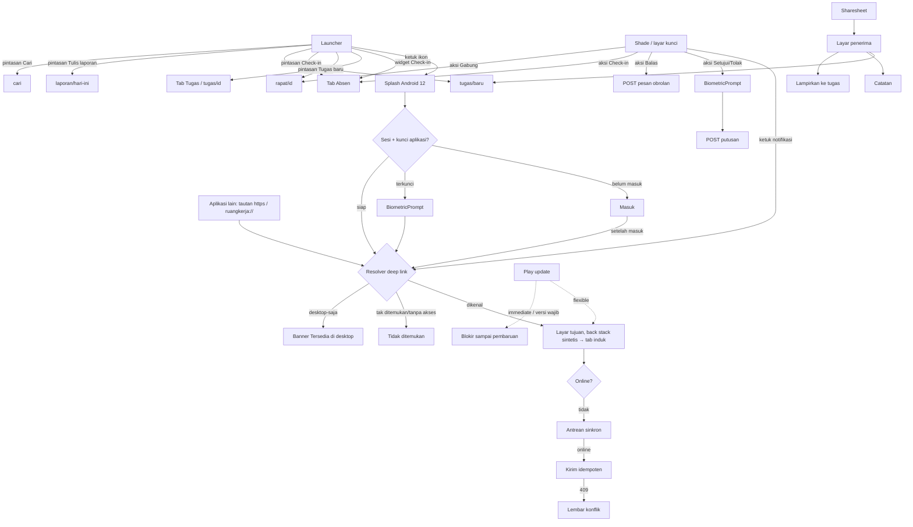

# Spesifikasi · Modul 12 — Fitur khas Android

> Mockup: `docs/mockups/android/screens/12-android-native/` (31 berkas HTML, 152 bingkai, 304 PNG terang + malam via `node docs/mockups/android/_kit/render.mjs 12-android-native`; PNG tidak di-commit). Gaya tambahan modul: `_m12.css` (prefiks `a12-`, hanya token kit). Hari acuan: **Selasa, 13 Okt 2026**; persona **Sari Wulandari** (staf), **Dimas Pratama** (Kepala Divisi, penyetuju), Rizky, Maya, Hana.
> Sumber: `docs/fitur/aplikasi-ponsel.md`, `docs/fitur/aplikasi-ponsel-rencana.md` (M3), `docs/deploy/ANDROID-AKUN.md`, `docs/deploy/ANDROID-IDENTITAS.md`, `docs/sesi/ponsel.md`, `apps/mobile/app.json`, paket desain `MWidget`/`MLockScreen`/`MOffline`/`MQuickAdd`/`MFondasi`/`Rail`, `docs/PLATFORM.md` §2/§2.1/§4, `resources/js/features/mobile-app/**`.
> **Catatan persona:** contoh notifikasi/layar kunci "pengajuan menunggu persetujuan" berlaku untuk **penyetuju** (Kepala Divisi, HR, Direksi). Staf (hanya peran `anggota`) tidak pernah menerima notifikasi persetujuan masuk; staf menerima "pengajuan Anda disetujui/ditolak" dan tidak melihat saldo cuti (PRD M2).

## 1. Inventaris layar

| Berkas | Nama | Peran yang melihat | Keadaan yang tercakup |
|---|---|---|---|
| `01-widget-checkin` | Widget Check-in 2×1 | semua karyawan | belum absen · sudah masuk · sudah pulang · libur · menunggu sinyal (antrean) · data lama · sesi berakhir; layar utama; tekan lama (ubah ukuran/setelan/hapus); galeri widget |
| `02-widget-tugas-rapat` | Widget Tugas hari ini 4×2 + Rapat berikutnya 4×1 | semua (Rapat bila `features.meetings` aktif) | normal · semua selesai · terlambat · data lama · sesi berakhir; rapat berlangsung/belum mulai/tidak ada/data lama; layar setelan widget (segmen Pribadi/Tim/Semua) |
| `03-notifikasi-bayangan` | Bayangan notifikasi berkelompok | semua | grup tertutup per saluran · grup Persetujuan dibuka · tekan lama (kontrol saluran) · Obrolan + Tugas dibuka |
| `04-notifikasi-aksi-cepat` | Notifikasi beraksi | semua (Setujui/Tolak: penyetuju) | siklus Setujui (awal/mengirim/berhasil/gagal/sudah diputuskan/dibatalkan) · Balas inline · Absensi (Check-in/Tunda/WFH/Koreksi/Laporan) · heads-up Rapat mulai · Tolak dengan alasan |
| `05-layar-kunci` | Layar kunci | semua | isi penuh · konten sensitif disembunyikan · aksi butuh autentikasi · always-on display |
| `06-saluran-notifikasi` | Saluran notifikasi Android | semua | daftar 7 saluran · detail saluran Rapat · peringatan di aplikasi (notifikasi/saluran dimatikan) |
| `07-pintasan-ikon` | Pintasan ikon (app shortcuts) | semua | popup tekan-lama · pintasan tersemat · varian (belum absen/sudah masuk/belum masuk akun/terkunci biometrik) · peta rute |
| `08-terima-berbagi` | Terima berbagi (share target) | semua | sharesheet sistem · layar penerima · Tugas baru · Lampirkan ke tugas · Tambahkan ke catatan · keadaan (belum masuk, file besar, tak didukung, tanpa sinyal, sukses) |
| `09-deep-link` | Deep link & App Links | semua | pemilih "Buka dengan" · wajib masuk lalu redirect · tugas terbuka · tidak ditemukan/tanpa akses · halaman desktop-saja · fitur dimatikan · pengaturan Android · tabel resolver |
| `10-biometrik` | Prompt biometrik | semua | buka aplikasi · gagal · wajah · wajah+konfirmasi · PIN perangkat · terkunci sementara · sebelum check-in · belum ada biometrik |
| `11-izin-runtime` | Dialog izin runtime | semua | penjelasan sebelum izin · lokasi (tepat/perkiraan) · kamera · notifikasi (13+) · mikrofon · ditolak sekali · ditolak permanen · Pengaturan Android · lokasi perkiraan · ringkasan izin |
| `12-baterai-latar` | Baterai & latar | semua | panduan dalam aplikasi · Info aplikasi › Baterai · dialog pengecualian baterai (tidak disarankan) · panduan per merek |
| `13-offline-banner-checkin` | Offline: banner, aturan, check-in | semua | Beranda tanpa sinyal (aturan v1) · Absen diblokir · check-in antre (usulan) · Beranda menunggu sinkron · layar baca offline · aturan "boleh diantrekan" |
| `14-offline-antrean-sinkron` | Antrean offline & sinkron | semua | menunggu · mengirim · semua tersinkron · gagal/konflik · lembar penyelesaian konflik · kedaluwarsa 72 jam · kosong |
| `15-pembaruan-aplikasi` | Pembaruan dalam aplikasi | semua | tersedia · dialog Play · mengunduh · siap dipasang · immediate · gagal · versi wajib diperbarui · "Yang baru" |
| `16-tablet-beranda` | Tablet · Beranda + Rail | semua | potret 834×1112 (belum check-in) · lanskap 1112×834 (sudah masuk) |
| `17-tablet-tugas-master-detail` | Tablet · Tugas dua panel | semua | 1112×834 · 834×1112 · detail kosong |
| `18-tablet-obrolan-tiga-kolom` | Tablet · Obrolan | semua | tiga kolom 1112 · dua kolom 834 · thread sebagai panel 834 |
| `19-lipat-dan-multi-jendela` | Lipat & multi-jendela | semua | lipat tertutup 360×760 · lipat terbuka postur meja (video) 884×760 · layar terbagi tablet |
| `20-lanskap-ponsel` | Lanskap ponsel | semua | ruang video · video + obrolan · Tugas (usulan) · kebijakan orientasi |
| `21-aksesibilitas-font` | Ukuran huruf | semua | 130% · 200% Beranda · 200% form Absen · 200% sheet |
| `22-aksesibilitas-talkback` | TalkBack | semua | urutan fokus Beranda + label · urutan fokus Absen + label · tindakan alternatif geser (Persetujuan) |
| `23-aksesibilitas-kontras-sentuh` | Kontras & target sentuh | semua | kontras tinggi terang/malam · teks tebal · audit 48dp · pengaturan aksesibilitas |
| `24-mode-gelap-sistem` | Mode gelap sistem | semua | pilihan tema · 18.59 terang → 19.00 gelap otomatis · panel pengaturan cepat · elemen yang tetap |
| `25-ikon-adaptif` | Ikon adaptif | — (aset) | konstruksi 108dp · saat ini vs usulan · lapis (depan/belakang/monokrom) · bentuk topeng & ukuran · ikon bertema terang/gelap |
| `26-ikon-notifikasi-kecil` | Ikon notifikasi kecil | — (aset) | siluet 24dp + ukuran per densitas · header notifikasi · salah vs benar |
| `27-splash-android12` | Splash Android 12 | — (aset) | terang · gelap · opsi tanpa latar · Android ≤ 11 · dimensi · setelah splash |
| `28-play-feature-graphic` | Feature graphic 1024×500 | — (aset) | varian A (ponsel miring) · varian B (widget) |
| `29-play-screenshot-ponsel` | 8 screenshot ponsel | — (aset) | 8 × (540×960 → 1080×1920) dengan teks bantu |
| `30-play-screenshot-tablet` | 4 screenshot tablet | — (aset) | Beranda · Tugas · Obrolan · Rapat video |
| `31-play-listing-data-safety` | Listing Play & Keamanan data | — (aset) | halaman produk · Keamanan data · detail Lokasi |

Tiap berkas memuat caption bahasa Indonesia di bawah bingkai (di luar PNG). Tema malam = `?tema=malam`; kontras tinggi dan paksa-terang/gelap di berkas 23–24 memakai kelas lokal.

## 2. Peta navigasi

Lebar jendela menentukan shell (`useWindowDimensions`): **< 600dp** tab bar kapsul (ponsel/lipat tertutup), **≥ 600dp** Rail 96dp; **≥ 720dp** dua panel (Tugas/Obrolan); **≥ 1000dp** tiga kolom Obrolan. Berbeda dari web (≥ 1024px = MenuBar + Dock): di aplikasi Android **tidak ada Dock/MenuBar** (lihat Keputusan 7).

## 3. Pemetaan layar → endpoint API v1

Legenda: **ADA** = sudah di `routes/api.php`; **BELUM ADA** = harus dibuat (Action/Policy web dipakai ulang).

| Layar/fitur | Endpoint | Status |
|---|---|---|
| Widget Check-in | `GET /absensi/hari-ini` | ADA |
| Widget Tugas | `GET /tugas/hari-ini?segmen=` (query `TugasHariIni`), `PATCH /tugas/{id}/status` (bila "tandai selesai" disetujui) | ADA |
| Widget Rapat | `GET /rapat?rentang=hari-ini` | ADA |
| Widget — snapshot tunggal (1 panggilan, hemat baterai) | `GET /widget/snapshot` (B8 rencana) | BELUM ADA (opsional; tanpa ini 3 panggilan) |
| Token untuk widget (headless task membaca SecureStore) | token Sanctum per perangkat (sama dengan app) | ADA (keputusan keamanan lihat §9) |
| Push FCM (kanal server `fcm`, payload per saluran, `publicVersion`) | `PUT /perangkat/{device}/push-token` | token ADA · kanal pengirim BELUM ADA (B7) |
| Notifikasi Setujui / Tolak (+alasan) | `POST /persetujuan/{id}/setujui`, `/tolak`; antrean persetujuan `GET /persetujuan` | BELUM ADA (hanya web) |
| "Urungkan" persetujuan 5 detik | tunda di klien sebelum POST **atau** `POST /persetujuan/{id}/urungkan` | BELUM ADA |
| Balas Obrolan dari notifikasi | `POST /obrolan/kanal/{c}/pesan`, `POST /obrolan/kanal/{c}/dibaca` | ADA |
| Aksi Absensi: Check-in / Check-out | `POST /absensi/check-in`, `/check-out` (limiter 6/menit) | ADA |
| Absensi: Tunda 15 mnt / WFH | lokal (alarm) + `mode` WFH di body check-in | ADA (mode WFH ikut Action web) |
| Ajukan koreksi dari notifikasi | `POST /pengajuan {type: KOR}` | ADA |
| Tulis laporan (pintasan, notifikasi 16.30) | `GET/PUT /laporan/hari-ini` | BELUM ADA (modul 06) |
| Pintasan Cari | `GET /cari?q=` | BELUM ADA (modul 10) |
| Tugas baru dari berbagi/pintasan | `POST /tugas` | ADA |
| Lampirkan ke tugas | `POST /tugas/{id}/lampiran` (unggah ke Drive workspace, ≤100 MB) | BELUM ADA |
| Tambahkan ke catatan | `GET /workspace/{w}/catatan`, `PATCH /catatan/{id}` (`body_html`, 409 `rich_note`) | ADA |
| Kirim ke obrolan dengan lampiran | `POST /obrolan/kanal/{c}/pesan` + lampiran | pesan ADA · lampiran BELUM ADA |
| Resolver tautan `/w/PRG/tasks/24` → id | `GET /tautan/selesaikan?path=` atau `GET /tugas/by-key/{KEY}/{no}` | BELUM ADA |
| Resolver ke workspace/rapat/obrolan/catatan/inbox | `GET /workspace/{w}/papan`, `/rapat/{id}`, `/obrolan/kanal/{id}/pesan`, `/catatan/{id}`, `/inbox` | ADA |
| "Kirim tautan ke email saya" (halaman desktop-saja) | `POST /tautan/kirim-email` | BELUM ADA |
| `assetlinks.json` (App Links) | `GET /.well-known/assetlinks.json` | ADA (isi `ANDROID_CERT_SHA256` di server) |
| Kunci aplikasi / biometrik | lokal; `GET /auth/saya` setelah buka | ADA |
| Sakelar "masuk biometrik" per perangkat | `PUT /perangkat/{device}` `{biometric_login}` | BELUM ADA (kolom `devices.biometric_login` belum) |
| Antrean offline (check-in, status, komentar) | idempotensi `client_id` ULID di body; `client_time` | `client_time` ADA · `client_id` BELUM ADA |
| Konflik 409 + alasan (status tugas) | `PATCH /tugas/{id}/status` mengembalikan 409 `{reason}` bila berubah sejak `version` klien | BELUM ADA (sekarang last-write-wins) |
| Antrean sinkron — server menolak check-in lama | aturan "maks. N jam" di `CheckIn` + flag `clock_skew`/`offline` | BELUM ADA |
| Pembaruan wajib (426 + `min_app_version`, header `X-Min-App-Version`) | middleware API v1 | BELUM ADA |
| Pembaruan Play (flexible/immediate) | Play Core (klien) | — |
| Perangkat saya / cabut | `GET /perangkat`, `DELETE /perangkat/{id}` | ADA |
| Integritas (Play Integrity) | `POST /perangkat/{id}/integritas` | BELUM ADA (rencana 4.3) |
| Izin & status saluran notifikasi | lokal | — |

## 4. Kemampuan khas Android

### 4.1 Izin (AndroidManifest)

| Izin | Kapan diminta | Sekarang (`app.json`) | Catatan |
|---|---|---|---|
| `CAMERA` | pertama kali selfie absen (dengan penjelasan) | ada (`expo-camera`) | hanya foto; `recordAudioAndroid: false` agar `RECORD_AUDIO` tidak ikut |
| `ACCESS_FINE_LOCATION` (+ `COARSE`) | check-in/out | ada (`expo-location`) | dialog presisi/perkiraan; absen butuh **Tepat**; **tanpa** `ACCESS_BACKGROUND_LOCATION` |
| `POST_NOTIFICATIONS` (API 33+) | setelah masuk pertama + penjelasan | belum | plugin `expo-notifications` |
| `USE_BIOMETRIC` | kunci aplikasi, konfirmasi check-in | belum | `expo-local-authentication` (Class 3 / kredensial perangkat) |
| `RECORD_AUDIO` | hanya jika dikte/rapat native dipakai | **ikut tanpa sengaja** lewat expo-camera | hapus sampai fitur ada (Play Data safety: Audio) |
| `ACCESS_NETWORK_STATE` | deteksi offline | belum | `@react-native-community/netinfo` |
| `RECEIVE_BOOT_COMPLETED`, `VIBRATE` | pemulihan alarm tunda, getar notifikasi | default prebuild | cek ulang di `AndroidManifest` hasil prebuild |
| `READ/WRITE_EXTERNAL_STORAGE`, `SYSTEM_ALERT_WINDOW` | tidak dibutuhkan | ikut template prebuild | blokir lewat `android.blockedPermissions` |
| `REQUEST_IGNORE_BATTERY_OPTIMIZATIONS` | **tidak** (kebijakan Play) | — | lihat Keputusan 3 |
| `SCHEDULE_EXACT_ALARM` | tidak (pengingat server FCM) | — | "Tunda 15 mnt" memakai `WorkManager` tak-eksak |

### 4.2 Saluran notifikasi (`setNotificationChannelAsync`, dibuat sekali; pengguna menguasai nilainya)

| ID | Nama (Indonesia) | Importance | Bunyi / getar | Layar kunci | Event web (`NotificationEvent`) | Aksi |
|---|---|---|---|---|---|---|
| `persetujuan` | Persetujuan | DEFAULT | bunyi default / ringan | PRIVATE | `request.pending`, `request.decided` | Setujui, Tolak (penyetuju) |
| `tugas` | Tugas | DEFAULT | default / ringan | PRIVATE | `task.assigned`, `task.commented`, `mention` (tugas), `task.due_soon`, `task.overdue`, `automation.notify`, `okr.activity`, `project.activity` | Buka tugas, Rencanakan hari ini |
| `rapat` | Rapat | HIGH (heads-up) | default / ganda | PRIVATE | `meeting` (mulai, undangan, jadwal berubah, notulen final) | Gabung, Tunda 5 mnt |
| `obrolan` | Obrolan | DEFAULT | default / ringan | PRIVATE | pesan DM/kanal, mention di obrolan | Balas, Tandai dibaca |
| `absensi` | Absensi | HIGH | default / ganda | PRIVATE | `attendance.check_in_reminder`, `attendance.check_out_reminder`, `report.reminder` | Check-in, Tunda 15 mnt, Saya WFH, Ajukan koreksi, Tulis laporan |
| `pengumuman` | Pengumuman | LOW (senyap) | tanpa bunyi | PUBLIC (judul) | `system`, `system.announcement`, `digest.daily` | — |
| `keamanan` | Keamanan akun | HIGH | default / ganda | PRIVATE | `account.security` (terkunci, tak bisa dimatikan di preferensi akun) | Buka |

* `publicVersion` (layar kunci): hanya jenis + jumlah ("3 pengajuan menunggu", "Rapat dimulai"), tanpa nama/judul/alasan.
* Pengelompokan: `setGroup(<saluran>)` + ringkasan berjudul-jumlah. **`expo-notifications` tidak mengekspos group Android** → gunakan `@notifee/react-native` (config plugin) untuk grup, MessagingStyle (Obrolan), `publicVersion`, dan `setAuthenticationRequired`; tanpa itu Android menumpuk otomatis ≥ 4 notifikasi/aplikasi dan aksi bertombol terbatas pada kategori `expo-notifications`.
* Jam tenang 21.00–06.00: server tidak mengirim FCM prioritas tinggi kecuali `keamanan`; DND sistem tetap dihormati. Badge ikon = jumlah Inbox belum dibaca (`setNumber`).

### 4.3 Widget layar utama

| Widget | Ukuran (dp) | Isi | Aksi | Pembaruan |
|---|---|---|---|---|
| Check-in | 2×1 = 190×92 | status absen, jam masuk, tombol bulat Check-in/Check-out | ketuk → `ruangkerja://absen`; widget **tidak** check-in sendiri (selfie + GPS) | saat check-in/out sukses (`requestWidgetUpdate`) + 30 menit |
| Tugas hari ini | 4×2 = 380×196 | judul + jumlah selesai/total, segmen, 3 tugas (centang/terlambat/jam), "+n lagi" | ketuk baris → `tugas/{id}`; judul → tab Tugas | 30 menit + saat tugas diubah di aplikasi |
| Rapat berikutnya | 4×1 = 380×92 | judul, jam, platform, tombol Gabung (jendela gabung) atau Detail | Gabung → `rapat/{id}` lalu peramban (video v1) | 30 menit + 5 menit sebelum rapat (alarm) |

* Pustaka yang sesuai Expo: `react-native-android-widget` (config plugin; widget digambar dari primitif `FlexWidget`/`TextWidget`, JS headless untuk data). Minimum interval pembaruan sistem 30 menit; untuk ketepatan rapat gunakan alarm `WorkManager`.
* Keadaan wajib: data lama ("Terakhir 07.10" + ketuk menyegarkan), sesi berakhir ("Masuk dulu"), kosong. Teks keadaan tidak hanya warna. Warna mengikuti tema sistem (token Arus), bukan wallpaper dinamis (opsional nanti).
* Privasi: widget menampilkan judul tugas di layar utama yang bisa dilihat orang di sekitar — sakelar "Sembunyikan judul di widget" diusulkan (Keputusan 4).

### 4.4 Pintasan ikon

`shortcuts.xml` statis + `setDynamicShortcuts`: **Check-in** (label berganti **Check-out** setelah masuk), **Tugas baru**, **Tulis laporan** (hari kerja), **Cari** — maksimal 4 terlihat. Pintasan tersemat dapat diseret ke layar utama. Pintasan non-aktif bila belum masuk (`setDisabledMessage`). Pustaka: `expo-quick-actions` bila mendukung Android shortcuts; jika tidak, config plugin `shortcuts.xml`.

### 4.5 Terima berbagi

Intent-filter `ACTION_SEND`/`ACTION_SEND_MULTIPLE`: `text/plain`, `image/*`, `application/pdf`, dokumen Office. Target langsung (Sharing Shortcuts): **Tugas baru**, **Catatan**, **Lampirkan ke tugas**; layar penerima untuk target umum. Pustaka: `expo-share-intent`. Isi tidak diunggah sebelum tujuan dipilih; belum masuk → isi ditahan di memori lalu dilanjutkan (tidak ditulis ke disk/log).

### 4.6 Deep link & App Links

| Skema | Contoh | Rute aplikasi |
|---|---|---|
| `ruangkerja://` | `ruangkerja://tugas/{id}`, `://absen?mulai=1`, `://cari` | sama dengan rute expo-router |
| `https://spkd.store/…` (autoVerify) | `/w/{KEY}/tasks/{no}`, `/w/{KEY}`, `/rapat/{id}`, `/rapat/{id}/gabung`, `/rapat/{id}/notulen`, `/obrolan/{id}`, `/catatan/{id}`, `/persetujuan/{id}`, `/inbox`, `/absensi` | lihat berkas 09 (tabel resolver) |

`app.json` › `android.intentFilters` hanya mendaftarkan `pathPrefix` yang dikenal (admin, audit, impor, `/lupa-sandi` tetap di peramban). Back stack sintetis (Kembali → tab induk). Tanpa sesi: tujuan disimpan di memori, dipakai sekali setelah Masuk (+ buka kunci biometrik). 403/404 ditampilkan sama ("Tidak ditemukan atau tanpa akses"). `assetlinks.json` sudah dilayani; isi `ANDROID_CERT_SHA256` (sertifikat **App Signing Play**, bukan hanya upload key).

### 4.7 Biometrik

`BiometricPrompt` (Class 3) via `expo-local-authentication`: (1) buka aplikasi (dingin dan setelah 1 menit di latar), (2) konfirmasi check-in, (3) aksi dari notifikasi/layar kunci, `requireConfirmation` untuk wajah. Cadangan PIN/pola/kata sandi perangkat. Setelah penolakan berulang/terkunci: **Masuk dengan kata sandi** (login Google ditahan). `FLAG_SECURE` pada layar saat terkunci agar hasil "Aplikasi terbaru" kosong. Tanpa biometrik/PIN: tawarkan `ACTION_BIOMETRIC_ENROLL` atau matikan kunci aplikasi.

### 4.8 Offline

* **Sekarang (v1):** check-in butuh koneksi (PLATFORM §2.1 butir 5, §5 butir 6): banner offline, tombol "Check-in butuh koneksi", data form dipertahankan.
* **Usulan Tahap 4.4 (aplikasi native = "Fase 3" di butir 5):** antrean lokal terenkripsi (selfie ≤ 200 KB, GPS, `client_time`, `client_id` ULID), maks. 72 jam; hanya aksi aman: check-in/out, ubah status/centang tugas, komentar/pesan, draf teks polos. Persetujuan, buat tugas, pengajuan, masuk/ganti sandi **tetap butuh koneksi**. Konflik 409 → lembar penyelesaian; item > 72 jam diarahkan ke pengajuan koreksi (KOR).
* Pustaka: `@react-native-community/netinfo`, `expo-sqlite` (atau MMKV) + kunci di SecureStore, `expo-background-task`/`expo-task-manager`.

### 4.9 Pembaruan dalam aplikasi (Play Core)

Prioritas Play 0–3 → **flexible** (kartu di Beranda → unduh di latar → snackbar "Mulai ulang"); 4–5 → **immediate** (layar penuh Google Play). Server menolak versi di bawah minimum dengan 426 → layar "Perbarui aplikasi untuk melanjutkan". Hanya efektif untuk instalasi Play; APK sideload tidak mendapat pembaruan Play (pakai pesan unduh manual + min-version). Pustaka: `sp-react-native-in-app-updates`.

### 4.10 Tablet, lipat, lanskap

* Kelas lebar: Compact < 600 (tab bar kapsul) · Medium 600–839 (Rail; Tugas/Obrolan dua panel ≥ 720) · Expanded ≥ 840 (Rail; tiga kolom Obrolan ≥ 1000).
* Rail 96dp: merek, Cari, Beranda, Tugas, Absen, Obrolan, Rapat, Lainnya, avatar; Workspace via Lainnya. Rail ramping 72dp (tanpa label) untuk ponsel lanskap bila dibuka.
* Lipat tertutup (≈ 360dp): tab bar kapsul, Beranda dipadatkan. Lipat terbuka: Expanded. Postur meja: video di atas, kontrol di bawah (butuh `WindowInfoTracker` via modul asli bila video dibuat native). Layar terbagi: tata letak mengikuti **lebar** jendela.
* Orientasi: `app.json` sekarang `"orientation": "portrait"` — rencana: ponsel potret kecuali ruang video & pratinjau lampiran; selfie selalu potret; tablet/lipat bebas (`expo-screen-orientation`).

### 4.11 Aksesibilitas

* Ukuran huruf mengikuti sistem sampai 200%: gunakan `sp`, tinggi baris relatif, tombol `minHeight` (bukan `height`); tab bar `maxFontSizeMultiplier=1.3`; judul tugas tanpa potong "…" pada ≥ 130%.
* Kontras tinggi: sakelar sendiri (Android tidak mengekspos "Teks kontras tinggi" ke RN); teks tebal sistem diikuti otomatis.
* TalkBack: urutan baca visual; kelompokkan teks kartu; peran/state (`tab`, `selected`, `disabled`, hitung "1 dari 3"); lencana dibacakan di label; aksi geser (Persetujuan, Inbox, baris tugas) tersedia sebagai `accessibilityActions`; judul layar `header`.
* Target sentuh ≥ **48×48dp** (aturan Android; PLATFORM §4 menulis 44px) dengan jarak ≥ 8dp: `hitSlop` untuk tautan "Semua" dan chip/segmen yang secara visual 40–42dp (audit di berkas 23).
* Gerak: `AccessibilityInfo.isReduceMotionEnabled` ("Hapus animasi") → transisi instan, loop berhenti; durasi 120/180 ms, `ease-brand` dipertahankan untuk gerak normal. Heads-up dan snackbar tidak bergantung pada animasi.
* Mode gelap: `userInterfaceStyle: "automatic"` (sudah) + `Appearance.addChangeListener`; pilihan Ikuti sistem/Terang/Malam sinkron dengan `users.theme`.

## 5. Matriks keadaan (modul ini)

| Keadaan | Wujud |
|---|---|
| Memuat | widget = tampilan terakhir (tidak ada skeleton di widget); layar penerima berbagi/resolver = skeleton kerangka tujuan; antrean = bilah tipis |
| Kosong | widget Tugas "Semua selesai", Rapat "Tidak ada rapat", antrean "Tidak ada perubahan menunggu", panel detail tablet "Pilih tugas" |
| Galat | widget "Data lama", dialog pembaruan gagal, konflik sinkron, tidak ditemukan/tanpa akses, `canAskAgain` salah |
| Offline | banner peringatan + data cache; check-in v1 diblokir / usulan antre; widget "Menunggu sinyal" |
| Terkunci | biometrik terkunci sementara, pintasan non-aktif bila belum masuk, jenis cuti/lembur terkunci (modul 04), notifikasi privat di layar kunci |
| Baca-saja | Direksi/HR/Super Admin di workspace non-anggota: tombol "Rencanakan"/ubah status tidak ada di notifikasi/widget; layar baca saat offline |

## 6. Catatan implementasi Expo

Sudah di `apps/mobile` (SDK 57): `expo-router`, `expo-camera`, `expo-location`, `expo-secure-store`, `expo-system-ui`, `expo-linking`, `expo-device`, `expo-application`, `expo-crypto`, `expo-file-system`, `expo-image-manipulator`, `expo-splash-screen`, `react-native-safe-area-context`. Tema `src/lib/theme.tsx` (terang/gelap), tab bar kontekstual `app/(tabs)/_layout.tsx`, layar blokir 403 `app/_layout.tsx` (`LayarBlokir`).

Perlu ditambah (verifikasi kompatibilitas SDK 57, `npx expo install`): `expo-notifications` (+ `@notifee/react-native` untuk grup/MessagingStyle/auth), `expo-local-authentication`, `expo-share-intent`, `expo-quick-actions`, `react-native-android-widget`, `@react-native-community/netinfo`, `expo-sqlite`, `expo-background-task`/`expo-task-manager`, `expo-screen-orientation`, `sp-react-native-in-app-updates`, modul Play Integrity (tahap 4.3). Konfigurasi `app.json` yang perlu: `android.intentFilters` (autoVerify), `android.blockedPermissions`, `android.adaptiveIcon.monochromeImage`, `expo-splash-screen` (`android.imageWidth`, `backgroundColor`, `dark`), `expo-notifications` (`icon`, `color`), `expo-camera` (`recordAudioAndroid: false`), `android.versionCode` otomatis EAS, `edgeToEdgeEnabled` (target API 35+) dan back prediktif.

Gerak (anotasi): perubahan tema, snackbar, sheet 180 ms `ease-brand`; hover/toggle 120 ms; widget statis (tanpa animasi); splash ikon statis, keluar memudar 180 ms; semuanya hormati "Hapus animasi".

## 7. Aset, ikon, dan Play Store

### 7.1 Ikon & splash
* **Ikon adaptif:** latar = gradien aksi (`#0B7F86 → #1E5FD6`, vektor/PNG), latar depan = tile putih 56dp radius 14 + rute (dalam zona aman 66dp), monokrom = siluet tile dengan rute dilubangi (hitam di transparan). PNG 1024×1024 per lapis, logo ≤ 676 px di tengah. Ikon Play 512×512 tanpa alfa.
* **Temuan ikon saat ini:** garis rute `#0B7F86` sama dengan `adaptiveIcon.backgroundColor` sehingga hilang; `monochromeImage` belum ada; `scripts/ikon.py` perlu diperbarui.
* **Ikon notifikasi kecil:** `notification-icon.png` 96×96 putih+alfa (rute), `color = #0B7F86`.
* **Splash Android 12:** opsi A disarankan — latar `#F3F6FA` / `#070B14`, ikon 240dp berlatar gradien (lingkaran 160dp); Android ≤ 11 `expo-splash-screen` `imageWidth: 200`.

### 7.2 Daftar aset Play

| Aset | Ukuran | Berkas mockup | Keterangan |
|---|---|---|---|
| Ikon | 512×512 PNG, tanpa alfa | 25 | dari latar + tile |
| Feature graphic | 1024×500 | 28 (A/B) | render ×2, perkecil: `sips -z 500 1024 --out feature.png hasil.png`; tanpa alfa |
| Screenshot ponsel | 1080×1920 (9:16), 2–8 | 29 | 8 tangkapan + teks bantu (render ×2 = 1080×1920 persis) |
| Screenshot tablet 10" | 2224×1888 (render ×2) | 30 | 4 tangkapan (rasio < 2:1) |
| Screenshot tablet 7" | sama, opsional | 30 | boleh memakai berkas yang sama |
| Video promo | — | — | tidak dibuat |

Teks bantu screenshot: 1 Mulai kerja dengan satu ketukan · 2 Absen dengan GPS dan selfie · 3 Tugas hari ini, jelas dan terurut · 4 Setujui pengajuan sambil jalan · 5 Rapat video dan notulen · 6 Obrolan tim di ponsel · 7 Catat notulensi dengan cepat · 8 Pantau proyek dan tim (tanpa skor produktivitas; hanya penyelesaian, ketepatan, terlambat, beban).

### 7.3 Teks listing (draf)
* **Nama (≤ 30):** RuangKerja
* **Deskripsi singkat (≤ 80):** Absen, tugas, rapat, dan notulensi karyawan SPKD dalam satu aplikasi.
* **Deskripsi lengkap (draf):** "RuangKerja adalah aplikasi kerja internal karyawan SPKD. Absen masuk dan pulang dengan GPS dan selfie, kelola tugas hari ini, setujui pengajuan, ikut rapat video, dan tulis notulensi — termasuk dari layar utama lewat widget dan pintasan. Masuk dengan akun yang didaftarkan HR. Lokasi dan selfie hanya dibaca saat absen dan dapat dicabut kapan saja. Aplikasi ini untuk karyawan; tidak ada pelacakan lokasi terus-menerus dan tidak ada skor produktivitas."
* **Kategori:** Bisnis. **Penayang:** SPKD. **Target audiens:** 18+ (bukan anak-anak). **Rating konten (IARC):** utilitas, tanpa konten sensitif. **Kebijakan privasi:** `https://spkd.store/kebijakan-privasi` (rute web ada; `ANDROID-AKUN.md`/rencana menulis `/privasi` — samakan).
* **Akses aplikasi:** Play meminta kredensial uji untuk peninjau. Akun demo (`*@demo.test`) hanya hidup di lokal → perlu **akun peninjau khusus di produksi** (Keputusan 11).

### 7.4 Data safety (ringkasan untuk formulir Play)

| Kategori Play | Jenis data | Dikumpulkan | Dibagikan | Efemeral | Wajib/opsional | Tujuan |
|---|---|---|---|---|---|---|
| Lokasi | Lokasi tepat | Ya (saat check-in/out) | Tidak | Tidak (bukti absensi) | Wajib untuk absen | Fungsi aplikasi |
| Lokasi | Lokasi perkiraan | Tidak | — | — | — | — |
| Info pribadi | Nama, alamat email, ID pengguna | Ya | Tidak | Tidak | Wajib | Fungsi aplikasi, manajemen akun |
| Foto dan video | Foto (selfie absen; lampiran tugas/pengajuan) | Ya | Tidak | Tidak (retensi selfie 12 bulan) | Selfie wajib untuk absen GPS; lampiran opsional | Fungsi aplikasi |
| Foto dan video | Video | Tidak (rapat video berjalan di peramban) | — | — | — | — |
| Audio | Rekaman suara | Tidak untuk v1 (dikte belum diputuskan; bila memakai STT cloud → Ya, opsional) | — | — | — | — |
| File dan dokumen | File (lampiran) | Ya | Tidak | Tidak | Opsional | Fungsi aplikasi |
| Pesan | Pesan lain (obrolan dalam aplikasi) | Ya | Tidak | Tidak | Opsional (fitur) | Fungsi aplikasi |
| Aktivitas aplikasi | Interaksi & konten dalam aplikasi (tugas, laporan, pengajuan) | Ya | Tidak | Tidak | Wajib | Fungsi aplikasi |
| Info & performa aplikasi | Log error/diagnostik | Belum diputuskan (Sentry/Crashlytics) | Penyedia layanan bila dipakai | — | — | Analitik/stabilitas |
| Perangkat atau ID lain | ID perangkat (hash SHA-256 `ANDROID_ID`), token push | Ya | Tidak (FCM = penyedia layanan) | Tidak | Wajib | Fungsi aplikasi, keamanan/anti-penipuan |
| Kesehatan | Lampiran surat dokter (pengajuan sakit) | Ya, opsional (>1 hari) | Tidak | Tidak | Opsional | Fungsi aplikasi |
| Biometrik | Sidik jari/wajah untuk kunci aplikasi | Tidak (diproses OS; aplikasi hanya menerima hasil) | — | — | — | — |
| Biometrik | Template wajah (Fase 3, opt-in) | Ya bila fitur aktif | Tidak | Tidak | Opsional | Fungsi aplikasi — cek kategori Play + kebijakan privasi |
| Keuangan | — | Tidak | — | — | — | — |

Praktik keamanan: data dienkripsi saat dikirim (TLS) — Ya; pengguna dapat meminta data dihapus — Ya (HR/Data Saya, `/privasi`); mengikuti kebijakan Keluarga — Tidak; tinjauan keamanan independen — Tidak (belum). Jalur rilis: uji internal → uji tertutup (akun pengembang baru perlu syarat penguji minimum selama periode tertentu — **verifikasi aturan Play terbaru**) → produksi bertahap 10 → 50 → 100%.

## 8. Pertanyaan / keputusan untuk pemilik

1. **Antrean check-in offline native** (berkas 13–14): aktifkan di Tahap 4.4 atau tetap "butuh koneksi"? Bila aktif: batas 72 jam, flag `offline`/`clock_skew`, siapa menyetujui?
2. **Setujui/Tolak langsung dari notifikasi & layar kunci** (butuh API putusan + autentikasi perangkat); "Urungkan 5 detik" ya/tidak? Revisi tetap hanya di aplikasi.
3. **Pengecualian baterai** (`REQUEST_IGNORE_BATTERY_OPTIMIZATIONS`): disarankan **tidak** (kebijakan Play, FCM cukup); setuju memakai panduan per merek saja?
4. **Widget:** boleh menandai tugas selesai langsung dari widget? Sembunyikan judul tugas di widget (layar utama terlihat orang lain)? Setuju menambah `react-native-android-widget`?
5. **Rapat video:** tetap lewat peramban (v1) atau native (LiveKit RN, izin kamera/mikrofon, postur meja)?
6. **Orientasi:** tetap potret terkunci selain ruang video, atau buka lanskap untuk Tugas (berkas 20, usulan)?
7. **Shell tablet:** Rail 96dp di semua lebar ≥ 600dp (usulan) — berbeda dengan web ≥ 1024px (MenuBar + Dock). Setuju?
8. **Saluran notifikasi:** 7 saluran (termasuk Keamanan akun) dan semua pesan Rapat (undangan + mulai) berbunyi; atau pisahkan "Info rapat" berimportance DEFAULT?
9. **Ikon & Play:** adopsi usulan ikon adaptif (tile 56dp + monokrom)? Feature graphic **A** atau **B**? Nama pengembang dan kontak yang tampil di toko?
10. **Fallback biometrik** = kata sandi (bukan Google, karena login Google ditahan). Setuju memperbarui `docs/fitur/aplikasi-ponsel.md`?
11. **Play Console:** akun personal atau organisasi (D-U-N-S)? Penguji tertutup (siapa)? Akun **peninjau** produksi untuk "Akses aplikasi"?
12. **Mikrofon:** hapus `RECORD_AUDIO` sampai dikte/rapat native ada; dikte pakai STT apa (Web Speech di WebView tidak ada di RN; opsi WhisperLive tertunda)?
13. **Sentry/Crashlytics** (memengaruhi Data safety dan kebijakan privasi)?
14. **Retensi:** selfie 12 bulan (PRD) dan template wajah aktif + 30 hari — dinyatakan di kebijakan privasi sebelum submit?
15. **Pembaruan wajib:** kebijakan versi minimum (426) dan masa tenggang; prioritas Play per rilis siapa yang menetapkan?

## 9. Celah dan temuan

* **Konfigurasi aplikasi:** `app.json` belum memuat `intentFilters` (App Links), `monochromeImage`, splash Android 12/gelap, `blockedPermissions`, plugin notifikasi; `expo-camera` ikut menambah `RECORD_AUDIO`. Orientasi terkunci potret (menghambat tablet/lipat). Belum ada `expo-notifications`, `expo-local-authentication`, share intent, netinfo, widget, pembaruan Play.
* **Ikon:** garis rute hilang di `adaptive-icon.png`; tile `icon.png` 75% kanvas melewati zona aman bila dipakai sebagai foreground; tanpa monokrom.
* **API:** persetujuan (daftar + putusan), laporan harian, cari, pengumuman, lampiran, resolusi `KEY-no`, `client_id` idempoten, 409 konflik tugas, 426 versi minimum, snapshot widget, kanal FCM server, sakelar biometrik — semua **BELUM ADA** (tabel §3).
* **Dokumen tidak sinkron:** `aplikasi-ponsel.md` menulis fallback "Masuk dengan Google" (PRD M1: ditahan); `PLATFORM.md` memakai Dock ≥ 1024px (di Android: Rail); `ANDROID-AKUN.md` menulis kebijakan privasi di `/privasi` sedangkan rute web adalah `/kebijakan-privasi`; rencana M1/M2 (TWA/Capacitor) sudah gugur.
* **Kit:** `.seg > span` (40px), `.chip` (42px), `.btn.sm` (40px) di bawah 48dp Android — perlu `hitSlop`/varian 48px; `.tabbar` belum punya varian ≥ 600dp (Rail); belum ada padanan "dialog izin sistem" dan "kartu notifikasi" di kit (dibuat lokal `a12-`).
* **Keamanan/privasi:** judul tugas pada widget/layar kunci; token Sanctum yang dibaca widget (headless) — penyimpanan di SecureStore harus terbaca background task; sidik jari tidak boleh dipakai sebagai satu-satunya bukti kehadiran (hanya konfirmasi).
* **Fitur web tanpa wujud ponsel (di luar modul ini):** "Kirim ke obrolan" dengan lampiran, "Kirim tautan ke email saya", persetujuan massal, widget layar kunci, kalender sistem (tambah rapat ke Google Calendar), notifikasi ringkasan harian sebagai kartu.

## 10. Kebutuhan kit (untuk koordinator)

Jangan ubah `_kit/` dari modul ini; komponen berikut dibuat lokal (`_m12.css`) dan layak dipromosikan: kartu notifikasi + grup tumpuk (`.a12-n`, `.a12-stack`), dialog izin sistem (`.a12-sd`), sheet BiometricPrompt (`.a12-bio`), Rail 96/72 (`.a12-rail`), widget (`.a12-w`), peluncur (`.a12-home`), bingkai perangkat Play (`.a12-dev`), pembungkus skala huruf (`.a12-fs` + `--fs`), pemaksa tema per-bingkai (`.a12-light` / `data-tema="malam"`). Usulan di kit: varian `.phone.immersive` (tanpa bilah sistem) dan `.rail`.
