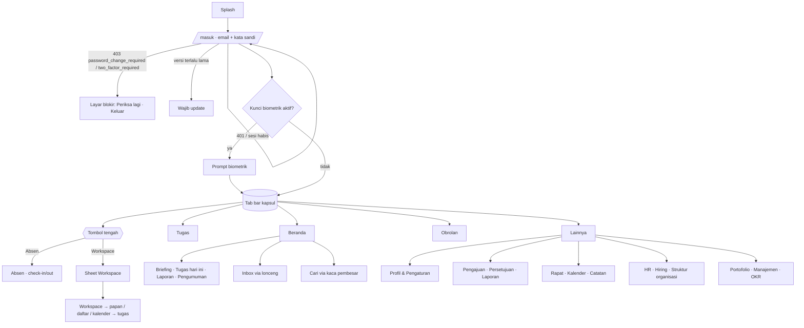
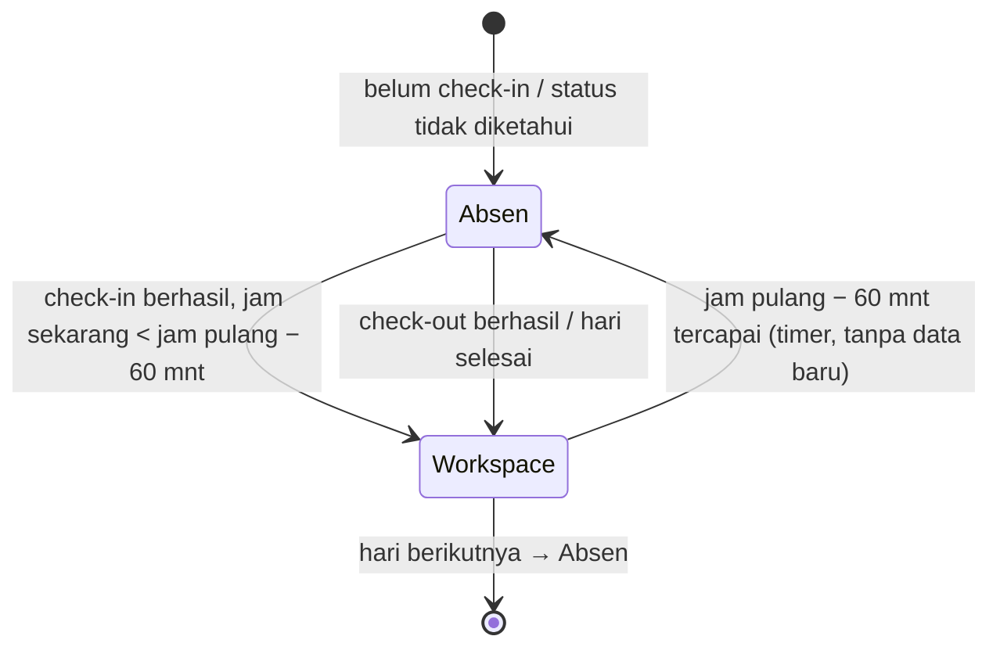

# Modul 13 — Fondasi desain Android

> Panduan gaya visual untuk pelaksana aplikasi Android (Expo / React Native). Modul ini **bukan** satu alur layar; isinya katalog token, komponen, pola keadaan, gerak, aksesibilitas, dan peta navigasi seluruh aplikasi yang dirujuk modul 01–12. Mockup ada di `docs/mockups/android/screens/13-fondasi-desain/` (PNG di `png/13-fondasi-desain/`, tidak di-commit). Sumber kebenaran visual tetap `docs/DESIGN.md`, `resources/css/tokens.css`, dan `docs/ruangkerja-design/`; bila berbeda dengan mockup lama, brief Android + dokumen ini yang berlaku.

Semua berkas satu HTML untuk dua tema (`?tema=malam`). Label hex pada lembar warna dan angka kontras pada lembar aksesibilitas **dibaca langsung dari token tema yang sedang tampil** (skrip kecil `_fd.js`), jadi PNG terang dan malam menampilkan nilai masing-masing.

## 1. Inventaris layar

"Layar" di sini = satu `.phone` (satu PNG per tema). Lembar lebar (`fd-wide`, 1.500–1.700 px) dipakai untuk tabel dan peta.

| Berkas | `.phone` | Nama | Peran yang melihat | Cakupan |
|---|---|---|---|---|
| `01-token-warna.html` | 3 | Token warna | semua (pedoman) | (1) permukaan, teks, garis, merek & aksi + pasangan kontras; (2) pasangan semantik, isian grafik, ramp teal, avatar, palet bernama, chip inverse & lencana; (3) 6 gradien, latar cahaya kembar, kaca & scrim, warna tetap. Terang + malam |
| `02-tipografi.html` | 3 | Tipografi | semua | (1) skala 11 tingkat nilai ponsel + aturan; (2) Figtree 400–800, JetBrains Mono, angka tabular; (3) ukuran huruf sistem 100/130/200% + aturan potong teks |
| `03-ruang-grid.html` | 3 | Ruang & grid | semua | (1) spasi, radius, elevasi, target sentuh; (2) anatomi layar Android beranotasi (frame 412×915); (3) kelas layar/breakpoint, zona jempol, aturan satu tangan |
| `04-ikon.html` | 4 | Ikon (Lucide) | semua | navigasi, aksi umum, status, domain kerja — masing-masing dengan padanan Ionicons; skala ukuran, penempatan baku, aturan |
| `05-kontrol.html` | 3 | Kontrol | semua | (1) tombol (6 varian, keadaan default/ditekan/fokus/nonaktif/memuat, ukuran, tombol ikon, bilah aksi bawah), FAB, chip; (2) input (default/terisi/fokus/galat/nonaktif, sandi, sufiks, area teks), kolom cari, **DateInput "Hari, dd/mm/yyyy"** (tampil/ketik/galat/di luar rentang/opsional), select + jam, kode 6 digit; (3) switch, centang, radio, segmen soft/solid, tab bergaris bawah, toggle ikon |
| `06-kartu-penanda.html` | 3 | Kartu & penanda | semua | (1) pil status, tag, prioritas, lencana angka, ikon status tugas, avatar (ukuran/nada/cincin/tumpukan/kehadiran), progres; (2) kartu (standar/ketat/rata), hero (aksi/hangat), KPI 2×2, baris daftar (5 bentuk), kepala seksi/panel, pasangan label–nilai; (3) banner semantik, banner khusus produk (lihat-saja, desktop-saja, terkunci, belum aktif), galat inline, kartu kosong |
| `07-umpan-balik-overlay.html` | 7 | Snackbar, dialog, sheet | semua | katalog snackbar (6 varian + aturan); snackbar pada layar nyata (FAB naik); dialog konfirmasi destruktif pada layar; katalog dialog (destruktif, informasi, pilihan, alasan wajib); bottom sheet aksi; sheet pilihan (cari + radio); sheet form cepat dengan papan ketik (tab bar tersembunyi) |
| `08-navigasi.html` | 4 | Tab bar & app bar | semua | 7 keadaan kapsul tab bar (Absen, Workspace, di layar Absen, lencana, Inbox bila Obrolan mati) + aturan pergantian; 7 bentuk app bar; layar Beranda dengan **sheet Workspace** dari tombol tengah; layar form dengan bilah aksi bawah |
| `09-pola-keadaan.html` | 6 | Pola keadaan | semua | memuat (skeleton ×5), kosong (7 jenis), galat (7 jenis termasuk 403/404/429/422), offline (banner, antrean, aksi butuh koneksi), akses (terkunci, lihat-saja, desktop-saja, belum aktif, blokir), berhasil |
| `10-kartu-jenis.html` | 6 | Kartu per jenis | semua | tugas (baris, papan, rencana), pengajuan (daftar, kartu persetujuan, lini masa), rapat (agenda, berlangsung, RSVP, pengamat, strip hari), pesan (daftar, linimasa, komposer), notifikasi (Inbox, pengumuman, geser aksi), lain-lain (absensi hari, workspace, catatan, KR, kandidat) |
| `11-gerak.html` | 1 (lebar) | Gerak | semua | tabel 15 interaksi (properti, durasi, easing, RN), kurva ease-brand, skala durasi, haptics, reduced motion |
| `12-aksesibilitas-malam.html` | 1 (lebar) | Aksesibilitas & malam | semua | 16 pasangan kontras dihitung langsung (lulus di kedua tema), 12 aturan, contoh label TalkBack, daftar periksa malam (15 butir), kedalaman permukaan |
| `13-peta-aplikasi.html` | 1 (lebar) | Peta aplikasi | semua | gerbang masuk, lima akar tab, 12 kartu modul + rute (ADA/USULAN/DESKTOP), matriks "siapa melihat apa" 25 baris × 5 peran |
| `14-lainnya-per-peran.html` | 4 | Menu Lainnya per peran | staf, Kepala Divisi, HR/Direksi | pintu ke semua modul, tiga contoh peran |

Total: **14 berkas HTML, 49 `.phone` → 98 PNG (terang + malam)**, ditambah `_fd.css` / `_fd.js` (gaya & skrip bantu lokal modul).

## 2. Peta navigasi seluruh aplikasi

Tombol tengah berganti mengikuti hari kerja (keputusan pemilik 9 Okt 2026, padanan `resources/js/components/mobile/tab-bar-center.ts`):

Peta visual lengkap: `13-peta-aplikasi.html`; hierarki menu per peran: `14-lainnya-per-peran.html`.

## 3. Pemetaan layar → endpoint API

Modul ini tidak punya endpoint sendiri. Data yang memengaruhi kerangka aplikasi:

| Kebutuhan | Endpoint (`/api/v1`, `docs/sesi/ponsel.md`) | Status |
|---|---|---|
| Status absensi untuk tombol tengah (Absen/Workspace) | `GET` absensi hari ini → `absensiHariIni()` (`action`, `end` jadwal) | **ADA** |
| Lencana belum dibaca (Lainnya/Inbox) | feed inbox → `inbox()` / `UnreadProvider` | **ADA** |
| Lencana Obrolan di tab, Obrolan→Inbox bila flag mati | daftar kanal 404 saat `features.chat` mati; **tidak ada** nilai flag di profil | **BELUM ADA** — `GET /saya` hanya `id,name,email,jabatan,divisi,work_mode` |
| **Peran & flag** untuk menyaring menu Lainnya (staf/Kadiv/HR/Direksi/SA, `features.*`), mode lihat-saja | tidak ada `roles`, `is_staff_only`, `features`, `permissions` di `UserProfile` | **BELUM ADA** — perlu `GET /saya` memuat `roles[]`, `is_staff_only`, `features{chat,meetings,notes,okr,automation,hiring,role_dashboards}`, `can{…}` agar menu bisa dirender tanpa menebak dari 404 |
| Tema (Ikuti sistem/Terang/Gelap) | lokal (SecureStore); server `users.theme` bisa disinkron | **BELUM ADA** (opsional) |
| Pengumuman, saldo (hanya non-staf), persetujuan tertunda untuk lencana | endpoint modul 02/04/10 | lihat spec modul masing-masing |

## 4. Kemampuan khas Android yang disentuh

| Kemampuan | Dipakai di | Catatan |
|---|---|---|
| Tema sistem (`useColorScheme`) + Tampilan manual | token, malam | pilihan disimpan di perangkat, berlaku sebelum layar pertama |
| Status bar & bilah navigasi sistem | seluruh layar | `StatusBar style` mengikuti tema; `expo-system-ui` `backgroundColor = --bg`; edge-to-edge, hormati inset |
| Gestur kembali sistem (prediktif Android 14+) | bar turunan, sheet, dialog | jangan menimpa gestur tepi; sheet menutup dengan kembali |
| Ukuran huruf sistem 200% / tampilan tebal | tipografi, tab bar | lihat `02-tipografi.html` fase 3 |
| Hapus animasi / reduced motion | gerak | `AccessibilityInfo.isReduceMotionEnabled` |
| TalkBack / Switch Access | aksesibilitas | peran, status, label, urutan fokus |
| Haptics | check-in, setujui, geser, rapat mulai | `expo-haptics`: ringan / ganda / klik |
| Papan ketik (adjustResize) | sheet form, komposer, form pengajuan | tab bar disembunyikan, bilah aksi naik |
| Blur latar | tab bar, bar turunan, sheet | `expo-blur` (belum di `package.json`); fallback solid `--surface` bila blur nonaktif/hemat daya |

## 5. Matriks keadaan

| Elemen | Memuat | Kosong | Galat | Offline | Terkunci | Baca-saja |
|---|---|---|---|---|---|---|
| Daftar | skeleton baris (4–6) | kartu garis putus + 1 aksi | banner/kartu + Coba lagi | data tersimpan + banner | ubin bergembok | tanpa aksi, banner |
| Detail | skeleton judul/meta/isi | — | kartu 404/403 | data tersimpan + "Antre" | — | kontrol nonaktif + banner |
| Tombol | spinner + "Mengirim…" | — | snackbar/dialog | nonaktif + alasan | — | disembunyikan |
| Form | tombol memuat | — | 422 per field + ringkasan | simpan draf lokal | jenis terkunci tidak bisa dikirim | — |
| Tab bar | tetap tampil | — | — | tetap tampil | — | — |

Rinci lengkap dengan contoh: `09-pola-keadaan.html`.

## 6. Pedoman inti (ringkasan lembar)

- **Warna**: hanya token tema. Status = ikon/titik + teks. Gradien aksi untuk tombol utama, pil aktif, hero/KPI sorotan (maks. satu per layar); hangat maks. satu per layar; tak ada gradien pada teks. Kaca hanya untuk tab bar, bar turunan saat menggulir, sheet, dialog, snackbar.
- **Tipografi**: Figtree (UI) + JetBrains Mono (kode/ID/jam tabel). Skala ponsel: 32/40 · 26/32 · 22/28 · 20/26 · 17/24 · 17/26 · 15/20 · 13/18 · overline 14/20 · KPI 28/34. Input 17. Teks wajib baca ≥ 15, 13 hanya meta.
- **Ruang**: grid 4; gutter 16; antar kartu 16; radius tombol/input 14, kartu 24, ubin 16–20, sheet 28; tinggi kontrol 40/52/56; target sentuh ≥ 44 (standar 48).
- **Tab bar**: kapsul kaca 70, inset 12, mengambang 14; pil aktif gradien; tombol tengah 54 bulat naik 26; Obrolan mati → Inbox.
- **Gerak**: 120 ms tekan/toggle, 180 ms sheet/pil/snackbar, `cubic-bezier(.2,.8,.2,1)`, skala tekan .98 (tombol/kartu) / .9 (ikon tab) / .95 (FAB); hanya transform/opacity; reduced motion → instan.
- **Aksesibilitas**: kontras AA kedua tema (16 pasangan terbukti di lembar), label TalkBack Indonesia, gestur selalu punya alternatif tombol, fokus 3 px.

## 7. Catatan implementasi Expo — pemetaan token

Sumber: `resources/css/tokens.css` ↔ `apps/mobile/src/lib/theme.tsx`, `palette.ts`. **Ada** = sudah ada kunci di tema RN; **(baru)** = perlu ditambah.

### 7.1 Warna

| Variabel CSS (web) | Variabel kit | Kunci tema RN | Terang | Malam |
|---|---|---|---|---|
| `--bg` | `--bg` | `colors.bg` — ada | `#F3F6FA` | `#070B14` |
| `--surface` | `--surface` | `colors.surface` — ada | `#FFFFFF` | `#0F1622` |
| `--surface-2` | `--surface-2` | `colors.surface2` — ada | `#EEF2F7` | `#172131` |
| `--border` | `--border` | `colors.border` — ada | `#DDE4EC` | `#233247` |
| `--border-strong` | `--border-strong` | `colors.borderStrong` — ada | `#C3CEDA` | `#34465E` |
| `--divider` | `--divider` | `colors.divider` (baru; kini memakai `border`) | `#EEF2F7` | `#172131` |
| `--text` | `--text` | `colors.text` — ada | `#0B1A2B` | `#EAF1F8` |
| `--text-muted` | `--text-muted` | `colors.muted` — ada | `#46576B` | `#A6B4C6` |
| `--text-subtle` | `--text-subtle` | `colors.subtle` — ada (hanya dekoratif!) | `#8495A8` | `#7D8FA5` |
| `--primary` | `--primary` | `colors.primary` — ada | `#0B7F86` | `#2DBFB1` |
| `--primary-hover` | — | `colors.primaryHover` — ada | `#09656E` | `#5AD6C8` |
| `--primary-fg` | `--primary-fg` | `colors.primaryFg` — ada | `#FFFFFF` | `#041421` |
| `--ring` | `--ring` | `colors.ring` (baru) | `rgba(20,184,166,.4)` | `rgba(45,191,177,.45)` |
| `--link` / `--link-soft` | `--link` / `--link-soft` | `colors.link` / `linkSoft` — ada | `#09656E` / `#E8FBF8` | `#5AD6C8` / `#0E2A2C` |
| `--success` / `-soft` | `--ok` / `--ok-soft` | `colors.success` / `successSoft` — ada | `#0F7A55` / `#E3F6EE` | `#4ADE9B` / `#0E2A20` |
| `--warning` / `-soft` | `--warn` / `--warn-soft` | `colors.warning` / `warningSoft` — ada | `#9A5800` / `#FFF1DC` | `#F6B95C` / `#2E2210` |
| `--danger` / `-soft` | `--bad` / `--bad-soft` | `colors.danger` / `dangerSoft` — ada | `#C42137` / `#FDE7EA` | `#FF7A8A` / `#3A1520` |
| `--info` / `-soft` | `--info` / `--info-soft` | `colors.info` / `infoSoft` — ada | `#1A4CB0` / `#E6EEFE` | `#A9C2FF` / `#14223F` |
| `--on-danger` | `--x-on-danger` | `colors.onDanger` (baru) | `#FFFFFF` | `#2A0A10` |
| `--badge` / `--on-badge` | (kit memakai `#E5484D`) | `colors.badge` / `onBadge` — ada | `#C42137` / `#FFF` | sama |
| `--accent-blue` / `-strong` | `--blue` / `--blue-strong` | `colors.accentBlue` / `accentBlueStrong` (baru) | `#2F7BEA` / `#1E5FD6` | sama |
| `--brand-50…900` | `--x-brand-*` | `colors.brand[50…900]` (baru) | ramp teal | sama |
| `--fill-teal/warning/danger/violet`, `--marker` | `--fill-*`, `--x-marker` | `colors.fill.{teal,warning,danger,violet}`, `colors.marker` (baru) | `#14B8A6/#E08A00/#C42137/#6D4AE0/#0B1A2B` | danger `#FF7A8A`, marker `#3B4F6B` |
| `--inverse` / `--on-inverse` | `--inverse` / `--on-inverse` | `colors.inverse` / `onInverse` (baru) | `#0B1A2B` / `#FFF` | `#EAF1F8` / `#0B1A2B` |
| `--inverse-success/danger/warning/info` | `--x-inv-*` | `colors.inverseStatus.*` (baru) | `#4ADE9B/#FF7A8A/#F6B95C/#A9C2FF` | `#0F7A55/#C42137/#9A5800/#1A4CB0` |
| `--avatar-{blue,teal,amber,neutral}` + `-fg` | `--x-av-*` | `colors.avatar.{tone}.{bg,fg}` (baru) | `#D9E6FF/#1A4CB0`, `#C8F4EE/#0A4E57`, `#FFF1DC/#9A5800`, `#EEF2F7/#46576B` | `#1C2D50/#A9C2FF`, `#103A38/#5AD6C8`, `#2E2210/#F6B95C`, `#172131/#A6B4C6` |
| `--grad-aksi` | `--grad-aksi` | `gradients.aksi` = `[#0B7F86,#1E5FD6]` 135° (ada hanya sebagai `gradientFrom/To`, dan malam salah pakai merek) | `#0B7F86→#1E5FD6` | sama |
| `--grad-merek` | `--grad-merek` | `gradients.merek` (baru) | `#14B8A6→#2F7BEA` | sama |
| `--grad-hangat` / `--grad-indigo` / `--grad-slate` | idem | `gradients.hangat/indigo/slate` (baru) | `#C2410C→#BE185D` / `#2F7BEA→#6D4AE0` / `#46576B→#0B1A2B` | sama |
| `--grad-soft` | `--grad-soft` | `gradients.soft` (baru) | `#E8FBF8→#EEF4FF` | `#0E2A2C→#14223F` |
| `--grad-active` + `--on-active` | `--grad-active` / `--on-active` | `gradients.active`, `colors.onActive` (baru) | `#0B7F86→#1E5FD6` / `#FFF` | `#2DBFB1→#5B8CF6` / `#041421` |
| `--page-glow` | `--glow` | komponen `<PageGlow/>` dua gradien radial (baru) | teal 20% + biru 18% | 16% / 14% |
| `--glass-bg` / `--glass-strong-bg` / blur | `--glass` | `colors.glass`, `BlurView intensity` (baru) | `rgb(255 255 255/.72–.82)` | `rgb(15 22 34/.72)` / `rgb(23 33 49/.88)` |
| `--scrim` | `--scrim` | `colors.scrim` (baru) | `rgba(7,11,20,.45)` | `rgba(0,0,0,.6)` |
| `--shadow-1/-2`, `--elev-glow/button/warm` | `--shadow-card/-float/-btn`, `--x-elev-*` | `shadows.{card,float,glow,button,warm}` memakai `boxShadow` RN 0.77+ (baru) | lihat `tokens.css` | bayangan hitam + border |
| Palet bernama (10) | `--x-p-*` | `palette.ts` `TERANG`/`GELAP` — ada | — | — |

### 7.2 Bentuk, jarak, tipe, ukuran

| Token web | Kunci RN | Catatan |
|---|---|---|
| `--radius-xs/sm/md/lg/xl/2xl/3xl` = 6/8/12/16/20/24/28 | `radius` sekarang `{sm:12, md:16, lg:20, xl:24}` | **Penamaan bentrok**: `radius.sm` RN = 12 padahal `--radius-sm` = 8. Usulan: ganti ke skala web (`xs 6, sm 8, md 12, lg 16, xl 20, '2xl' 24, '3xl' 28, full 999`) lalu migrasi pemakaian (`sm→md`, `md→lg`, `lg→xl`, `xl→2xl`) |
| Kit: tombol/input 14, kartu 24, kartu ketat 20 | `radius.control = 14`, `radius.card = 24`, `radius.cardTight = 20` | kit sengaja 14 (bukan 12) agar tombol 52 tampak seimbang; samakan di RN |
| Spasi 4/8/12/16/20/24/32/64 | `space[1,2,3,4,5,6,8,16]` (baru) | |
| `text-display` 32/40 w800 ls −.025em | `type.display` (baru; sekarang judul 26) | `fontFamily: Figtree_800ExtraBold` |
| `text-h1` 26/32 w700 · `h2` 22/28 · `h3` 20/26 | `type.h1/h2/h3` (baru) | |
| `text-title` 17/24 w600 · `body` 17/26 · `label` 15/20 w600 | `type.title/body/label` (baru; sekarang body 15/22, label 13) | |
| `text-meta` 13/18 w500 · `overline` 14/20 w700 caps .06em · `kpi` 28/34 w700 | `type.meta/overline/kpi` (baru; meta pakai `muted`, bukan `subtle`) | `fontVariant:['tabular-nums']` |
| `h-control-sm/-/lg/xl` 36/44/52/56 | `size.control = {sm:36, md:44, lg:52, xl:56}` (baru) | tombol default 52 |
| `--app-bar-height` 56 · `--tab-bar-capsule` 70 · inset 12 · lift 14 · raise 16 | `layout.{appBar:56, tabBar:70, tabInset:12, tabLift:14}` (baru) | padding bawah konten = tabBar + lift + raise + inset aman |
| `--ease` `cubic-bezier(.2,.8,.2,1)` | `motion.ease = Easing.bezier(.2,.8,.2,1)`; `motion.fast=120`, `motion.base=180` (baru) | `useMotion()` hormati reduced motion |

### 7.3 Komponen: yang sudah ada vs target

| Komponen target | Status di `apps/mobile/src/components/ui.tsx` | Tindakan |
|---|---|---|
| Button (primary gradien, outline, tonal, quiet, danger solid; sm/md/lg; loading; pressed .98) | ada: primary/secondary/danger(soft)/ghost, tinggi 48, tanpa gradien | perluas varian & ukuran, gradien via `expo-linear-gradient` |
| IconButton 48 bulat (+ lencana) | belum | baru |
| Input/Field (fokus, galat, nonaktif, sufiks, area, 17 px) | ada `Input` min 48 radius 12 border 1 tanpa fokus/galat | tambah keadaan, 52/14/17 |
| DateInput "Hari, dd/mm/yyyy" | belum | baru (ketik + `DateTimePickerAndroid`) |
| Select + SheetPicker | belum | baru |
| Segmented (soft/solid), Chip, ChipScroller, TabNav | ada `Segmented` (satu gaya) | tambah solid, chip, tab garis bawah |
| Switch/Checkbox/Radio | belum (RN `Switch` bawaan) | komponen sendiri 52×32 / 24 / 24 |
| Badge (titik, tone), Tag, CountBadge | ada `Badge` (tanpa titik, 12 px) | titik, 13 px, count |
| Avatar (nada, ring, stack), Progress | belum | baru |
| Card (24), Hero, KpiCard, ListRow (ubin ikon, ≥ 64), Panel | ada `Card` (radius 20, border hairline), `Row` | samakan radius/tinggi, tambah Hero/Kpi |
| Banner (info/warn/bad/ok/netral/terkunci/lihat-saja/desktop-saja) | belum | baru |
| EmptyState / ErrorState / Skeleton / OfflineBanner | ada Empty/Error (ikon bulat), `Loading` spinner penuh | ganti spinner dengan Skeleton; Error beragam (403/404/429) |
| Snackbar, Dialog (Material), BottomSheet | belum (`Alert.alert`) | baru; pakai Modal + Reanimated atau `@gorhom/bottom-sheet` |
| AppBar (large/greeting/sub/select) | ada `ScreenTitle` 26 | baru |
| TabBar kapsul + tombol tengah kontekstual | ada `TabBarKita` bar penuh, ikon `subtle`, tombol `primary` rata | ganti total |
| Fab | belum | baru |
| PageGlow latar | belum (`Screen` warna rata) | baru |

## 8. Kebutuhan kit

Catatan celah `docs/mockups/android/_kit/` yang ditemukan saat mendokumentasikan (kit **tidak** diubah; solusi lokal ada di `screens/13-fondasi-desain/_fd.css`):

**Variabel yang belum ada / berbeda dari `tokens.css`**
1. Tidak ada: `--brand-50…900`, `--avatar-*` (kit menuliskan hex langsung di `.avatar`, bernilai sedikit berbeda: `#DCEBFF` vs token `#D9E6FF`), `--on-danger` (teks tombol bahaya malam harus gelap), `--badge/--on-badge`, `--inverse-success/-danger/-warning/-info` (ikon pada snackbar), `--marker`, `--elev-glow/-warm/-segment`, `--on-brand`, `--ring` sudah ada tetapi tanpa kelas keadaan fokus.
2. Nilai berbeda: kit `--fill-bad:#E5484D` (token `--fill-danger` terang `#C42137`, malam `#FF7A8A`); lencana `.ibtn .dot` dan `.tab .badge-n` memakai `#E5484D` + putih (≈ 3,9:1, **tidak lulus AA**; token `--badge` `#C42137` lulus 5,8:1).
3. Penamaan semantik berbeda dari web (`--ok/--warn/--bad` vs `--success/--warning/--danger`; `--blue` vs `--accent-blue`); disarankan alias agar spec dan CSS merujuk satu nama.
4. `.btn`/`.input` radius 14 dan `.card` 24 tidak identik dengan token web (kontrol 12, kartu 20, panel 24) — pilihan sadar, dicatat di spec ruang; dokumentasikan di `kit.css`.

**Kelas yang belum ada**
5. Tab bar: `.tab.center span{display:none}` — web menampilkan label "Absen"/"Workspace" di bawah tombol tengah; tidak ada `.tab.center.on`, tidak ada varian 4 tab, lencana titik, dan lencana `.badge-n` diposisikan `right:10` (web: tengah + 6). Perlu `.tabbar .tab.center` dengan label, `.tabbar.n4`, `.tab .dot`.
6. Komponen keadaan: `.btn.loading` (spinner), `.btn.pressed`, `.is-focus` (cincin), `.input.disabled`, slot awalan/akhiran `.input`, `.date-input`, `.otp`, `.hint` varian ikon.
7. Overlay: `.snack` tidak punya varian status/ikon dan `bottom:120` bertabrakan dengan `.fab` (`bottom:124`) — perlu `.fab.up`; `.dialog`/`.snack`/`.sheet` tidak punya mode statis untuk katalog (saya memakai `position:static` lokal); tidak ada `.keyboard` tiruan papan ketik.
8. Pola: `.banner.neutral/.lock/.readonly`, `.empty.solid`, `.stepper` (lini masa), `.bubble.in/.out` (obrolan), `.prio` (titik prioritas), `.badge.count`, `.avatar-stack`, `.list .swipe` (aksi geser), `.bar-sub.select`, `.chip.tonal/.dismiss`.
9. Bingkai: `.stage:has(.phone:nth-child(2))` mengatur satu baris `width:max-content` dan **meregangkan semua `.phone` ke tinggi tertinggi** (tak ada `align-items:flex-start`) — PNG layar pendek berisi ruang kosong; perlu `.phone.auto` (tinggi mengikuti isi) dan `data-chrome="none"` untuk menyembunyikan status/gesture bar pada lembar dokumentasi/peta lebar.
10. `render.mjs`: hanya mendeteksi `scrollWidth` melebar; `.body{overflow:hidden}` diam-diam **memotong konten yang kepanjangan** — tambahkan pemeriksaan `scrollHeight > clientHeight` per `.body`. Tidak ada mode keadaan interaktif (hover/pressed/fokus) selain kelas manual.
11. Nama ikon: `bar-chart-3` (dipakai `lib/navigation.ts` web) tidak ada di `icons.js` (Lucide terbaru: `chart-bar`/`chart-no-axes-column`); render menandainya, jadi spec memakai nama baru.
12. Font: kit membungkus Figtree 400–800 dan JetBrains Mono 500/600; belum ada `font-feature-settings:'tnum'` eksplisit (hanya `font-variant-numeric` di `body`, tidak mewarisi ke `i`/elemen `button` — sudah aman).

## 9. Celah yang ditemukan (web ↔ Android)

1. **Aplikasi memakai Ionicons**, desain Arus memakai Lucide; bentuk ikon berbeda di seluruh aplikasi. Padanan lengkap ada di `04-ikon.html`.
2. **Font belum dimuat**: `apps/mobile` memakai font sistem; Figtree/JetBrains Mono belum di-bundle → seluruh tipografi bergeser.
3. **Tab bar bukan kapsul**: `TabBarKita` = bar penuh dengan ikon abu `subtle` (≈ 3:1, di bawah AA) dan tombol tengah rata, bukan gradien kaca; tidak ada logika Absen⇄Workspace, sheet Workspace, atau varian Inbox.
4. **`Screen`/`ScreenTitle`**: latar rata (tanpa cahaya kembar), judul 26 (token: 32/40), tanpa app bar sapaan/turunan, padding 16/48 ad hoc.
5. **Skala huruf & warna meta**: isi 15/22 (token 17/26), meta 13 berwarna `subtle` (kontras ≈ 3:1 — meta harus `muted`), badge 12 px.
6. **Input**: tinggi 48, radius 12, 16 px (token: 52/14/17), tanpa keadaan fokus/galat/nonaktif; tidak ada DateInput "Hari, dd/mm/yyyy" (form pengajuan meminta teks `YYYY-MM-DD`).
7. **Konfirmasi destruktif** memakai `Alert.alert` (gaya sistem) — brief meminta dialog Material konsisten; **tidak ada** Snackbar, BottomSheet, Skeleton, Banner, Avatar, Progress, FAB.
8. **Tema hanya mengikuti sistem**; tak ada pilihan Terang/Gelap manual dan tak ada sinkron ke `users.theme`.
9. **Kontrak API**: profil tak membawa peran/flag/`is_staff_only` → menu per peran, Obrolan⇄Inbox, mode lihat-saja, penyembunyian saldo cuti untuk staf **tidak bisa dibuat benar** tanpa ini (lihat §3).
10. **Penanda-dibaca kanal obrolan** tidak ada di API v1 (dicatat di `docs/sesi/ponsel.md`) — memengaruhi lencana Obrolan di tab bar.
11. **Selisih skala huruf paket desain lama** (`MFondasi.dc.html`) vs `tokens.css` — spesifikasi ini mengikuti `tokens.css`.

## 10. Pertanyaan / keputusan untuk pemilik

1. **Paket baru** (AGENTS.md: tiap paket harus diberi alasan): `lucide-react-native` + `react-native-svg` (ikon identik web), `expo-linear-gradient` (gradien aksi/merek — RN tak punya), `expo-blur` (kaca tab bar/sheet), `expo-font` + `@expo-google-fonts/figtree` + `@expo-google-fonts/jetbrains-mono`, `react-native-reanimated` + `react-native-gesture-handler` (geser baris, sheet, gerak 120/180 ms), `@gorhom/bottom-sheet` (opsional). Setujui sebagai satu paket "fondasi UI"?
2. **Ikon**: pindah penuh ke Lucide (disarankan) atau tetap Ionicons dengan tabel padanan?
3. **Ikon tab**: Absen = `fingerprint` (Android) walau web `map-pin`; Lainnya = `menu` agar tidak bentrok dengan `layout-grid` (Workspace). Setuju?
4. **Radius**: samakan nama dengan skala web (migrasi `radius.sm→md` dst.) atau pertahankan skala RN sekarang? Disarankan migrasi.
5. **Tombol bahaya**: solid `--danger` (di dialog konfirmasi) atau tetap latar lembut seperti sekarang?
6. **Check-in tanpa sinyal**: ditolak (butuh verifikasi lokasi) atau diantre dengan penanda? Mockup menampilkan *ditolak*, antrean hanya untuk centang tugas/komentar/draf laporan/catatan.
7. **Ukuran huruf**: tab bar dibatasi 1,3× dan elemen lain sampai 200% — setuju?
8. **Mode Terang/Gelap manual**: tambahkan Tampilan (Ikuti sistem · Terang · Gelap) di Pengaturan (modul 01) dan sinkron ke profil?
9. **Mode lihat-saja**: kontrol disembunyikan bila bisa, nonaktif + banner bila tata letak menuntut — cukup?
10. **Peran/flag di profil** (`GET /saya`): izinkan menambah `roles`, `is_staff_only`, `features`, `can` ke kontrak API v1 (tugas backend kecil)?
11. **Reduced motion**: skala animator 0 dianggap "hapus animasi"; setuju fade ≤ 120 ms tetap diizinkan?
